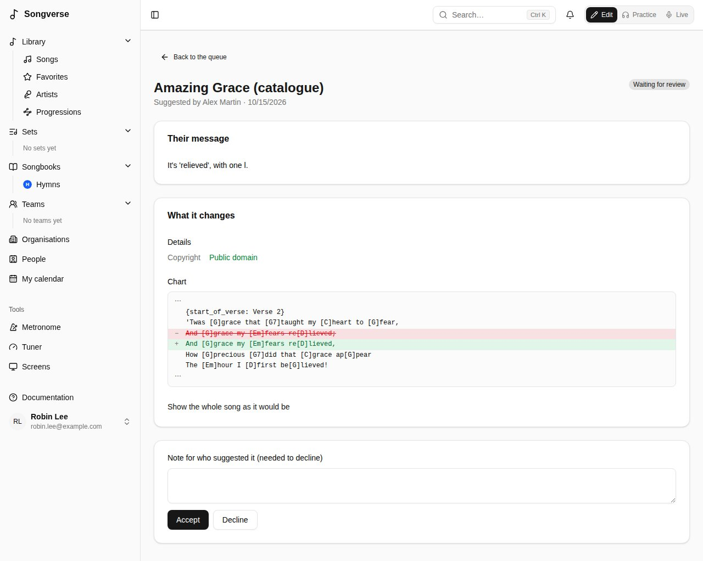

## Reviewers

A reviewer - someone with a role that allows reviewing, such as the built-in **Reviewer** role (see [Roles](/admin/#roles)), or a global admin - checks songs submitted to the global catalogue. The **Review** page lists what's waiting. For each song you can:

- **Approve and publish** it, optionally with a trust label shown on the global song ("Official publisher text"). The song itself moves to the catalogue, credited to whoever it came from; their files stay theirs;
- **Merge into** a similar song already in the catalogue: theirs is folded into it - their versions, files and sets move over, their way of singing it becomes their version of it, and their changed details come to you as a suggestion;
- **Ask for changes**, or **Reject** it, with a note for the submitter.

You can't review your own submissions. Global admins can also **Publish now** their own songs without a review.

The **Review** page also lists **Suggested changes** to catalogue songs (see [Suggesting a change](/library/#suggesting-a-change)). Each shows what it changes, from the song as it was when it was suggested; **Accept** saves it to the song in its author's name, **Decline** needs a note. If the song was changed since in the same place, it says where, and it can only be declined.

## Global admins

Global admins manage the whole server from **Dashboard**, in the sidebar's **Admin** section (reviewers find **Review** there).

Global admins see and change the global catalogue, and songs sent to it for review. People's own songs and their teams' stay theirs: a global admin sees one only as anyone else would (shared with them, or in a team or set of theirs), in lists and by its link alike.

### Users

Everyone with an account, with their status, roles (their teams' in outline), songs and storage. For each user you can:

- **Roles…** - tick the roles they have (see [Roles](/admin/#roles)); the ones they get from their teams are listed below, to change in **Teams**;
- **Ban** them (they're signed out and can't sign in until unbanned; their content stays);
- **Delete user**, choosing what happens to what they personally own: delete it now, or keep it for a **transfer link**. Whoever opens that link while signed in, before it expires, becomes its owner.

Below the list, **Sign-up and invitations** says who can create an account. With **Only invited people can sign up** ticked, someone signing up is refused unless they were invited here, or came through a team's invite link or a set's share link; existing accounts aren't affected. It shows where the setting comes from - saved here, the `SIGNUP_INVITE_ONLY` environment variable, or the default (anyone can sign up) - and **Use the environment variable** goes back to the server's configuration. The bootstrap admins (`BOOTSTRAP_ADMIN_EMAILS`) can always sign up.

To invite someone, enter their email under **Email to invite** and choose **Invite**: with **Email them the link** ticked they're sent a link, and the link is also shown, to send another way. It opens a page with their email filled in, and works for two weeks, for that email. The invitations are listed as **Waiting**, **Signed up** or **Expired**: **Copy link** copies a waiting one's link, **Send again** sends a new link for another two weeks, and **Remove** cancels it.

### Teams

Every team, with its roles, members, songs and **storage pool**: what's on a team's songs counts there, whoever uploaded it, not against the uploader. **Roles…** gives the team roles: each one applies to every member, and a storage tier sets the team's pool.

### Organisations

Whether the server has organisations - a church, a club - grouping teams to plan together (see [Organisations](/organizations/)). Under **Organisations on this server**:

- **None: Songverse on its own** - the default; nobody sees organisations;
- **One: everyone who signs in is in it** - **Create the organisation** (a **Name**, and **Its admin's email (optional)** if it isn't you), once;
- **Several, each kept apart** - global admins create them under **New organisation**; with **Anyone can create an organisation** ticked, anyone can, from **Organisations** in the sidebar.

With **Anyone can create an organisation**, **Review each one first** (or `ORGANIZATIONS_REVIEWED`; on unless set) has people ask for one instead - its kind, city, a contact person and their email (see [Asking for one](/organizations/#asking-for-one)) - and global admins are told. **Requests** lists those waiting: what they told, who asked, and the organisations or other requests it looks like, with their note on why it isn't the same. **Approve** makes it, run by who asked; **Decline** tells them your reason, if you give one. One that looks like another is refused unless they explain, so the same church isn't made twice.

It shows where each setting comes from - saved here, the `ORGANIZATION_MODE` and `ORGANIZATIONS_OPEN` environment variables, or the default - with **Save configuration** and **Revert to environment variables**. **All organisations** lists them with their teams, members and admins; **Delete organisation** leaves their teams on their own.

**Organisations may use their own storage** (or the `ORGANIZATIONS_OWN_STORAGE` environment variable) lets an organisation's admins whose role allows it keep its teams' songs' files in the organisation's own bucket (see [Its own storage](/organizations/#its-own-storage)); those files leave this server's storage, its quotas and its backups.

Below the page's title, it says where [Planiverse](/planiverse/) is, when it's deployed beside Songverse (an address set where it's deployed, `PLANIVERSE_URL`), or that it isn't.

### Roles

The one place that says what people may do beyond their own and their teams' songs. A role can allow:

- **Review submissions** - the global catalogue's queue (see [Reviewers](/admin/#reviewers));
- **Split recordings into stems**, with its own **Separations per person in 30 days** or, left empty, the one in **Stem separation**;
- **Upload audio files** - recordings and stems. People who sign up don't have it, but can still record in Songverse; the built-in **Audio uploads** role allows it, and was given to everyone who had an account when it came in;
- **Keep lossless originals** - a WAV, FLAC or AIFF they upload keeps its original, as FLAC (a WAV at its own sample rate and bit depth), beside the Opus copy that's played; without it, only the Opus copy is kept (see [Audio files](/library/#audio-files-and-their-originals));
- **Run the screens** - control what's presented on the screens of any set they can open, beside its leader, and lock that control to themselves (see [The media operator](/screens/#the-media-operator));
- **Move the screens on** - move the screens of any set they can open to the next or previous song or section, from Live's Sync menu, without presenting any other slide: for singers who lead the set on (see [Moving the screens on](/screens/#moving-the-screens-on));
- **Route the screens** - change what the screens of any set they can open draw - hide, show or clear their layers and the title card, for all of them or one - from the operator view, without presenting, the timer or messages: for the tech at the desk (see [Screens and layers](/screens/#screens-and-layers));
- **Manage screens** - pair, change and disconnect the screens and Pulses of their teams and organisations without being their admin, with no say over the sets on them or who owns them (see [Whose screen it is](/screens/#whose-screen-it-is));
- **Own storage for organisations** - as an organisation's admin, connect its own bucket for its teams' files, when **Organisations** allows it (see [Its own storage](/organizations/#its-own-storage));
- **A storage tier** - how much a person may store, or a team's pool.

**Teams can give it** lets a team's or an organisation's admins give the role to their own members, on their team or organisation only (see [Teams](/teams/#roles-on-the-team)). Given that way, it lets them run the screens, move them on, route them or manage them, there and nothing else: storage, uploads, stems and review stay what you give here. Untick it and the roles teams gave stop counting.

**Reviewer**, **Stem separation**, **Audio uploads** and **Media operator** (runs the screens; teams can give it) are built in: they can be edited but not deleted. **New role** adds your own, such as "Storage 10 GB". Give roles to people in **Users** and to teams in **Teams**. Someone can do what any of their roles allows - their own and their teams' - and the largest limit wins; without a storage tier, the defaults in **Storage** apply. Global admins can do everything. Changes take effect straight away.

Teams and organisations also make roles of their own, on their pages, with the same editor: for their own bucket, their own Sonic server and their screens, counting only there (see [Its own roles](/organizations/#its-own-roles)). They aren't listed here, and can't be given here.

### Instruments

The instruments people can pick as what they play (see [Roles](/account/#roles)). Under **Added**, add one the list lacks with its **Name** and, if it differs, its name **In French** (**Add instrument**); **Rename** changes it, **Remove** takes it away, and off whoever had picked it. **On the list already** shows the built-in ones.

### Auth

How Songverse sends email (verification, password reset) through Resend, and whether **Google sign-in** is offered. Settings saved here take effect immediately; **Revert to environment variables** goes back to the server's configuration.

It's optional: teams and organisations can run their own. **Teams and organisations may connect their own Songverse Sonic server** lets their admins connect one on their page (see [Your own stem separation server](/sonic/)); their songs are then split there by their members, within the limit they set, with no role needed. **On private or local addresses too** allows addresses on this server's network (`http://192.168.1.20:8000`); otherwise an address must be public and start with https://. **Connected** lists the servers connected, whose they are and how many separations each has done.

### Security

How the API protects itself. **Limit requests** caps how many requests it takes a minute: per signed-in user, per address before signing in, and a tighter number for the expensive ones (uploads, artwork and artist lookups, joining by link). Over a limit, the request is refused until the minute is out and the app says "Too many requests, try again in a moment". **Proxies in front of the API** says how many proxies (a load balancer, Traefik…) sit before it, so it counts each visitor by their own address rather than the proxy's. **API documentation** decides who can read `/api/docs`: anyone, or only global admins. **Content-Security-Policy** tells browsers which scripts, connections and frames Songverse's pages may use, so a script slipped into a page wouldn't run: **Enforced** (the default), **Only reported** - nothing is refused, and what would have been goes to the web server's log, to try a change first - or **Off**. Each setting shows where it comes from - saved here, an environment variable, or the default - and **Revert to environment variables** goes back to the server's configuration.

### Collaboration

**Live co-editing** lets people who can change a song type in it together in the Editor, each seeing what the others type as they type it (see [Typing together](/song-editor/#typing-together)). It's off until you turn it on; off, each person edits on their own and is told when someone else saved. It takes effect for songs opened after the change. The setting shows where it comes from - saved here, the `LIVE_CO_EDITING` environment variable, or the default - and **Revert to environment variables** goes back to the server's configuration.

### Notifications

What Songverse tells people besides the bell in the app. **Send notifications by email** is off until you turn it on: emails go through the Resend account set under **Auth**, the same as account mail, and its free tier has a sending limit. Once on, each person chooses which kinds they're emailed about in their account settings; one email covers notifications made together (an event that changed several dates), and an address that isn't verified gets none. **Push to devices** sends notifications to people's phones and computers through their browser's push service (Google's, Mozilla's, Apple's, Microsoft's - never anywhere else). It needs a VAPID key pair: **Generate keys** makes one and keeps it (the private key encrypted, never shown again), or paste your own, with a **Contact (mailto: or https:)** the push services can reach. Generating new keys later means everyone turns their devices on again. The private key field stays empty once saved (it's never sent back) and says **Saved and hidden**. A push service's refusal shows on the person's device, and a test that reaches no device fails in **Server maintenance**'s background jobs, with why; so does a Worker that can't decrypt the saved key (another `SETTINGS_ENCRYPTION_KEY`). Each setting shows where it comes from, and **Revert to environment variables** goes back to the server's configuration.

### Storage

Where uploaded files are kept (object storage such as Cloudflare R2, or local disk for development), how much is used, the largest song file of each type (**File size limits**: PDF, ChordPro, MusicXML, ABC, Text, Image, Audio, Other - 25 MB, audio 50 MB, unless set here, up to 500 MB, since an upload is held in the server's memory until it's stored; **Reset** goes back to the built-in one; global admins aren't held to them, only to the 500 MB), and the default storage limits: **Default limit per user (MB)** and **Default limit for a team's pool (MB)**, for whoever no storage tier (see [Roles](/admin/#roles)) gives a limit. What's on a team's songs counts toward the team's pool; the rest of what someone uploads, toward their own. Global admins have no limit.

### Backups

Each night the Worker backs up the server to a second bucket, apart from the main storage: the whole database (accounts, songs and their history, sets, settings), encrypted, and every stored file once - a file is never copied twice, since its name in storage is a hash of its bytes. Under **Where**, give an S3-compatible bucket: **Endpoint**, **Region**, **Bucket**, **Folder in the bucket** (optional, to keep several servers' backups in one bucket), **Access key ID** and **Secret access key** (leave it blank to keep the saved one). Take another account or provider than the main storage's (Backblaze B2, Amazon S3, another R2 account), so one problem can't take both. Without anything saved here, the server's `BACKUP_S3_*` environment variables are used, or `BACKUP_DIR`, a folder on the Worker; **Currently using** says which.

Under **When, and how long they're kept**: **Back up every night** (on once there's a bucket), the **Hour of the night (UTC, 0-23)** it starts at (and as soon as possible when the last one is over a day old, the Worker having been down), the **Daily database copies kept**, **Weekly database copies kept** and **Monthly database copies kept** (7, 4 and 12 unless set here), and the **Days a deleted file stays in the backup** (30), so a file deleted by mistake can still be brought back. Each setting shows where it comes from; **Revert to environment variables** goes back to the server's configuration.

**Back up now** starts one straight away. **Last backups** lists the last 20: when, nightly or asked for, the database copy's size, the new files copied and those already there, and, for one that failed, why. A file the database names but the storage has lost is counted there too.

The database copies are encrypted with the server's `SETTINGS_ENCRYPTION_KEY`, which isn't in the backup: keep it in your password manager with the backup bucket's keys. Restoring needs both, and is done on the server, by the person who runs it: see "Restoring from a backup" in Deploy.md in the repository. People's own copies of their songs are another feature, still to come.

### Stem separation

This Songverse's own server for splitting recordings into stems (a Songverse Sonic server, see [Separating a recording into stems](/library/#separating-a-recording-into-stems)): its **API address** and **API key** (leave the key blank to keep the current one), the **Quick pass model** (htdemucs; asking for 6 parts uses htdemucs_6s), **Then a finer pass** and its model (htdemucs_ft), which replaces the quick stems when the server has time (not for 6 parts: htdemucs_ft splits into 4), and the **Separations per person in 30 days** (empty: no limit). **Test connection** checks the address and key and lists the server's models. The server must be able to reach the API back to say when stems are ready; otherwise Songverse checks every 2 minutes.

**Who can use it**: whoever has a role that allows it - the built-in **Stem separation** role, or one of yours - given to them or to their team (see [Roles](/admin/#roles)); they can split the recordings of the songs they can edit and of their team's songs. Global admins always can. **Revert to environment variables** goes back to the server's configuration.

### Catalogs

Manages the published songbook catalogs (see [Songbooks](/songbooks/#from-a-published-songbooks-catalog)): add one, edit its entries in a table, import or export them as CSV or JSON.

### Bibles

Where Bible translations come from: files imported here, and YouVersion.

**Imported Bibles** are translations imported from a file - Zefania, Beblia or OSIS XML, or json-bible (FreeShow's format) - for everyone on the server. **Import a file** uploads one; it shows as importing until the background worker has read it, then with its books, verses and format, its name, abbreviation and copyright line taken from the file. A file that can't be read says why. Its text is kept on the server. Under each one, tick what its licence allows: **Shown on screens**, **Kept offline**, **Exported** - all off until you do. A public-domain translation (such as the King James Version or Louis Segond 1910) may have all three; most modern translations need a licence for each. **Edit** changes its **Name**, **Abbreviation** and **Copyright**, shown with its text wherever it's shown. **Delete** removes it and its text. **Try a passage** reads one from an imported Bible. Sets' passages are read from these Bibles (see [Sets](/sets/)); deleting one leaves its passages in sets without their text.

**YouVersion** holds the App Key of YouVersion's Platform API: register an app on platform.youversion.com, and the versions it may use are the ones YouVersion licenses to that app. Enter it as **App Key** - kept encrypted and never shown again; leave it blank to keep the current one. Without a key (here or in the `YOUVERSION_APP_KEY` environment variable) YouVersion isn't asked and nothing about it shows. **Test connection** lists the key's English versions; **Revert to environment variables** goes back to `YOUVERSION_APP_KEY`, or to no YouVersion without it.

**Try a passage** reads one through the key: **Find versions** in a language (a tag such as `en` or `fr`), pick a **Version**, write a **Passage** as people do ("John 3:16-18", "Jean 3.16"), and **Read**. Each version's copyright line is shown under its text, with a link to the version on YouVersion. A version whose publisher gives no copyright line, such as a public-domain text, shows its title and its description instead. The versions your App Key gets are the ones whose licences you accepted on YouVersion's platform; what each licence allows is settled with YouVersion, not here. Songverse asks YouVersion afresh every time and keeps nothing: a YouVersion passage in a set goes on the [screens](/screens/), read from YouVersion each time, and never into the copies kept on devices.

### Plugins

**Plugins** lists what Songverse can look songs up in beyond the services under Metadata. For now these are built in: the **Song provider** plugin, off until you turn it **On**, connects servers that speak the Song provider API, for song info, artwork, artists' pictures and **Find chords** (see [Song providers](/song-providers/)). Installing plugins from elsewhere comes later.

### Server maintenance

The **Metadata** page has two maintenance tasks: **Check status** compares the database migrations on the server with what's applied, and **Run seed script** re-applies the built-in data (tag categories, tags, tuning presets). It's safe to re-run.

At the top of **Background jobs** is the version of Oneverse running (`0.9.0`, or `0.9.0-dev` for a build that isn't a release, with its commit when known) and the database's latest migration, as on `/health`; a Worker running another version than the API's is pointed out: redeploy it with the API. The version is also at the foot of Admin's sidebar, on every admin page; it opens **Metadata**.

**Background jobs** shows whether the Worker - the server process that does the slow work in the background (finding artwork and artists, songbook uploads, recorded takes, Bible imports, the hourly clean-up of expired transfers, and of live sessions nobody runs any more, writing down what was done in each live session, kept 90 days after it ends) - is running, how many jobs wait in each queue or failed, and the last ones' results, refreshed every few seconds. The admin's backfills have a queue of their own, so a new song's lookups never wait behind one. The songs of a songbook upload are looked up for their song info one at a time, on a queue of their own (**song-info**, see [Bulk upload](/songbooks/#bulk-upload)): each result says what was filled in, or why nothing was. Songs linked to MusicBrainz before their song info was kept with the link have it saved once, by a backfill that starts by itself when the server does. It also warns when the Worker has no `SETTINGS_ENCRYPTION_KEY`, or not the API's: it then can't use the secrets saved here (the providers' keys, storage). It says which ffmpeg the Worker has, which turns recorded takes into Opus (see [Recording a part](/library/#recording-a-part)); without it, takes stay as recorded (WAV), about eight times bigger. **Scheduled** lists the jobs that run on their own - **Sets for team calendar dates** every 6 hours, **Calendar reminders** every hour, **Deleting old notifications (read after 90 days, unread after a year)** every day, **Live sessions' record** every minute, **Live sessions nobody runs, and records over 90 days** every hour - with **Run now** for each. **Repeated sections** looks through every song for sections written out again (see [Repeated sections](/song-editor/#repeated-sections)): **Count** says how many songs have some, of each kind, without changing anything; **Link the same and transposed** links those in every song (each kept in its song's history), leaving the ones with chords or lines of their own to the song's editors. **Failed jobs** lists the jobs that failed, with why; **Clear failed jobs** empties that list, in every queue. **No Worker is running** means jobs wait: see Deploy.md in the repository to set one up, or to let the API run them itself (`JOBS_IN_API`).

**Metadata providers** lists where songs and artists are looked up - MusicBrainz, Apple Music, Deezer, Spotify and the **Song providers** connected under Plugins (see [Song providers](/song-providers/)) - in the order they're asked. Move one with the arrows, and tick what each is asked for, among what it can do: **Song info** (a song's **Auto detect**, see [The library](/library/)), **Album artwork** (a song's image), **Artist pictures** and **Artist bios** (MusicBrainz's are Wikipedia's, found through Wikidata). **(needs a key)** beside one means it's ticked but can't be asked until its settings have a key. Auto detect's matches closest to the title and artist come first, then the song's first release, and this order breaks what's left; a new song's artwork and an artist's picture come from the first provider here, among those ticked, that has one. **Save configuration** keeps the list; **Revert to environment variables** goes back to `METADATA_PROVIDERS` (those listed, in order, for all they can do, like `musicbrainz,deezer`), or to all of them in this order without it. **(needs a server in Admin > Plugins)** beside Song providers means no song provider is connected for that yet.

Each provider's **Settings** open under it:
- **MusicBrainz**: the **Contact** sent to MusicBrainz with each request, as it asks - a web address or an email address (else `MUSICBRAINZ_CONTACT`).

- **Apple Music**: the **Apple Music storefront (country)** searched - two letters, like us or fr - and, optionally, the Apple Music API's MusicKit key. Without a key, Apple Music is searched through iTunes Search, which needs none. With one, it's searched through the Apple Music API: the same songs, plus their ISRC, who wrote them, and artist pictures. Create a MusicKit key in your Apple Developer account (Certificates, Identifiers & Profiles > Keys), then enter its **Team ID**, **Key ID** and **Private key (.p8)** - the whole file, BEGIN and END lines included. The private key is kept encrypted and never shown again: leave it blank to keep the current one. Until you have a key, **Developer token URL (without a key)** can take an address that answers with a developer token (`{"token": "eyJ…"}`, or `APPLE_MUSIC_TOKEN_URL`); each token is kept until it expires. Its tokens are signed by whoever runs that address, not your Apple account, so they can stop working at any time - a key, once saved, is used instead. **Test connection** tries a search with the key or the token. **Revert to environment variables** clears both and goes back to `APPLE_MUSIC_TEAM_ID`, `APPLE_MUSIC_KEY_ID` and `APPLE_MUSIC_PRIVATE_KEY` (or `APPLE_MUSIC_TOKEN_URL`), or to iTunes Search without them.
- **Deezer** needs no key.
- **Spotify** needs an app: create one on Spotify for Developers (developer.spotify.com > Dashboard > Create app, with the Web API) and enter its **Client ID** and **Client secret** - kept encrypted and never shown again; leave it blank to keep the current one - and the **Market (country)** searched (else `SPOTIFY_MARKET`, else the Apple Music storefront). No one signs in to Spotify: Songverse asks as the app. Its matches bring the song's Spotify link and ISRC. **Test connection** tries a search; **Revert to environment variables** goes back to `SPOTIFY_CLIENT_ID` and `SPOTIFY_CLIENT_SECRET`, or to not asking Spotify without them.

**YouTube** holds the YouTube Data API's key, which lets a song's YouTube link be searched for on its **Links** tab (YouTube isn't asked for song info). Create a key in the Google Cloud console (APIs & Services > Credentials > Create credentials > API key, with the YouTube Data API v3 enabled) and enter it as **API key** - kept encrypted and never shown again; leave it blank to keep the current one. Each search uses 100 of the key's 10,000 free daily units: about 100 searches a day. **Test connection** tries a search; **Revert to environment variables** goes back to `YOUTUBE_API_KEY`, or to no YouTube search without it.

**Song artwork** turns a song's artwork on or off (**Find artwork for songs**): found on its own for a new song, from the providers ticked for **Album artwork**. **Save configuration** keeps it; **Revert to defaults** goes back to on. **Find artwork for songs without one** looks up to 50 songs at a time, newest first, in the background: its result shows under **Background jobs**. A song nothing matched isn't tried again; one whose lookup failed (a provider down or refusing) is, next time. See [Artwork](/library/#artwork).

**Artist pictures and bios** turns them on or off (**Look up artists' pictures and bios**): a picture from the providers ticked for **Artist pictures**, and a short bio from Wikipedia, found through MusicBrainz and Wikidata, in English and French. **Save configuration** keeps it; **Revert to environment variables** goes back to `ARTIST_LOOKUPS` (`off` turns them off), or on without it. **Look up artists not looked up yet** asks about up to 25 at a time, the most recently credited first, in the background: its result shows under **Background jobs**. An artist whose lookup failed is tried again next time. See [Artists](/library/#artists).

