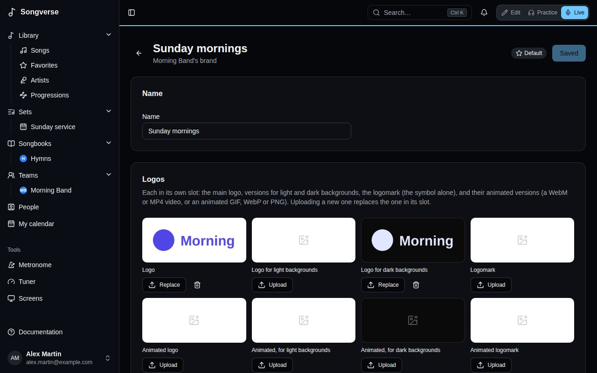

A **brand** keeps a team's or an organisation's look in one place: its logos, its colours, its fonts, its backgrounds and where people find it online. Templates and widgets use it, so the screens look like you without setting colours one template at a time. A church can have several: one for Sunday services, one for the youth, one for a conference.

## Where brands are

They're on the **Brands** tab of [Screens](/screens/). It lists the brands of your teams and of their organisations, grouped by whose they are; each tile shows its logo on a light and a dark background, and its colours. The team's or the organisation's page shows its admins a **Brands** card too, with a link here.

A team's admins add and change the team's brands; an organisation's admins, the organisation's. Everyone in the team - and in the organisation's teams, for its brands - can see them and use them; the others see **Only its admins change this brand.**

**New brand** asks for its **Name** and who it's **For**: a team or an organisation you run. It then opens, to fill in. A team's or an organisation's first brand is its **Default**, the one picked first; **Make it the default** picks another.

## Logos

Each logo has its own slot: the **Logo**, a **Logo for light backgrounds** and a **Logo for dark backgrounds**, the **Logomark** (the symbol alone, for a corner of the screen), and the animated version of each. A still logo is a picture: SVG, PNG, WebP, JPEG or AVIF, 15 MB at most. An animated one can be:

- an animated SVG (with CSS or SMIL animation);
- a Lottie animation, as a Lottie JSON file or a .lottie file;
- a video (WebM, which keeps its transparency, or MP4, 150 MB at most);
- an animated GIF, WebP or PNG.

An SVG is cleaned as it's uploaded: anything that could run a script or load something from elsewhere is taken out, while its shapes, colours, gradients and animation stay. A Lottie animation keeps the pictures embedded in it; pictures it would load from elsewhere are removed. **Upload** fills a slot; **Replace** puts a new file in it, and the old one goes.

## Colours

A brand's colours have names, each with its value **On light** and **On dark** backgrounds. **Start with the usual colours** gives you five to change - Primary, Secondary, Accent, Background and Text - and **Add a colour** another. Templates refer to a colour by its name, so changing it here changes it everywhere it's used.

## Typography

Pick a font for **Headings**, **Text** and **Lyrics**: one of the built-in fonts, or one you upload. **Upload a font** takes a WOFF2, WOFF, TTF or OTF file of 5 MB at most; only upload a font whose licence lets you use it on screens. Each choice shows a line in that font.

## Backgrounds

**Upload a background** adds a picture or a looping video (MP4 or WebM) to offer in templates.

## Links

The brand's **Website**, its **Social profiles** (**Add a profile**: Instagram, Facebook, YouTube, TikTok…) and its **WhatsApp groups** (**Add a group**: its name, its invite link from WhatsApp - https://chat.whatsapp.com/… - and what it's for). QR codes and the WhatsApp widget use them.

**Save** keeps the name, colours, fonts and links; files go up as soon as you pick them. **Delete the brand** removes it with its files.

A team's brand's files count against the team's storage; an organisation's against whoever uploads them.
