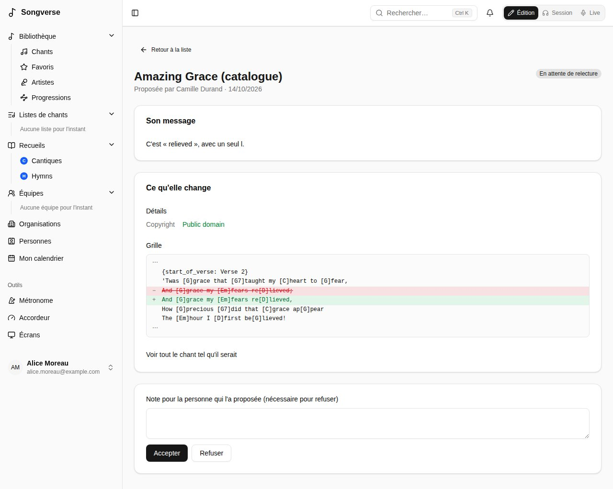

## Relecteurs

Un relecteur - qui a un rôle qui permet de relire, comme le rôle intégré **Reviewer** (voir [Rôles](/fr/admin/#rôles)), ou un administrateur global - vérifie les chants proposés au catalogue global. La page **Relecture** liste ce qui attend. Pour chaque chant, vous pouvez :

- **Approuver et publier**, avec si vous voulez une mention de confiance affichée sur le chant global (« Texte officiel de l'éditeur »). Le chant lui-même passe au catalogue, au nom de la personne qui l'a proposé ; ses fichiers restent les siens ;
- **Fusionner avec** un chant semblable déjà dans le catalogue : le sien y est intégré - ses versions, fichiers et listes passent à ce chant, sa façon de le chanter devient sa version de celui-ci, et les détails qu'elle avait changés vous arrivent comme une proposition ;
- **Demander des modifications**, ou **Refuser**, avec une note pour la personne qui l'a proposé.

Vous ne pouvez pas relire vos propres propositions. Les administrateurs globaux peuvent aussi **Publier maintenant** leurs propres chants sans relecture.

La page **Relecture** liste aussi les **Modifications proposées** pour les chants du catalogue (voir [Proposer une modification](/fr/library/#proposer-une-modification)). Chacune montre ce qu'elle change, depuis le chant tel qu'il était quand elle a été proposée ; **Accepter** l'enregistre dans le chant au nom de son auteur, **Refuser** demande une note. Si le chant a été modifié depuis au même endroit, elle dit où, et ne peut qu'être refusée.

## Administrateurs globaux

Les administrateurs globaux gèrent tout le serveur depuis **Tableau de bord**, dans la section **Administration** de la barre latérale (les relecteurs y trouvent **Relecture**).

Les administrateurs globaux voient et modifient le catalogue global, et les chants qui y sont envoyés en relecture. Les chants personnels et ceux des équipes restent à leurs propriétaires : un administrateur global n'en voit un que comme n'importe qui (partagé avec lui, ou dans une de ses équipes ou listes de chants), dans les listes comme par son lien.

### Utilisateurs

Tous les comptes, avec leur statut, leurs rôles (ceux de leurs équipes en contour), leurs chants et leur stockage. Pour chaque personne, vous pouvez :

- **Rôles…** - cocher les rôles qu'elle a (voir [Rôles](/fr/admin/#rôles)) ; ceux qu'elle tient de ses équipes sont listés dessous, à changer dans **Équipes** ;
- **Bannir** (la personne est déconnectée et ne peut plus se connecter jusqu'à la levée du bannissement ; son contenu reste) ;
- **Supprimer l'utilisateur**, en choisissant ce que devient ce qui lui appartient : le supprimer tout de suite, ou le garder pour un **lien de transfert**. Qui ouvre ce lien en étant connecté, avant qu'il n'expire, en devient propriétaire.

Sous la liste, **Inscription et invitations** indique qui peut créer un compte. Avec **Seules les personnes invitées peuvent s'inscrire** coché, une inscription est refusée, sauf pour une personne invitée ici ou arrivée par le lien d'invitation d'une équipe ou le lien de partage d'une liste de chants ; les comptes existants ne sont pas concernés. Le réglage indique d'où il vient - enregistré ici, la variable d'environnement `SIGNUP_INVITE_ONLY` ou la valeur par défaut (tout le monde peut s'inscrire) - et **Utiliser la variable d'environnement** retourne à la configuration du serveur. Les administrateurs initiaux (`BOOTSTRAP_ADMIN_EMAILS`) peuvent toujours s'inscrire.

Pour inviter quelqu'un, saisissez son adresse dans **E-mail à inviter** et choisissez **Inviter** : avec **Lui envoyer le lien par e-mail** coché, le lien lui est envoyé, et il est aussi affiché, pour l'envoyer autrement. Il ouvre une page où son adresse est déjà remplie, et fonctionne deux semaines, pour cette adresse. Les invitations sont listées **En attente**, **Inscrit** ou **Expirée** : **Copier le lien** copie le lien d'une invitation en attente, **Renvoyer** envoie un nouveau lien pour deux semaines de plus, et **Retirer** l'annule.

### Authentification

Comment Songverse envoie ses e-mails (vérification, réinitialisation du mot de passe) via Resend, et si la **connexion avec Google** est proposée. Les réglages enregistrés ici prennent effet tout de suite ; **Revenir aux variables d'environnement** retourne à la configuration du serveur.

Il est facultatif : les équipes et les organisations peuvent avoir le leur. **Les équipes et les organisations peuvent connecter leur propre serveur Songverse Sonic** permet à leurs admins d'en connecter un sur leur page (voir [Votre propre serveur de séparation](/fr/sonic/)) ; leurs chants y sont alors séparés par leurs membres, dans la limite qu'ils fixent, sans rôle. **Aussi sur des adresses privées ou locales** autorise les adresses du réseau de ce serveur (`http://192.168.1.20:8000`) ; sinon, une adresse doit être publique et commencer par https://. **Connectés** liste les serveurs connectés, à qui ils sont et combien de séparations chacun a faites.

### Sécurité

Comment l'API se protège. **Limiter les requêtes** plafonne le nombre de requêtes qu'elle accepte par minute : par utilisateur connecté, par adresse avant connexion, et un nombre plus serré pour les requêtes coûteuses (envois de fichiers, recherches de pochettes et d'artistes, adhésion par lien). Au-delà, la requête est refusée jusqu'à la fin de la minute et l'application affiche « Trop de requêtes, réessayez dans un instant ». **Proxys devant l'API** indique combien de proxys (un répartiteur de charge, Traefik…) la précèdent, pour qu'elle compte chaque visiteur par sa propre adresse plutôt que celle du proxy. **Documentation de l'API** décide qui peut lire `/api/docs` : tout le monde, ou seulement les administrateurs globaux. **Content-Security-Policy** indique aux navigateurs quels scripts, connexions et cadres les pages de Songverse peuvent utiliser, pour qu'un script glissé dans une page ne s'exécute pas : **Appliquée** (par défaut), **Seulement signalée** - rien n'est refusé, et ce qui l'aurait été va dans le journal du serveur web, pour essayer un changement d'abord - ou **Désactivée**. Chaque réglage indique d'où il vient - enregistré ici, une variable d'environnement ou la valeur par défaut - et **Revenir aux variables d'environnement** retourne à la configuration du serveur.

### Collaboration

**Modification à plusieurs en direct** permet aux personnes qui peuvent modifier un chant d'y écrire ensemble dans l'éditeur, chacun voyant ce que les autres tapent au fil de la frappe (voir [Écrire à plusieurs](/fr/song-editor/#écrire-à-plusieurs)). Elle est désactivée tant que vous ne l'activez pas ; désactivée, chacun modifie de son côté et est prévenu quand quelqu'un d'autre a enregistré. Elle vaut pour les chants ouverts après le changement. Le réglage indique d'où il vient - enregistré ici, la variable d'environnement `LIVE_CO_EDITING` ou la valeur par défaut - et **Revenir aux variables d'environnement** retourne à la configuration du serveur.

### Équipes

Chaque équipe, avec ses rôles, ses membres, ses chants et son **espace de stockage** : ce qui est sur les chants d'une équipe y compte, quel que soit qui l'a envoyé, et non pour la personne qui l'a envoyé. **Rôles…** donne des rôles à l'équipe : chacun s'applique à tous ses membres, et un palier de stockage fixe l'espace de l'équipe.

### Organisations

Si le serveur a des organisations - une église, un club - qui regroupent des équipes pour planifier ensemble (voir [Organisations](/fr/organizations/)). Sous **Organisations sur ce serveur** :

- **Aucune : Songverse seul** - par défaut ; personne ne voit d'organisations ;
- **Une seule : toute personne qui se connecte en fait partie** - **Créer l'organisation** (un **Nom**, et l'**E-mail de son administrateur (facultatif)** si ce n'est pas vous), une fois ;
- **Plusieurs, chacune à part** - les administrateurs globaux les créent sous **Nouvelle organisation** ; avec **Tout le monde peut créer une organisation** coché, tout le monde le peut, depuis **Organisations** dans la barre latérale.

La page indique d'où vient chaque réglage - enregistré ici, les variables d'environnement `ORGANIZATION_MODE` et `ORGANIZATIONS_OPEN`, ou la valeur par défaut - avec **Enregistrer la configuration** et **Revenir aux variables d'environnement**. **Toutes les organisations** les liste avec leurs équipes, membres et administrateurs ; **Supprimer l'organisation** laisse leurs équipes à part entière.

Sous le titre de la page, elle indique où se trouve [Planiverse](/fr/planiverse/), quand il est déployé à côté de Songverse (une adresse réglée là où il est déployé, `PLANIVERSE_URL`), ou qu'il ne l'est pas.

### Rôles

Le seul endroit qui dit ce que chacun peut faire au-delà de ses chants et de ceux de ses équipes. Un rôle peut permettre de :

- **Relire les propositions** - la file du catalogue global (voir [Relecteurs](/fr/admin/#relecteurs)) ;
- **Séparer des enregistrements en pistes**, avec ses propres **Séparations par personne sur 30 jours** ou, laissé vide, celle de **Séparation en pistes** ;
- **Importer des fichiers audio** - des enregistrements et des pistes. Les personnes qui s'inscrivent ne l'ont pas, mais peuvent toujours enregistrer dans Songverse ; le rôle intégré **Audio uploads** le permet, et a été donné à tous ceux qui avaient un compte quand il est apparu ;
- **Garder les originaux sans perte** - un WAV, FLAC ou AIFF importé garde son original, en FLAC (un WAV à sa fréquence d'échantillonnage et sa résolution), à côté de la copie Opus qui est jouée ; sans cela, seule la copie Opus est gardée (voir [Fichiers audio](/fr/library/#les-fichiers-audio-et-leurs-originaux)) ;
- **Gérer les écrans** - contrôler ce qui est présenté sur les écrans de toute liste que l'on peut ouvrir, à côté de son responsable, et se réserver ce contrôle (voir [L'opérateur média](/fr/screens/#lopérateur-média)) ;
- **Avancer les écrans** - passer les écrans de toute liste que l'on peut ouvrir au chant ou à la partie suivante ou précédente, depuis le menu Synchro de Live, sans présenter d'autre diapositive : pour les chanteurs qui font avancer la liste (voir [Avancer les écrans](/fr/screens/#avancer-les-écrans)) ;
- **Orienter les écrans** - changer ce que dessinent les écrans de toute liste que l'on peut ouvrir - masquer, afficher ou effacer leurs calques et la carte de titre, pour tous ou pour l'un d'eux - depuis la vue opérateur, sans présenter ni toucher au minuteur ou aux messages : pour la technique à la régie (voir [Écrans et calques](/fr/screens/#écrans-et-calques)) ;
- **Administrer les écrans** - associer, modifier et déconnecter les écrans et les Pulse de ses équipes et organisations sans en être administrateur, sans droit sur les listes qu'ils affichent ni sur qui les possède (voir [À qui est l'écran](/fr/screens/#à-qui-est-lécran)) ;
- **Un palier de stockage** - combien une personne peut stocker, ou l'espace d'une équipe.

**Les équipes peuvent le donner** permet aux administrateurs d'une équipe ou d'une organisation de donner le rôle à leurs propres membres, dans leur équipe ou organisation seulement (voir [Équipes](/fr/teams/#rôles-dans-léquipe)). Donné ainsi, il leur permet d'y gérer les écrans, de les avancer, de les orienter ou de les administrer, rien d'autre : stockage, envois audio, pistes et relecture restent ce que vous donnez ici. Décochez-le et les rôles donnés par les équipes ne comptent plus.

**Reviewer** (relecteur), **Stem separation** (séparation en pistes), **Audio uploads** (import audio) et **Media operator** (opérateur média, qui gère les écrans et que les équipes peuvent donner) sont intégrés, avec ces noms, que vous pouvez changer : ils se modifient mais ne se suppriment pas. **Nouveau rôle** ajoute les vôtres, comme « Stockage 10 Go ». Donnez les rôles aux personnes dans **Utilisateurs** et aux équipes dans **Équipes**. On peut faire ce que permet l'un de ses rôles - les siens et ceux de ses équipes - et la plus grande limite l'emporte ; sans palier de stockage, les valeurs par défaut de **Stockage** s'appliquent. Les administrateurs globaux peuvent tout faire. Les changements s'appliquent tout de suite.

### Instruments

Les instruments que chacun peut choisir comme ce qu'il joue (voir [Rôles](/fr/account/#rôles)). Sous **Ajoutés**, ajoutez-en un qui manque à la liste avec son **Nom** et, s'il diffère, son nom **En français** (**Ajouter l'instrument**) ; **Renommer** le change, **Retirer** l'enlève, ainsi qu'à ceux qui l'avaient choisi. **Déjà dans la liste** montre ceux qui y sont d'office.

### Notifications

Ce que Songverse dit aux gens en plus de la cloche dans l'application. **Envoyer les notifications par e-mail** reste désactivé tant que vous ne l'activez pas : les e-mails passent par le compte Resend réglé dans **Authentification**, comme le courrier du compte, et son offre gratuite limite les envois. Une fois activé, chacun choisit dans les réglages de son compte ce qu'il reçoit par e-mail ; un seul e-mail regroupe les notifications faites ensemble (un événement dont plusieurs dates ont changé), et une adresse non vérifiée n'en reçoit aucun. **Notifications sur les appareils** envoie les notifications sur les téléphones et ordinateurs par le service de notifications de leur navigateur (celui de Google, de Mozilla, d'Apple, de Microsoft - jamais ailleurs). Il faut une paire de clés VAPID : **Générer des clés** en crée une et la garde (la clé privée chiffrée, plus jamais affichée), ou collez la vôtre, avec un **Contact (mailto: ou https:)** que les services de notifications peuvent joindre. Générer de nouvelles clés plus tard oblige chacun à réactiver ses appareils. Une fois enregistrée, la clé privée n'est plus jamais renvoyée : son champ reste vide et indique **Enregistrée et masquée**. Le refus d'un service de notifications s'affiche sur l'appareil de la personne, et un test qui n'atteint aucun appareil échoue dans les tâches de fond de **Maintenance du serveur**, avec la raison ; de même pour un Worker qui ne peut pas déchiffrer la clé enregistrée (une autre `SETTINGS_ENCRYPTION_KEY`). Chaque réglage indique d'où il vient, et **Revenir aux variables d'environnement** retourne à la configuration du serveur.

### Stockage

Où sont gardés les fichiers envoyés (un stockage objet comme Cloudflare R2, ou le disque local pour le développement), l'espace utilisé, le plus gros fichier de chaque type (**Taille maximale des fichiers** : PDF, ChordPro, MusicXML, ABC, Texte, Image, Audio, Autre - 25 Mo, audio 50 Mo, sauf réglage ici, jusqu'à 500 Mo, car un envoi est gardé dans la mémoire du serveur jusqu'à son stockage ; **Rétablir** revient à la valeur par défaut ; les administrateurs globaux n'y sont pas tenus, seulement aux 500 Mo), et les limites de stockage par défaut : **Limite par défaut par utilisateur (Mo)** et **Limite par défaut de l'espace d'une équipe (Mo)**, pour qui n'a pas de palier de stockage (voir [Rôles](/fr/admin/#rôles)). Ce qui est sur les chants d'une équipe compte dans l'espace de l'équipe ; le reste de ce qu'on envoie, dans sa propre limite. Les administrateurs globaux n'ont pas de limite.

### Sauvegardes

Chaque nuit, le Worker sauvegarde le serveur dans un second bucket, séparé du stockage principal : toute la base de données (comptes, chants et leur historique, listes, réglages), chiffrée, et chaque fichier stocké une seule fois - un fichier n'est jamais copié deux fois, puisque son nom dans le stockage est une empreinte de son contenu. Sous **Où**, indiquez un bucket compatible S3 : **Point d'accès (endpoint)**, **Région**, **Bucket**, **Dossier dans le bucket** (facultatif, pour garder les sauvegardes de plusieurs serveurs dans un même bucket), **ID de clé d'accès** et **Clé d'accès secrète** (laissez-la vide pour garder celle enregistrée). Prenez un autre compte ou un autre fournisseur que celui du stockage principal (Backblaze B2, Amazon S3, un autre compte R2), pour qu'un même problème ne touche pas les deux. Sans rien d'enregistré ici, les variables d'environnement `BACKUP_S3_*` du serveur sont utilisées, ou `BACKUP_DIR`, un dossier du Worker ; **Actuellement utilisé** dit laquelle.

Sous **Quand, et combien de temps elles sont gardées** : **Sauvegarder chaque nuit** (activé dès qu'il y a un bucket), l'**Heure de la nuit (UTC, 0-23)** où elle commence (et dès que possible quand la dernière date de plus d'un jour, le Worker ayant été arrêté), les **Copies quotidiennes de la base gardées**, **Copies hebdomadaires de la base gardées** et **Copies mensuelles de la base gardées** (7, 4 et 12 sauf réglage ici), et les **Jours pendant lesquels un fichier supprimé reste dans la sauvegarde** (30), pour qu'un fichier supprimé par erreur puisse encore être récupéré. Chaque réglage indique d'où il vient ; **Revenir aux variables d'environnement** revient à la configuration du serveur.

**Sauvegarder maintenant** en lance une tout de suite. **Dernières sauvegardes** liste les 20 dernières : quand, nocturne ou demandée, la taille de la copie de la base, les nouveaux fichiers copiés et ceux déjà présents, et, pour une qui a échoué, pourquoi. Un fichier que la base nomme mais que le stockage a perdu y est compté aussi.

Les copies de la base sont chiffrées avec la `SETTINGS_ENCRYPTION_KEY` du serveur, qui n'est pas dans la sauvegarde : gardez-la dans votre gestionnaire de mots de passe avec les clés du bucket de sauvegarde. La restauration a besoin des deux, et se fait sur le serveur, par la personne qui l'administre : voir « Restoring from a backup » dans Deploy.md, dans le dépôt. Les copies que chacun fera de ses propres chants sont une autre fonction, encore à venir.

### Séparation en pistes

Le serveur de ce Songverse pour séparer les enregistrements en pistes (un serveur Songverse Sonic, voir [Séparer un enregistrement en pistes](/fr/library/#séparer-un-enregistrement-en-pistes)) : son **Adresse de l'API** et sa **Clé d'API** (laisser la clé vide pour garder l'actuelle), le **Modèle de la passe rapide** (htdemucs ; demander 6 pistes utilise htdemucs_6s), **Puis une passe plus fine** et son modèle (htdemucs_ft), qui remplace les pistes rapides quand le serveur a le temps (pas pour 6 pistes : htdemucs_ft sépare en 4), et les **Séparations par personne sur 30 jours** (vide : pas de limite). **Tester la connexion** vérifie l'adresse et la clé et liste les modèles du serveur. Le serveur doit pouvoir joindre l'API en retour pour dire quand les pistes sont prêtes ; sinon Songverse vérifie toutes les 2 minutes.

**Qui peut l'utiliser** : qui a un rôle qui le permet - le rôle intégré **Stem separation**, ou l'un des vôtres - donné à la personne ou à son équipe (voir [Rôles](/fr/admin/#rôles)) ; elle peut séparer les enregistrements des chants qu'elle peut modifier et de ceux de son équipe. Les administrateurs globaux le peuvent toujours. **Revenir aux variables d'environnement** retourne à la configuration du serveur.

### Catalogues

Gère les catalogues de recueils publiés (voir [Recueils](/fr/songbooks/#à-partir-du-catalogue-dun-recueil-publié)) : en ajouter, modifier leurs entrées dans un tableau, les importer ou les exporter en CSV ou JSON.

### Bibles

D'où viennent les traductions de la Bible : les fichiers importés ici, et YouVersion.

Les **Bibles importées** sont des traductions importées depuis un fichier - Zefania, Beblia ou OSIS XML, ou json-bible (le format de FreeShow) - pour tout le monde sur le serveur. **Importer un fichier** en envoie un ; il apparaît en cours d'import jusqu'à ce que le traitement en arrière-plan l'ait lu, puis avec ses livres, ses versets et son format, son nom, son abréviation et sa mention de copyright tirés du fichier. Un fichier illisible dit pourquoi. Son texte est gardé sur le serveur. Sous chacune, cochez ce que sa licence permet : **Montrée sur les écrans**, **Gardée hors ligne**, **Exportée** - rien tant que vous ne cochez pas. Une traduction du domaine public (comme la Louis Segond 1910 ou la King James) peut avoir les trois ; la plupart des traductions modernes demandent une licence pour chacun. **Modifier** change son **Nom**, son **Abréviation** et son **Copyright**, montré avec son texte partout où il est montré. **Supprimer** l'enlève avec son texte. **Essayer un passage** en lit un dans une Bible importée. Les passages des listes sont lus dans ces Bibles (voir [Listes de chants](/fr/sets/)) ; en supprimer une laisse ses passages dans les listes sans leur texte.

**YouVersion** garde l'App Key de la Platform API de YouVersion : enregistrez une application sur platform.youversion.com ; les versions utilisables sont celles que YouVersion accorde à cette application. Saisissez-la comme **App Key** - gardée chiffrée et plus jamais affichée ; laissez-la vide pour garder l'actuelle. Sans clé (ici ou dans la variable d'environnement `YOUVERSION_APP_KEY`), YouVersion n'est pas interrogé et rien ne s'en affiche. **Tester la connexion** liste les versions anglaises de la clé ; **Revenir aux variables d'environnement** revient à `YOUVERSION_APP_KEY`, ou à aucun YouVersion sans elle.

**Essayer un passage** en lit un avec la clé : **Chercher les versions** d'une langue (un code comme `fr` ou `en`), choisissez une **Version**, écrivez un **Passage** comme on l'écrit (« Jean 3.16-18 », « John 3:16 »), puis **Lire**. La mention de copyright de chaque version s'affiche sous son texte, avec un lien vers la version sur YouVersion. Une version dont l'éditeur ne donne pas de mention, comme un texte du domaine public, affiche à la place son titre et sa description. Les versions que votre clé obtient sont celles dont vous avez accepté les licences sur la plateforme de YouVersion ; ce que chaque licence permet se règle avec YouVersion, pas ici. Songverse redemande le texte à YouVersion à chaque fois et n'en garde rien : un passage YouVersion dans une liste va sur les [écrans](/fr/screens/), lu sur YouVersion à chaque fois, et jamais dans les copies gardées sur les appareils.

### Maintenance du serveur

La page **Métadonnées** a deux tâches de maintenance : **Vérifier** compare les migrations de la base de données présentes sur le serveur avec celles appliquées, et **Exécuter le script de départ** réapplique les données intégrées (catégories d'étiquettes, étiquettes, accordages). On peut le relancer sans risque.

En haut de **Tâches de fond** s'affiche la version d'Oneverse qui tourne (`0.9.0`, ou `0.9.0-dev` pour une version qui n'est pas une publication, avec son commit quand il est connu) et la dernière migration de la base de données, comme sur `/health` ; si le Worker tourne une autre version que l'API, c'est signalé : redéployez-le avec l'API. La version s'affiche aussi en bas de la barre latérale de l'administration, sur chaque page ; elle ouvre **Métadonnées**.

**Tâches de fond** montre si le Worker - le processus serveur qui fait le travail lent en arrière-plan (trouver illustrations et artistes, les imports de recueils, les prises enregistrées, les imports de Bibles, le nettoyage horaire des transferts expirés et des sessions en direct que plus personne ne mène, l'historique de ce qui a été fait dans chaque session en direct, gardé 90 jours après sa fin) - tourne, combien de tâches attendent dans chaque file ou ont échoué, et le résultat des dernières, actualisés toutes les quelques secondes. Les recherches en lot de l'administrateur ont leur propre file : les recherches d'un nouveau chant n'attendent jamais derrière. Il signale aussi un Worker sans `SETTINGS_ENCRYPTION_KEY`, ou pas celle de l'API : il ne peut alors pas utiliser les secrets enregistrés ici (clés des sources, stockage). Il indique quel ffmpeg a le Worker, qui convertit les prises enregistrées en Opus (voir [Enregistrer une piste](/fr/library/#enregistrer-une-piste)) ; sans lui, les prises restent telles qu'enregistrées (WAV), environ huit fois plus lourdes. **Planifiées** liste les tâches qui se lancent d'elles-mêmes - **Listes des dates des calendriers d'équipe** toutes les 6 heures, **Rappels du calendrier** toutes les heures, **Suppression des anciennes notifications (lues après 90 jours, non lues après un an)** tous les jours, **Historique des sessions en direct** toutes les minutes, **Sessions en direct que personne ne mène, et historiques de plus de 90 jours** toutes les heures - avec **Lancer maintenant** pour chacune. **Sections reprises** parcourt tous les chants à la recherche de sections écrites à nouveau (voir [Sections reprises](/fr/song-editor/#sections-reprises)) : **Compter** dit combien de chants en ont, de chaque sorte, sans rien changer ; **Lier les identiques et transposées** les lie dans tous les chants (chacune gardée dans l'historique de son chant), en laissant celles qui ont des accords ou des lignes à elles aux éditeurs du chant. **Tâches en échec** liste les tâches qui ont échoué, avec la raison ; **Effacer les tâches en échec** vide cette liste, dans toutes les files. **Aucun Worker ne tourne** signifie que les tâches attendent : voir Deploy.md dans le dépôt pour en installer un, ou laisser l'API les exécuter elle-même (`JOBS_IN_API`).

**Sources de métadonnées** liste où chercher les chants et les artistes - MusicBrainz, Apple Music, Deezer et Spotify - dans l'ordre où elles sont interrogées. Déplacez-en une avec les flèches, et cochez ce que chacune fournit, parmi ce qu'elle sait faire : **Infos du chant** (la **Détection automatique** d'un chant, voir [La bibliothèque](/fr/library/)), **Illustrations d'album** (l'image d'un chant), **Photos d'artistes** et **Biographies d'artistes** (celles de MusicBrainz viennent de Wikipédia, via Wikidata). **(demande une clé)** à côté signifie qu'elle est cochée mais ne peut être interrogée tant que ses réglages n'ont pas de clé. Les résultats de la détection automatique les plus proches du titre et de l'artiste viennent en premier, puis la première sortie du chant, et cet ordre départage le reste ; l'illustration d'un nouveau chant et la photo d'un artiste viennent de la première source ici, parmi celles cochées, qui en a une. **Enregistrer la configuration** garde la liste ; **Revenir aux variables d'environnement** revient à `METADATA_PROVIDERS` (celles listées, dans l'ordre, pour tout ce qu'elles savent faire, comme `musicbrainz,deezer`), ou aux quatre dans cet ordre sans elle.

Les **Réglages** de chaque source s'ouvrent en dessous :
- **MusicBrainz** : le **Contact** envoyé à MusicBrainz avec chaque requête, comme il le demande - une adresse web ou e-mail (sinon `MUSICBRAINZ_CONTACT`).

- **Apple Music** : la **Boutique Apple Music (pays)** interrogée - deux lettres, comme us ou fr - et, en option, la clé MusicKit de l'API Apple Music. Sans clé, Apple Music est interrogé via iTunes Search, qui n'en demande pas. Avec une clé, via l'API Apple Music : les mêmes chants, avec leur ISRC, leurs auteurs et les photos d'artistes. Créez une clé MusicKit dans votre compte Apple Developer (Certificates, Identifiers & Profiles > Keys), puis saisissez son **Team ID**, son **Key ID** et sa **Clé privée (.p8)** - tout le fichier, lignes BEGIN et END comprises. La clé privée est gardée chiffrée et n'est plus jamais affichée : laissez-la vide pour garder l'actuelle. En attendant une clé, **Adresse de jetons développeur (sans clé)** peut recevoir une adresse qui répond par un jeton développeur (`{"token": "eyJ…"}`, ou `APPLE_MUSIC_TOKEN_URL`) ; chaque jeton est gardé jusqu'à son expiration. Ses jetons sont signés par qui gère cette adresse, pas par votre compte Apple : ils peuvent cesser de fonctionner à tout moment - une clé, une fois enregistrée, est utilisée à la place. **Tester la connexion** fait une recherche avec la clé ou le jeton. **Revenir aux variables d'environnement** efface les deux et revient à `APPLE_MUSIC_TEAM_ID`, `APPLE_MUSIC_KEY_ID` et `APPLE_MUSIC_PRIVATE_KEY` (ou `APPLE_MUSIC_TOKEN_URL`), ou à iTunes Search sans elles.
- **Deezer** ne demande pas de clé.
- **Spotify** demande une application : créez-en une sur Spotify for Developers (developer.spotify.com > Dashboard > Create app, avec la Web API) et saisissez son **Client ID** et son **Client secret** - gardé chiffré et plus jamais affiché ; laissez-le vide pour garder l'actuel - et le **Marché (pays)** interrogé (sinon `SPOTIFY_MARKET`, sinon le pays Apple Music). Personne ne se connecte à Spotify : Songverse interroge en tant qu'application. Ses résultats apportent le lien Spotify du chant et son ISRC. **Tester la connexion** fait une recherche ; **Revenir aux variables d'environnement** revient à `SPOTIFY_CLIENT_ID` et `SPOTIFY_CLIENT_SECRET`, ou à ne pas interroger Spotify sans elles.

**YouTube** garde la clé de la YouTube Data API, qui permet de chercher le lien YouTube d'un chant depuis son onglet **Liens** (YouTube n'est pas interrogé pour les infos du chant). Créez une clé dans la console Google Cloud (API et services > Identifiants > Créer des identifiants > Clé API, avec la YouTube Data API v3 activée) et saisissez-la comme **Clé API** - gardée chiffrée et plus jamais affichée ; laissez-la vide pour garder l'actuelle. Chaque recherche utilise 100 des 10 000 unités gratuites par jour de la clé : environ 100 recherches par jour. **Tester la connexion** fait une recherche ; **Revenir aux variables d'environnement** revient à `YOUTUBE_API_KEY`, ou à aucune recherche YouTube sans elle.

**Illustrations des chants** active ou non l'illustration des chants (**Trouver les illustrations des chants**) : trouvée toute seule pour un nouveau chant, depuis les sources cochées pour **Illustrations d'album**. **Enregistrer la configuration** le garde ; **Revenir aux réglages par défaut** revient à activé. **Trouver les illustrations des chants qui n'en ont pas** en cherche jusqu'à 50 à la fois, les plus récents d'abord, en arrière-plan : son résultat apparaît dans **Tâches de fond**. Un chant sans résultat n'est pas réessayé ; un chant dont la recherche a échoué (une source en panne ou qui refuse) l'est, la fois suivante. Voir [Illustration](/fr/library/#illustration).

**Photos et biographies des artistes** les active ou non (**Chercher les photos et biographies des artistes**) : une photo depuis les sources cochées pour **Photos d'artistes**, et une courte biographie de Wikipédia, trouvée via MusicBrainz et Wikidata, en anglais et en français. **Enregistrer la configuration** le garde ; **Revenir aux variables d'environnement** revient à `ARTIST_LOOKUPS` (`off` les désactive), ou activé sans elle. **Chercher les artistes pas encore cherchés** en cherche jusqu'à 25 à la fois, les plus récemment crédités d'abord, en arrière-plan : son résultat apparaît dans **Tâches de fond**. Un artiste dont la recherche a échoué est réessayé la fois suivante. Voir [Artistes](/fr/library/#artistes).

