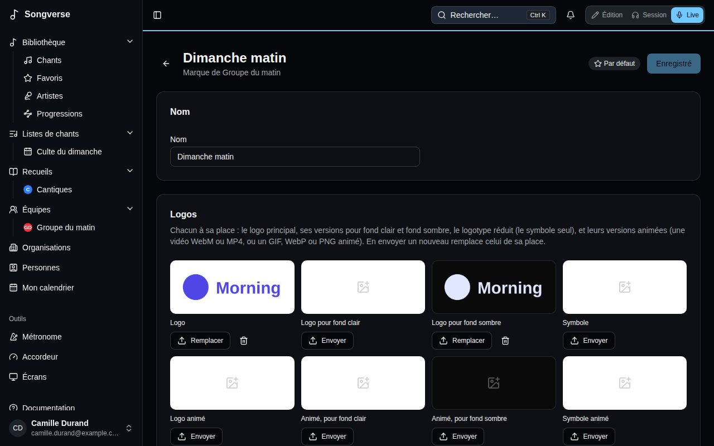

Une **marque** réunit l'identité d'une équipe ou d'une organisation : ses logos, ses couleurs, ses polices, ses fonds et les endroits où l'on vous trouve en ligne. Les modèles et les widgets s'en servent : les écrans vous ressemblent sans régler les couleurs modèle par modèle. Une église peut en avoir plusieurs : une pour le culte du dimanche, une pour les jeunes, une pour une conférence.

## Où sont les marques

Elles sont dans l'onglet **Marques** d'[Écrans](/fr/screens/). Il liste les marques de vos équipes et de leurs organisations, regroupées par propriétaire ; chaque vignette montre son logo sur fond clair et sur fond sombre, et ses couleurs. La page de l'équipe ou de l'organisation montre aussi à ses admins une carte **Marques**, avec un lien vers cet onglet.

Les admins d'une équipe ajoutent et modifient les marques de l'équipe ; les admins d'une organisation, celles de l'organisation. Tous les membres de l'équipe - et des équipes de l'organisation, pour ses marques - peuvent les voir et s'en servir ; les autres voient **Seuls ses admins modifient cette marque.**

**Nouvelle marque** demande son **Nom** et **Pour** qui : une équipe ou une organisation que vous dirigez. Elle s'ouvre ensuite, à compléter. La première marque d'une équipe ou d'une organisation est sa marque **Par défaut**, choisie en premier ; **En faire la marque par défaut** en choisit une autre.

## Logos

Chaque logo a sa place : le **Logo**, un **Logo pour fond clair** et un **Logo pour fond sombre**, le **Symbole** (seul, pour un coin de l'écran), et la version animée de chacun. Un logo fixe est une image - PNG, WebP, JPEG ou AVIF, 15 Mo au plus, ou un SVG, que votre navigateur transforme en PNG net (2048 pixels sur son plus grand côté) à l'envoi ; un logo animé est une vidéo (WebM, avec sa transparence, ou MP4, 150 Mo au plus) ou un GIF, WebP ou PNG animé. **Envoyer** remplit une place ; **Remplacer** y met un nouveau fichier, et l'ancien part.

## Couleurs

Les couleurs d'une marque ont un nom, chacune avec sa valeur **Sur clair** et **Sur sombre**. **Commencer avec les couleurs habituelles** en donne cinq à modifier - Principale, Secondaire, Accent, Fond et Texte - et **Ajouter une couleur** une de plus. Les modèles se réfèrent à une couleur par son nom : la changer ici la change partout où elle sert.

## Typographie

Choisissez une police pour les **Titres**, le **Texte** et les **Paroles** : une police intégrée, ou une que vous envoyez. **Envoyer une police** accepte un fichier WOFF2, WOFF, TTF ou OTF de 5 Mo au plus ; n'envoyez qu'une police dont la licence permet l'usage sur écran. Chaque choix montre une ligne dans cette police.

## Fonds

**Envoyer un fond** ajoute une image ou une vidéo en boucle (MP4 ou WebM) à proposer dans les modèles.

## Liens

Le **Site web** de la marque, ses **Réseaux sociaux** (**Ajouter un profil** : Instagram, Facebook, YouTube, TikTok…) et ses **Groupes WhatsApp** (**Ajouter un groupe** : son nom, son lien d'invitation WhatsApp - https://chat.whatsapp.com/… - et à quoi il sert). Les codes QR et le widget WhatsApp s'en servent.

**Enregistrer** garde le nom, les couleurs, les polices et les liens ; les fichiers partent dès que vous les choisissez. **Supprimer la marque** la retire avec ses fichiers.

Les fichiers de la marque d'une équipe comptent dans le stockage de l'équipe ; ceux d'une organisation, dans celui de qui les envoie.
