La **Bibliothèque** contient tous les chants que vous pouvez voir : les vôtres, ceux de vos équipes et ceux du catalogue global. **Bibliothèque** s'ouvre sur son accueil ; **Chants**, en dessous dans la barre latérale, est la liste complète, avec **Favoris**, **Artistes** et vos listes intelligentes à côté.

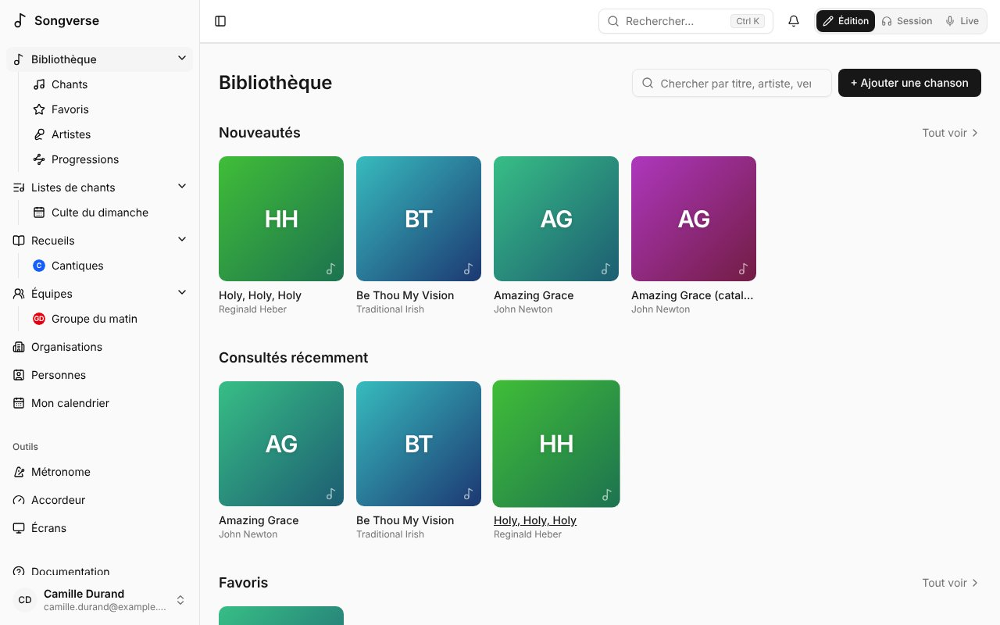

## L'accueil de la bibliothèque

**Bibliothèque** s'ouvre sur son accueil : des rangées de chants, puis les chants modifiés en dernier.

- **Nouveautés** - les derniers chants que vous pouvez voir ; **Tout voir** les liste tous dans **Chants**, les plus récents d'abord.
- **Consultés récemment** - les chants que vous avez ouverts en dernier (sur leur page, dans une liste de chants ou en Live). Vous seul·e voyez les vôtres.
- **Favoris** - les chants que vous avez marqués d'une étoile : l'étoile sur la carte d'un chant ici, ou à côté de **Partager** sur sa page (**Ajouter aux favoris**, **Retirer des favoris**). La rangée apparaît dès que vous en avez un. **Tout voir** les liste, comme le filtre **Favoris** au-dessus de la liste et dans le panneau de la barre latérale. Vos favoris sont à vous.
- **Populaires dans vos équipes** - ce que vos équipes jouent et consultent le plus : les chants de leurs listes et ouverts par leurs membres ces 90 derniers jours.

Quand une rangée a plus de chants qu'il n'en tient, faites-la glisser, ou utilisez à la souris les flèches à côté de son titre.

Un chant sans image à lui a une couverture tirée de son titre : une couleur et ses initiales. Sous les rangées, **Modifiés récemment** montre les chants modifiés en dernier, et son lien ouvre **Chants**.

Pointez la carte d'un chant et trois boutons apparaissent sur sa couverture : l'étoile, **Ajouter à une liste** et **Aperçu**. L'étoile d'un favori reste sur sa couverture, sur un écran tactile aussi. **Aperçu** montre le chant d'un coup d'œil sans quitter la page : sa couverture, ses artistes, sa tonalité, son tempo et sa mesure, ses numéros de recueil et ses étiquettes, et son refrain (ou, sans refrain, ses premières lignes), avec l'étoile, **Ajouter à une liste**, **Écouter** et **Ouvrir le chant**. Son titre ouvre aussi le chant, et le nom d'un artiste sa page. **Écouter** joue l'enregistrement du chant, ou sa vidéo YouTube s'il n'a pas d'enregistrement - pas les pistes séparées - et continue de chant en chant jusqu'à **Arrêter**. **Précédent** et **Suivant** parcourent les chants de la rangée, l'aperçu gardant sa place et sa taille. Au clavier : les flèches vont au chant précédent ou suivant, **Page précédente** et **Page suivante** de cinq chants, **Début** et **Fin** au premier et au dernier, **Entrée** ouvre le chant, **F** le met en favori et **L** l'écoute ; **Échap** ferme l'aperçu, sur la carte du dernier chant vu. Sur un écran tactile, appuyez longuement sur une carte pour ouvrir l'aperçu, et balayez-le vers la gauche ou la droite pour le chant suivant ou le précédent ; un simple appui ouvre toujours le chant.

Pour chercher, utilisez **Rechercher** en haut de chaque page, ou le champ au-dessus de **Chants**.

## Chercher et filtrer

**Chants** est la liste complète, et rien d'autre :

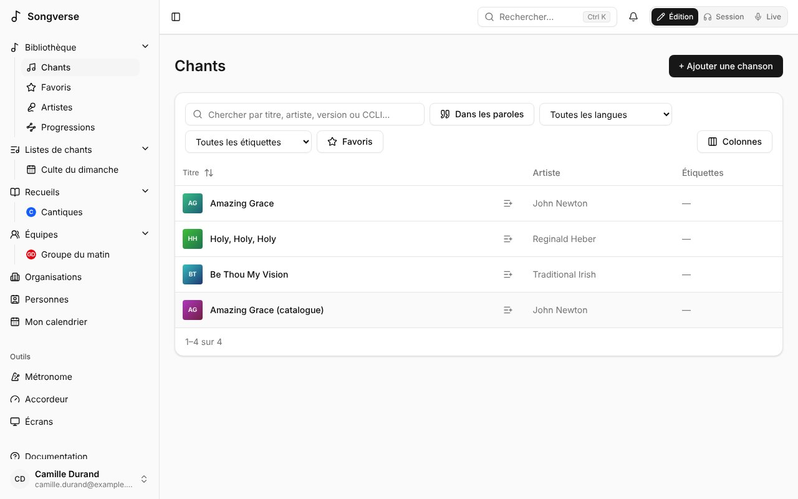

- **Recherchez** par titre, artiste ou numéro CCLI.
- **Filtrez** par langue (**Toutes les langues**) et étiquette (**Toutes les étiquettes**), ou n'affichez que vos **Favoris**.
- **Triez** par colonne en cliquant sur son titre.
- La colonne **Statut** dit où en est un chant : **Personnel** ou **Équipe** s'il n'a jamais été proposé au catalogue global, puis où en est sa proposition (**En attente de relecture**, **Publié**…).

## Artistes

**Artistes** montre toutes les personnes créditées comme artiste sur les chants que vous pouvez voir, en grille : sa photo (ou ses initiales), son nom et son nombre de chants ; la recherche les filtre. Les noms écrits différemment (avec ou sans majuscules ou accents) comptent pour un seul artiste.

Choisissez-en un pour sa page : sa photo, une courte biographie et ses chants. La photo vient de Deezer, Spotify ou Apple Music (selon les réglages de votre administrateur) et la biographie de Wikipédia (**Depuis Wikipédia** ouvre l'article), en anglais ou en français selon la langue de Songverse ; un artiste est cherché quand un chant le crédite pour la première fois, ou à la première ouverture de sa page. Son nombre de chants ouvre la liste **Chants** avec **De** suivi du nom ; le **×** à côté montre de nouveau tout le monde.

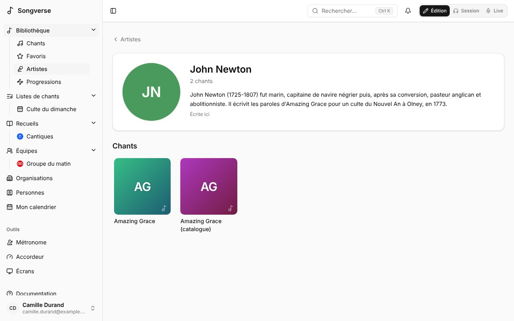

Un administrateur global peut **Ajouter une photo** (glissée et zoomée dans le cercle), **Retirer la photo**, **Modifier la biographie** - écrite ici, elle remplace celle de Wikipédia dans cette langue ; laissée vide, celle de Wikipédia revient - et **Chercher à nouveau**. Un artiste est le même pour tous : ces changements apparaissent à tous ceux qui voient un de ses chants.

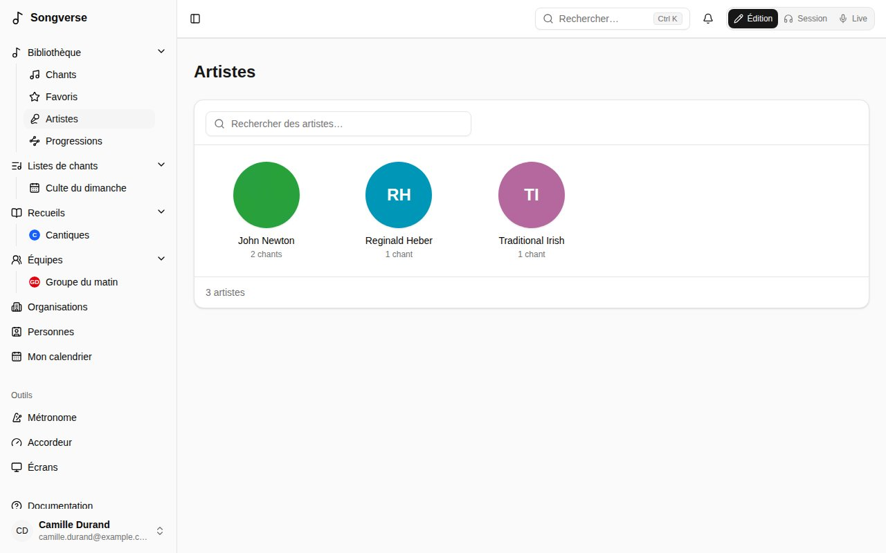

## Chants par progression d'accords

**Progressions**, sous **Bibliothèque** dans la barre latérale, trouve des chants selon le mouvement de leurs accords, quelle que soit leur tonalité. Tapez les accords en chiffres - **1 5 6m 4** - ou en chiffres romains - **I V vi IV**, en minuscules pour les mineurs ; un 2, 3 ou 6 seul est mineur, comme dans les accords de la tonalité, et **b7** ou **#4** sont des accords hors de la tonalité. Vous obtenez les chants que vous voyez qui font ce chemin, avec les parties où il se trouve. Une partie se lit en boucle, comme elle se joue : **1 5 6m 4** trouve aussi un refrain écrit **6m 4 1 5**. Les septièmes, les extensions et les basses ne comptent pas (G7/B compte comme 5 en Do), et un chant a besoin d'une tonalité pour être trouvé.

Sur la page d'un chant, **Progressions d'accords** montre les accords de chaque partie en chiffres, et **Chants aux progressions semblables** : les chants que vous voyez qui partagent le plus d'enchaînements d'accords avec lui - plus l'enchaînement est rare, plus il compte, car 1 4 5 est partout - avec les enchaînements qu'ils partagent. Pratique pour construire un medley ou une transition entre deux chants.

## Listes intelligentes

**Chants** affiche d'abord 50 chants ; les suivants arrivent quand vous faites défiler jusqu'en bas (ou avec **Afficher plus**), et recharger ou revenir en arrière ramène tous ceux déjà affichés. **Colonnes** choisit les colonnes affichées - Artiste et Étiquettes au départ, avec le titre ; Langue, Statut, Mis à jour, Ajouté et CCLI aussi si vous le voulez - et leur ordre (le titre reste en premier), retenus sur cet appareil.

Une recherche, des filtres et un tri que vous utilisez souvent peuvent devenir une liste intelligente : réglez-les dans **Chants**, puis **Enregistrer comme liste intelligente** et donnez-lui un nom. Elle apparaît en haut du panneau de la bibliothèque dans la barre latérale (sous **Bibliothèque** sur téléphone). Une liste intelligente garde les filtres, pas les chants : un nouveau chant qui correspond y apparaît tout seul.

Sur une liste intelligente, changez les filtres et **Enregistrer les changements de la liste** garde les nouveaux ; **Renommer** et **Supprimer la liste** font ce qu'ils disent. Les listes intelligentes sont les vôtres : personne d'autre ne les voit.

## Ajouter un chant

Choisissez **+ Ajouter une chanson**. Un **nom** et au moins un **artiste** suffisent ; tout le reste peut venir plus tard.

- **Déjà dans votre bibliothèque ?** Pendant que vous tapez le nom, Songverse montre les chants que vous avez déjà sous ce titre. Vous pouvez ouvrir l'existant, **Partir de celui-ci** (reprendre ses détails), ou **Le lier à ce chant** - quand le vôtre en est une traduction ou une adaptation (voir [Traductions et adaptations](/fr/library/#traductions-et-adaptations)). Une interprétation acoustique ou pour les jeunes n'est pas un nouveau chant : c'est une [version](/fr/versions/).
- La **Détection automatique** cherche le chant en ligne - sur MusicBrainz, Apple Music, Deezer et Spotify, selon les réglages de votre administrateur. En ajoutant un chant, elle cherche d'elle-même une fois le titre saisi (et l'artiste, pour un résultat plus juste) ; sur un chant que vous avez, choisissez **Chercher le chant**. La même sortie trouvée sur plusieurs d'entre eux est un seul résultat, qui les nomme tous. Les plus proches du titre et de l'artiste viennent en premier ; parmi eux, la première sortie du chant avant les suivantes (une compilation, un album live) et avant les versions comme le karaoké. **Utiliser** sur le bon résultat affiche **Ce que ce résultat complète** : chaque champ qu'il connaît - artiste, auteurs, album, année, ISRC, tempo, durée et sa pochette - à côté de ce que le chant a déjà. Ce que le chant n'a pas encore est coché ; ce qu'il a n'est remplacé que si vous le cochez. Puis **Utiliser la sélection**, ou **Tout utiliser**. Rien n'est enregistré avant le chant : le résultat est alors lié, ses liens Apple Music, Deezer et Spotify s'ajoutent aux **Liens** (s'il ne les a pas déjà), et sa pochette devient l'image du chant si vous l'avez cochée. Le tempo vient de Deezer, les auteurs d'Apple Music quand votre administrateur a configuré son API ; aucun service ne donne la tonalité ni la mesure d'un chant, qui restent celles de la grille.
- **La grille** : collez les paroles et les accords, ou ajoutez un fichier : ChordPro (`.cho`, `.chordpro`, `.chopro`, `.crd`, `.pro`), OnSong (`.onsong`), texte (`.txt`), paroles minutées (`.lrc`), un PDF ou une photo d'une grille (PNG, JPEG, WebP). Songverse reconnaît le ChordPro, les accords écrits au-dessus des paroles et les paroles seules - aussi mélangés dans un même fichier, et en désordre (voir [Fichiers venus d'ailleurs](/fr/library/#fichiers-venus-dailleurs)). Ce que le fichier dit du chant - son titre (ou sinon le nom du fichier), son artiste, ses auteurs, sa tonalité, son tempo, sa mesure, son capo, son numéro CCLI, son copyright - remplit les champs encore vides, et une ligne sous le fichier dit lesquels (« Repris du fichier : Nom du chant, Artiste, Tonalité »). Vous pouvez ensuite la travailler dans l'[éditeur](/fr/song-editor/) - où, une fois le chant enregistré, **Remplacer depuis un fichier ou un collage…** en lit une nouvelle (voir [Remplacer la grille](/fr/song-editor/#remplacer-la-grille)). Un PDF est conservé dans **Fichiers**, et ses paroles et accords remplissent la zone de texte : chaque accord se place sur la syllabe au-dessus de laquelle il est imprimé, vérifiez-en quelques-uns avant d'enregistrer. Son titre, ses artistes, sa tonalité, son tempo, sa mesure, son numéro CCLI et son copyright, en haut ou en bas, vont dans les détails du chant ; ce que chaque page répète en en-tête et en pied de page (numéros de page, le site d'où il vient, la licence) est laissé de côté, et deux colonnes sont lues l'une après l'autre. Un PDF scanné ou une photo d'une grille est lu de la même façon en reconnaissant son texte (OCR), sur votre appareil - la première fois prend quelques secondes de plus, le temps de le charger - ou par le serveur quand votre appareil ne le peut pas ; vérifiez alors les paroles autant que les accords. Une page sans rien à lire le dit : collez les paroles.

Puis **Enregistrer le chant**.

### Fichiers venus d'ailleurs

Les grilles copiées de sites d'accords ou faites par d'autres applications sont rarement bien rangées. Songverse les lit comme elles sont pensées :

- **Les détails en tête** : `{title}`, `{artist}`, `{key}`, `{tempo}`, `{time}`, `{capo}`, `{ccli}`, `{copyright}` et `{meta: …}` en ChordPro, ou les premières lignes d'un fichier texte - « Amazing Grace chords by Chris Tomlin », « Capo 2 », « Tonalité : G », « Tempo: 72 », un titre et un artiste au-dessus - deviennent les détails du chant, pas une partie de la grille.
- **Les accords** : toutes les façons de les écrire (`F#7sus4`, `G(add9)`, `Em7b5`, `D6/9`, `B°`, `(G)`), avec les tirets, barres et `x2` qu'une ligne d'accords a souvent. Les accords écrits au-dessus des paroles s'y placent, aussi dans un fichier ChordPro, et les tabulations qui les alignaient comptent comme les espaces qu'elles représentaient.
- **Les sections** : un nom seul sur sa ligne, dans un commentaire (`{c: Refrain}`) ou avant les paroles (`Couplet 1 : Grâce infinie…`, `Intro : G D Em C`) commence une section, avec ou sans ligne vide avant. Les strophes numérotées d'un cantique (`1. …`, `2. …`) sont des strophes.
- **Les reprises** : « Reprendre le refrain », « Refrain x2 », « Refrain (bis) », ou le nom d'une section sans rien dessous, la font chanter à nouveau - comme copie liée dans l'ordre du chant, deux fois pour `x2`.
- **Les sections collées** : un refrain réécrit avec ses accords décalés d'une lettre ou d'un mot, ou sans titre, reste une copie liée ; un bloc qui colle plusieurs sections sans titres ni lignes vides est coupé là où une section déjà écrite revient, ou là où des lignes sont rechantées juste après elles-mêmes. `(x2)` seul sur sa ligne fait chanter la section deux fois. Une section titrée « Refrain » dont les paroles sont celles du couplet (le deuxième couplet, mal titré) devient un couplet, et des accords seuls avant les premières paroles sont l'intro.
- **Les paroles minutées** (`.lrc`) : les paroles, dans l'ordre où elles sont chantées, en sections là où le chant s'arrête ; le titre, l'artiste et l'album d'après ses balises. Les minutages ne sont pas encore gardés.
- **Les vieux fichiers** : les accents se lisent bien dans les fichiers d'anciens ordinateurs Windows et dans les fichiers UTF-16. Un fichier qui n'est pas du texte - un `.pro` de ProPresenter, par exemple - est refusé, en le disant : exportez-le d'abord en ChordPro ou en texte.

## La page d'un chant

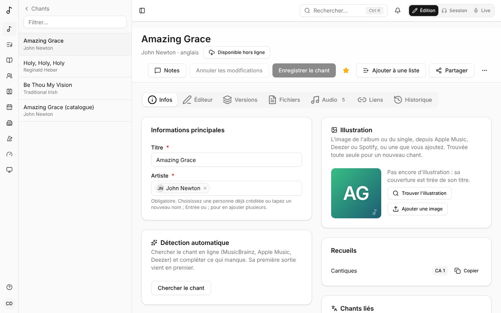

Un cadenas sur la pochette d'un chant, et à côté de son titre sur sa page, indique qu'il est **privé - vous seul·e le voyez** : il est à vous, partagé avec personne (une personne, une équipe ou une organisation), dans aucune liste d'une équipe ni une liste que vous avez partagée, et pas envoyé au [catalogue global](/fr/library/#proposer-au-catalogue-global). Partagez-le et le cadenas disparaît.

Ouverte depuis une liste - **Chants** tels que vous les avez cherchés et triés, vos **Favoris**, une liste intelligente, les chants d'un artiste ou un [recueil](/fr/songbooks/) - la page d'un chant montre où il se trouve (« 2 sur 12 · Favoris »), avec les chants d'avant et d'après de chaque côté : une touche mène au suivant, toujours dans la même liste.

Un chant a des onglets :

- **Infos** - son nom et ses artistes, et sous **Plus de détails** : compositeurs, auteurs et autres crédits, album, année, tonalité, tempo et la note qu'il compte (**Tempo en** : laissé sur **Habituel**, celle de la mesure, des noires en 6/8 - voir [le métronome](/fr/metronome/#mesure-et-motif)), mesure, le **Motif du métronome** de la version (celui de chaque musicien, sauf si vous en choisissez un), capo suggéré, durée, copyright, numéros CCLI et ISRC, une référence (par exemple le passage biblique dont il s'inspire), des notes et des étiquettes. Il liste aussi les recueils qui le contiennent.
- **Éditeur** - la grille elle-même. Voir [L'éditeur de chants](/fr/song-editor/).
- **Versions** - la façon dont vous et vos équipes le jouez et le chantez. Voir [Versions](/fr/versions/).
- **Fichiers** - partitions, fichier d'origine de la grille, images (25 Mo maximum chacun, sauf si votre administrateur a fixé d'autres limites ; l'onglet l'indique). Les PDF, images, fichiers audio et vidéo et le texte brut s'ouvrent dans le navigateur ; tout autre fichier (une page web, par exemple) est téléchargé, pour ne jamais pouvoir s'exécuter dans Songverse.
- **Audio** - des enregistrements pour apprendre ou répéter (MP3, Opus, M4A, WAV, OGG… 50 Mo maximum chacun, sauf si votre administrateur a fixé une autre limite), et les pistes du chant (voir plus bas). Importer des fichiers audio demande un rôle qui le permet (voir [Rôles](/fr/admin/#rôles)) ; sans cela, l'onglet le dit, et vous pouvez toujours [enregistrer une piste](/fr/library/#enregistrer-une-piste) dans Songverse.
- **Liens** - le chant sur Spotify, Apple Music, Deezer et YouTube. Collez un lien, ou trouvez-le : la loupe à côté d'un service (**Chercher sur Spotify**…) y cherche le chant par son titre et son premier artiste et liste quelques résultats, avec leur pochette, leur artiste et leur album (la chaîne d'une vidéo, sur YouTube) ; choisissez-en un et il est enregistré comme lien. Apple Music et Deezer peuvent toujours être cherchés ; Spotify et YouTube une fois que votre administrateur les a configurés. En dessous, les [enregistrements de référence](/fr/library/#enregistrements-de-référence) du chant.

Les modifications des onglets **Infos** et **Éditeur** sont enregistrées ensemble par **Enregistrer le chant** ; les fichiers, l'audio et les liens sont enregistrés dès que vous les ajoutez. **Annuler les modifications** retire ce qui n'est pas enregistré. Le menu **⋯** permet d'**Exporter en ChordPro** ou de **Supprimer le chant**.

### Illustration

L'image d'un chant est l'illustration de l'album ou du single où il figure, depuis Apple Music, Deezer ou Spotify (selon les réglages de votre administrateur), conservée sur le stockage de Songverse. Un nouveau chant la reçoit tout seul, d'après son titre et son premier artiste, quand l'un d'eux a un résultat assez proche ; en attendant, sa couverture est tirée de son titre. Elle apparaît sur l'accueil de la bibliothèque, dans **Chants** et sur la page du chant - à côté de son titre, en Édition et en Session - pour tous ceux qui peuvent voir le chant.

Dans **Infos**, **Illustration** la montre. Si vous pouvez modifier le chant, **Trouver l'illustration** liste leurs résultats, chacun avec sa provenance - choisissez l'album ou le single d'où il vient ; sur un ordinateur, le survoler affiche son nom complet. S'il n'y est pas, **Ajouter une image** en prend une à vous : faites glisser et zoomez pour choisir le carré affiché, puis **Utiliser cette image**. **Retirer** l'enlève. Les images sont gardées carrées, en 800×800 maximum.

Voilà le chant en mode **Édition**. En **Session**, sa page est la grille elle-même, lue avec vos réglages d'accords, avec sa tonalité, son capo et son tempo, et l'enregistrement ou les pistes du chant en bas (voir [Pistes](/fr/library/#pistes)). En haut : le titre du chant et ses artistes, puis sa tonalité, son tempo et sa mesure (**100 BPM · 4/4**) avec le métronome et sa version (quand le chant en a d'autres, la version ouvre la liste pour passer à l'une d'elles). À côté du titre, **Affichage** ouvre le panneau [Affichage](/fr/display/) de la Session - taille du texte, noms des accords, diagrammes, colonnes (**Auto**, autant que la place le permet, **1**, **2** ou **3**) et plus - et **Notes** les [notes](/fr/notes/) du chant ; **Ajouter à une liste** et **Modifier** (retour à l'édition) suivent sur un écran plus large, et sur un téléphone ils sont dans le menu **Plus** (**…**), avec **Live**. Sur un écran large, la grille se répartit en colonnes, sans jamais couper une section entre deux. **Grille** / **Mesures** au-dessus lit le chant en mesures (voir [Grille en mesures](/fr/metronome/#grille-en-mesures)). Quand le chant a un PDF (une partition, la grille d'où il vient), **PDF** à côté bascule vers les pages du PDF - s'il y en a plusieurs, choisissez lequel ; un long PDF montre sa première page pendant que la suite arrive - ici, sur sa page dans une liste et en Live. Songverse retient votre choix pour le chant sur votre compte : chaque appareil où vous êtes connecté - la tablette sur scène aussi - l'affiche de la même façon ; pour les chants où vous n'avez rien choisi, votre réglage **Lire les chants en** décide (voir [Affichage des grilles](/fr/account/#affichage-des-grilles)). En **Live**, il s'ouvre comme les chants d'une liste.

En Session, le **Défilement** en bas à droite (deux flèches vers le bas) avance dans la grille, ses mesures ou son PDF au fil du chant, comme en [Live](/fr/sets/#jouer-une-liste-en-live) : ligne par ligne, sur la **Durée** du chant quand il en a une, sinon à son tempo, et avec les pistes, l'enregistrement ou le métronome pendant qu'ils jouent (il affiche alors **Avec la musique**). La tortue et le lièvre à côté le ralentissent ou l'accélèrent. Sa durée est la pastille à côté de la tonalité : **3:40**, ou **~3:40** quand elle est calculée d'après le tempo ; à votre propre tempo de travail, la durée du chant est ajustée d'autant. La vue Pistes a sa propre tête de lecture : le défilement n'y est pas.

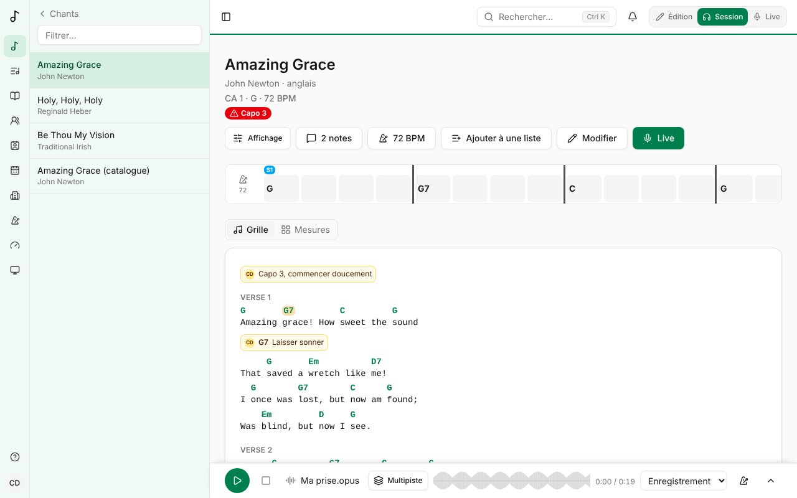

Le **Capo suggéré** n'est qu'une suggestion (par exemple le capo de l'enregistrement) : il s'applique quand une version n'indique pas le sien.

Un chant peut aussi vous être partagé par une de vos [personnes](/fr/people/) : il est marqué **Partagé par** elle, et vous pouvez le lire, ou aussi le modifier si elle a choisi **Peut modifier**.

Si un chant n'est pas à vous (un chant global, ou un chant d'équipe dont vous n'êtes pas administrateur), vous pouvez le lire, en faire votre version et y ajouter vos propres fichiers (voir [Qui voit un fichier](/fr/library/#qui-voit-un-fichier)), mais pas le modifier.

### Les paroles, pour les chanteurs

**Paroles**, à côté de **Grille** et **Mesures**, lit le chant comme un chanteur : ses paroles seules, en grand, dans l'ordre où on les chante - un refrain chanté deux fois s'affiche deux fois - chaque partie nommée par une petite étiquette (**Couplet 1**, **Refrain**), et une partie sans paroles en une ligne discrète avec ses mesures (**Intro · Instrumental · 4 mesures**). Au-dessus, la barre des parties montre ses parties dans l'ordre, celle que vous lisez entourée ; touchez-en une pour y aller. En bas, **Ensuite** dit ce qui suit la partie que vous lisez, avec ses premiers mots. Quand la musique joue - l'enregistrement du chant, ses pistes ou le métronome - et que ses temps sont placés dans ses paroles (voir [Placer les temps dans les paroles](/fr/metronome/#placer-les-temps-dans-les-paroles)), la ligne chantée ressort, ses mots se remplissant au fil du chant, et les lignes déjà chantées s'estompent. Sa lecture - sa taille, **Ligne par ligne**, les reprises, de petits accords - se règle dans la partie **Paroles** du panneau [Affichage](/fr/display/). Elle est gardée pour le chant comme **Grille** et **Mesures**, donc le Live l'affiche aussi, et **Lire les chants en** peut en faire votre choix par défaut (voir [Affichage des grilles](/fr/account/#affichage-des-grilles)).

### La batterie, pour les batteurs

**Batterie**, à côté de **Paroles**, lit le chant de derrière une batterie : tout son fond est le métronome, une colonne par temps de la mesure - quatre en 4/4, six en 6/8 - qui s'allume à chaque temps dans la couleur de son niveau (accent orange, moyen bleu, petit gris). Par-dessus, les parties du chant dans l'ordre où elles sont jouées, en grandes étiquettes avec leurs mesures, celle qu'on joue en blanc avec la mesure où l'on est (**3/8**) ; son nom avec **Mesure 3 sur 8** ; le tempo et la mesure en grand, avec le temps compté ; la ligne chantée et la suivante ; les notes pour le groupe sur cette partie ; et en bas **Ensuite** avec la partie suivante, ses mesures et ses premiers mots. Quand la musique joue - les pistes ou l'enregistrement du chant, le métronome, ou celui du meneur en lecture synchronisée - elle suit toute seule ; sinon, **Partie suivante**, la flèche à côté, une étiquette touchée ou les touches page d'un pédalier (**Page suivante**, **Page précédente**) font passer d'une partie à l'autre. Les paroles et la partie suivante se masquent dans la section **Batterie** du panneau [Affichage](/fr/display/), et la luminosité des colonnes est celle de la section **Métronome**. Elle est gardée pour le chant comme les autres vues, donc le Live l'affiche aussi, et **Lire les chants en** peut en faire votre choix par défaut (voir [Affichage des grilles](/fr/account/#affichage-des-grilles)).

## Supprimer un chant

**Supprimer le chant**, dans le menu **⋯** d'un chant que vous pouvez modifier, dit d'abord où d'autres l'utilisent : leurs listes de chants et celles de leurs équipes, les recueils qui ne sont pas les vôtres, et les fichiers, versions et notes que d'autres y ont. S'il est dans une liste de chants de l'une de vos équipes ou partagé avec l'une d'elles, **Le donner à** cette équipe à la place : le chant devient celui de l'équipe (ou est proposé à ses administrateurs, si vous n'en êtes pas un), et reste là où il est utilisé.

**Mettre à la corbeille** retire le chant de la vue de tous - la bibliothèque, les listes de chants, les recueils - pendant 30 jours. Les listes de chants gardent sa place, vide, jusqu'à son retour. La **Corbeille**, sous **Bibliothèque** dans la barre latérale, liste ce que vous avez supprimé et les chants à vous ou à vos équipes que quelqu'un d'autre a supprimés, avec la date où chacun part pour de bon. **Remettre** remet un chant là où il était, avec ses fichiers, versions, notes et historique ; **Supprimer pour de bon** le supprime tout de suite, après confirmation. Après 30 jours, il est supprimé pour de bon de lui-même.

## Traductions et adaptations

Une traduction ou une adaptation (paroles simplifiées, pour enfants) est un chant à part entière - son propre titre, sa langue, son propriétaire, ses [versions](/fr/versions/) et ses fichiers - lié au chant dont il vient. Sa page le dit (« Traduction de Amazing Grace »), et **Traductions et adaptations**, dans **Infos**, liste les chants liés à celui-ci. **Ajouter une traduction** commence un nouveau chant lié à lui. Vous pouvez traduire un chant du catalogue et garder votre traduction pour vous, ou la proposer au catalogue elle aussi.

Dans une liste, un chant qui a des traductions ou adaptations peut passer à l'un d'eux (sa **Traduction**).

## Enregistrements de référence

En plus de son lien par service, un chant peut avoir plusieurs **enregistrements de référence** sur lesquels jouer : une vidéo en live, une version acoustique, une répétition. Dans l'onglet **Liens**, sous **Enregistrements de référence**, collez son **Adresse** (YouTube, Spotify, Apple Music, Deezer ou n'importe quelle adresse web), donnez-lui un **Nom** (« Live 2019 ») et, s'il le faut, l'endroit où il commence (**Commencer à**, en secondes ; une adresse YouTube avec `t=` le dit déjà). **Ajouter l'enregistrement** le garde. Comme un fichier, il est à vous : vous seul le voyez, sauf si vous le partagez avec l'une de vos équipes, et qui gère le chant peut le montrer à tous ceux qui voient le chant (voir [Qui voit un fichier](/fr/library/#qui-voit-un-fichier)).

Une [version](/fr/versions/) peut en choisir un comme **Enregistrement de référence**, et l'un des multipistes du chant comme **Pistes** : c'est ce qui se joue quand un set joue le chant dans cette version.

## Qui voit un fichier

Chaque fichier des onglets **Fichiers** et **Audio** a son propre réglage **Visible par**, choisi par qui l'a ajouté :

- **Moi seulement** - vous seul·e. C'est le réglage des nouveaux fichiers : enregistrements et pistes sont souvent sous le droit d'auteur de quelqu'un d'autre.
- **Groupe du matin (équipe)** - vous et les membres de cette équipe (une de vos équipes).
- **Les personnes avec qui je le partage** - vous et les [personnes avec qui le chant est partagé](/fr/people/#partager-un-chant), pour qui le partage (un chant personnel ou d'équipe).
- **Tous ceux qui voient ce chant** - pour qui peut modifier le chant.

Choisissez-le avant d'ajouter des fichiers, sous la zone de dépôt, ou changez-le ensuite sous le fichier. Les autres voient qui a partagé un fichier (« Partagé par Hugo avec Groupe du matin ») ; un fichier que vous ne pouvez pas voir n'apparaît nulle part, ni dans le chant, ni dans ses listes, ni en Session, ni hors ligne.

Toute personne qui voit un chant peut y ajouter ses propres fichiers, même sans pouvoir le modifier : ils sont à elle, et elle seule les voit sauf si elle les partage avec une de ses équipes. Ceux qui modifient le chant peuvent supprimer les fichiers qu'ils voient, mais seul·e le ou la propriétaire d'un fichier choisit qui le voit.

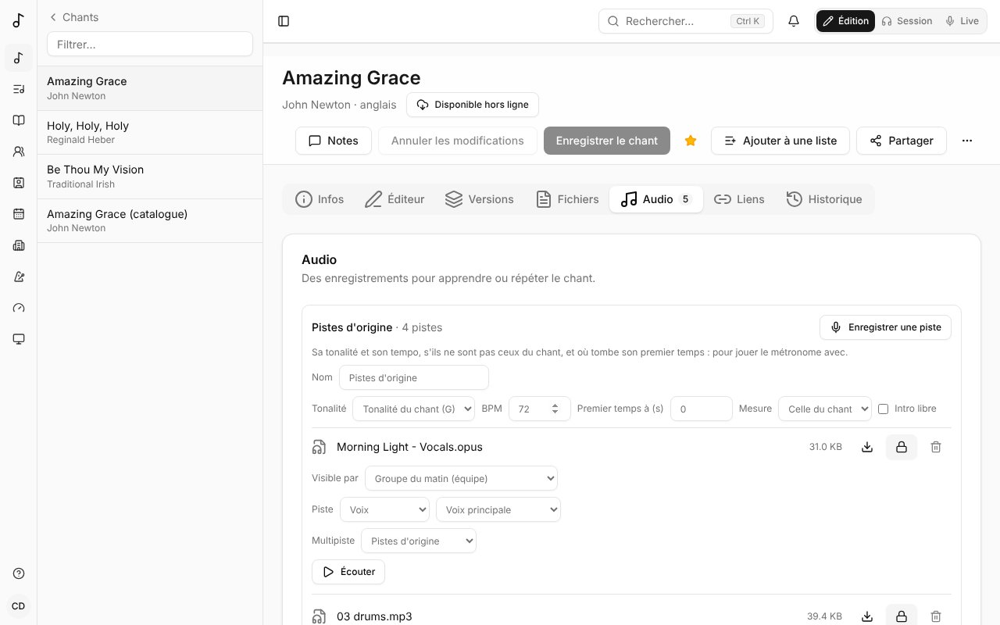

## Les fichiers audio et leurs originaux

Un fichier audio au-delà de 320 kb/s - sa taille pour sa durée : un WAV, FLAC ou AIFF - est converti en Opus en arrière-plan après son envoi, une fraction de la taille, tel quel : rien n'est coupé, il reste en place avec son multipiste. **En cours de traitement…** s'affiche dessous jusque-là. Les fichiers MP3, AAC ou Opus sont gardés tels qu'envoyés.

Avec un rôle qui garde les originaux sans perte (voir [Rôles](/fr/admin/#rôles)), l'original est gardé aussi, en FLAC - un WAV à sa fréquence d'échantillonnage et sa résolution, un FLAC tel quel - à côté de la copie Opus qui est jouée. **FLAC**, à côté du bouton de téléchargement du fichier, le télécharge ; les pistes en sont séparées plutôt que de la copie. Les deux comptent dans votre stockage.

## Ce qui joue

En mode **Session**, **Ce qui joue** choisit ce qui joue avec le chant : dans le lecteur en bas de la page d'un chant, et en haut de sa page dans une liste :

- **Master** - son enregistrement, un seul fichier : le plus rapide à charger.
- **YouTube** - sa vidéo (l'enregistrement de référence de la version quand c'est une vidéo YouTube, sinon celle du chant).
- **Pistes** - ses pistes, sans les parties que d'autres y ont enregistrées.
- **Pistes + prises** - ses pistes avec ces enregistrements (voir [Enregistrer une piste](/fr/library/#enregistrer-une-piste)).
- **Métronome seul** - le métronome au tempo et à la mesure du chant, avec votre motif et votre son.
- **Rien**.

Seul ce que le chant a est proposé. Tant que vous n'avez rien choisi, le master joue quand il y en a un, sinon les pistes (avec les prises), sinon la vidéo, sinon le métronome quand le chant a un tempo. Songverse garde votre choix sur votre compte, pour le chant et pour chaque page de chant d'une liste : il vous suit sur vos autres appareils. Seul ce que vous choisissez est téléchargé : les pistes que vous n'avez pas choisies attendent **Lecture**. Choisir autre chose pendant la lecture reprend là où on en était. Sur la page d'un chant d'une liste, le chant suivant est récupéré à l'avance pendant que vous y êtes, pour que sa **Lecture** soit rapide.

**Lecture** démarre les pistes dès que toutes celles que vous entendez sont arrivées, ensemble ; la page les télécharge à l'avance pendant que vous lisez, si bien que c'est en général immédiat. Les pistes coupées peuvent être encore en route : elles rejoignent les autres, en rythme, dès leur arrivée (**Les pistes coupées suivent dès leur arrivée…**). Enregistrer une piste attend qu'elles soient toutes là.

En jeu synchronisé, le choix du meneur est celui de tous : le **Ce qui joue** des autres l'affiche, avec le nom du meneur (voir [Jouer en synchro](/fr/sets/#jouer-synchronisé)).

**Le tempo** sous le titre du chant (**100 BPM**, à côté du métronome, la mesure après lui) est un bouton en Pratique : **−** et **+**, ou tapez-le, pour travailler plus lentement ou plus vite. C'est le vôtre : le métronome, les mesures et le clic de la grille le jouent, sur vos appareils, jusqu'à **Revenir au tempo du chant (100)** ; le chant garde son propre tempo, et un point indique que le vôtre est différent. Les pistes et les enregistrements gardent leur propre vitesse (voir [Pistes](/fr/library/#pistes)).

## Pistes

Les pistes (ou stems) sont les parties du chant enregistrées séparément : voix, batterie, basse, etc. Importez-les dans l'onglet **Audio**. Un fichier nommé d'après sa partie (« Voix.mp3 », « 03 drums.opus », « Basse.mp3 », « Alto.wav ») devient cette piste tout seul. Pour les autres fichiers, choisissez sa partie sous le fichier, en deux temps :

- **Voix** : **Voix principale**, une harmonie - **Harmonie 1 (soprano)**, **Harmonie 2 (alto)**, **Harmonie 3 (ténor)**, **Harmonie 4 (basse)** - **Chœurs**, ou **Autre nom…** de votre choix (« Contre-chant »).
- **Instrument** : **Batterie**, **Basse**, **Guitare**, **Piano et claviers** ou **Autres**, avec un nom si vous voulez (« Guitare acoustique », « Violon »).
- **Repères** : le clic, les décomptes et les repères parlés, avec un nom (« Clic », « Guide »).

**Pas une piste** est pour un enregistrement complet. Une piste enregistrée par quelqu'un d'autre dit qui, dans le lecteur de pistes (**Enregistrée par** sous son nom) et sous le fichier. Sur une piste enregistrée dans un multipiste, ou quand les pistes d'un chant viennent de plusieurs personnes, le bouton rond du lecteur porte la photo de qui l'a enregistrée (ou ses initiales).

Si les pistes (ou un enregistrement) ne sont pas dans la tonalité du chant ou à son tempo, une version live un ton plus haut par exemple, indiquez les leurs dans le cadre des pistes au-dessus des fichiers (ou sous le fichier) : **Tonalité** et **BPM**, et **Mesure** pour sa mesure. Laissés sur **Tonalité du chant**, vides et sur **Celle du chant**, ce sont ceux du chant. **Premier temps à (s)** indique où tombe son premier temps, en secondes depuis son début (vide : à 0:00) : avec le tempo, il place le métronome sur l'enregistrement. Cochez **Intro libre** quand ce qui précède ce premier temps est joué librement, hors du temps : le métronome l'attend alors. Quand le clic ne tombe pas tout à fait juste, utilisez **Déplacer le 1** pendant qu'il joue : **−1** et **+1** déplacent le 1 de la mesure d'un temps plus tôt ou plus tard (les temps restent où ils sont), et **−10 ms** et **+10 ms** avancent ou retardent tous les temps un peu. Le clic, les mesures et les repères des sections bougent ensemble, et les temps que la [séparation des pistes a trouvés](/fr/library/#séparer-un-enregistrement-en-pistes) sont gardés, ce que ne fait pas la saisie d'un nouveau premier temps.

En mode **Session** (voir [Édition, Session et Live](/fr/getting-started/#édition-session-et-live)), un chant qui a un enregistrement ou des pistes affiche le lecteur de pistes en bas de sa page, et de sa page dans une liste. Il s'ouvre réduit, sur une ligne : **Lecture**, et ce qu'il joue - le nom de l'enregistrement, ou celui du multipiste et son nombre de pistes. Ce qu'il joue se choisit avec [Ce qui joue](/fr/library/#ce-qui-joue). Les commandes propres aux pistes - couper, solo, le mixage - sont dans le lecteur agrandi.

À côté de **Lecture**, **Arrêter, retour au début** (le carré) arrête les pistes et les ramène au début. Quand l'écran est assez large, le lecteur réduit montre aussi la forme d'onde de ce qui est entendu, les pistes combinées, à côté de ce qu'il joue : cliquez dessus pour vous y rendre.

La flèche au bout l'agrandit : une ligne par partie avec un bouton rond à son instrument (un micro pour la voix, une batterie, une clé de fa, une guitare, un piano…) - touchez-le pour couper cette partie et jouer avec le reste, de nouveau pour la remettre - sa forme d'onde et **S** (solo : ne joue que les parties en solo, vert quand il est actif). Sur un écran plus large, **M** (couper) est à côté de **S**, comme sur une table de mixage. La ligne en haut du lecteur montre où en est la lecture, dans les deux vues : cliquez ou faites-la glisser pour aller ailleurs dans le chant (ou utilisez les flèches du clavier). Pendant un solo, un bouton rond retire sa partie du solo ou l'y ajoute ; retirez la dernière pour entendre de nouveau toutes les parties. Cliquez sur une forme d'onde pour vous y rendre. La forme d'onde de chaque piste a sa longueur : une prise qui s'arrête avant la fin du chant s'y arrête aussi. **Combiner les pistes** (le bouton calques) affiche les boutons ronds des pistes et une seule forme d'onde de ce qui est entendu au lieu d'une ligne par piste, pour laisser plus de place à la grille ; Songverse s'en souvient. Avec le **Mixage** activé aussi, le bouton et le curseur de chaque piste sont listés en compact en dessous. À côté du temps se trouvent les outils du lecteur : **Combiner les pistes**, **Mixage**, **Placer les sections**, **Enregistrer une piste** et **Clic avec l'enregistrement**. Sur un téléphone, le multipiste, la transposition et la vitesse passent sur une deuxième ligne. La flèche du haut le réduit de nouveau, ce qui désactive le **Mixage** ; il s'ouvre réduit sur la page de chaque chant. Les fichiers commencent à se télécharger dès que la page du chant s'ouvre en mode Session (la ligne du haut montre où il en est), si bien que **Lecture** est en général immédiat. En attendant, la forme d'onde de chaque partie est déjà là, pâle, et se remplit à mesure que son fichier arrive ; elle s'affiche normalement dès que la partie peut jouer. Une fois téléchargés, ils ne le sont plus de nouveau. Safari avant 18.4 (iPhone, iPad, Mac) ne sait pas lire les fichiers Opus que Songverse enregistre et sépare tels qu'ils sont stockés : Songverse les réemballe pour lui au chargement. Si une partie ne peut toujours pas être jouée, mettez l'appareil à jour.

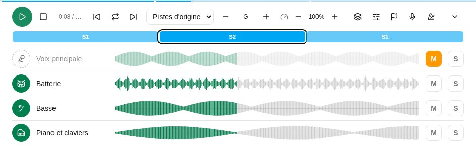

**Mixage** donne à chaque piste un curseur de volume : sur un téléphone, il est posé sur la forme d'onde de la piste ; sur un écran plus large, il est à côté. Chaque forme d'onde grandit ou rétrécit avec son volume, pour voir l'équilibre d'un coup d'œil, et la forme d'onde combinée le suit aussi. Songverse retient les volumes de chaque chant sur l'appareil ; **Réinitialiser le mixage** remet toutes les pistes au maximum.

#### Les sections d'un enregistrement

Une fois les sections placées sur un multipiste (voir plus bas), le lecteur les montre en bande au-dessus des pistes : chaque section à sa place, aussi longue qu'elle dure, aux couleurs de la barre de structure du mode Live (C1, R, P…), celle en cours entourée. Touchez-en une pour vous y rendre. Celle en cours est nommée à côté du temps (« 0:41 / 3:52 · Refrain »), et la ligne en haut du lecteur prend les couleurs des sections, vives là où la lecture est passée, pâles devant, pour voir la forme du chant même lecteur réduit.

Les sections placées, le lecteur a trois boutons de plus, à côté de **Lecture** (dans le lecteur réduit aussi, quand l'écran est assez large) : **Section précédente** (retour au début de celle en cours, ou à la précédente dans ses deux premières secondes), **Section suivante**, et **Boucler cette section** (les flèches en boucle), qui rejoue en boucle la section sous la tête de lecture, pour travailler un passage. La boucle commence et finit sur les barres de mesure de l'enregistrement les plus proches des repères de la section : elle boucle des mesures entières et le clic continue sans à-coup ; tant qu'elle est active, les boutons de section déplacent la boucle, et **Arrêter, retour au début** revient au début de la boucle. Touchez-le de nouveau pour continuer. Au clavier : **0** arrête, **[** et **]** vont à la section précédente et suivante, **L** boucle.

**Placer les sections** (le bouton drapeau), pour qui peut modifier les fichiers du multipiste, les place :

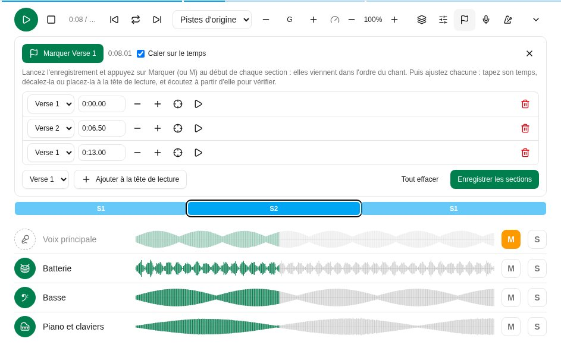

- Lancez l'enregistrement et appuyez sur **Marquer** (ou la touche **M**) au début de chaque section : elles viennent dans l'ordre du chant (« Marquer Couplet 1 », « Marquer Refrain »…), si bien que chanter l'ordre d'un bout à l'autre les place toutes.
- Puis ajustez chacune dans la liste : tapez son temps (« 1:02.35 »), décalez-la **Plus tôt** ou **Plus tard** (d'un temps, quand l'enregistrement a un tempo), **Placer à la tête de lecture**, ou **Écouter juste avant** pour vérifier à l'oreille. **Caler sur le temps** les garde sur les temps de l'enregistrement.
- Ou déplacez-les sur la bande elle-même, comme dans un logiciel de montage vidéo : pendant le placement, le début de chaque section a une poignée, affichée quand le pointeur survole la bande (toujours, sur un écran tactile). Faites-la glisser pour déplacer la section, calée sur le temps - maintenez **Alt** pour la placer n'importe où - ou donnez-lui le focus et utilisez les flèches : un temps à la fois, ou 10 ms avec **Maj**. Une section ne peut pas passer au-delà de ses voisines, et le temps s'affiche sous la poignée pendant qu'elle bouge. La bande et la liste restent synchronisées.
- **Ajouter à la tête de lecture** place n'importe quelle section, chantée plus souvent que l'ordre du chant ne le dit par exemple ; **Retirer** en enlève une.
- **Enregistrer les sections** les garde sur chaque fichier du multipiste, ses autres prises comprises. Elles désignent les sections du chant, et survivent donc à ses modifications.

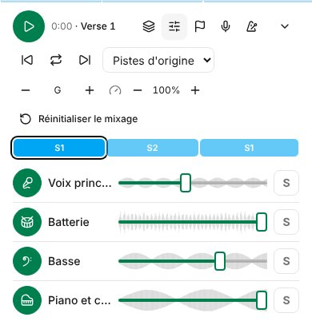

**Transposer** monte ou descend les pistes d'un demi-ton à la fois (**Un demi-ton plus haut**, **Un demi-ton plus bas**), pendant la lecture : pour la tessiture d'un chanteur, ou une autre tonalité. Entre les deux boutons, la tonalité entendue : « B (+2) » pour des pistes en A. La ligne de chaque piste a alors son bouton flèches, **Transposer** (le nom de la piste) : enfoncé, la piste est transposée ; relâché, elle joue telle qu'enregistrée. La batterie, le clic et les repères commencent relâchés, toutes les autres pistes enfoncées. Songverse retient la transposition, et quelles pistes sont transposées, pour chaque chant sur l'appareil. En jeu synchronisé, ce sont celles du meneur.

Une prise enregistrée pendant que les pistes étaient transposées est chantée dans cette tonalité, et sa ligne le dit (« chantée à +2 »). Le lecteur la décale de la différence : à +2, elle joue telle que chantée ; à 0, elle est descendue de 2 pour aller avec le reste. Sur la page d'un chant dans une liste, les pistes sont transposées dans la tonalité de la liste, sauf si vous choisissez autrement : des pistes en A, pour une liste en C, jouent en C (+3).

**Vitesse** joue les pistes plus lentement ou plus vite dans la même tonalité, de 50 % à 150 % par pas de 5 % (**Plus lent**, **Plus rapide**), pour apprendre lentement un passage difficile ou prendre le chant à un autre tempo. Le pourcentage entre les deux boutons la ramène à 100 %. La tête de lecture, les formes d'onde et les sections restent dans le temps de l'enregistrement. Tant que la vitesse n'est pas à 100 %, la piste de clic et de repères se tait, car un clic étiré bave, et le métronome joue son temps au nouveau tempo à sa place. L'enregistrement attend le retour à 100 % : une prise chantée sur des pistes ralenties ne tomberait pas juste à pleine vitesse. Songverse retient la vitesse pour chaque chant sur l'appareil, et le lecteur réduit l'affiche (« 80 % »). En jeu synchronisé, la vitesse du meneur est celle de tous. Une vidéo YouTube a la même commande **Vitesse**.

Le bouton du métronome à côté, **Clic avec l'enregistrement**, joue le [métronome](/fr/metronome/) avec les pistes : au tempo de l'enregistrement (ou du chant), son premier temps là où tombe celui de l'enregistrement, avec votre motif et votre son. Il bat dès 0:00, sur le temps de l'enregistrement, même quand son premier temps vient plus tard : le décompte sert à l'enregistrement. Avec **Intro libre** cochée pour l'enregistrement, ou **Décompte seulement** sur la page Métronome, il attend le premier temps, avec votre décompte avant. Il suit **Lecture**, la pause, la tête de lecture et une boucle. Quand la séparation des pistes a trouvé les temps de l'enregistrement, chaque clic tombe dessus : il reste avec un groupe qui accélère ou ralentit un peu. Il passe par le lecteur lui-même, sur la même horloge audio que les pistes. En jeu synchronisé, celui du meneur est celui de chacun (voir [Jouer synchronisé](/fr/sets/#jouer-synchronisé)).

Le chant continue de jouer quand vous allez sur une autre page ou quittez le mode Session, et sur un téléphone écran verrouillé, où l'écran de verrouillage peut aussi le mettre en pause. L'écran de verrouillage (et les commandes multimédia d'un ordinateur) montre le titre du chant, ses artistes et sa pochette - ou, sans pochette, la couverture faite de son titre, comme dans la bibliothèque. Un petit bouton en bas à droite montre ce qui joue : touchez le nom du chant pour y revenir, ou mettez-le en pause de là.

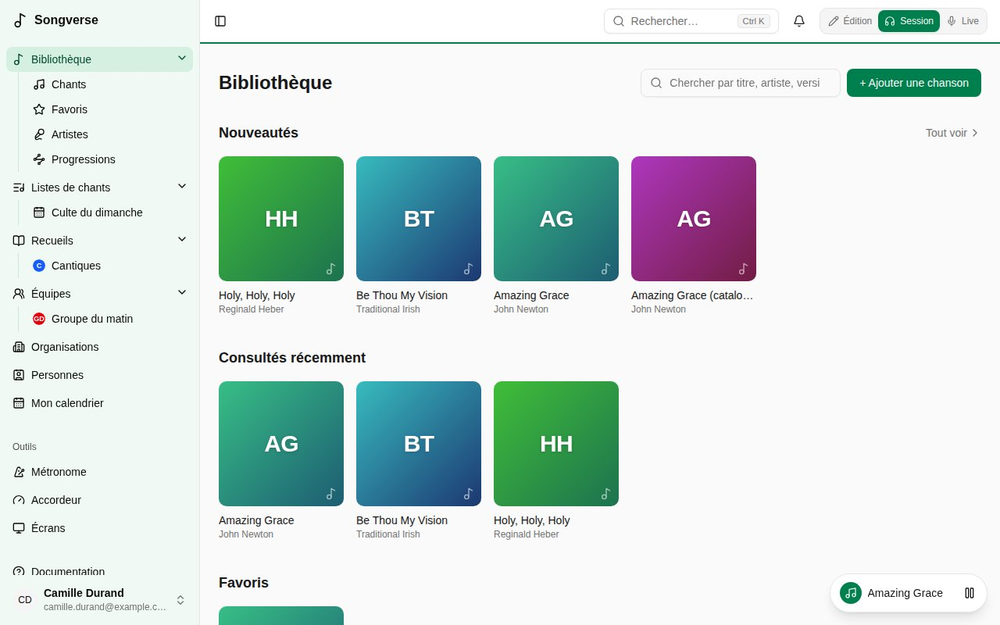

Le master, le dernier enregistrement du chant, joue dans le même lecteur, comme une seule partie. **YouTube** dans [Ce qui joue](/fr/library/#ce-qui-joue) - le choix par défaut d'un chant sans audio mais avec un lien YouTube (onglet **Liens**) - y joue sa vidéo, et les parties ne peuvent pas être séparées. Le lecteur s'ouvre réduit, sur une ligne : **Lecture** l'agrandit et joue, car YouTube ne joue qu'une vidéo affichée - à côté des commandes, ou au-dessus d'elles, de toute la largeur d'un téléphone. **Réduire le lecteur** (la flèche) met la vidéo en pause pour la même raison. **Vitesse** fonctionne comme pour les pistes, mais une vidéo YouTube ne peut pas être transposée : le lecteur de YouTube ne laisse pas modifier son son. Pour jouer le chant dans une autre tonalité, ajoutez son enregistrement à l'onglet **Audio**. La ligne en haut est aussi sa tête de lecture : cliquez ou faites-la glisser pour aller ailleurs dans la vidéo. Elle continue dans une petite fenêtre en bas à droite quand vous allez sur d'autres pages ; le nom du chant vous y ramène. YouTube s'arrête quand le téléphone se verrouille et ne joue pas hors ligne : dans ces cas, ajoutez l'enregistrement dans l'onglet **Audio**.

Les pistes gardées sur votre appareil pour le hors ligne (**Avec l'audio**, voir [Hors ligne](/fr/offline/)) se lisent aussi hors ligne.

### La vue Pistes

**Pistes**, à côté de **Grille** et **Mesures** au-dessus d'un chant qui a des pistes (en Session, et sur sa page dans une liste), montre ses pistes en couloirs, comme dans un logiciel de studio. La mesure jouée s'affiche à droite de ces boutons. Le lecteur doit avoir chargé les pistes du chant : appuyez une fois sur **Lecture**. Pendant leur téléchargement, les couloirs montrent déjà la forme d'onde de chaque partie, pâle, qui se remplit à mesure que son fichier arrive.

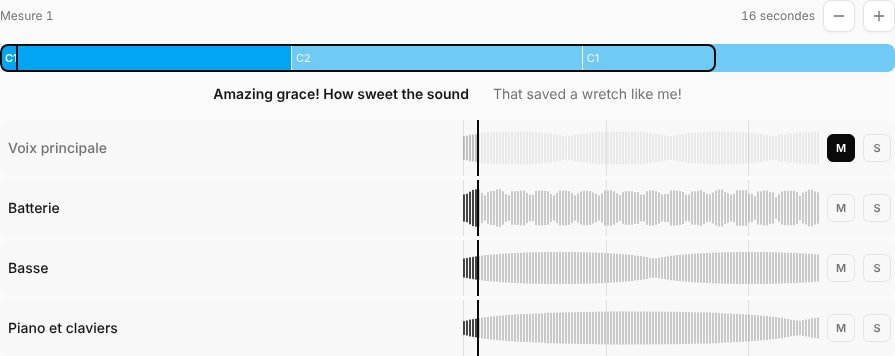

- **En haut**, les sections de tout le chant (une fois [placées](/fr/library/#les-sections-dun-enregistrement)), avec un cadre autour du passage montré dans les couloirs. Touchez-le pour y aller.
- **Les paroles** chantées, avec la ligne d'avant et celle d'après.
- **Un couloir par piste** : sa forme d'onde, une forme pleine sous la tête de lecture, plus foncée sur ce qui a été joué, avec les mesures marquées. Chaque piste a sa couleur (les voix en vert, la batterie en orange, la basse en violet, les claviers en bleu...) ; **Une couleur par partie** (le bouton palette) les retire ou les remet, et **Lignes fines** (le bouton à côté) dessine chaque forme d'onde en fines lignes plutôt qu'en forme pleine ; les deux sont gardés sur cet appareil. **M** et **S** la coupent ou la mettent en solo, comme dans le lecteur, et une piste coupée est pâle. Touchez un couloir pour aller à cet endroit.
- **Métronome**, sous les pistes quand le chant a un tempo : un trait pour chaque clic que le métronome joue avec l'enregistrement, aussi haut qu'il est fort (les accents les plus hauts, puis les temps moyens et petits ; rien pour un temps coupé), sur le [motif](/fr/metronome/) du chant ou le vôtre. Son bouton (le métronome) est **Clic avec l'enregistrement**, comme dans le lecteur : allumé, le clic joue avec les pistes ; éteint, le couloir est pâle.
- **Zoomez** avec **-** et **+**, de 8 secondes à tout le chant.
- **Sur un téléphone**, les couleurs, les lignes fines et le zoom sont dans la section **Pistes** du panneau [Affichage](/fr/display/), pour laisser la place aux couloirs.
- **Pendant que vous enregistrez une piste** dans le lecteur, la prise a son propre couloir rouge, qui grandit à mesure que vous chantez. Avec les couloirs à l'écran, le lecteur ne montre que l'enregistreur, puisque les couloirs ont déjà les pistes.

Le choix est gardé pour le chant sur cet appareil. Live lit le chant comme avant.

### Multipistes

Un chant peut avoir plus d'un jeu de pistes : ses **Pistes d'origine**, et des multipistes - des pistes enregistrées ensemble, une autre version ou vos propres couches (voir [Enregistrer une piste](/fr/library/#enregistrer-une-piste)). Chacun a son cadre dans l'onglet **Audio**, avec son **Nom**, son nombre de pistes (et d'autres prises), la liste pour laquelle il a été enregistré s'il y en a une (**Pour aucune liste** l'en retire), et ce dans quoi ses pistes ont été enregistrées : tonalité, tempo, mesure et premier temps, qu'elles partagent. Ses fichiers sont listés dans son cadre : ses pistes d'abord - importées ou séparées - puis **Enregistrements**, les pistes que des personnes y ont enregistrées dans Songverse, chacune disant qui et quand, pour ne jamais les confondre avec les pistes. Elles se jouent toujours avec les pistes de ce multipiste. Sous une piste, la liste **Multipiste** la déplace dans un autre, ou dans un **Nouveau multipiste** à elle : importez les fichiers d'une autre version, puis rassemblez-les ainsi.

En mode **Session**, le lecteur de pistes joue un multipiste à la fois : quand un chant en a plusieurs, la liste à côté du temps passe de l'un à l'autre (**Pistes d'origine**, puis les autres par leur nom, ou **Multipiste 2**… ; l'enregistrement du chant est le **Master** de [Ce qui joue](/fr/library/#ce-qui-joue)). Songverse retient votre choix pour chaque chant sur l'appareil, et pour chaque page de chant d'une liste. En jeu synchronisé, chacun joue le multipiste du meneur, avec ses propres fichiers.

### Séparer un enregistrement en pistes

Quand un admin a configuré la séparation en pistes et vous y a autorisé (vous ou votre équipe) - ou quand votre équipe ou votre organisation a connecté son propre serveur (voir [Votre propre serveur de séparation](/fr/sonic/)) - **Séparer en pistes** sous un enregistrement de l'onglet **Audio** le sépare en ses pistes sur un serveur de séparation : **4 pistes : voix, batterie, basse, autre** (par défaut), **6 pistes : plus guitare, piano**, ou **2 pistes : voix et instrumental**. Ne séparez qu'un enregistrement que vous avez le droit d'utiliser ainsi. Sur le serveur d'une équipe ou d'une organisation, la fenêtre le dit : **Sur le serveur Sonic de Grace Church**.

Les premières pistes arrivent en quelques minutes dans un nouveau multipiste nommé d'après ses pistes, **Séparé (4 pistes)**, verrouillé, dans la tonalité et le tempo de l'enregistrement et avec ses sections, et avec la même visibilité que lui. La liste **Séparations en pistes** sous les fichiers dit où en est chacune : **En attente**, **Séparation…**, **Prêt - une version plus fine arrive** - une séparation plus lente et meilleure qui remplace les pistes sur place quand le serveur a le temps, souvent la nuit - puis **Prêt**, avec **Haute qualité** une fois la version plus fine arrivée. 6 pistes n'ont pas de version plus fine : il n'existe pas de modèle plus fin pour 6. La liste, et le cadre du multipiste, nomment aussi les modèles utilisés (**Modèles : htdemucs → htdemucs_ft**), et la liste garde le nom de l'enregistrement après sa suppression - le supprimer n'empêche pas la version plus fine, que le serveur a déjà. Une séparation échouée dit pourquoi, avec **Réessayer**. La page vérifie d'elle-même ; les pistes comptent dans votre espace de stockage.

Là où l'enregistrement n'a ni tonalité, ni tempo, ni mesure, ni premier temps, ni sections, le serveur a pu les trouver : son cadre les montre sous **Vérifier ce que Sonic a trouvé** (Em, 72 BPM, 3/4, sections…), chacun avec la certitude de l'analyse : *sûr*, *assez sûr* ou *une supposition*. À côté de chacun, ce qu'il pourrait être d'autre : une autre tonalité est appliquée tout de suite, et un autre tempo, une autre mesure ou une autre mesure 1 demande à Sonic de réécouter avec (Sonic 1.11 ou plus récent) - les temps, les mesures et les sections sont alors retrouvés autour de votre choix, sur les mêmes pistes, sans compter comme une séparation. Un détail dont l'analyse n'était pas assez sûre reste vide, avec ce qu'elle a entendu proposé à côté. **C'est juste** les garde tous, et en changer un le confirme. Des pistes séparées avant que le chant ait des paroles le disent : dès que la grille a des paroles, Sonic replace les sections avec elles de lui-même, là où ce sont encore ses suppositions - ou **Les placer d'après les paroles maintenant** le demande tout de suite. Les sections trouvées sont placées sur celles du chant, dans l'ordre - vérifiez-les dans **Placer les sections**. Les paroles et les accords du chant partent au serveur avec l'enregistrement, dans l'ordre où ils sont chantés : un serveur à partir de Sonic 1.9 trouve où commence chacune des sections du chant sur les mesures de l'enregistrement - un refrain de plus ou un instrumental absent de la grille compris - si bien que ses sections sont les vôtres, prêtes à boucler. L'analyse peut aussi trouver les temps et les mesures de l'enregistrement (**24 mesures, temps par temps**) : la [ligne des mesures](/fr/metronome/#mesures) suit alors l'enregistrement lui-même, même quand il accélère ou ralentit, et une ouverture libre active **Intro libre**. Indiquer le tempo ou le premier temps à la main les met de côté. Ce que l'enregistrement dit déjà n'est jamais remplacé.

Pour le séparer de nouveau - 6 pistes après 4, par exemple - utilisez encore **Séparer en pistes**. **Remplacer les pistes précédentes** (coché) met les nouvelles à la place de celles de la dernière séparation : leurs sections et leur nom sont repris, et les enregistrements faits dedans passent dans les nouvelles. Décochez-le pour garder les deux.

### Enregistrer une piste

Vous pouvez enregistrer une piste directement dans Songverse, sur un ordinateur, un téléphone ou une tablette avec un micro :

- **Enregistrer un nouveau multipiste**, en bas de l'onglet **Audio** : la première couche d'un chant, ou une autre version, avec le métronome seul. Donnez-lui un **Nom**, un **Tempo (BPM)** et une **Mesure** (ceux du chant pour commencer ; le tempo d'un enregistrement compte les temps de sa mesure, donc un chant en 6/8 à 71 en noires commence à 142). Le clic joue le motif du métronome pour la mesure : celui de la version, sinon le vôtre. Il commence par une mesure de décompte, qui est gardée : le premier temps du multipiste tombe une mesure plus loin.
- **Enregistrer une piste**, dans le cadre d'un multipiste : une autre piste de ce multipiste, en entendant les autres (décochez-en une sous **Entendre** pour la laisser de côté) et le clic, à son tempo, avec une mesure de décompte avant son premier temps.

#### L'enregistreur

L'enregistreur est le même partout. Dans le lecteur de pistes, le bouton micro l'ouvre comme onglet **Enregistrer** du lecteur, à côté de son onglet **Mix** (les pistes, leurs coupures et solos) : sur un téléphone on passe de l'un à l'autre, et l'onglet **Enregistrer** laisse le multipiste, la transposition et la vitesse à l'onglet **Mix** - pendant une prise, le lecteur ne garde que **Lecture**, le temps et le bouton micro ; sur un écran plus large ils sont côte à côte, ou l'un au-dessus de l'autre sur un écran en hauteur comme une tablette tenue verticalement. Ailleurs - **Enregistrer une piste** dans le cadre d'un multipiste de l'onglet **Audio**, **Enregistrer un nouveau multipiste** - il s'ouvre dans un tiroir en bas de l'écran. Aucun ne bloque la page : la grille et les paroles restent utilisables, et suivent la musique pendant l'enregistrement - la ligne chantée allumée dans la partition, la mesure dans la grille (voir [Mesures](/fr/metronome/#mesures)).

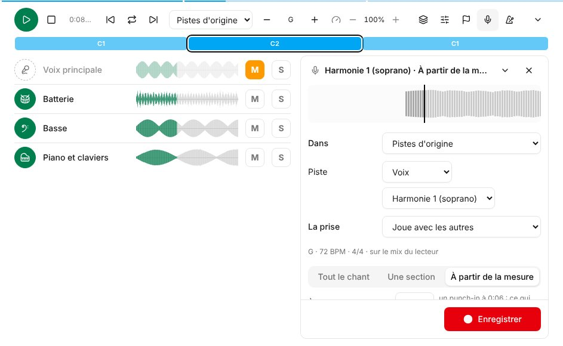

- En haut, ce que vous enregistrez (« Voix principale · Refrain »), et dessous la prise telle qu'elle s'enregistre : le trait au milieu est la tête de lecture. Ce que le micro entend se dessine à sa gauche (en rouge pendant l'enregistrement, en orange là où c'est trop fort), et ce qui arrive dans les pistes que vous entendez à sa droite, avec les sections marquées. Avant même d'enregistrer, vous voyez si le micro vous entend.
- La flèche à côté affiche ou masque tous les choix : **Dans**, **Piste**, **La prise**, quoi enregistrer, **Entendre** et **Clic**, le niveau du **Micro**, le retard et le nettoyage. Ils se masquent pendant l'enregistrement, pour laisser voir la page ; la flèche les fait revenir. Masqués, une ligne sous la forme d'onde dit encore comment le micro vous entend - **Bon niveau**, trop faible, trop fort, ou **Rien n'est entendu** quand il n'entend rien du tout (pas le bon micro, ou coupé) - avec le nom du micro.
- Quoi enregistrer : **Tout le chant** ; **Une section**, choisie parmi les sections placées dans le lecteur (**Placer les sections**) ; ou **À partir de la mesure**, un punch-in. Le décompte est la mesure d'avant, ses temps décomptés en haut. La prise d'une section s'arrête d'elle-même à la fin de la section.
- Depuis le lecteur de pistes, il enregistre par-dessus le lecteur tel qu'il est : vos coupures, solos et transposition, le métronome si **Clic avec l'enregistrement** est activé, à partir de la mesure où se trouve la tête de lecture. Enregistrée en transposant, la prise est gardée comme chantée dans cette tonalité (voir plus haut).
- Chaque prise est gardée jusqu'à la fermeture de l'enregistreur, listée sous **Prises** : **Écouter** en joue une avec les autres pistes (dans le lecteur, comme une piste appelée **Nouvelle prise**), **Choisir** désigne celle à garder, et **Caler** l'ajuste. **Recommencer** en enregistre une autre d'une seule touche.
- **Garder la prise 2** (celle choisie) l'ajoute au multipiste. Pour enregistrer une piste en plusieurs fois (les couplets, puis le refrain), appuyez plutôt sur **Garder, section suivante** : elle va dans la même piste, la section suivante est choisie, et vous l'enregistrez ; **Garder** les enregistre ensuite toutes en un seul fichier. Une prise ne remplace que le passage qu'elle couvre, avec un court fondu enchaîné à chaque jonction : la piste qu'elle remplace est gardée de part et d'autre (un punch-in et out), ou c'est le silence.
- Fermer l'enregistreur avec des prises non gardées demande d'abord confirmation.
- Touchez le nom d'une piste que vous avez enregistrée ou importée, sauf si elle est verrouillée (voir [Fichiers verrouillés](/fr/library/#fichiers-verrouillés)) - la petite flèche après lui - pour voir ce qu'on peut en faire : **Enregistrer dedans** ouvre l'enregistreur sur cette piste, ce que vous enregistrez ne remplaçant que le passage couvert ; **Fusionner avec…** y mélange une autre de vos pistes chantée dans la même tonalité, en un seul fichier joué à leur place (les deux sont gardés comme autres prises) ; **Supprimer** le supprime, après confirmation.

#### Depuis l'onglet Audio

**Dans** passe d'un multipiste du chant à l'autre, ou à **Nouveau multipiste**. Sur la page d'un chant dans une liste, un nouveau multipiste peut être celui de cette liste (**Pour cette liste**) : là, c'est celui que joue le lecteur de pistes, sauf si vous en choisissez un autre.

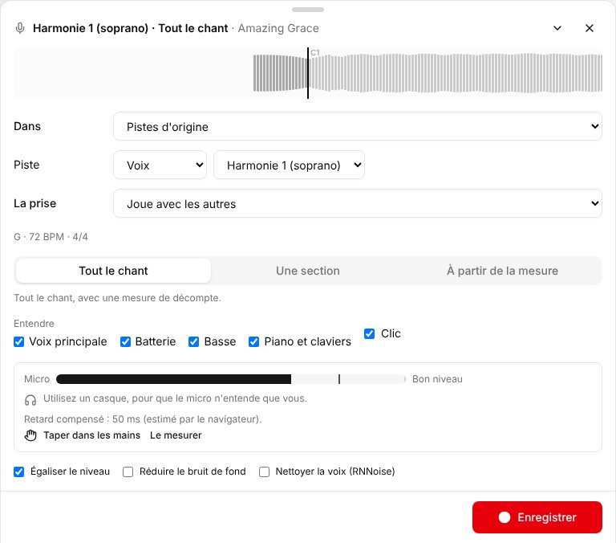

Choisissez la **Piste** que vous enregistrez (une voix, un instrument ou des repères, comme ci-dessus), vérifiez que **Micro** vous entend à un **Bon niveau**, décochez **Clic** pour enregistrer sans métronome, et appuyez sur **Enregistrer** ; **Arrêter** termine la prise. Utilisez un casque, pour que le micro n'entende que vous, pas le clic et les autres pistes.

**La prise** indique ce qu'elle devient une fois gardée, quand le multipiste a déjà cette piste :

- **Remplace** celle qui y est, gardée comme **Autre prise** : pas jouée, mais là pour y revenir.
- **Joue avec les autres** : une deuxième piste du même genre (deux guitares).
- **Gardée comme autre prise, pas jouée**.

Dans l'onglet **Audio**, **Utiliser cette prise** sous une autre prise la joue à la place de celle de sa piste, qui devient l'autre prise.

#### Fichiers verrouillés

L'audio que vous importez est verrouillé au départ (le bouton cadenas à côté du fichier, enfoncé) : il est gardé tel qu'importé. Un fichier verrouillé ne peut pas être supprimé, remplacé par une autre prise, fusionné ni nettoyé, et le lecteur de pistes n'affiche ni à qui il est ni d'actions dessus ; sa piste, sa tonalité, son tempo et ses sections peuvent toujours changer. Une prise enregistrée à côté d'une piste verrouillée joue avec elle plutôt qu'à sa place. Seul qui l'a importé peut le déverrouiller (**Déverrouiller**, le même bouton) - pour remplacer une piste par exemple - et le verrouiller de nouveau. Ce que vous enregistrez dans Songverse n'est pas verrouillé.

Ce que vous jouez est calé sur ce que vous avez entendu : Songverse compense le retard entre un son qui sort de l'appareil et le moment où le micro l'entend. L'enregistreur l'indique - estimé par le navigateur pour commencer. Pour une valeur plus juste :

- **Taper dans les mains**, casque sur les oreilles : écoutez deux clics, puis tapez dans les mains sur chacun des huit suivants, près du micro. Cela mesure tout le trajet - casque Bluetooth compris.
- **Le mesurer**, avec le son sur les haut-parleurs (casque retiré, son monté) : Songverse joue quelques clics et les écoute.

Songverse retient la mesure sur cet appareil, pour chaque sortie : branchez un autre casque et l'enregistreur indique que son retard n'est pas encore mesuré. Un casque filaire est préférable : le Bluetooth ajoute un retard grand et variable, et l'enregistreur prévient quand le son semble aller vers du Bluetooth. Refaites la mesure si une prise sonne en retard.

**Écouter** rejoue la prise avec le reste. Si elle est encore un peu en avance ou en retard, déplacez **Caler** (en millisecondes) et réécoutez. **Garder** l'ajoute au multipiste comme cette piste, que vous seul voyez jusqu'à ce que vous choisissiez qui d'autre la voit (voir [Qui voit un fichier](/fr/library/#qui-voit-un-fichier)) ; **Recommencer** refait une prise. Une prise peut durer jusqu'à neuf minutes environ.

Rien de ce que vous enregistrez ne se perd en route. Une prise est écrite sur l'appareil pendant l'enregistrement et, une fois gardée, elle y reste jusqu'à ce que l'envoi soit passé :

- Sans connexion au moment de **Garder**, l'enregistreur indique que la prise est **Gardée sur cet appareil**. Elle s'envoie d'elle-même dès le retour de la connexion, tant que Songverse est ouvert. D'ici là, elle figure dans **Prises sur cet appareil**, dans l'onglet **Audio** du chant et dans le lecteur de pistes, où **Envoyer maintenant** l'envoie tout de suite.
- Si la page se recharge ou que le navigateur se ferme en pleine prise, ce qui a été enregistré jusque-là y est aussi, marqué **coupée** : **Écoutez**-la, puis **Gardez**-la (elle est ajoutée comme autre prise, jamais à la place d'une piste) ou **Supprimez**-la.
- Si le micro est débranché ou changé, ou que le téléphone reprend le son (un appel, l'écran verrouillé), la prise s'arrête là, et ce qui a été enregistré est gardé et peut être écouté.

Une prise gardée est enregistrée en WAV, puis convertie en Opus en arrière-plan (mono, 96 kbit/s : environ un huitième de la taille) - **En cours de traitement…** s'affiche dessous jusque-là. Le silence après sa fin est coupé, jamais avant, pour qu'elle reste en place. **Égaliser le niveau** (coché pour commencer) l'amène à un volume standard ; **Réduire le bruit de fond** retire un bruit constant - souffle, ronflement, ventilateur - appris sur le décompte quand c'est possible, en douceur pour ne pas toucher à la musique. Pour une voix, **Nettoyer la voix (RNNoise)** va plus loin : un réseau de neurones entraîné sur des voix garde le chant et retire le reste - la pièce, la rue, un ventilateur - mais il n'est pas fait pour les instruments, qu'il peut hacher.

Pour faire de même après coup, **Nettoyer** sous un fichier audio que vous pouvez modifier propose **Nettoyer la voix (RNNoise)** pour une voix, **Égaliser le niveau** et **Réduire le bruit de fond** : c'est fait en arrière-plan, et le fichier revient en Opus, calé comme avant.

#### Appareils essayés

L'enregistrement dépend de l'appareil et du navigateur : le temps que met le son à sortir et à revenir, et ce que le navigateur permet à une page de faire avec le micro. Ce qui a été essayé jusqu'ici :

| Appareil et navigateur | Enregistrement | Remarques |
| --- | --- | --- |
| Chrome sur un ordinateur (Linux) | Fonctionne | Vérifié par les tests automatiques, avec un micro simulé |
| iPhone et iPad (Safari) | Pas encore essayé | |
| Téléphone Android (Chrome) | Pas encore essayé | |
| Mac (Safari, Chrome) | Pas encore essayé | |
| Windows (Chrome, Edge) | Pas encore essayé | |
| Casque Bluetooth | Pas encore essayé | Attendez-vous à un grand retard : tapez dans les mains pour le mesurer |

Cette liste s'allonge à mesure que d'autres appareils sont essayés. Si le vôtre se comporte mal, dites quel appareil, quel navigateur et quel casque vous utilisiez.

## Proposer au catalogue global

La carte **Catalogue global** de votre chant (ou d'un chant d'équipe que vous administrez) le propose à tout le monde. **Proposer à la relecture**, avec une note pour le relecteur si vous le souhaitez ; le copyright et le numéro CCLI aident mais ne sont pas obligatoires. Un relecteur le publie, demande des modifications ou le refuse, et vous suivez où il en est sur la même carte.

Une fois publié, le chant lui-même passe au catalogue - il n'y a pas de seconde copie. Votre bibliothèque le liste une seule fois, marqué **Publié par vous**, et sa page dit de qui il vient. Sa grille et ses détails (ses notes aussi) sont désormais à tout le monde, et seuls les administrateurs les modifient ; son [historique](/fr/song-editor/#historique) continue. Ce qui était à vous le reste : vos fichiers restent à vous (ou à l'équipe avec qui vous les avez partagés - voir [Qui voit un fichier](/fr/library/#qui-voit-un-fichier)), vos versions restent les vôtres, tout comme vos propres étiquettes.

Si un relecteur trouve que le chant est déjà dans le catalogue, il le fusionne avec celui-ci, et le vôtre y est intégré - il n'y a toujours qu'un seul chant. Vos [versions](/fr/versions/) passent au chant du catalogue (vérifiez-les : chacune dit ce qu'il faut revoir), tout comme vos fichiers (toujours à vous seul·e), vos étiquettes et leurs places dans les listes et les recueils. Votre façon d'avoir le chant - vos paroles, accords, ordre et tonalité - devient une de vos versions du chant, à votre nom, avec vos notes ; vos listes le jouent ainsi. Les détails que vous aviez modifiés (titre, crédits, droits) sont proposés aux relecteurs.

Les chants publiés avant que Songverse fonctionne ainsi avaient été copiés dans le catalogue ; ils ont été intégrés à leur chant du catalogue de la même façon.

## Proposer une modification

Seuls les administrateurs modifient un chant du catalogue global, mais tout le monde peut proposer une modification - y compris la personne qui l'a proposé au catalogue. Sur la page du chant, **Proposer une modification** : ses onglets **Infos** et **Éditeur** s'ouvrent comme pour votre propre chant. Faites votre modification, puis **Envoyer la proposition**, avec un mot pour le relecteur si vous le souhaitez. Le chant lui-même ne change pas encore.

Un relecteur voit ce qu'elle change - détails et crédits barrés et nouveaux, lignes de la grille supprimées et ajoutées - et l'accepte ou la refuse. Une proposition acceptée est enregistrée dans le chant à votre nom, dans son [historique](/fr/song-editor/#historique), par-dessus ce qui a changé depuis. Si la même partie (la grille, un détail, les crédits) a été modifiée autrement entre-temps, elle ne peut pas être acceptée telle quelle.

**Vos propositions**, sur la page du chant, montre où en est chacune et la note du relecteur ; **Retirer** reprend une proposition encore en attente.
