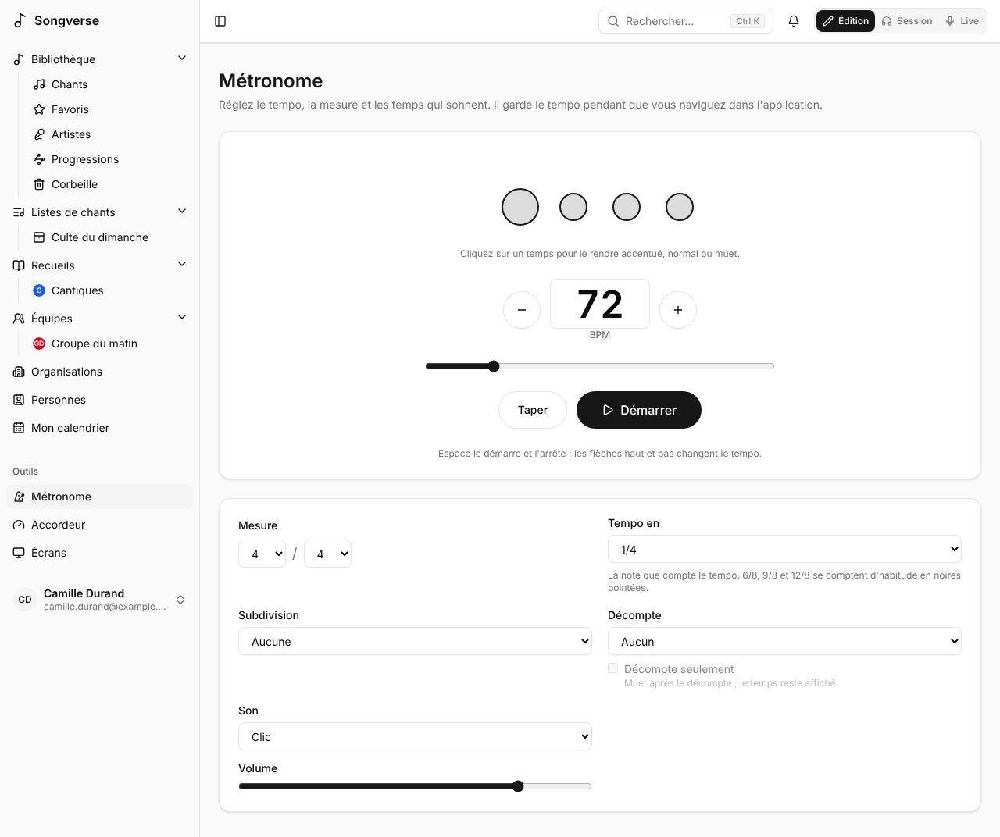
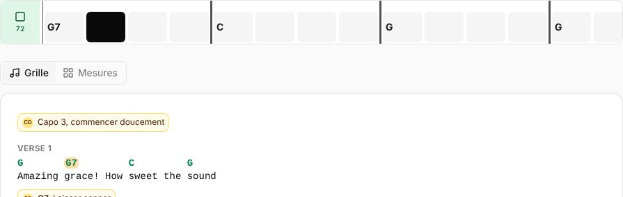
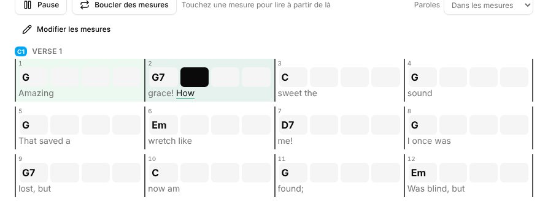
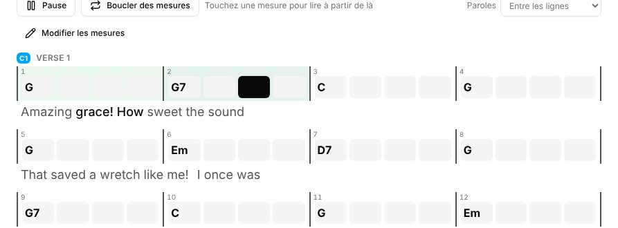
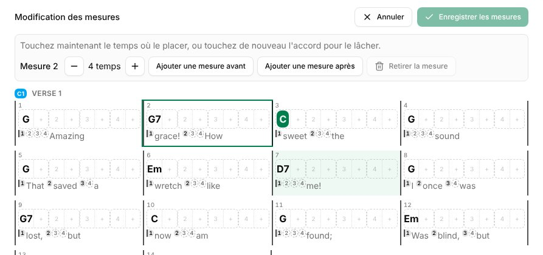
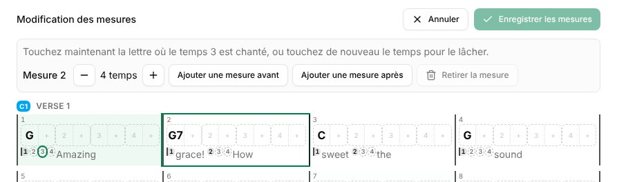

**Métronome**, dans les **Outils** de la barre latérale, ouvre sa page : tout ce qu'il sait faire, réglé une fois et retenu sur cet appareil. Il garde le tempo pendant que vous naviguez dans Songverse ; un petit bouton en bas de l'écran montre son tempo et le temps, ramène à sa page et l'arrête.

## Tempo

- **−** et **+** changent le tempo d'un battement par minute à la fois ; tapez-le, ou faites glisser le curseur (de 20 à 300 BPM).
- **Taper** : tapez en rythme avec la musique, et le métronome prend ce tempo.
- **Démarrer** et **Arrêter**. Au clavier, **Espace** le démarre et l'arrête, et **↑** **↓** changent le tempo (de 5 avec **Maj**).

Un nouveau tempo prend effet au temps suivant, sans arrêt.

## Mesure et motif

- **Mesure** : le nombre de temps par mesure et la valeur du temps - **4 / 4**, **3 / 4**, **6 / 8**...
- **Tempo en** : la note que compte le tempo - **1/8**, **1/4**, **1/2**, **1/8 pointée**, **1/4 pointée** ou **1/2 pointée**. Il prend celle d'habitude pour la mesure : son propre temps, sauf en 6/8, 9/8 et 12/8, comptés en noires (**1/4**). 3/4 à 71 joue donc trois noires par mesure, et 6/8 à 71 joue ses six croches dans le même temps, deux fois plus vite (142 par minute). Quelle que soit la note, chaque temps de la mesure clique : la note ne règle que la vitesse. Choisissez-en une autre quand un chant se compte autrement : **1/4 pointée** pour un 6/8 compté à deux (71 noires pointées, ses croches 213 fois par minute), **1/8** pour un 6/8 lent compté à six. Changer de mesure prend la note d'habitude de la nouvelle, sauf si vous en aviez choisi une autre.
- Les cercles sont les temps de la mesure, celui que vous entendez allumé. Chaque temps a un niveau, que la taille de son cercle montre : **accent** (le plus grand, un son plus aigu), **moyen**, **petit** ou **coupé** (vide, pas entendu). Cliquez sur un temps pour passer de l'un au suivant.
- **Chaque mesure a son propre motif.** Celui d'habitude accentue le premier temps ; les autres sont petits, sauf le premier temps de chaque groupe, qui est moyen. 3/4 fait donc « **1** 2 3 », 4/4 « **1** 2 3 4 », et 6/8 « **1** 2 3 *4* 5 6 » : deux groupes de trois, 3/4 et 6/8 se sentent différemment sans rien changer d'autre. 9/8 et 12/8 ont trois et quatre groupes de trois. Un motif que vous changez est gardé pour cette mesure sur cet appareil : 6/8 et 6/4 en ont deux, et revenir en 6/8 ramène le vôtre. **Motif habituel** remet celui d'habitude.
- **Une mesure à 5 ou 7 temps** montre comment ses temps sont groupés : **3+2** ou **2+3** pour 5, **2+2+3**, **3+2+2** ou **2+3+2** pour 7. Choisissez-en un, et le premier temps de chaque groupe devient moyen.
- **Subdivision** ajoute des clics entre les temps : **2 par temps**, **Triolets** ou **4 par temps**, plus doux que les temps.

## Décompte

**Décompte** joue une ou deux mesures avant le chant, tous les temps entendus avec les niveaux du motif (un temps coupé y est petit, pour que le compte soit complet). Avec **Décompte seulement**, il se tait ensuite : les cercles continuent de montrer le temps, pour un groupe qui a juste besoin d'être lancé.

## Son et volume

**Son** : **Clic**, **Wood block** ou **Bip**, chacun avec son propre son pour un accent, un temps moyen et un petit temps ; et son **Volume**. Le son est produit sur votre appareil : le métronome fonctionne hors ligne.

Utilisez un casque filaire ou le haut-parleur de l'appareil : un casque Bluetooth l'entend avec une fraction de seconde de retard.

## Au tempo d'un chant

En [Live](/fr/sets/#jouer-une-liste-en-live), sur la page d'un chant dans une liste et sur la page d'un chant en mode Session, le bouton du métronome (sur la page d'un chant, il affiche son tempo : **76 BPM**, avec sa note quand ce n'est pas une noire : **71 BPM · 1/4.**) le démarre au tempo, à sa note et à la mesure du chant (ceux de sa version, quand la liste en joue une) en une pression ; appuyez à nouveau pour l'arrêter. Il utilise votre motif pour cette mesure, votre son et votre décompte de la page Métronome, et clignote avec le temps. Une version peut avoir son propre motif, un 7/8 senti 3+2+2 par exemple : choisissez-le dans son onglet **Infos**, sous **Plus de détails** > **Motif du métronome** (**En choisir un pour cette version**, puis cliquez sur les temps). Tout le monde entend alors celui-là pour le chant ; **Utiliser celui de chaque musicien** le retire. Un chant sans tempo ne peut pas le démarrer : ajoutez-en un dans son onglet **Infos**, avec **Tempo en** à côté quand il ne se compte pas dans la note d'habitude de sa mesure.

En jouant avec d'autres, le métronome du meneur peut être celui de chacun, en rythme : voir [Jouer synchronisé](/fr/sets/#jouer-synchronisé).

## Mesures

En haut d'un chant, en Session et en Live, la **ligne des mesures** place les accords du chant en mesures et en temps, avec le métronome :

- **Une case par temps.** Un trait marqué commence chaque mesure, son premier temps est entouré, et le nom d'un accord est sur le temps où il commence (au milieu de la case quand c'est le seul accord du temps). Le nom de chaque section (S, R, P…) est sur sa première mesure, aux couleurs de la barre de structure.
- **Le bouton du métronome**, à gauche, en Live, affiche le tempo du chant et lance ou arrête le clic à ce tempo. En Session, le métronome est à côté du tempo, sous le titre du chant : quand les pistes ou l'enregistrement jouent, c'est leur **Clic avec l'enregistrement**.
- **Pendant que la musique joue,** le temps joué se remplit. La ligne montre des mesures entières - une sur un téléphone, plus sur un écran plus large - et le premier temps de la suivante ; quand la dernière mesure montrée est finie, elle passe aux suivantes d'un coup, sans défiler. Elle suit les pistes ou l'enregistrement du chant quand ils jouent - temps par temps quand la [séparation des pistes a trouvé ses temps et ses mesures](/fr/library/#séparer-un-enregistrement-en-pistes), sinon d'après son tempo et son premier temps - sinon le métronome, y compris celui du meneur quand vous [jouez synchronisé](/fr/sets/#jouer-synchronisé). À l'arrêt, elle reste sur la première mesure et défile au doigt.
- **Les accords se lisent comme sur la grille :** transposés, avec votre capodastre, vos noms et vos couleurs.

Les mesures viennent des [barres de mesure](/fr/song-editor/#les-barres-de-mesure) de la grille quand elle en a. Sinon de ses accords : chaque accord a une mesure, et une ligne chantée en prend au moins deux (une ligne à un seul accord le garde une deuxième mesure). Les lignes d'accords seuls (une intro) prennent une mesure par accord, et les notes aucune. Chaque mesure a autant de temps que l'indique la mesure du chant, et une section peut avoir sa propre mesure dans l'ordre du chant.

**Affichage** > **Accords** > **Mesures** la masque, séparément en Session et en Live (voir [Affichage](/fr/display/)).

La partition suit aussi, en Session et sur la page d'un chant dans une liste : pendant que la musique joue, la ligne chantée s'allume un temps à l'avance et reste visible, au-dessus du lecteur. Les paroles sont calées sur les temps tels qu'ils sont [placés dans les paroles](/fr/metronome/#placer-les-temps-dans-les-paroles), sinon réparties sur leurs mesures. Si vous faites défiler vous-même, elle attend quelques secondes avant de suivre à nouveau.

## Grille en mesures

**Grille** / **Mesures** au-dessus d'un chant (en Session, sur sa page dans une liste et dans l'en-tête du Live) lit le chant en mesures plutôt que sa grille : les mêmes mesures, disposées comme sur une grille de jazz.

- **Quatre mesures par ligne** (deux sur un téléphone), chaque section sous son nom, avec sa mesure là où elle change.
- **Chaque mesure** a son numéro, un bloc par temps et l'accord dans le bloc du temps où il change, comme dans la ligne des mesures. Le temps joué devient foncé. Un accord sur le « et » d'un temps coupe son bloc en deux. Un accord qui continue depuis la mesure d'avant est rappelé, en gris. Dessous, les paroles chantées dans cette mesure (de l'accord ou de la barre de mesure où elles commencent au suivant).
- **Pendant que la musique joue,** la mesure et le temps joués s'allument, et la page défile pour garder cette mesure en vue. Elle suit la même chose que la ligne des mesures : les pistes, le métronome ou celui du meneur.
- **Les accords se lisent comme sur la grille :** transposés, avec votre capodastre, vos noms et vos couleurs, et sur la page d'un chant dans une liste vos **Accords simplifiés** et **Sans basses** aussi.

Votre choix est gardé pour le chant, comme celui d'un PDF : chaque appareil où vous êtes connecté, et le Live, l'affichent de la même façon. Pour lire tous les chants ainsi sauf choix contraire, réglez **Lire les chants en** sur **Accords en mesures** (voir [Affichage des grilles](/fr/account/#affichage-des-grilles)).

### Les paroles

**Paroles** au-dessus des mesures choisit où vont les paroles. Votre choix est gardé sur cet appareil, pour tous les chants :

- **Dans les mesures** : chaque mesure a dessous les paroles chantées dedans, comme ci-dessus.
- **Entre les lignes** : chaque ligne de mesures a ses paroles en une ligne dessous, plus facile à lire. Les paroles de la mesure jouée deviennent foncées.
- **Sous une ligne fixe** : la ligne de mesures jouée reste en haut, et les paroles du chant défilent dessous en grand, la ligne chantée allumée.
- **Masquées** : seulement les mesures.

Pendant **Modifier les mesures**, les paroles sont dans les mesures, là où les temps se placent.

### Lire depuis les mesures

Au-dessus des mesures, **Lire l'enregistrement** lance les pistes ou l'enregistrement du chant, et **Lancer le clic** lance le métronome au tempo du chant s'il n'a ni l'un ni l'autre.

- **Touchez une mesure** pour lire à partir de son premier temps, ou pour y sauter pendant la lecture. Avec un enregistrement, la mesure est trouvée d'après ses temps et ses mesures (quand la [séparation des pistes les a trouvés](/fr/library/#séparer-un-enregistrement-en-pistes)), sinon d'après son tempo et son premier temps. Avec le clic, un décompte joue les temps juste avant la mesure.
- **Boucler des mesures** (avec un enregistrement) : touchez la première mesure, puis la dernière. Ces mesures se répètent, soulignées, jusqu'à ce que vous touchiez **Arrêter la boucle**.

Quand vous [jouez en synchro](/fr/sets/#jouer-synchronisé) et suivez le meneur, c'est lui qui lance et arrête la musique : toucher une mesure ne fait rien.

### Placer les accords sur les temps

Si vous pouvez modifier le chant, **Modifier les mesures** au-dessus des mesures en Session vous permet de dire exactement où tombe chaque accord :

- **Déplacer un accord sur un autre temps.** Faites-le glisser, ou touchez-le puis touchez le temps. Chaque temps a deux moitiés : celle de gauche est le temps lui-même, celle de droite son « et » (le + entre les temps). Un accord reste entre l'accord d'avant et celui d'après dans la grille, pour que les mesures et les paroles ne se contredisent jamais.
- **Changer une mesure.** Touchez une mesure pour afficher ses outils. **−** et **+** changent son nombre de temps, pour une anacrouse ou une mesure à 2/4 avant le refrain. **Ajouter une mesure avant** et **Ajouter une mesure après** ajoutent une mesure vide, où l'accord d'avant continue. **Retirer la mesure** retire une mesure vide (déplacez d'abord ses accords).
- **Enregistrer les mesures** les enregistre, et **Annuler** abandonne vos changements. Chaque reprise d'une section a les mêmes mesures : un refrain change partout où il revient.

Les mesures sont enregistrées avec le chant, comme les [barres de mesure](/fr/song-editor/#les-barres-de-mesure) de l'éditeur, et apparaissent dans son historique. La ligne des mesures, le clic et les mesures les suivent. Si vous déplacez ensuite une barre de mesure dans l'éditeur, les accords placés ici gardent leurs temps dans chaque mesure qui n'a pas changé.

### Placer les temps dans les paroles

Sous chaque mesure, ses paroles sont découpées à ses temps : pendant la musique, les paroles du temps joué sont soulignées. La grille place les temps d'elle-même. Le premier temps est là où commencent les paroles de la mesure, le temps d'un accord est sur son mot, et les autres sont répartis entre eux, chacun sur le mot le plus proche. Un mot tenu sur un temps n'en a pas.

Quand un temps est chanté ailleurs, déplacez-le dans **Modifier les mesures**. Chaque temps est un petit numéro juste avant la lettre où il est chanté (un temps tenu se met juste après celui d'avant).

- **Faites glisser un temps sur une lettre**, ou touchez-le puis touchez la lettre. Il peut aller sur n'importe quelle lettre, pas seulement au début d'un mot, mais il reste dans les paroles de sa mesure, entre le temps d'avant et celui d'après. Les temps que vous avez placés sont remplis.
- **Le temps 1 est le début de la mesure.** Le faire glisser déplace la barre de mesure dans sa ligne de paroles : des mots passent d'une mesure à l'autre.
- **Laisser la grille le placer**, affiché quand vous touchez un temps que vous avez placé, le rend à la grille.

L'éditeur de chant montre les mêmes temps sous les paroles d'une section avec des barres de mesure, pour les déplacer là aussi (voir [Les temps dans les paroles](/fr/song-editor/#les-temps-dans-les-paroles)). **Enregistrer les mesures** enregistre les temps avec les mesures. C'est aussi avec eux que [Suivre la musique](/fr/screens/#suivre-la-musique) fait avancer les écrans.

