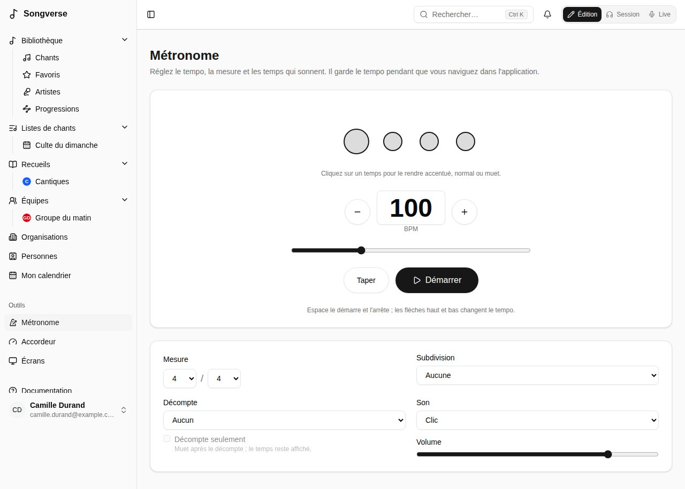
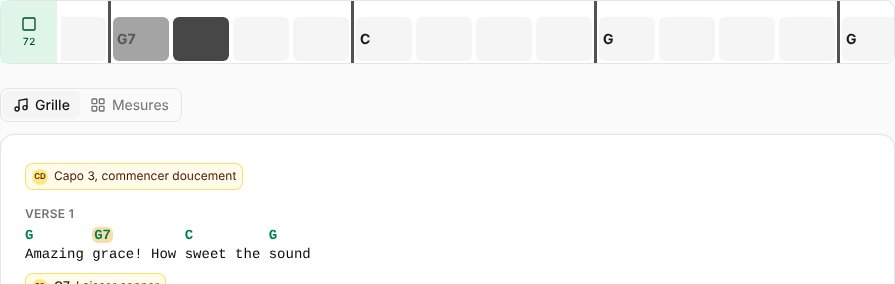
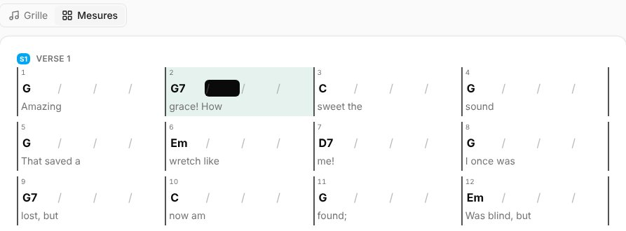

**Métronome**, dans les **Outils** de la barre latérale, ouvre sa page : tout ce qu'il sait faire, réglé une fois et retenu sur cet appareil. Il garde le tempo pendant que vous naviguez dans Songverse ; un petit bouton en bas de l'écran montre son tempo et le temps, ramène à sa page et l'arrête.

## Tempo

- **−** et **+** changent le tempo d'un battement par minute à la fois ; tapez-le, ou faites glisser le curseur (de 20 à 300 BPM).
- **Taper** : tapez en rythme avec la musique, et le métronome prend ce tempo.
- **Démarrer** et **Arrêter**. Au clavier, **Espace** le démarre et l'arrête, et **↑** **↓** changent le tempo (de 5 avec **Maj**).

Un nouveau tempo prend effet au temps suivant, sans arrêt.

## Mesure et motif

- **Mesure** : le nombre de temps par mesure et la valeur du temps - **4 / 4**, **3 / 4**, **6 / 8**... Le tempo compte ces temps : en 6/8, des croches.
- Les cercles sont les temps de la mesure : celui que vous entendez s'allume, le premier de la mesure est plus grand. Cliquez sur un temps pour le rendre **accentué**, **normal** ou **muet** - par exemple, seulement les temps 2 et 4, ou une mesure sans son dernier temps.
- **Subdivision** ajoute des clics entre les temps : **2 par temps**, **Triolets** ou **4 par temps**, plus doux que les temps.

## Décompte

**Décompte** joue une ou deux mesures avant le chant, tous les temps entendus. Avec **Décompte seulement**, il se tait ensuite : les cercles continuent de montrer le temps, pour un groupe qui a juste besoin d'être lancé.

## Son et volume

**Son** : **Clic**, **Wood block** ou **Bip** ; et son **Volume**. Le son est produit sur votre appareil : le métronome fonctionne hors ligne.

Utilisez un casque filaire ou le haut-parleur de l'appareil : un casque Bluetooth l'entend avec une fraction de seconde de retard.

## Au tempo d'un chant

En [Live](/fr/sets/#jouer-une-liste-en-live), sur la page d'un chant dans une liste et sur la page d'un chant en mode Session, le bouton du métronome (sur la page d'un chant, il affiche son tempo : **76 BPM**) le démarre au tempo et à la mesure du chant (ceux de sa version, quand la liste en joue une) en une pression ; appuyez à nouveau pour l'arrêter. Il utilise votre motif, votre son et votre décompte de la page Métronome, et clignote avec le temps. Un chant sans tempo ne peut pas le démarrer : ajoutez-en un dans son onglet **Infos**.

En jouant avec d'autres, le métronome du meneur peut être celui de chacun, en rythme : voir [Jouer synchronisé](/fr/sets/#jouer-synchronisé).

## Mesures

En haut d'un chant, en Session et en Live, la **ligne des mesures** place les accords du chant en mesures et en temps, avec le métronome :

- **Une case par temps.** Un trait marqué commence chaque mesure, et le nom d'un accord est sur le temps où il commence. Le nom de chaque section (S, R, P…) est sur sa première mesure, aux couleurs de la barre de structure.
- **Le bouton du métronome**, à gauche, affiche le tempo du chant et lance ou arrête le clic à ce tempo.
- **Pendant que la musique joue,** le temps joué se remplit et la ligne défile, pour que la suite reste visible. Elle suit les pistes ou l'enregistrement du chant quand ils jouent - temps par temps quand la [séparation des pistes a trouvé ses temps et ses mesures](/fr/library/#séparer-un-enregistrement-en-pistes), sinon d'après son tempo et son premier temps - sinon le métronome, y compris celui du meneur quand vous [jouez synchronisé](/fr/sets/#jouer-synchronisé). À l'arrêt, elle reste sur la première mesure et défile au doigt.
- **Les accords se lisent comme sur la grille :** transposés, avec votre capodastre, vos noms et vos couleurs.

Les mesures viennent de la grille : chaque accord a une mesure, et une ligne chantée en prend au moins deux (une ligne à un seul accord le garde une deuxième mesure). Les lignes d'accords seuls (une intro) prennent une mesure par accord, et les notes aucune. Chaque mesure a autant de temps que l'indique la mesure du chant, et une section peut avoir sa propre mesure dans l'ordre du chant.

**Affichage** > **Accords** > **Mesures** la masque, séparément en Session et en Live (voir [Affichage](/fr/display/)).

## Grille en mesures

**Grille** / **Mesures** au-dessus d'un chant (en Session, sur sa page dans une liste et dans l'en-tête du Live) lit le chant en mesures plutôt que sa grille : les mêmes mesures, disposées comme sur une grille de jazz.

- **Quatre mesures par ligne** (deux sur un téléphone), chaque section sous son nom, avec sa mesure là où elle change.
- **Chaque mesure** a son numéro, une barre oblique par temps et l'accord sur le temps où il change. Un accord qui continue depuis la mesure d'avant est rappelé, en gris. Dessous, les paroles chantées dans cette mesure (de l'accord où elles commencent au suivant).
- **Pendant que la musique joue,** la mesure et le temps joués s'allument, et la page défile pour garder cette mesure en vue. Elle suit la même chose que la ligne des mesures : les pistes, le métronome ou celui du meneur.
- **Les accords se lisent comme sur la grille :** transposés, avec votre capodastre, vos noms et vos couleurs, et sur la page d'un chant dans une liste vos **Accords simplifiés** et **Sans basses** aussi.

Votre choix est gardé pour le chant, comme celui d'un PDF : chaque appareil où vous êtes connecté, et le Live, l'affichent de la même façon. Pour lire tous les chants ainsi sauf choix contraire, réglez **Lire les chants en** sur **Accords en mesures** (voir [Affichage des grilles](/fr/account/#affichage-des-grilles)).
