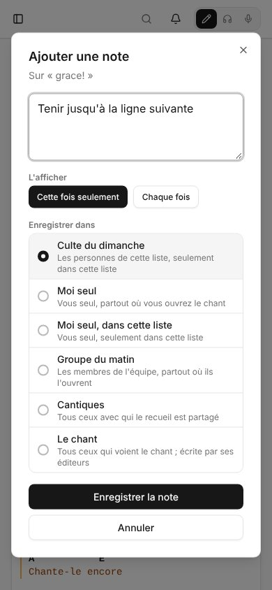

Une note, c'est ce qu'on veut retenir d'un chant : « Laisser sonner » sur un accord, « Tenir » sur un mot, « Grande fin » sur le dernier refrain, « Capo 3, commencer doucement » sur tout le chant. Vous l'écrivez une fois, l'attachez là où elle va, et l'enregistrez quelque part. Là où elle est enregistrée décide qui la voit.

## Ajouter une note

Sur la page d'un chant en Session, sur un chant d'une liste, et en Live :

- **Clic droit** sur un accord, un mot ou le nom d'une partie. Sur un écran tactile, **appuyez longuement** dessus.
- Ou ouvrez **Notes** à côté d'**Affichage** et choisissez **Ajouter une note**, pour tout le chant.

La fenêtre dit sur quoi porte la note (**Sur G7**, **Sur « grace »**, **Sur Refrain**). Écrivez la note, choisissez où l'enregistrer, puis **Enregistrer la note**.

Dans une partie chantée plusieurs fois, **L'afficher** demande si la note vaut pour **Cette fois seulement** (par défaut) ou **Chaque fois**. « Grande fin » sur le dernier refrain reste sur le dernier refrain.

## Où elle est enregistrée

**Enregistrer dans** liste les endroits possibles, chacun avec qui verra la note :

| Enregistrée dans | Qui la voit | Où elle s'affiche |
|---|---|---|
| **Moi seul** | vous | partout où vous ouvrez le chant |
| **Moi seul, dans cette liste** | vous | seulement dans cette liste |
| Une équipe | les membres de l'équipe | partout où ils ouvrent le chant |
| Un recueil | tous ceux avec qui le recueil est partagé | partout où ils ouvrent le chant, tant qu'il est dans le recueil |
| Une liste | tous ceux qui ouvrent la liste | seulement dans cette liste |
| **Le chant** | tous ceux qui voient le chant | partout ; seuls les éditeurs du chant peuvent l'y enregistrer |

Le premier choix est celui d'où vous venez : un chant d'une liste s'enregistre dans cette liste, un chant ouvert depuis un recueil dans ce recueil, sinon pour vous seul. Un chant retiré d'un recueil cache les notes de ce recueil. Elles reviennent si le chant y est remis.

## Sur la grille

Chaque note s'affiche là où elle est attachée :

- celles de tout le chant au-dessus de la grille ;
- celles d'une partie sous son nom ;
- celles d'une ligne, d'un accord ou d'un mot sous la ligne, avec l'accord ou le mot concerné ;
- celles entre deux parties après la première.

Un accord qui porte une note est surligné. Chaque note montre la photo ou les initiales de son auteur, et son nombre de réponses. Si ce à quoi une note était attachée est supprimé, la note remonte : d'un accord à sa ligne, d'une ligne à sa partie, d'une partie à tout le chant. Une petite flèche indique qu'elle a été déplacée. Une modification ne fait jamais perdre une note.

## Réponses

Touchez une note pour l'ouvrir, avec ses réponses. Tous ceux qui voient une note peuvent **Répondre**. L'auteur de la note, et tous ceux qui y ont répondu, reçoivent une notification avec un lien vers elle.

La personne qui a écrit une note peut la **Modifier**, la **Résoudre**, ou la **Supprimer** avec ses réponses. Une note résolue quitte la grille mais reste dans son fil ; **Rouvrir** la remet. Le peuvent aussi :

- les admins d'une équipe, pour les notes de l'équipe ;
- ceux qui peuvent modifier un recueil, pour ses notes ;
- les responsables de la liste (son propriétaire, ou les admins de son équipe), pour ses notes ;
- les éditeurs du chant, pour les notes du chant.

Ils peuvent aussi modifier ou supprimer les réponses. Les autres ne peuvent modifier que leurs propres réponses.

Les admins globaux peuvent modifier, résoudre et supprimer toutes les notes et réponses.

## Toutes les notes d'un chant

**Notes** (avec leur nombre) liste toutes les notes que vous pouvez voir sur le chant, résolues comprises. Elle ignore vos réglages d'affichage. En Édition, le bouton est dans l'en-tête à côté de **Partager** (sur un écran plus étroit, sous **Plus d'actions**, **Toutes les notes**) : pour lire les notes, y répondre, ou en ajouter une sur tout le chant pendant que vous modifiez.

## Afficher les notes, mode par mode

Dans [Affichage](/fr/display/), **Mise en page** > **Notes** règle ce que la grille montre dans chaque mode : **Toutes les notes** (par défaut), **Mes notes** ou **Aucune note**. Session et Live gardent chacun leur choix : Live peut ne montrer que vos notes pendant que Session montre celles de tout le monde.

## Hors ligne

Un chant ou une liste gardés sur votre appareil garde ses notes. Hors ligne, vous pouvez les lire et en écrire de nouvelles. Une nouvelle note attend sur l'appareil, marquée d'un petit nuage, et part dès votre retour en ligne. Voir [Hors ligne](/fr/offline/).
