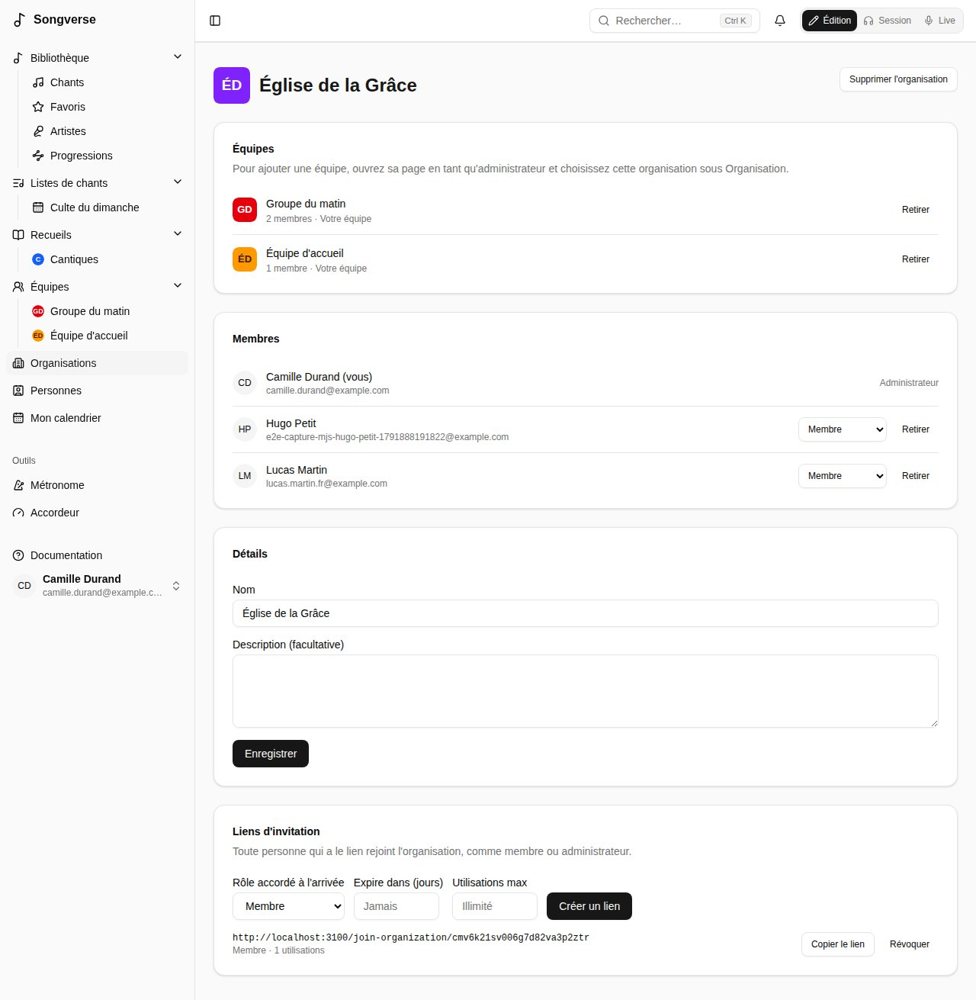
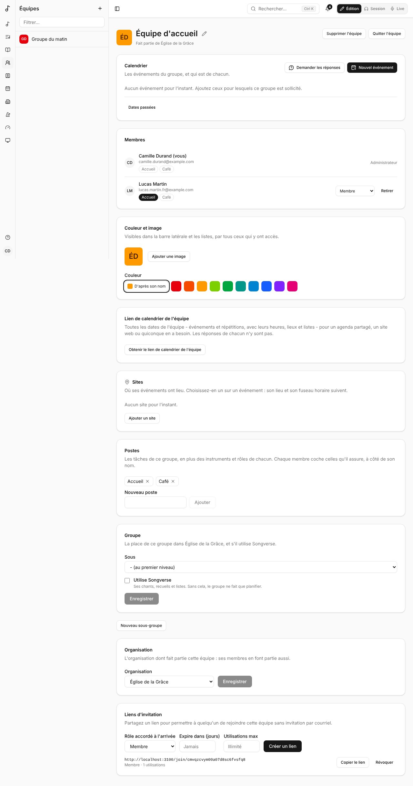
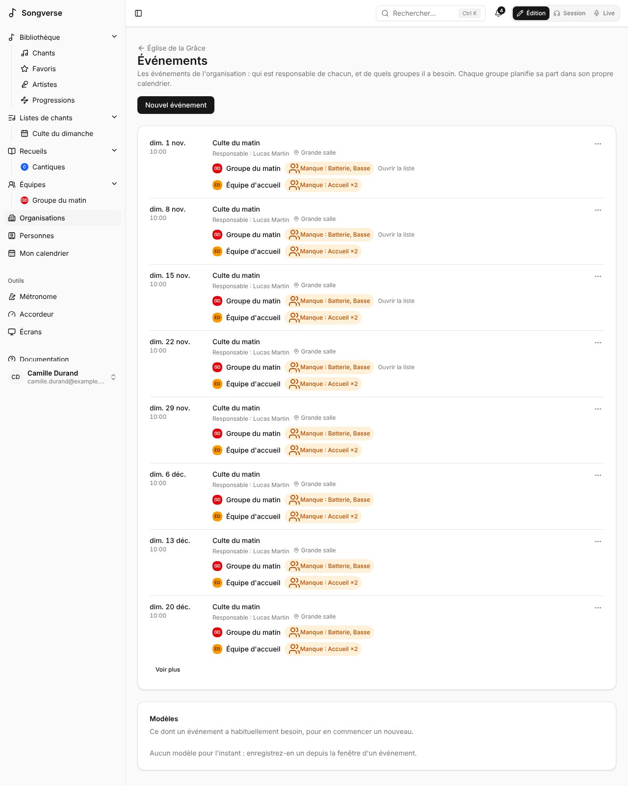

Une organisation, c'est l'église, le club ou l'école dont font partie vos équipes : l'équipe de louange, d'accueil, technique… C'est là qu'elles planifient ensemble - qui accueille chaque événement, de quelles équipes chacun a besoin - dans Songverse, ou dans [Oneverse Plan](/fr/plan/), la planification à part, quand le serveur l'a. Songverse fonctionne sans : un serveur n'a d'organisations que si ses administrateurs les ont activées (voir [Administration](/fr/admin/#organisations)), et d'ici là vous ne les voyez pas.

## Où les trouver

**Organisations**, dans la barre latérale, liste celles dont vous faites partie - avec leur nombre d'équipes et de membres, et si vous en êtes **Administrateur**. Selon le serveur :

- **Une seule organisation** : toute personne qui se connecte en fait partie. Vous ne pouvez pas la quitter.
- **Plusieurs** : vous faites partie de celles où l'on vous a invité, ou dont vous êtes dans une équipe. Si le serveur le permet, **Créer une organisation** (un **Nom** et une **Description** facultative, puis **Créer**) en crée une, que vous gérez.

### En demander une

Sur un serveur dont les administrateurs examinent d'abord chaque organisation, **Demander une organisation** prend son **Nom**, **Ce que c'est** (une église, une école, une chorale…), son **Adresse** - **Numéro et rue**, **Code postal**, **Ville** et **Pays** - la **Personne responsable** (**Prénom** et **Nom**) et un **Numéro de téléphone** pour la joindre, une **Personne à contacter** et un **E-mail de contact** - vous, ou quelqu'un qui la dirige - et, si vous voulez, son **Site web**, combien de personnes environ et une **Description**. **Envoyer la demande**, et les administrateurs de ce serveur sont prévenus ; vous l'êtes aussi quand ils l'approuvent - elle est créée, avec vous comme administrateur - ou la refusent, avec leur raison. **Vos demandes** liste celles en attente, que vous pouvez **Retirer**.

Le pays se choisit dans la liste, et le code postal est vérifié selon le format de ce pays pendant que vous le tapez (aucun n'est demandé dans un pays sans codes postaux). Le numéro de téléphone est vérifié comme un numéro qui peut exister, écrit comme dans le pays de l'adresse ou avec son indicatif (comme +44) ; rien ne lui est envoyé, et seuls les administrateurs de ce serveur le voient.

Là où les administrateurs de ce serveur ont activé les propositions d'adresses, la rue propose des adresses pendant que vous la tapez : choisissez-en une et le code postal, la ville et le pays sont remplis. En France elles viennent de la Base Adresse Nationale, ailleurs d'OpenStreetMap ; ce que vous tapez de l'adresse y est envoyé pour les trouver. Vous pouvez toujours taper l'adresse vous-même.

Si elle ressemble à une organisation déjà présente, ou qu'un autre a demandée - presque le même nom dans la même ville, ou un autre nom à la même adresse - elle n'est pas envoyée : le formulaire liste celles auxquelles elle ressemble. Si l'une d'elles est la vôtre, demandez plutôt un lien d'invitation à ses administrateurs. Si ce n'est pas la même, dites pourquoi sous **Pourquoi ce n'est pas la même** et renvoyez-la : les administrateurs voient votre note à côté de celles auxquelles elle ressemble. Presque le même nom à la même adresse, c'est la même organisation : elle ne peut pas être demandée à nouveau, même avec une note.

### S'inscrire avec son organisation

Certains serveurs n'acceptent les inscriptions que sur invitation, ou en demandant son organisation. Là, **S'inscrire** sur Oneverse commence par votre organisation - les mêmes informations que ci-dessus - et **Suivant : votre compte** la vérifie, puis affiche le formulaire habituel, votre nom rempli avec celui de la personne responsable. Créez votre compte (ou continuez avec Google) dans l'heure.

Jusqu'à ce que les administrateurs de ce serveur approuvent votre organisation, votre compte n'affiche que l'état de votre demande, sur votre page de compte Oneverse : Songverse et Planiverse vous y renvoient. Vous pouvez la **Retirer**, et en redemander une si elle a été refusée (avec leur raison). Une fois approuvée, elle est créée avec vous comme administrateur, et votre compte s'ouvre. Les invitations fonctionnent toujours : ouvrez le lien d'invitation d'une équipe ou d'une organisation, et vous êtes dedans tout de suite.

## La mettre en place

Les administrateurs d'une nouvelle organisation trouvent **Mettre en place votre organisation** en haut de sa page : les étapes pour que ses membres planifient ensemble, chacune cochée une fois faite, avec **Y aller** (la carte sur la page) et **Guide** (la page d'ici qui l'explique) :

1. **Invitez vos membres**, avec un lien d'invitation (voir [La page d'une organisation](/fr/organizations/#la-page-dune-organisation)) ;
2. **Créez vos équipes** (voir [Équipes](/fr/organizations/#équipes)) ;
3. **Définissez leurs droits** : ses rôles propres, donnés à des personnes ou à des équipes entières (voir [Ses rôles propres](/fr/organizations/#ses-rôles-propres)) ;
4. **Gardez vos fichiers dans votre propre stockage**, facultatif, là où ce serveur le permet (voir [Votre propre stockage](/fr/own-storage/)) ;
5. **Faites tourner votre propre Songverse Sonic**, facultatif, là où ce serveur le permet (voir [Votre propre serveur de séparation](/fr/sonic/)).

La croix la range ; **Afficher la liste de démarrage**, sous **Détails**, la fait revenir. Dans [Oneverse Plan](/fr/plan/), les trois dernières se font dans Songverse, sur la page de l'organisation.

## La page d'une organisation

Elle commence par son **Calendrier** : les prochaines dates de ses événements, chacune avec son responsable, son lieu et les équipes nécessaires, **Places à pourvoir** quand il manque quelqu'un à une équipe ; **Ouvrir le calendrier** les montre toutes (voir [Événements](/fr/organizations/#événements)).

Chacun y voit ses **Équipes** - chacune sous celle dont elle fait partie, celles qui n'utilisent pas Songverse marquées **Planification seule**, les vôtres marquées **Votre équipe** et qui ouvrent leur page - et ses **Membres**.

Ses administrateurs peuvent aussi :

- changer son **Nom** et sa **Description** sous **Détails**, puis **Enregistrer** ;
- choisir qui est **Administrateur** ou **Membre**, et **Retirer** quelqu'un - qui quitte aussi ses équipes (s'il est le seul administrateur de l'une d'elles, nommez d'abord quelqu'un d'autre) ;
- **Retirer** une équipe : elle continue à part entière, avec ses membres et ses chants ;
- créer des **liens d'invitation** : avec un rôle, une expiration et un nombre d'utilisations, comme ceux d'une équipe (voir [Équipes](/fr/teams/#créer-une-équipe-et-inviter)). Qui en ouvre un rejoint l'organisation, après s'être connecté ou avoir créé un compte - même sur un serveur où seules les personnes invitées peuvent s'inscrire ;
- connecter son propre serveur Songverse Sonic dans **Séparation en pistes**, quand ce Songverse le permet : les chants de ses équipes y sont séparés en pistes, sauf si une équipe connecte le sien (voir [Votre propre serveur de séparation](/fr/sonic/)) ;
- garder les fichiers des chants de ses équipes dans son propre bucket sous **Stockage propre**, quand ce Songverse le permet (voir [Son propre stockage](/fr/organizations/#son-propre-stockage)) ;
- **Supprimer l'organisation** : ses équipes restent, à part entière (pas tant qu'elle utilise son propre stockage : arrêtez-le d'abord).

**Quitter l'organisation** vous retire d'elle et de ses équipes ; son seul administrateur nomme d'abord quelqu'un d'autre administrateur.

Sous **Rôles**, ses administrateurs donnent à ses membres les rôles que l'administration permet aux équipes de donner, sur toutes ses équipes, comme le **Media operator** (opérateur média), qui gère leurs écrans (voir [Équipes](/fr/teams/#rôles-dans-léquipe)) - et ses rôles propres (voir [Ses rôles propres](/fr/organizations/#ses-rôles-propres)).

Sous **Bible**, ses administrateurs cochent **Montrer la Bible dans la barre latérale** pour les membres de toutes ses équipes (voir [Bible](/fr/bible/)).

## Y mettre une équipe

Sur la page d'une équipe, ses administrateurs choisissent l'organisation sous **Organisation** - une dont ils sont administrateurs - puis **Enregistrer**. Les membres de l'équipe rejoignent l'organisation, comme quiconque rejoindra l'équipe plus tard. La page de l'équipe indique alors **Fait partie de** l'organisation. **Aucune (une équipe à part entière)** l'en retire.

## Équipes

Les équipes d'une organisation sont tout ce qu'on y fait ensemble : l'équipe de louange, mais aussi une équipe d'accueil ou un planning de ménage. Ses administrateurs en créent une avec **Nouvelle équipe** : un **Nom**, l'équipe sous laquelle elle se place (**Sous**, ou aucune, au premier niveau), et si elle **Utilise Songverse**, puis **Créer l'équipe** - vous en êtes l'administrateur, et sa page s'ouvre.

- Une équipe qui **Utilise Songverse** a ses chants, ses recueils, ses versions et ses listes.
- Une équipe qui ne l'utilise pas (par défaut pour une nouvelle équipe) ne fait que planifier : elle a son calendrier, ses membres et ses postes, et ni chants ni recueils à elle. Ses dates peuvent tout de même avoir une liste - pour les passages bibliques, diapositives et chants du catalogue qu'elles projettent - quand son événement en demande une (**Créer une liste pour chaque date**, désactivé par défaut pour une telle équipe). Ses listes s'ouvrent dans Songverse. Elle n'apparaît pas parmi vos équipes dans Songverse ; vous la trouvez sur la page de l'organisation.

Sur la page d'une équipe, ses administrateurs changent les deux sous **Équipe**, puis **Enregistrer**. Une équipe qui a des chants, des recueils ou des arrangements continue d'utiliser Songverse tant qu'ils ne sont pas déplacés ou supprimés ; ses listes restent dans tous les cas. Une équipe retirée de l'organisation redevient une équipe à part entière, qui utilise Songverse.

Les administrateurs d'une équipe créent aussi des équipes en dessous : **Nouvelle sous-équipe** sur sa page, avec un **Nom** et si elle **Utilise Songverse**, puis **Créer l'équipe** - vous en êtes l'administrateur.

Faire partie d'une équipe ne vous met pas dans l'équipe au-dessus : chaque équipe a ses propres membres.

**Rôles qu'elle tient**, sur la page d'une équipe, dit quels rôles elle prend aux événements de l'organisation : Louange tient la **Musique** ; Technique tient **Projection**, **Sono** et **Lumières**. Un rôle demandé par un événement est alors ouvert aux membres de cette équipe dès qu'il est ajouté, affiché **Musique · Louange**, et aux membres des équipes en dessous : Projection, Sono et Lumières sous Technique. Si aucune équipe ne tient un rôle, les administrateurs choisissent qui, comme avant.

**Les propositions attendent un administrateur**, sur la page d'une équipe, fait vérifier les propositions de ses membres : quand l'un d'eux prend un poste ouvert grâce à elle, il est dans l'équipe du jour **En attente d'un administrateur** jusqu'à ce qu'un administrateur de l'équipe de l'événement ou de l'organisation choisisse **Confirmer** dans l'équipe du jour (ou l'en retire). Les administrateurs sont prévenus, et la personne aussi une fois confirmée.

## Postes

En plus des instruments et rôles que chacun indique pour lui-même, chaque équipe a ses propres **Postes** - « Accueil » et « Café » pour une équipe d'accueil, « Salle » et « Cuisine » pour un planning de ménage. Ses administrateurs les ajoutent sous **Postes** (**Nouveau poste**, puis **Ajouter**) et les retirent avec la croix.

À côté du nom de chaque membre, les postes de l'équipe s'affichent : cochez ceux que vous assurez en cliquant dessus. Les administrateurs de l'équipe peuvent les cocher pour n'importe qui ; les autres ne voient que ceux que chacun assure.

Un événement de l'équipe les demande sous **Postes nécessaires** : **Ajouter un poste** liste d'abord les **Postes de cette équipe** (voir [Postes nécessaires](/fr/teams/#postes-nécessaires)). Un poste est couvert par les membres qui l'ont coché, et son nom suit quand il est renommé ; un poste qu'un événement demande encore ne peut pas être retiré.

## Événements

Les événements d'une organisation ont besoin de plusieurs de ses équipes : un culte du dimanche demande la batterie et la basse de l'équipe de louange, deux personnes à l'accueil, quelqu'un à la régie son. Sur la page de l'organisation, **Calendrier** ouvre ses prochaines dates (**Voir plus** pour les suivantes), chacune avec son responsable et chaque équipe nécessaire. **Événements**, à côté de **Dates**, liste chaque événement une fois - son rythme, son responsable et ses équipes - avec **Modifier la série** pour en changer un en entier.

Ses administrateurs en créent un avec **Nouvel événement** : son **Titre**, sa première date, son heure de début, sa durée, son fuseau horaire, **Répétition** et **Lieu (facultatif)** comme pour l'événement d'une équipe, son **Responsable** - un membre de l'organisation, qui est prévenu - et sous **Équipes nécessaires**, **Ajouter une équipe** pour chacune, avec les postes qu'on lui demande (ses postes, instruments, rôles ou noms ; voir [Postes nécessaires](/fr/teams/#postes-nécessaires)) et, si vous voulez, son **Arrivée (minutes avant)** : les musiciens une heure avant, l'accueil un quart d'heure. La part de chaque équipe a **Créer une liste pour chaque date**, activé par défaut pour une équipe qui utilise Songverse et désactivé pour une équipe qui ne fait que planifier : désactivez-le pour une réunion, et les dates de cette équipe n'ont pas de liste. **Enregistrer l'événement** ajoute l'événement au calendrier de chaque équipe : ses administrateurs font son équipe du jour comme pour n'importe lequel de ses événements, la date d'une équipe a sa liste quand il en demande une, et les inscrits reçoivent leurs rappels.

- Dans le calendrier d'une équipe, l'événement est marqué **Planifié par** l'organisation (et son responsable). Sa date, son heure et son lieu se règlent dans les Événements de l'organisation ; les administrateurs de l'équipe choisissent seulement ce dont elle a besoin, sous **Postes nécessaires**, et son heure d'arrivée.
- Dans les Événements de l'organisation, ses administrateurs et le responsable de l'événement voient comment les postes de chaque équipe sont couverts (**Manque : Batterie**, ou **Au complet**), modifient l'événement avec **Modifier la série** (**Modifier l'événement** pour un événement qui ne se répète pas), et **Annuler cette date** - ou la rétablir - pour toutes les équipes à la fois. Les autres voient les équipes et combien sont prévus pour chacune.
- Seuls les administrateurs choisissent un autre responsable (qui est prévenu) et **Supprimer l'événement**, pour toutes les équipes. Une équipe retirée des **Équipes nécessaires** perd sa part ; une équipe retirée de l'organisation la garde, comme son propre événement.

Les administrateurs d'une équipe peuvent confier l'un de ses événements à l'organisation (voir [Calendrier](/fr/teams/#calendrier)). Il attend en haut du calendrier, pour les administrateurs de l'organisation, sous **Demandes pour rejoindre le calendrier** : **Accepter** en fait un événement de l'organisation, au même horaire, dont la personne qui a demandé est responsable, avec la part de l'équipe telle quelle - ses dates, réponses, équipes du jour et listes ; **Refuser** le laisse à l'équipe. La personne qui a demandé est prévenue dans les deux cas.

Les **Modèles** gardent ce dont un événement a habituellement besoin : dans la fenêtre d'un événement, **Enregistrer comme modèle** sous un **Nom du modèle**. **Nouvel événement** part alors de l'un d'eux avec **Modèle**, qui remplit son titre, son heure, son lieu et ses équipes. Les administrateurs retirent les modèles sous **Modèles**.

### Types d'événement

**Types d'événement**, en haut de la page de l'organisation, garde les sortes d'événements de toutes ses équipes - un culte, une soirée de prière, une réunion - pour ses administrateurs : chacun avec son horaire habituel, ses postes (lesquels sont obligatoires, et quelles places sont ouvertes à l'équipe concernée ou à d'autres équipes ; voir [Postes nécessaires](/fr/teams/#postes-nécessaires)) et **Créer une liste pour chaque date**. Ils sont proposés à chaque équipe : dans le calendrier d'une équipe, **Types d'événement** les liste, marqués du nom de l'organisation, et **Nouvel événement** les choisit comme ceux de l'équipe. Un événement créé à partir de l'un d'eux peut encore demander plus de postes. Seuls les administrateurs de l'organisation les modifient ou les suppriment ; les administrateurs de l'équipe peuvent toujours garder leurs propres types.

## Sites

Où ont lieu les événements de l'organisation - une église, une salle, un campus : ses administrateurs les ajoutent sous **Sites** sur sa page, avec **Ajouter un site** (un **Nom**, une **Adresse (facultatif)**, un **Fuseau horaire**), **Modifier** et **Retirer**. Ses événements en choisissent un avec **Site** dans leur fenêtre, ce qui remplit le lieu et le fuseau horaire, et la part de chaque équipe le suit ; un modèle le garde aussi. Les événements propres à ses équipes peuvent aussi les utiliser, à côté de ceux de l'équipe (voir [Sites](/fr/teams/#sites)).

## Ses rôles propres

Ses administrateurs créent des rôles à elle sous **Rôles** sur sa page, avec **Nouveau rôle** - le même éditeur que [Administration > Rôles](/fr/admin/#rôles), avec seulement ce qu'il revient à l'organisation de permettre, et valable seulement chez elle :

- **Garder des fichiers dans son propre stockage**, avec un **Stockage (Mo)** facultatif : ce que chaque titulaire peut garder dans son bucket, sinon la valeur par défaut sous **Stockage propre** ;
- **Importer des fichiers audio** et **Garder les originaux sans perte**, pour les chants de ses équipes gardés dans son propre stockage ;
- **Séparer des enregistrements en pistes**, sur son propre serveur Songverse Sonic (voir [Votre propre serveur de séparation](/fr/sonic/)), avec ses propres **Séparations par personne sur 30 jours** ou, vide, celle du serveur ;
- gérer, avancer, orienter et administrer les écrans de ses équipes.

Cochez qui a chacun sous le rôle. Un rôle qui garde des fichiers peut aussi être donné à des **équipes entières** : leurs membres l'ont, et son palier de stockage est la part de l'équipe. Ses noms sont les siens ; les administrateurs de ce serveur ne les voient pas dans Administration > Rôles, et ils ne valent nulle part ailleurs. Les administrateurs d'une équipe créent aussi des rôles à elle, pour son propre serveur Sonic et ses écrans (voir [Équipes](/fr/teams/#rôles-dans-léquipe)).

## Annonces

Les administrateurs d'une organisation envoient des nouvelles à ses membres depuis sa page : **Annonces**, puis **Nouvelle annonce** - un **Titre**, un **Texte** et, si vous voulez, un **Lien** (une adresse web, ou une page de l'application, tapée comme `/calendar` ou choisie sous **Ou une page de l'application**). **Destinataires** : **Tous ses membres**, ou **Les membres de certaines de ses équipes** - cochez les équipes, et **Et les équipes en dessous** pour les inclure aussi ; chacun la reçoit une seule fois. **Sous la cloche** montre à quoi elle ressemblera ; elle reste un **Brouillon** jusqu'à **Envoyer**, qui dit à combien de membres elle part. Les membres la reçoivent sous la cloche avec le nom de l'organisation, et sur leurs appareils ; par e-mail seulement s'ils l'activent. Une annonce envoyée peut encore être corrigée pour tout le monde (**Enregistrer : corrigée pour tout le monde**) ou retirée (**Retirer**).

## Son propre stockage

Une organisation peut garder les fichiers des chants de ses équipes - enregistrements, pistes, PDF et autres pièces jointes - dans un bucket à elle plutôt que sur ce serveur : son espace, sa facture. Ses administrateurs voient **Stockage propre** sur sa page quand l'administrateur du serveur a coché **Les organisations peuvent utiliser leur propre stockage** (voir [Administration](/fr/admin/#organisations)) et qu'un de leurs rôles permet le **Stockage propre des organisations** (voir [Administration](/fr/admin/#rôles)) ; sinon la carte dit à qui le demander.

Choisissez le **Fournisseur** - **Cloudflare R2**, **Amazon S3**, **Backblaze B2** ou **Wasabi** - puis son **ID du compte** (R2) ou la **Région** du bucket (les autres, comme `eu-central-1` ou `us-west-004`), le **Bucket**, l'**ID de clé d'accès** et la **Clé d'accès secrète**. Utilisez une clé qui ne peut lire et écrire que ce bucket. **Enregistrer et essayer** y écrit, relit et supprime un petit fichier, et ne garde les réglages que si cela marche ; la clé secrète est gardée chiffrée et n'est plus jamais affichée (laissez-la vide pour garder l'actuelle).

Une fois connecté :

- les fichiers déjà sur les chants de ses équipes y sont déplacés en arrière-plan, chacun vérifié octet par octet avant de quitter ce serveur ; la carte compte les fichiers qui y sont et ceux en cours de déplacement ;
- les nouveaux fichiers des chants de ses équipes y vont directement. Les chants personnels, et les images (avatars, images des chants et des équipes), restent sur ce serveur ;
- seuls ses administrateurs, et ceux à qui elle donne l'un de ses rôles propres qui coche **Garder des fichiers dans son propre stockage** (voir [Ses rôles propres](/fr/organizations/#ses-rôles-propres)), ajoutent des fichiers aux chants de ses équipes. Les autres sont invités à demander à ses administrateurs ;
- ses fichiers ne comptent pas ici dans l'espace de stockage de ses équipes. Sous **Par défaut**, en Mo, ses administrateurs fixent **Par équipe** (ce que les chants de chaque équipe peuvent y garder), **Par personne** (ce que chaque titulaire d'un rôle peut y importer) et le **Plus gros fichier** (jusqu'à 500 Mo ; les limites de ce serveur par type de fichier s'appliquent toujours). Le palier de stockage d'un rôle l'emporte, comme sur ce serveur. Un champ laissé vide ne limite pas ; **Enregistrer les valeurs par défaut** les garde. Elles valent pour les nouveaux imports et les pistes, pas pour les fichiers déjà là ou qui y sont déplacés ;
- une équipe qui quitte l'organisation, ou un chant qui passe à quelqu'un d'autre, ramène ses fichiers sur ce serveur.

Si le bucket ne répond plus, la carte le dit : les nouveaux fichiers sont gardés sur ce serveur en attendant, puis déplacés quand il répond à nouveau (il est réessayé toutes les dix minutes). Son bucket ne peut pas changer tant que des fichiers y sont.

**Arrêter de l'utiliser**, puis **Ramener les fichiers et déconnecter**, ramène chaque fichier sur ce serveur, puis déconnecte le bucket ; les fichiers sont supprimés du bucket à mesure qu'ils sont déplacés. D'ici là, l'organisation ne peut pas être supprimée.

Pourquoi l'utiliser, qui peut voir les fichiers, ce qui est à votre charge et comment le mettre en place chez chaque fournisseur : [Votre propre stockage](/fr/own-storage/). Ce qui est dans son bucket est à l'organisation de le sauvegarder : les sauvegardes de ce serveur ne le copient pas, même si une [sauvegarde de l'organisation](/fr/backups/) contient bien les fichiers de ses équipes.
