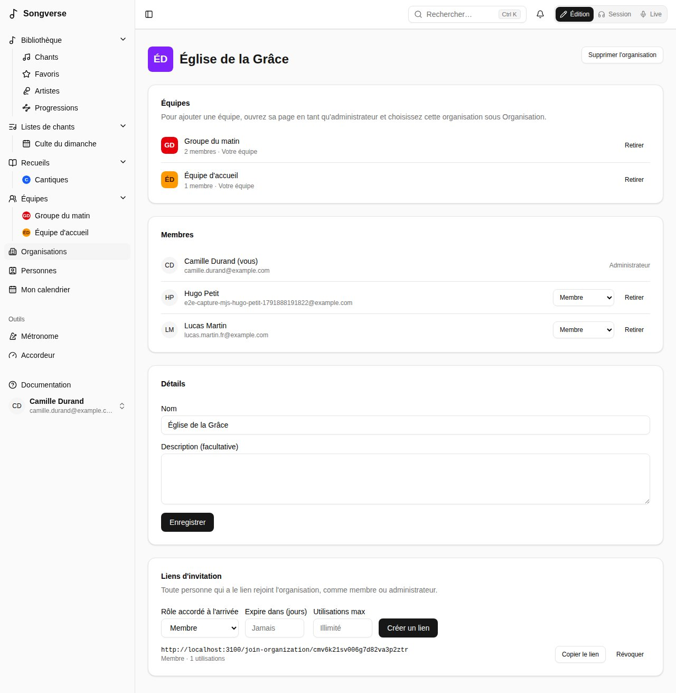
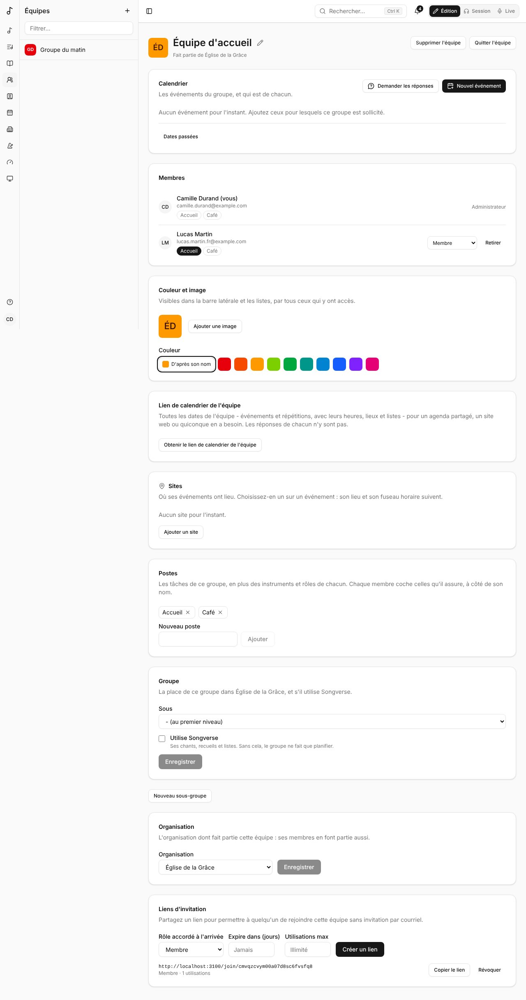
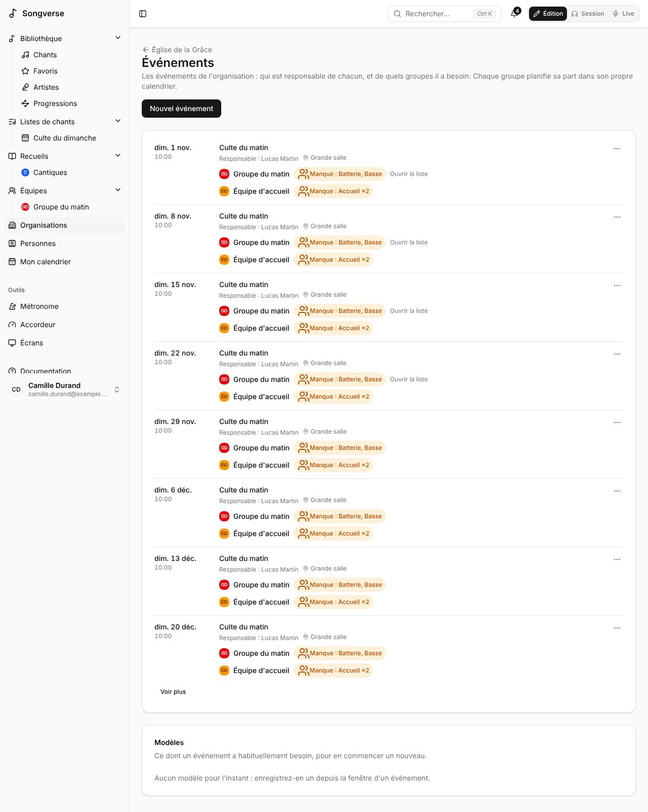

Une organisation, c'est l'église, le club ou le groupe dont font partie vos équipes : l'équipe de louange, d'accueil, technique… C'est là qu'elles planifient ensemble - qui accueille chaque événement, de quels groupes chacun a besoin - dans Songverse, ou dans [Planiverse](/fr/planiverse/), la planification à part, quand le serveur l'a. Songverse fonctionne sans : un serveur n'a d'organisations que si ses administrateurs les ont activées (voir [Administration](/fr/admin/#organisations)), et d'ici là vous ne les voyez pas.

## Où les trouver

**Organisations**, dans la barre latérale, liste celles dont vous faites partie - avec leur nombre d'équipes et de membres, et si vous en êtes **Administrateur**. Selon le serveur :

- **Une seule organisation** : toute personne qui se connecte en fait partie. Vous ne pouvez pas la quitter.
- **Plusieurs** : vous faites partie de celles où l'on vous a invité, ou dont vous êtes dans une équipe. Si le serveur le permet, **Créer une organisation** (un **Nom** et une **Description** facultative, puis **Créer**) en crée une, que vous gérez.

## La page d'une organisation

Chacun y voit ses **Groupes** - chacun sous celui dont il fait partie, ceux qui n'utilisent pas Songverse marqués **Planification seule**, les vôtres marqués **Votre équipe** et qui ouvrent leur page - et ses **Membres**.

Ses administrateurs peuvent aussi :

- changer son **Nom** et sa **Description** sous **Détails**, puis **Enregistrer** ;
- choisir qui est **Administrateur** ou **Membre**, et **Retirer** quelqu'un - qui quitte aussi ses équipes (s'il est le seul administrateur de l'une d'elles, nommez d'abord quelqu'un d'autre) ;
- **Retirer** une équipe : elle continue à part entière, avec ses membres et ses chants ;
- créer des **liens d'invitation** : avec un rôle, une expiration et un nombre d'utilisations, comme ceux d'une équipe (voir [Équipes](/fr/teams/#créer-une-équipe-et-inviter)). Qui en ouvre un rejoint l'organisation, après s'être connecté ou avoir créé un compte - même sur un serveur où seules les personnes invitées peuvent s'inscrire ;
- connecter son propre serveur Songverse Sonic dans **Séparation en pistes**, quand ce Songverse le permet : les chants de ses équipes y sont séparés en pistes, sauf si une équipe connecte le sien (voir [Votre propre serveur de séparation](/fr/sonic/)) ;
- garder les fichiers des chants de ses équipes dans son propre bucket sous **Stockage propre**, quand ce Songverse le permet (voir [Son propre stockage](/fr/organizations/#son-propre-stockage)) ;
- **Supprimer l'organisation** : ses équipes restent, à part entière (pas tant qu'elle utilise son propre stockage : arrêtez-le d'abord).

**Quitter l'organisation** vous retire d'elle et de ses équipes ; son seul administrateur nomme d'abord quelqu'un d'autre administrateur.

Sous **Rôles**, ses administrateurs donnent à ses membres les rôles que l'administration permet aux équipes de donner, sur toutes ses équipes, comme le **Media operator** (opérateur média), qui gère leurs écrans (voir [Équipes](/fr/teams/#rôles-dans-léquipe)).

Sous **Bible**, ses administrateurs cochent **Montrer la Bible dans la barre latérale** pour les membres de toutes ses équipes (voir [Bible](/fr/bible/)).

## Y mettre une équipe

Sur la page d'une équipe, ses administrateurs choisissent l'organisation sous **Organisation** - une dont ils sont administrateurs - puis **Enregistrer**. Les membres de l'équipe rejoignent l'organisation, comme quiconque rejoindra l'équipe plus tard. La page de l'équipe indique alors **Fait partie de** l'organisation. **Aucune (une équipe à part entière)** l'en retire.

## Groupes

Les groupes d'une organisation sont ses équipes : l'équipe de louange, mais aussi une équipe d'accueil ou un planning de ménage. Ses administrateurs en créent un avec **Nouveau groupe** : un **Nom**, le groupe sous lequel il se place (**Sous**, ou aucun, au premier niveau), et s'il **Utilise Songverse**, puis **Créer le groupe** - vous en êtes l'administrateur, et sa page s'ouvre.

- Un groupe qui **Utilise Songverse** est une équipe comme vous la connaissez : ses chants, ses recueils et ses listes.
- Un groupe qui ne l'utilise pas (par défaut pour un nouveau groupe) ne fait que planifier : il a son calendrier, ses membres et ses postes, mais ni chants, ni recueils, ni listes, et ses dates n'ont pas de liste. Il n'apparaît pas parmi vos équipes dans Songverse ; vous le trouvez sur la page de l'organisation.

Sur la page d'un groupe, ses administrateurs changent les deux sous **Groupe**, puis **Enregistrer**. Une équipe qui a des chants, des recueils ou des listes continue d'utiliser Songverse tant qu'ils ne sont pas déplacés ou supprimés. Un groupe retiré de l'organisation redevient une équipe à part entière, qui utilise Songverse.

Les administrateurs d'un groupe créent aussi des groupes en dessous : **Nouveau sous-groupe** sur sa page, avec un **Nom** et s'il **Utilise Songverse**, puis **Créer le groupe** - vous en êtes l'administrateur.

Faire partie d'un groupe ne vous met pas dans le groupe au-dessus : chaque groupe a ses propres membres.

## Postes

En plus des instruments et rôles que chacun indique pour lui-même, chaque groupe a ses propres **Postes** - « Accueil » et « Café » pour une équipe d'accueil, « Salle » et « Cuisine » pour un planning de ménage. Ses administrateurs les ajoutent sous **Postes** (**Nouveau poste**, puis **Ajouter**) et les retirent avec la croix.

À côté du nom de chaque membre, les postes du groupe s'affichent : cochez ceux que vous assurez en cliquant dessus. Les administrateurs du groupe peuvent les cocher pour n'importe qui ; les autres ne voient que ceux que chacun assure.

Un événement du groupe les demande sous **Postes nécessaires** : **Ajouter un poste** liste d'abord les **Postes de ce groupe** (voir [Postes nécessaires](/fr/teams/#postes-nécessaires)). Un poste est couvert par les membres qui l'ont coché, et son nom suit quand il est renommé ; un poste qu'un événement demande encore ne peut pas être retiré.

## Événements

Les événements d'une organisation ont besoin de plusieurs de ses groupes : un culte du dimanche demande la batterie et la basse de l'équipe de louange, deux personnes à l'accueil, quelqu'un à la régie son. Sur la page de l'organisation, **Événements** liste les prochaines dates (**Voir plus** pour les suivantes), chacune avec son responsable et chaque groupe nécessaire.

Ses administrateurs en créent un avec **Nouvel événement** : son **Titre**, sa première date, son heure de début, sa durée, son fuseau horaire, **Répétition** et **Lieu (facultatif)** comme pour l'événement d'une équipe, son **Responsable** - un membre de l'organisation, qui est prévenu - et sous **Groupes nécessaires**, **Ajouter un groupe** pour chacun, avec les postes qu'on lui demande (ses postes, instruments, rôles ou noms ; voir [Postes nécessaires](/fr/teams/#postes-nécessaires)) et, si vous voulez, son **Arrivée (minutes avant)** : les musiciens une heure avant, l'accueil un quart d'heure. **Enregistrer l'événement** ajoute l'événement au calendrier de chaque groupe : ses administrateurs font son équipe du jour comme pour n'importe lequel de ses événements, la date d'une équipe de louange a sa liste, et les inscrits reçoivent leurs rappels.

- Dans le calendrier d'un groupe, l'événement est marqué **Planifié par** l'organisation (et son responsable). Sa date, son heure et son lieu se règlent dans les Événements de l'organisation ; les administrateurs du groupe choisissent seulement ce dont il a besoin, sous **Postes nécessaires**, et son heure d'arrivée.
- Dans les Événements de l'organisation, ses administrateurs et le responsable de l'événement voient comment les postes de chaque groupe sont couverts (**Manque : Batterie**, ou **Au complet**), modifient l'événement avec **Modifier l'événement**, et **Annuler cette date** - ou la rétablir - pour tous les groupes à la fois. Les autres voient les groupes et combien sont prévus pour chacun.
- Seuls les administrateurs choisissent un autre responsable (qui est prévenu) et **Supprimer l'événement**, pour tous les groupes. Un groupe retiré des **Groupes nécessaires** perd sa part ; un groupe retiré de l'organisation la garde, comme son propre événement.

Les **Modèles** gardent ce dont un événement a habituellement besoin : dans la fenêtre d'un événement, **Enregistrer comme modèle** sous un **Nom du modèle**. **Nouvel événement** part alors de l'un d'eux avec **Modèle**, qui remplit son titre, son heure, son lieu et ses groupes. Les administrateurs retirent les modèles sous **Modèles**.

## Sites

Où ont lieu les événements de l'organisation - une église, une salle, un campus : ses administrateurs les ajoutent sous **Sites** sur sa page, avec **Ajouter un site** (un **Nom**, une **Adresse (facultatif)**, un **Fuseau horaire**), **Modifier** et **Retirer**. Ses événements en choisissent un avec **Site** dans leur fenêtre, ce qui remplit le lieu et le fuseau horaire, et la part de chaque groupe le suit ; un modèle le garde aussi. Les événements propres à ses groupes peuvent aussi les utiliser, à côté de ceux de l'équipe (voir [Sites](/fr/teams/#sites)).

## Son propre stockage

Une organisation peut garder les fichiers des chants de ses équipes - enregistrements, pistes, PDF et autres pièces jointes - dans un bucket à elle plutôt que sur ce serveur : son espace, sa facture. Ses administrateurs voient **Stockage propre** sur sa page quand l'administrateur du serveur a coché **Les organisations peuvent utiliser leur propre stockage** (voir [Administration](/fr/admin/#organisations)) et qu'un de leurs rôles permet le **Stockage propre des organisations** (voir [Administration](/fr/admin/#rôles)) ; sinon la carte dit à qui le demander.

Choisissez le **Fournisseur** - **Cloudflare R2**, **Amazon S3**, **Backblaze B2** ou **Wasabi** - puis son **ID du compte** (R2) ou la **Région** du bucket (les autres, comme `eu-central-1` ou `us-west-004`), le **Bucket**, l'**ID de clé d'accès** et la **Clé d'accès secrète**. Utilisez une clé qui ne peut lire et écrire que ce bucket. **Enregistrer et essayer** y écrit, relit et supprime un petit fichier, et ne garde les réglages que si cela marche ; la clé secrète est gardée chiffrée et n'est plus jamais affichée (laissez-la vide pour garder l'actuelle).

Une fois connecté :

- les fichiers déjà sur les chants de ses équipes y sont déplacés en arrière-plan, chacun vérifié octet par octet avant de quitter ce serveur ; la carte compte les fichiers qui y sont et ceux en cours de déplacement ;
- les nouveaux fichiers des chants de ses équipes y vont directement. Les chants personnels, et les images (avatars, images des chants et des équipes), restent sur ce serveur ;
- ses fichiers ne comptent pas dans l'espace de stockage de ses équipes ;
- une équipe qui quitte l'organisation, ou un chant qui passe à quelqu'un d'autre, ramène ses fichiers sur ce serveur.

Si le bucket ne répond plus, la carte le dit : les nouveaux fichiers sont gardés sur ce serveur en attendant, puis déplacés quand il répond à nouveau (il est réessayé toutes les dix minutes). Son bucket ne peut pas changer tant que des fichiers y sont.

**Arrêter de l'utiliser**, puis **Ramener les fichiers et déconnecter**, ramène chaque fichier sur ce serveur, puis déconnecte le bucket ; les fichiers sont supprimés du bucket à mesure qu'ils sont déplacés. D'ici là, l'organisation ne peut pas être supprimée.

Ce qui est dans son bucket est à l'organisation de le sauvegarder : les sauvegardes de ce serveur ne le copient pas, même si une [sauvegarde de l'organisation](/fr/backups/) contient bien les fichiers de ses équipes.
