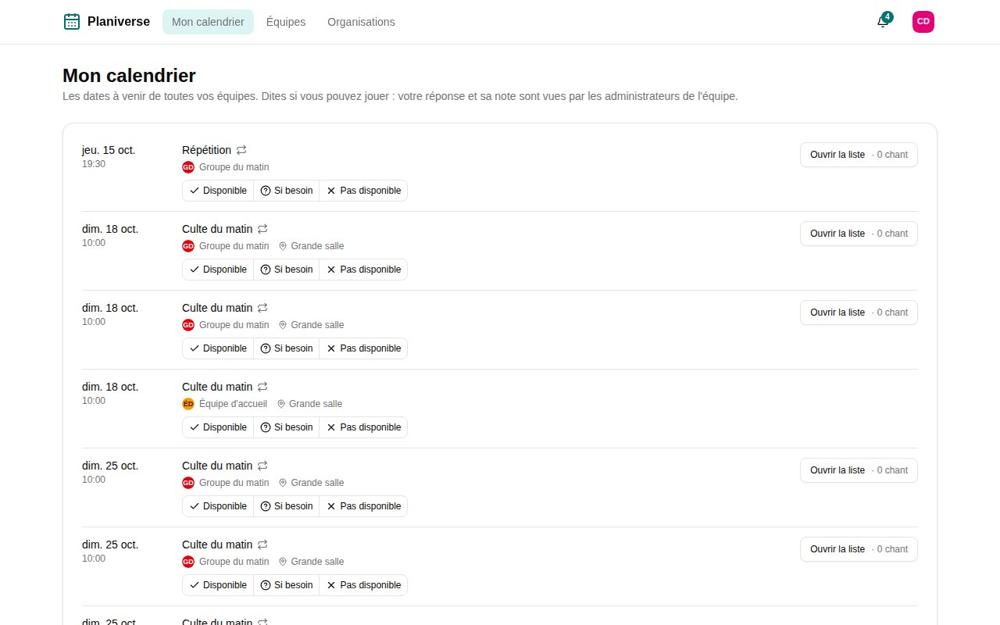

Oneverse Plan (appelé Planiverse avant), c'est la planification de Songverse à part : [Mon calendrier](/fr/teams/#calendrier), les [organisations](/fr/organizations/), leurs équipes et leurs événements, sans les chants et recueils. C'est pour ceux qui planifient avec vous sans jouer - l'équipe d'accueil, l'équipe technique, ceux qui accueillent. Un serveur ne l'a que si ses administrateurs l'ont déployé, à côté de Songverse.

## Se connecter

C'est le même compte que celui de Songverse, votre compte Oneverse : Oneverse Plan vous envoie sur Oneverse pour vous connecter (voir [Se connecter](/fr/getting-started/#se-connecter)), puis vous ramène. S'inscrire depuis là crée un compte qui marche dans les deux : le lien de l'e-mail vous ramène dans Oneverse Plan. **Paramètres du compte**, dans le menu sous votre photo, change votre nom, votre photo et votre langue, et **Gérer sur Oneverse** votre adresse e-mail, votre mot de passe et vos clés d'accès, comme [votre compte](/fr/account/) dans Songverse ; **Aide** ouvre cette page.

## Ce qu'on y trouve

- **Mon calendrier** : les prochaines dates de toutes vos équipes, avec vos réponses - Je m'inscris, Si besoin, Pas disponible - et vos jours d'absence.
- **Équipes** : toutes vos équipes, y compris celles hors de toute organisation - une sous-équipe sous celle au-dessus, quand vous êtes dans les deux.
- **Organisations** : celles dont vous faites partie, leurs équipes, membres et événements, comme dans Songverse (voir [Organisations](/fr/organizations/)).
- La page d'une équipe : son calendrier, ses membres et leurs postes, et pour ses administrateurs les mêmes outils que dans Songverse - événements, réponses demandées, équipe du jour, liens d'invitation.

Une date qui a une liste la montre - une équipe qui ne fait que planifier en a aussi, pour les passages bibliques, diapositives et chants du catalogue que sa date projette : **Ouvrir la liste** l'ouvre dans Songverse, où les listes se remplissent. **Préparer la liste**, sur une date qui n'en a pas encore, la crée et l'ouvre là-bas.

Un lien d'invitation à une organisation ou à une équipe, ouvert dans Oneverse Plan, vous y fait entrer.

## Notifications

La cloche à côté de votre photo liste vos notifications, comme dans Songverse. **Paramètres du compte** choisit aussi comment chaque type vous parvient, et les active pour l'appareil sur lequel vous êtes. Les notifications d'une équipe qui ne fait que planifier, ou d'un événement que vous accueillez, sont celles de Oneverse Plan : leurs e-mails ouvrent Oneverse Plan, et elles vont aux appareils activés dans Oneverse Plan (aux autres s'il n'y en a pas). Les autres sont celles de Songverse : appuyer sur l'une d'elles qui concerne un chant, une liste ou vos personnes l'ouvre dans Songverse. **Tout voir** ouvre la page **Notifications**.
