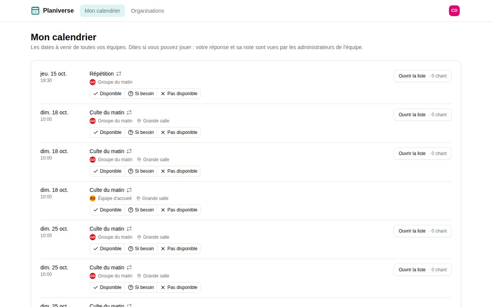

Planiverse, c'est la planification de Songverse à part : [Mon calendrier](/fr/teams/#calendrier), les [organisations](/fr/organizations/), leurs groupes et leurs événements, sans les chants, recueils et listes. C'est pour ceux qui planifient avec vous sans jouer - l'équipe d'accueil, l'équipe technique, ceux qui accueillent. Un serveur ne l'a que si ses administrateurs l'ont déployé, à côté de Songverse.

## Se connecter

C'est le même compte que celui de Songverse : la même adresse e-mail et le même mot de passe, clé d'accès ou connexion Google, à l'adresse de Planiverse. S'y inscrire crée un compte qui marche dans les deux. Ses **Paramètres du compte** (dans le menu sous votre photo) ouvrent ceux de Songverse, où sont votre nom, votre langue et vos clés d'accès.

## Ce qu'on y trouve

- **Mon calendrier** : les prochaines dates de toutes vos équipes et de tous vos groupes, avec vos réponses - Disponible, Si besoin, Pas disponible - et vos jours d'absence.
- **Organisations** : celles dont vous faites partie, leurs groupes, membres et événements, comme dans Songverse (voir [Organisations](/fr/organizations/)).
- La page d'une équipe ou d'un groupe : son calendrier, ses membres et leurs postes, et pour ses administrateurs les mêmes outils que dans Songverse - événements, réponses demandées, équipe du jour, liens d'invitation.

Une date d'une équipe qui utilise Songverse montre sa liste : **Ouvrir la liste** l'ouvre dans Songverse. Les listes se préparent là-bas, pas dans Planiverse.

Un lien d'invitation à une organisation ou à un groupe, ouvert dans Planiverse, vous y fait entrer.

## Notifications

**Notifications**, dans le menu sous votre photo, choisit comment chaque type vous parvient, et les active pour l'appareil sur lequel vous êtes - comme dans [votre compte](/fr/account/). Les notifications d'un groupe qui ne fait que planifier, ou d'un événement que vous accueillez, sont celles de Planiverse : leurs e-mails ouvrent Planiverse, et elles vont aux appareils activés dans Planiverse (aux autres s'il n'y en a pas). Les autres sont celles de Songverse.
