Un **écran** affiche une liste sur grand écran : les paroles pour l'assemblée, deux lignes à la fois, ou la grille pour le groupe. Ce peut être le navigateur d'une télé, un ordinateur ou un petit boîtier branché à un projecteur, ou une vieille tablette. Qui mène la liste la présente depuis [Live](/fr/sets/#jouer-une-liste-en-live), et chaque écran suit.

## Associer un écran

1. Sur l'écran, ouvrez **screen.oneverse.top**, l'application d'écran de Oneverse. Personne ne s'y connecte : il affiche un code et un code QR. Le code change toutes les 10 minutes tant qu'il n'est pas utilisé.

   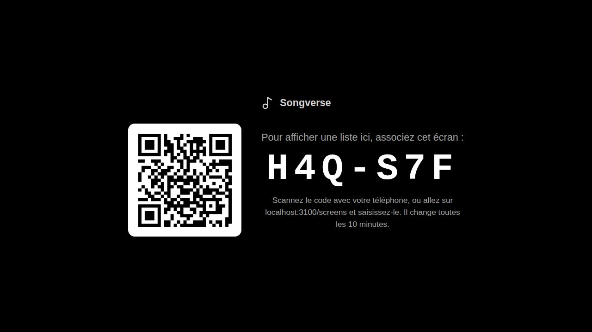

2. Sur votre téléphone ou votre tablette, scannez le code QR, ou ouvrez **Écrans** - sous **Outils** dans la barre latérale, ou depuis le menu Synchro de Live (**Écrans…**) - et saisissez le code.
3. Donnez un **Nom** à l'écran (« Télé de l'église »), choisissez la **Liste** qu'il affiche - une des vôtres, ou **La liste du jour (automatique)** (voir [plus bas](/fr/screens/#la-liste-du-jour)) **Associé pour** dit combien de temps il le reste : **Sans limite**, ou **12 heures**, **1 jour** ou **1 semaine** pour l'ordinateur d'un intervenant ou l'écran d'une salle louée (voir [Pour un temps, ou pour plusieurs](/fr/screens/#pour-un-temps-ou-pour-plusieurs)). Puis **Associer l'écran**. Ce qu'il affiche - les paroles ou la grille des musiciens - vient de son [modèle](/fr/screens/#modèles).

   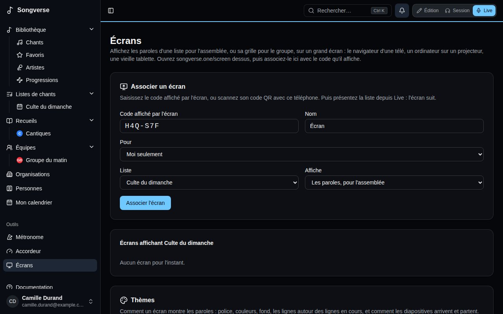

L'écran se souvient qu'il est associé : la fois suivante, ouvrez la même page et il se reconnecte tout seul. Un écran associé avant l'application d'écran, sur **songverse.top/screen**, y est envoyé et reste associé. Seul qui peut modifier la liste (son propriétaire, ou un administrateur de son équipe) peut y associer un écran, puisque c'est lui qui la mène.

**Écrans** a quatre onglets : **Écrans**, **Modèles**, **Widgets** et **Marques** (les [marques](/fr/brands/) de vos équipes et organisations). Dans **Écrans**, **Ajouter un écran** ouvre le formulaire d'association ci-dessus (un code QR l'ouvre avec le code déjà saisi). En dessous, chaque écran est une vignette : son apparence, s'il est **Connecté** (ou quand il l'a été pour la dernière fois), la liste qu'il affiche, son modèle et à qui il est. **Réglages** ouvre une boîte de dialogue pour renommer l'écran, le passer à une autre liste, changer son modèle ou son propriétaire, activer ou non ses **Effets** (voir [Effets](/fr/screens/#effets)) et choisir les **Calques affichés** (voir [Calques](/fr/screens/#calques)), avec l'apparence de l'écran à côté ; l'écran change aussitôt, et **Terminé** la ferme. **Déconnecter**, sur la vignette, l'arrête : il revient à un nouveau code.

### La liste du jour

Un écran sur **La liste du jour (automatique)** suit le planning de son propriétaire : l'écran d'une équipe affiche la liste de l'équipe datée d'aujourd'hui, celui d'une organisation la liste du jour parmi celles de ses équipes, et votre propre écran la vôtre. S'il y a deux listes le même jour, il affiche celle en cours (commencée depuis moins de trois heures), sinon la prochaine. L'écran le calcule avec sa propre horloge à chaque chargement : il passe tout seul à la liste du lendemain.

Sur l'écran lui-même, quand rien n'est présenté, **OK** sur la télécommande (ou Entrée sur un clavier) ouvre la liste des listes du propriétaire : **Aujourd'hui et à venir**, **Sans date**, puis **Archives** quand vous l'ouvrez. Déplacez-vous avec les flèches de la télécommande et choisissez avec **OK** ; le choix tient jusqu'au lendemain. **Revenir à la liste du jour** revient à celle du jour, et Retour (Échap) ferme la liste. Sans liste aujourd'hui, elle s'affiche d'elle-même. Cela fonctionne avec la télécommande d'un Chromecast avec Google TV, ou les flèches d'un ordinateur.

Une liste mise sur un écran depuis **Écrans**, dans les **Réglages** de sa vignette, est fixe : l'écran l'affiche jusqu'à ce que vous la changiez, et OK n'ouvre pas la liste. Sa vignette indique quelle est la liste du jour, ou qu'il n'y en a pas aujourd'hui.

### Événements à un site

L'écran d'une équipe ou d'une organisation peut plutôt suivre un de ses [sites](/fr/teams/#sites) : choisissez **Événements à Campus principal (automatique)** comme **Liste**. Il affiche alors la liste de l'événement qui s'y déroule (commencé depuis moins de trois heures), sinon le prochain de la journée à cet endroit, calculé dans le fuseau horaire du site ; il passe tout seul au suivant quand il commence. Une télé d'accueil ou un Pulse qui reste dans une église se règle ainsi une fois pour toutes. Sa vignette indique « À Campus principal : Culte du dimanche », ou qu'il n'y a pas d'événement en ce moment.

### Le menu de l'écran

L'écran a son propre menu, pour qui se trouve à côté, même pendant qu'une liste est présentée. Pour l'ouvrir, appuyez **trois fois sur OK** rapidement sur la télécommande (ou Entrée sur un clavier), maintenez OK environ une seconde, ou appuyez sur la touche **Menu** de la télécommande. Avec une souris, **double-cliquez** ou faites un clic droit sur l'écran ; sur un écran tactile, **appuyez longuement**. Un seul appui sur OK ou un simple clic ne l'ouvre jamais : il n'apparaît pas par accident par-dessus les paroles. Sur un écran qui suit la liste du jour, un seul appui sur OK ouvre toujours la liste des listes, une demi-seconde plus tard, quand aucun second appui ne suit.

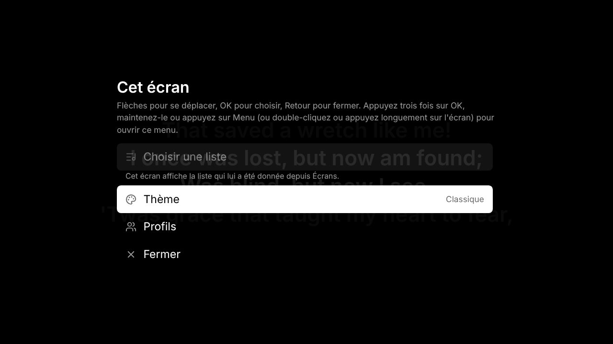

- **Choisir une liste** ouvre la liste des listes ci-dessus. Sur un écran à liste fixe, il est grisé : changez cette liste depuis **Écrans**.
- **Thème** propose les modèles **Intégrés** et les **Thèmes enregistrés** du propriétaire, celui utilisé étant marqué. Choisissez-en un avec **OK** et l'écran change aussitôt. Il garde ce thème, comme s'il avait été choisi dans les **Réglages** de sa vignette.
- **Entrée vidéo**, avec un modèle qui en affiche une (voir [Calques](/fr/screens/#calques)), liste les caméras et cartes de capture de l'appareil : **La première caméra disponible**, ou l'une d'elles par son nom. L'écran garde celle choisie, sur cet appareil. Le navigateur demande l'autorisation d'utiliser la caméra la première fois.
- **Profils** liste les profils de l'écran, un pour chaque fois qu'il a été associé, celui affiché étant marqué : choisissez-en un autre et l'écran l'affiche. **L'associer à nouveau** affiche un code pour un de plus (voir [Pour un temps, ou pour plusieurs](/fr/screens/#pour-un-temps-ou-pour-plusieurs)).
- **Retour** sort des thèmes, des caméras ou des profils, et Retour (Échap) ou **Fermer** ferme le menu.

### À qui est l'écran

Un écran est à vous, à une équipe ou à une organisation. En l'associant, **Pour** le choisit : **Moi seulement**, ou une équipe ou une [organisation](/fr/organizations/) dont vous êtes administrateur - le projecteur et l'écran de retour de l'église appartiennent à l'église, et restent quand la personne qui les a associés s'en va. Les boutons au-dessus des vignettes les montrent **Tous**, **Les miens**, ou ceux d'une équipe ou d'une organisation.

- L'écran d'une équipe est géré par ses administrateurs, celui d'une organisation par les siens : ils le renomment, changent ce qu'il affiche et son modèle, le donnent à quelqu'un d'autre avec **Appartient à**, ou le déconnectent.
- Qui a un rôle qui permet d'**Administrer les écrans** (voir [Rôles](/fr/admin/#rôles)) - la personne qui s'occupe de la technique à l'église, par exemple - fait de même pour les équipes et organisations pour lesquelles on le lui a donné, sans en être administrateur : elle y associe des écrans et des Pulse, les renomme, les modifie et les déconnecte. Elle ne donne pas un écran à quelqu'un d'autre, et n'y met que des listes qu'elle peut modifier.
- Les membres de l'équipe ou de l'organisation le voient et y mettent une de leurs listes - une liste qu'ils peuvent modifier. L'écran l'affiche comme eux la voient.
- Vos écrans partent avec votre compte ; ceux d'une équipe ou d'une organisation, quand elle est supprimée.

### Pour un temps, ou pour plusieurs

Un écran associé pour **12 heures**, **1 jour** ou **1 semaine** dit sur sa vignette quand l'association prend fin (« Jusqu'au 14 oct. 2026, 22:00 »). Ses gestionnaires la repoussent avec **Prolonger**, sur la vignette : pour cette durée à partir de maintenant, ou **Sans limite**. À la fin, l'écran est déconnecté tout seul : il revient à un nouveau code, et sa vignette disparaît d'**Écrans**.

Un même écran peut aussi avoir plusieurs profils - la télé d'une salle utilisée par deux églises, par exemple. Ses gestionnaires ouvrent ses **Réglages** et appuient sur **Afficher à nouveau un code**, ou quelqu'un devant l'écran choisit **Profils**, puis **L'associer à nouveau**, dans [son menu](/fr/screens/#le-menu-de-lécran). L'écran affiche un code, et quelqu'un d'autre l'associe comme d'habitude, à sa liste, son modèle et son propriétaire, pour la durée qu'il choisit ; **Retour** sur l'écran revient au profil qu'il affichait. Chaque profil est un écran à part dans **Écrans** : chaque propriétaire ne voit et ne modifie que le sien, et **Déconnecter** n'enlève que ce profil. L'écran passe d'un profil à l'autre depuis **Profils** dans son menu, et réaffiche le dernier quand on le rallume. Un profil déconnecté, ou arrivé à sa fin, est oublié : l'écran en affiche un autre, ou un nouveau code s'il n'en reste aucun. Un Pulse n'a qu'un propriétaire : associez plutôt un autre Pulse.

## Présenter depuis Live

La présentation passe par la [Synchro](/fr/sets/#jouer-synchronisé) : les écrans sont membres de la session de la liste.

1. Dans Live, ouvrez le menu Synchro, **Activer la synchro**, puis **Mener la liste**. Les écrans associés y figurent avec les autres membres, marqués « (écran) ».
2. Choisissez **Présenter sur les écrans**. Un panneau s'ouvre en bas de Live, avec ce que montrent les écrans.

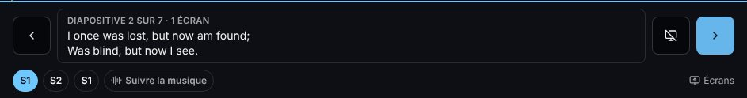

- **Diapositive suivante** et **Diapositive précédente** (les flèches de chaque côté) avancent de deux lignes. Au clavier ou avec une pédale Bluetooth tourne-page, la flèche bas ou Page suivante avance, la flèche haut ou Page précédente recule. Après la dernière diapositive d'un chant, Live passe au chant suivant de la liste et les écrans suivent ; avant sa première, à la dernière diapositive du chant précédent.
- Les sections du chant (S1, R, S2…) sous la diapositive y mènent directement, pour un refrain repris ou un couplet sauté.
- **Écran noir** éteint tous les écrans, pour une prière, une prise de parole ou entre deux chants. Appuyez de nouveau pour faire revenir les paroles.
- **Arrêter la présentation**, dans le menu Synchro, laisse les écrans afficher le nom de la liste.
- Quand l'[opérateur média](/fr/screens/#qui-pilote-les-écrans) a pris les écrans seul, le panneau le dit et ses commandes attendent qu'il les rende.

D'autres peuvent présenter à côté de vous. Dans le menu Synchro, quand vous menez, **Présentent aussi** liste les personnes de la liste : cochez quelqu'un pour qu'il présente aussi depuis son propre Live, pour cette session ; décochez-le pour arrêter. Qui peut modifier la liste, ou dont le rôle gère les écrans (voir [L'opérateur média](/fr/screens/#lopérateur-média)), présente sans qu'on le lui demande. Chaque **Diapositive suivante** fait avancer les écrans depuis ce qu'ils montrent : quand deux personnes appuient au même moment, les écrans avancent une fois, pas deux. Si quelqu'un modifie le chant pendant qu'il est affiché, un écran qui a encore les anciennes paroles recharge le chant ; tant qu'il n'a pas les paroles que vous voyez, il n'en affiche aucune plutôt que les mauvaises. Avec une connexion faible, la diapositive où vous passez reste sur votre Live, marquée **envoi…**, jusqu'à ce que le serveur l'ait, et part vers les écrans dès que la connexion revient.

### Avancer les écrans

Qui a un rôle qui permet d'**Avancer les écrans** (voir [Rôles](/fr/admin/#rôles)) - un chanteur qui fait avancer la liste, par exemple - ne présente pas, mais a **Avancer les écrans** dans le menu Synchro de Live : **Chant précédent**, **Partie précédente**, **Partie suivante** et **Chant suivant**. Les écrans passent à la première diapositive de ce chant ou de cette partie, telle que le Live de chacun la découpe : après la dernière partie d'un chant, **Partie suivante** passe au chant suivant. Comme **Diapositive suivante**, deux personnes qui appuient au même moment ne font avancer les écrans qu'une fois, et tant que quelqu'un pilote les écrans seul, rien ne se passe. Un passage de la Bible compte pour une seule partie. Cela marche de même sur Pulse quand Internet tombe.

### Quand Internet tombe : Continuer sur Pulse

Oneverse Pulse, un petit ordinateur qui reste dans la salle, est en préparation. Quand une liste en a un, il suit sa session tant qu'Internet est là, et garde ses diapositives. Si Internet tombe plus de quelques secondes, Pulse mène la session dans la salle, et Live (et la console de l'opérateur média) affiche **Continuer sur Pulse**. Touchez-le, sur un appareil connecté au réseau de la salle : la page de Pulse s'ouvre avec les diapositives de la liste et les commandes des écrans, et vous reprenez là où en étaient les écrans, sans vous reconnecter. Quand Internet revient, ce que la salle a fait redevient la session de la liste, et Live la reprend.

Un Pulse s'associe comme un écran : il affiche un code, que vous saisissez sous **Associer un écran**. Le formulaire indique alors **Ce code est celui d'un Oneverse Pulse** et le nomme « Pulse ». Donnez-lui une liste, ou plutôt **Événements à** son site (voir [Événements à un site](/fr/screens/#événements-à-un-site)) : il fait alors tourner la liste de l'événement qui s'y déroule. Dans **Écrans**, sa vignette porte un badge **Pulse**.

## Ce qu'affichent les écrans

Avec un modèle pour l'assemblée, les deux lignes de chaque diapositive sont grandes et centrées. La ligne d'avant est estompée au-dessus, celle d'après en dessous, et chaque diapositive apparaît en fondu - avec l'apparence par défaut ; un [modèle](/fr/screens/#modèles) change tout cela. Une section sans paroles, comme un instrumental, est une diapositive vide : on avance dans le chant au rythme du groupe. La première diapositive d'un chant affiche son titre, et la première et la dernière ses crédits en bas : qui l'a écrit, son copyright et son numéro de chant CCLI, tirés des informations du chant.

Avec un modèle pour les musiciens, comme **Grille du groupe**, l'écran affiche la grille du chant avec ses accords, dans la tonalité de la liste, et garde la section chantée en évidence et à l'écran.

Les paroles sont celles de la version et de la tonalité que joue la liste. Les notes du chant et les accords ne sont jamais montrés à l'assemblée. Si l'écran perd sa connexion, il l'indique dans un coin et se reconnecte tout seul.

## Modèles

Un modèle, c'est l'apparence d'un écran et ce à quoi il sert. Il est fait de trois parties, chacune enregistrée et modifiée à part, pour qu'un changement suive partout où elle sert :

- un **thème de contenu** - l'apparence des paroles et leur façon d'arriver et de partir, ou la grille d'accords pour les musiciens ;
- un **thème de fond** - la couleur, l'image, la vidéo ou la lumière en mouvement sous les paroles, et l'entrée vidéo ;
- des **effets** - le lien entre les deux : le fond qui répond aux paroles, et le mouvement propre des paroles.

Un modèle y ajoute ses **tags** et sa mise en page - des [widgets](/fr/screens/#widgets) sur une grille, et des [masques](/fr/screens/#calques). Chacun est fait pour un seul usage : il n'y a pas de bascule entre paroles et grille, un modèle pour les musiciens utilise un thème de contenu en grille d'accords. Un écran choisit un modèle dans **Modèle**, dans les **Réglages** de sa vignette ; l'écran change aussitôt.

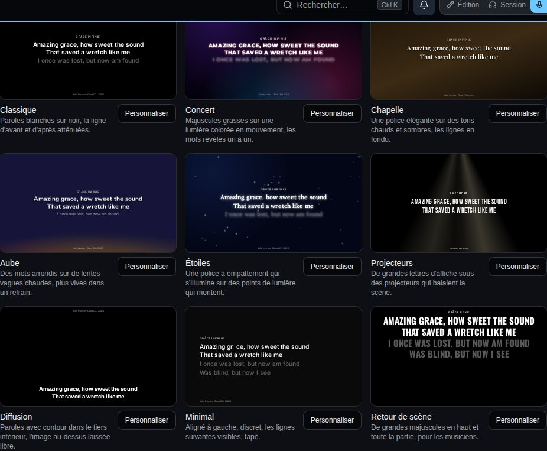

L'onglet **Modèles** a quatre vues : **Modèles**, **Thèmes de contenu**, **Thèmes de fond** et **Effets**. Chaque élément joue un chant d'exemple, pour voir comment il bouge.

### Les modèles et leurs tags

Les tags disent à quoi sert un modèle : **Public**, **Scène**, **Présentation**, **Paroles**, **Accords**, **Affichage** et **Écriture**. Choisissez des tags au-dessus de la liste pour ne voir que les modèles qui les ont tous. **Nouveau modèle** en commence un avec les parties intégrées. Les **Modèles intégrés** :

- **Classique** - paroles blanches sur noir, la ligne d'avant et d'après atténuées : l'apparence par défaut.
- **Concert** - majuscules grasses sur une lumière colorée en mouvement, les mots révélés un à un.
- **Chapelle** - une police élégante sur des tons chauds et sombres, les lignes en fondu.
- **Aube** - des mots arrondis sur de lentes vagues chaudes, plus vives dans un refrain.
- **Étoiles** - une police à empattement qui s'illumine sur des points de lumière qui montent.
- **Projecteurs** - de grandes lettres d'affiche sous des projecteurs qui balaient la scène.
- **Diffusion** - paroles avec contour dans le tiers inférieur, l'image au-dessus laissée libre pour une vidéo ou une diffusion en direct.
- **Minimal** - aligné à gauche et discret, les lignes suivantes visibles, tapé.
- **Affichage de scène** - pour la scène, sur une grille de [widgets](/fr/screens/#widgets) : la diapositive en cours et la suivante, l'heure, un compte à rebours, le chant et la suite, et les messages de l'opérateur.
- **Retour de scène** - de grandes majuscules en haut et toute la partie, pour les musiciens.
- **Grille du groupe** - la grille du chant avec ses accords, la partie chantée en vue, pour les musiciens.
- **Écriture** - pour un passage de la Bible : le style chapelle, deux versets par diapositive.

**Personnaliser** en ouvre un dans l'éditeur de modèle, avec son aperçu à côté des réglages - en **16:9** ou **4:3** - qui change à mesure que vous les changez. **⏵** lance le chant d'exemple, **‹ ›** avancent diapositive par diapositive.

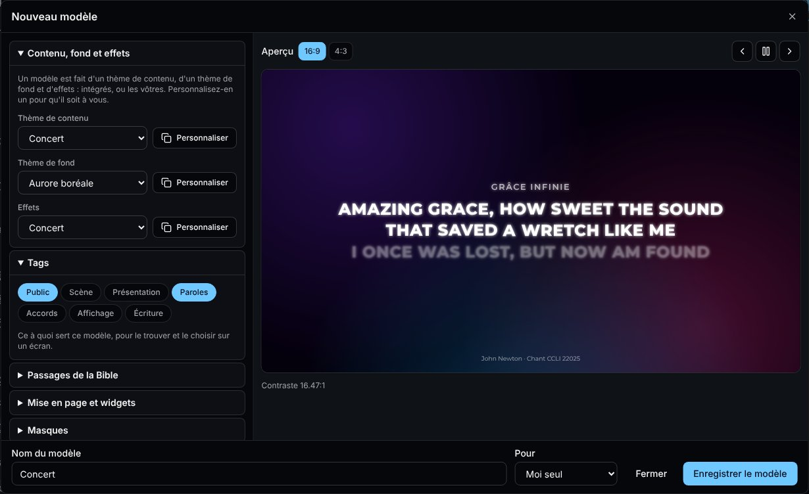

- **Contenu, fond et effets** - les trois parties du modèle : intégrées, ou les vôtres et celles de vos équipes. **Personnaliser** à côté d'une partie intégrée en fait une copie à vous et l'ouvre ; **Modifier** ouvre une des vôtres. Une partie utilisée par plusieurs modèles le dit : la changer les change tous.
- **Tags** - ce à quoi sert le modèle.
- **Passages de la Bible** - **Versets par diapositive** : combien de versets d'un passage vont sur une diapositive quand un passage d'une liste est affiché avec ce modèle (voir [Bible](/fr/bible/#lajouter-à-une-liste)). Étiquetez-le **Écriture** pour le proposer en premier pour les passages.
- **Mise en page et widgets** - place des [widgets](/fr/screens/#widgets) sur une grille. Voir plus bas.
- **Masques** - du noir sur une partie de l'image, ou une fenêtre sur l'entrée vidéo. Voir [Calques](/fr/screens/#calques).

Nommez le modèle et **Enregistrer le modèle** : il est à vous ou - si vous administrez une équipe - à l'équipe, pour que chaque membre puisse le choisir pour ses écrans (seuls ses administrateurs le modifient). Le modèle d'une équipe utilise les parties de l'équipe. Un modèle que vous pouvez modifier a **Modifier** et **Supprimer** ; le supprimer remet ses écrans sur l'apparence par défaut, et ses parties restent.

### Thèmes de contenu

L'apparence des paroles, modifiée depuis **Thèmes de contenu** (**Nouveau thème de contenu**, ou **Personnaliser** un thème intégré) ou depuis un modèle :

- **Affiche** - **Les paroles, pour le public** ou **La grille d'accords, pour les musiciens**.
- **Texte** - la police (ou une **Police envoyée** : un fichier WOFF2, WOFF, TTF ou OTF que vous avez le droit d'utiliser ainsi), sa taille (**Ajustée à la ligne**, ou fixe), sa graisse, sa couleur, **Majuscules**, **Lisibilité** (une ombre, un contour ou un halo, pour des paroles sur un fond animé), l'alignement, l'interligne et l'espacement des lettres.
- **Lignes** - **La diapositive**, avec les lignes d'avant et d'après, ou **Toute la partie** avec les lignes de la diapositive mises en avant ; les lignes autour **Atténuées**, **Plus petites**, **Floues** ou **Masquées**.
- **Mise en page** - en haut, au centre, en bas ou **Tiers inférieur**, et une **Marge de sécurité** pour les téléviseurs qui rognent les bords.
- **Mouvement** - **Entre les diapositives** : une coupe, un fondu, un glissement, une montée, une échelle, un flou ou un zoom, et sa durée (un nouveau chant prend deux fois plus de temps). **Apparition des mots** : d'un coup, ligne par ligne, mot par mot, lettre par lettre, tapés ou en lumière.
- **Titre et crédits** - afficher ou non le titre du chant et ses crédits (auteurs, copyright, numéro CCLI), sur quelles diapositives et où.
- **Accords** - pour la grille d'accords : la couleur des accords et la taille de la grille.

L'éditeur vérifie le contraste entre les paroles et le fond et prévient en dessous de 4,5:1.

### Thèmes de fond

Ce qu'il y a sous les paroles :

- **Base et entrée vidéo** - la couleur de base et la caméra ou la carte de capture de l'écran. Voir [Calques](/fr/screens/#calques).
- **Fond** - une **Couleur**, un **Dégradé**, de la lumière en mouvement (**Aurore**, **Vagues**, **Particules**, **Projecteurs**, jusqu'à quatre couleurs), ou votre propre **Image** (qui se rapproche lentement) ou **Vidéo** en boucle : **Envoyer…** un JPEG, PNG, WebP, AVIF ou GIF jusqu'à 15 Mo, ou un MP4 ou WebM jusqu'à 150 Mo. **Assombrir** garde les paroles lisibles sur n'importe quel fond.
- Quatre fonds suivent les paroles à l'écran, où que le modèle les place :
  - **Courants** - des traînées qui dérivent sur l'écran, s'écartent autour des paroles, et jaillissent là où chaque mot apparaît ;
  - **Cordes** - des lignes lumineuses qui ondulent sur l'écran, contournent les paroles et vibrent à chaque nouvelle diapositive ;
  - **Grille** - une grille discrète dont les cases s'allument sous chaque mot qui apparaît, puis s'éteignent ;
  - **Bokeh** - de grands disques flous qui dérivent et se rassemblent derrière les paroles.

  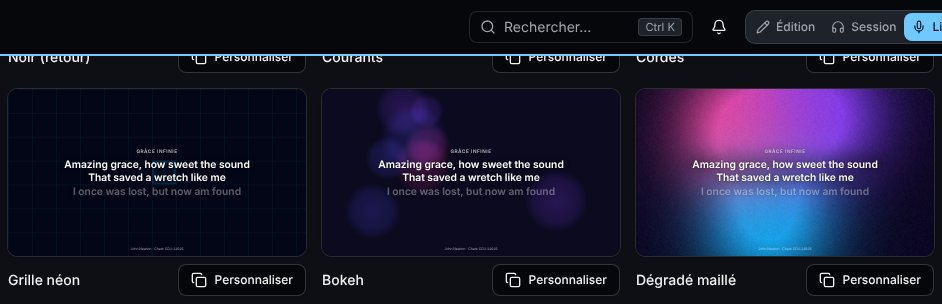

  La première couleur est le fond, les autres celles des traînées, cordes, cases ou disques. Avec des effets, ils bougent aussi plus vite, changent de couleur, s'éclairent ou grossissent, selon **Sa réponse aux effets**. Avec un **Mouvement** à 0, ils restent immobiles.
- Un **Shader** est dessiné par la puce graphique de l'écran (WebGL 2) : **Dégradé maillé** (des couleurs douces qui se fondent les unes dans les autres), **Dégradé maillé Paper** (toutes les couleurs qui coulent les unes dans les autres, déformées et tourbillonnantes), **Bruit neuronal** (des fils lumineux qui se tissent comme des nerfs), **Lignes lumineuses** (des lignes qui ondulent sur l'écran) ou **Braises** (des points de lumière qui montent en profondeur) ; le Dégradé maillé Paper et le Bruit neuronal viennent de [Paper Shaders](https://shaders.paper.design). Chacun a ses **Réglages du shader** - luminosité, contraste, saturation, changement de couleur, grain, rotation, échelle et position, les mêmes pour tous les shaders, puis les siens (douceur, nombre, etc.) - et reste plus calme derrière les paroles. Un shader prend jusqu'à huit **Couleurs** : ajoutez-en une avec **+**.  **Réinitialiser les réglages** les remet par défaut. **Mouvement** règle son rythme, et **Rotation continue** le fait tourner lentement, dans un sens ou dans l'autre, pour un shader qui peut tourner.

  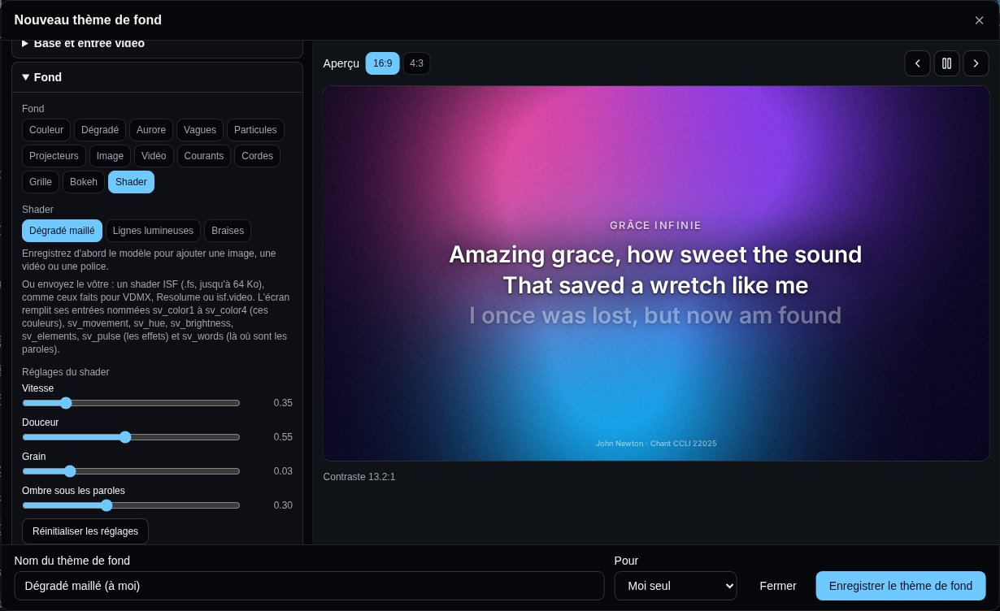

  Vous pouvez aussi **Envoyer…** le vôtre : un shader [ISF](https://isf.video) (un fichier `.fs` jusqu'à 64 Ko), le format de VDMX, Resolume et de nombreux sites de shaders. Ses entrées deviennent ses réglages. Les entrées nommées comme le dit la [spécification des shaders](https://github.com/Vulcio/Oneverse/blob/main/docs/screen-shader-spec.md) - `sv_brightness`, `sv_contrast`, `sv_hue`, `sv_rotation`, `sv_scale` et les autres - ont les mêmes réglages que les shaders intégrés et répondent aux effets ; l'écran remplit `sv_color1` à `sv_color8` (les couleurs du thème), `sv_pulse` (ce que déclenchent les effets), `sv_speed`, `sv_quality` et `sv_words` (une image, blanche là où sont les paroles). Un fichier sans en-tête ISF est refusé ; un que l'écran ne peut pas dessiner montre les couleurs à la place. Les shaders à plusieurs passes ne sont pas encore dessinés.

  Un écran qui ne suit pas dessine le shader avec moins de détails d'abord, puis plus petit, et revient dès qu'il peut : une clé TV bouge encore sans à-coups, un mini PC le dessine entièrement en pleine taille. Un écran sans WebGL 2 (certaines anciennes clés TV) montre les couleurs du shader, qui dérivent lentement, à la place.
- **Sa réponse aux effets** - à quel point son **Mouvement**, son **Changement de couleur**, sa **Luminosité** et ses **Éléments** (taches, vagues, particules, faisceaux) bougent quand des effets les déclenchent ; pour un shader, sa **Rotation** et son **Échelle** aussi.

Les polices et les images s'ajoutent à un thème de contenu ou de fond enregistré : enregistrez-le d'abord ; elles comptent dans votre stockage.

### Effets

Les effets relient les paroles au fond. **Réactions** : **Quand** une diapositive arrive, une ligne ou un mot apparaît, une nouvelle partie commence, ou dans un refrain (tant qu'il dure), **le fond** pulse de lumière, bouge plus vite, change de couleur, s'éclaire, fait grossir ses éléments, tourne ou se rapproche - chacun autant que vous le choisissez, fois la réponse du fond. **Montée** est le temps qu'il met à y arriver et **Retombée** le temps qu'il met à revenir au calme : un fond lent qui accélère à chaque diapositive, puis se calme en une demi-seconde, c'est **bouge plus vite** avec une **Montée** et une **Retombée** courtes. **Le mouvement des paroles** : **Pulsation**, **Respiration**, **Lueur**, **Scintillement** ou **Flottement**, avec son intensité et sa vitesse. Un modèle peut n'avoir aucun effet.

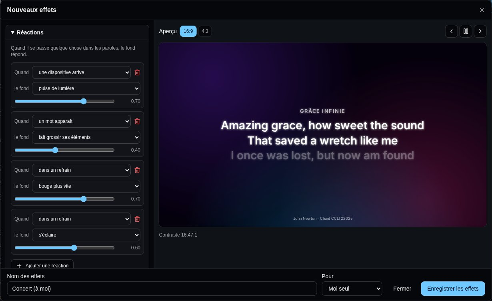

Un écran qui ne suit pas - une vieille télé, une petite clé HDMI - peut désactiver les **Effets** dans les **Réglages** de sa vignette : il affiche le même modèle, sans les réactions ni le mouvement des paroles.

Chaque écran dit ce qu'il est et comment il dessine, toutes les demi-minutes tant qu'il est connecté : sa vignette montre s'il suit - **Fluide**, **Limité** ou **Minimal** - et ses **Réglages** montrent son **Appareil** : le navigateur et le modèle, sa puce graphique et le WebGL qu'il a, ses cœurs et sa mémoire, son écran, et comment son fond se dessine (images par seconde, l'image la plus lente, les détails et la résolution d'un shader). **Fluide** fait tout tourner ; **Limité** fait tourner les shaders avec moins de détails ou en résolution réduite, et des effets légers (une clé TV comme un Chromecast, un Raspberry Pi sur un grand écran) ; **Minimal** doit s'en tenir aux fonds fixes, sans effets.

### Calques

Un écran dessine son modèle en calques, de bas en haut :

1. **Base** - une couleur sous tout le reste : **La première couleur du fond**, ou une couleur à elle.
2. **Entrée vidéo** - la caméra ou la carte de capture de l'écran (**Caméra ou carte de capture**), pour montrer une caméra ou la sortie d'une régie vidéo sous les paroles. **Remplir l'écran** ou **Image entière**, et son opacité. Chaque écran utilise l'appareil branché sur lui, choisi dans [son menu](/fr/screens/#le-menu-de-lécran) ; un aperçu montre où elle se place.
3. **Média** - le **Fond** ci-dessus : une couleur, un dégradé, de la lumière en mouvement, une image ou une vidéo. Un fond **Couleur** est la base : l'entrée vidéo se voit à travers.
4. **Contenu** - les paroles, et les widgets qui montrent le chant (la diapositive actuelle et la suivante, les parties, le chant, les éléments de la liste).
5. **Superpositions** - les autres widgets (horloges, minuteurs, messages, codes QR…) et la carte de titre de l'opérateur.
6. **Masques** - **Ajouter un masque** : un **Rectangle** ou une **Ellipse**, placé en % de l'écran, avec un **Bord adouci**. **Couvrir de noir** cache cette partie de l'image, pour un projecteur sur un mur de forme irrégulière ; **Fenêtre sur la vidéo** traverse le média à cet endroit : l'entrée vidéo s'y voit, les paroles restant par-dessus. **Tout sauf la forme** l'inverse.

Le **Calque** d'un widget, dans ses réglages sur la grille, le fait passer du **Contenu** aux **Superpositions**. L'[opérateur média](/fr/screens/#écrans-et-calques) affiche, masque ou vide chaque calque, et les **Calques affichés** d'un écran, dans les **Réglages** de sa vignette, en écartent certains pour de bon : un retour de scène sans le média, une TV d'accueil sans le contenu. Le choix de l'écran l'emporte : l'opérateur ne peut pas activer un calque qu'il écarte.

Tout ce qui bouge est dessiné par la puce graphique de l'écran : ça reste fluide sur le navigateur d'un téléviseur. Un appareil qui demande moins d'animations a des fonds immobiles et de simples fondus.

Pour essayer un modèle intégré sur un écran, ou afficher les paroles dans un logiciel de diffusion (comme source navigateur), ajoutez `?theme=` et son nom à l'adresse de l'écran : **screen.oneverse.top/?theme=stream**. C'est pour cet appareil seulement, tant que l'adresse ne change pas.

## Widgets

Un modèle peut placer des widgets sur une grille : un affichage de scène montre aux chanteurs la diapositive en cours et la suivante, l'heure et le temps restant ; l'écran de l'assemblée peut ajouter une horloge dans un coin, ou le mot de passe Wi-Fi. L'onglet **Widgets** les liste :

- **Paroles ou grille** - ce que l'écran affiche sans grille : les paroles, ou la grille pour le groupe, avec l'apparence du modèle.
- **Diapositive en cours** et **Diapositive suivante** - les paroles affichées pour l'assemblée, et celles qui arrivent (la première du chant suivant, à la fin d'un chant).
- **Partie en cours** et **Partie suivante** - toute la partie, chaque ligne : celle qu'on chante, la diapositive à l'écran mise en avant, et celle d'après.
- **Structure du chant** - les parties du chant dans l'ordre où on les chante (C1 R C2 R P R), celle en cours mise en avant, et une **Barre de progression** dans le chant.
- **Horloge** - sur **24 heures** ou **12 heures (AM/PM)**, avec **Les secondes** et **La date** au besoin. **Horloge à aiguilles** - un cadran, avec une **Trotteuse** au besoin.
- **Compte à rebours** - le temps restant. **Temps donné par** : **L'opérateur média**, **Une durée fixe, depuis l'arrivée de l'élément**, ou **Jusqu'à une heure donnée** (le début du culte). **Après zéro**, il peut **Continuer, en rouge** ou **Rester à 0:00**, et passe à l'orange vers la fin. **Couleurs selon le temps restant** règle les vôtres : **Ajouter un palier**, donnez-lui une durée (m:ss) et la couleur de son **Texte** et de son **Fond** à partir de là - orange sous 5:00 et blanc sur rouge sous 1:00, par exemple.
- **Chronomètre** - le temps écoulé depuis **Le chant à l'écran, depuis son arrivée**, ou depuis que l'opérateur média l'a lancé. **Couleurs selon le temps écoulé** fonctionne comme pour un compte à rebours, une fois ce temps passé.
- **Message** - un court message de l'opérateur média, affiché jusqu'à ce qu'il l'efface.
- **Chant** et **Chant suivant** - le titre du chant, avec sa tonalité et son tempo, et ce qui vient ensuite dans la liste.
- **Élément en cours** et **Élément suivant** - ce qui se passe dans la liste et ce qui vient ensuite, chants ou non, avec **Sa place dans la liste (3 sur 8)**.
- **Texte** - vos propres mots.
- **Date** - la date du jour, **Écrite** **dimanche 20 octobre**, **20 oct. 2026**, **20/10/2026**, **2026-10-20** ou le jour seul, **Avec l'heure** si vous le souhaitez.
- **Numéro de diapositive** - quelle diapositive est à l'écran, sous la forme 3 / 12 : **Compter** **Les diapositives du chant** ou **Les diapositives de toute la liste**, avec une **Barre de progression** (**Fine**, **Épaisse** ou **Aucune**) dessous.
- **Code QR** - un code que l'on scanne avec son téléphone. **Il contient** **Une adresse web**, **Un événement** (son titre, son début, sa fin et son lieu, ajouté à l'agenda), **Une fiche contact** (nom, téléphone, e-mail, organisation) ou **Le Wi-Fi** (le nom du réseau et son mot de passe, pour s'y connecter d'un geste). Son libellé s'écrit dessous.

Chacun s'anime dans l'onglet **Widgets**, avec un chant d'exemple. **Personnaliser** règle son apparence par défaut - ses options, sa police, sa couleur, sa taille, son fond et ses coins - qu'il prend quand on l'ajoute à un modèle : **Enregistrer par défaut** pour vous, ou, avec **Pour**, pour une équipe dont vous êtes administrateur. Un modèle d'équipe prend l'apparence de l'équipe, sinon la vôtre, sinon celle intégrée ; **Revenir à l'apparence intégrée** oublie la vôtre. Un modèle qui a déjà le widget garde la sienne.

Dans l'éditeur de modèle, **Mise en page et widgets** les place :

1. **Partir de** une mise en page toute faite - **Les paroles seules**, **Paroles et horloge** ou **Affichage de scène** - ou **Ajouter un widget** aux paroles.
2. Sur l'aperçu, faites glisser un widget pour le déplacer, et tirez son coin pour le redimensionner. Une fois choisi, les flèches du clavier le déplacent, et avec Maj elles le redimensionnent. **Afficher la grille** masque les cases pour voir l'écran tel qu'il sera.
3. Choisissez un widget, dans la liste ou sur l'aperçu, pour régler ce qu'il affiche et son **Apparence** : sa police et sa couleur (ou celles du modèle), sa taille, un **Fond derrière** et des **Coins arrondis**. Dans la liste, les flèches le mettent devant ou derrière, là où des widgets se chevauchent.
4. **Colonnes**, **Lignes** et **Espace entre les cases** règlent la grille, et **L'écran noir masque** **Tout** ou **Seulement les paroles (minuteurs et horloge restent)** - un affichage de scène garde son horloge et son compte à rebours quand les écrans de l'assemblée passent au noir.

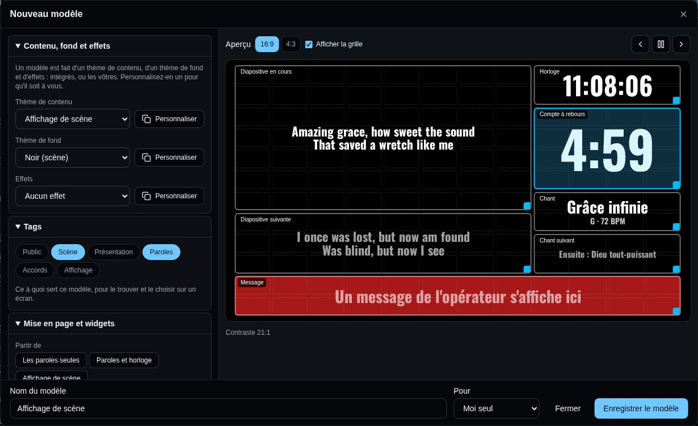

Chaque écran qui utilise le modèle affiche ses widgets, chacun dans ses cases. Les widgets que l'opérateur média pilote - ses comptes à rebours et ses messages - viennent de la liste présentée.

## L'opérateur média

Qui pilote les écrans pendant le culte - l'opérateur média - a sa propre vue : **Vue opérateur**, sur la page de la liste, ou dans le menu Synchro de Live (elle s'ouvre dans un nouvel onglet, pour que Live continue). C'est une page de Live : l'application passe en mode Live. Quiconque peut modifier la liste peut l'utiliser, qu'il mène la liste ou non, ainsi que qui a un rôle qui permet de **Gérer les écrans** (voir [Rôles](/fr/admin/#rôles)), sur toutes les listes qu'il peut ouvrir ; elle ne joue ni le métronome ni les pistes.

La même console est sur **screen.oneverse.top/operate**, sans Songverse : connectez-vous avec votre compte Oneverse, puis choisissez une liste sous **Gérer les écrans**. Elle pilote les écrans, leur minuteur, leurs messages et leurs calques, mais jamais le métronome ni les pistes.

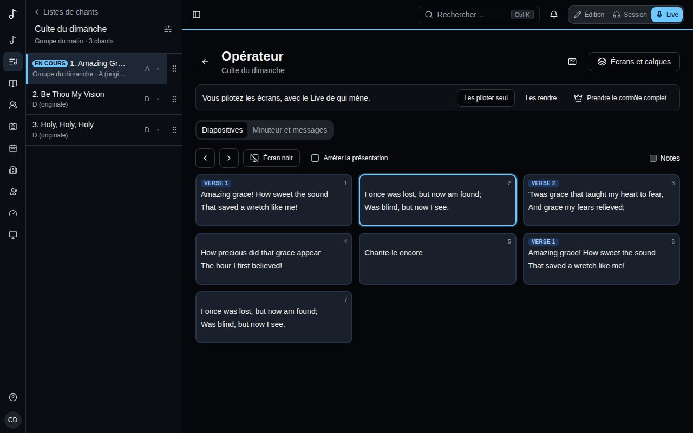

### Qui pilote les écrans

Vous pouvez envoyer des diapositives dès que la vue opérateur s'ouvre, à côté du Live de qui mène : chaque diapositive envoyée fait avancer les écrans depuis ce qu'ils montrent, si bien qu'un « suivant » pressé ici et dans Live au même moment les fait avancer une fois. La barre en haut dit qui pilote les écrans, et vous permet de les prendre :

- **Prendre les écrans** - la barre montre à tous que vous les pilotez ; Live continue aussi de présenter.
- **Les prendre seul** - vous seul envoyez des diapositives. Dans Live, le panneau de présentation dit qui pilote les écrans, et ses commandes attendent que vous les rendiez (**Les rendre**).
- **Partager avec Live** et **Les piloter seul** passent de l'un à l'autre ; **Les rendre** redonne les écrans à qui mène.
- **Prendre le contrôle complet** vous fait aussi mener la liste : le métronome, les pistes et le chant que tout le monde suit, comme dans Live.

Si vous fermez la vue opérateur, les écrans reviennent à qui mène. Si c'est votre connexion qui tombe (le Wi-Fi de la régie, un rechargement), ils vous attendent une minute, toujours à vous seul si vous les aviez pris seul, et la vue opérateur les reprend en se reconnectant ; entre-temps, la barre et Live indiquent que vous avez perdu la connexion. Sans retour dans la minute, ils reviennent à qui mène.

### La liste et ses diapositives

La barre latérale montre les chants de la liste, comme dans Live. Celui qui est sur les écrans est marqué **En cours**, et ceux que les écrans ont dépassés sont cochés comme joués (**Reprendre au début** les efface). Choisissez-y un chant pour voir ses diapositives.

L'onglet **Diapositives** montre chaque diapositive de ce chant en vignette, colorée selon sa section (couplet, refrain, pont…). Une vignette envoie sa diapositive à tous les écrans ; les flèches (**Diapositive suivante** et retour) les font défiler, et **Écran noir** et **Arrêter la présentation** marchent comme dans Live.

Cochez **Notes** pour voir les notes du chant sous les diapositives où elles sont : **Toutes les notes**, ou seulement celles des personnes qui tiennent l'un des [postes](/fr/organizations/#postes) de l'équipe (*Notes de : Média*), pour les repères qui vous sont destinés.

### Minuteur et messages

L'onglet **Minuteur et messages** :

- **Sur les écrans** - le chant et la diapositive que les écrans affichent, et s'ils sont au noir.
- **Minuteur** - ce qu'affichent les widgets **Compte à rebours** et **Chronomètre** quand leur temps est donné par **L'opérateur média** : choisissez une durée (1, 3, 5, 10, 15 ou 30 minutes, ou tapez-en une et **Régler**), ou **Chronomètre** ; puis **Démarrer** et **Pause**, **Remettre à zéro**, une minute de moins ou de plus (**-** et **+**), ou **Effacer**. Après zéro, un compte à rebours passe au rouge.
- **Message à la scène** - tapez-en un et **Envoyer**, ou choisissez-en un tout prêt (**On conclut**, **Une minute**, **Chant suivant**…). Il s'affiche dans le widget **Message** des écrans de la liste jusqu'à ce que vous l'effaciez (**Effacer**).

Un chant de la liste peut avoir son propre minuteur (**Minuteur sur les écrans**, sur la [page de la liste](/fr/sets/#les-chants-dune-liste)) : un compte à rebours de cinq minutes pour une prise de parole, un chronomètre pour un chant. Quand le Live de qui mène arrive à ce chant, le minuteur démarre tout seul sur les écrans.

### Écrans et calques

**Écrans et calques**, en haut à droite, ouvre un panneau sur la droite, à côté des diapositives plutôt que par-dessus, comme le panneau **Affichage**. Sur un téléphone, il s'ouvre en bas. Les diapositives, la barre latérale et le clavier restent utilisables pendant qu'il est ouvert. Il montre les **Écrans connectés** qui affichent la liste, et les **Calques** qu'ils dessinent (voir [Calques](/fr/screens/#calques)), du haut vers le bas : **Masques**, **Superpositions**, **Contenu**, **Média** et **Entrée vidéo**.

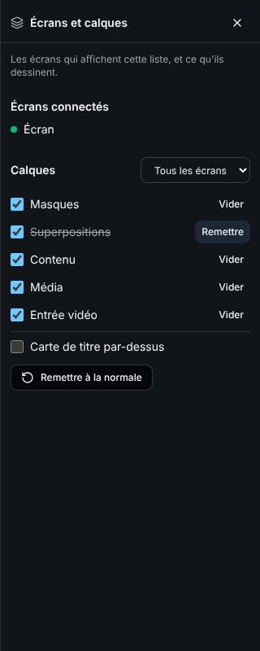

- **Calques de** - **Tous les écrans**, ou l'un des écrans connectés. Un changement pour un écran lui est propre (« ses propres calques » à côté de son nom) ; un changement pour tous les écrans l'atteint aussi. **Comme tous les écrans** le remet comme les autres.
- La case d'un calque l'affiche ou le masque. Sans **Contenu**, les écrans n'affichent que le fond (pour une vidéo ou un moment calme) pendant que les diapositives continuent d'avancer ; sans **Média**, les paroles s'affichent sur la couleur de base.
- **Vider** masque un calque jusqu'à la diapositive ou au chant suivant, comme dans d'autres logiciels de présentation ; il revient tout seul, ou avec **Remettre**.
- **Carte de titre par-dessus** - le nom de la liste et de l'équipe, par-dessus ce qu'affichent les écrans, avant le culte ou entre deux parties.
- **Remettre à la normale** réaffiche tous les calques, sur tous les écrans, sans la carte de titre.

Un calque qu'un écran écarte dans ses propres réglages reste masqué sur lui, quoi que dise le panneau.

Qui a un rôle qui permet d'**Orienter les écrans** (voir [Rôles](/fr/admin/#rôles)) - la technique à la régie, par exemple - ouvre aussi la vue opérateur, depuis le menu Synchro de Live, et n'y a que ces écrans et ces calques : il change ce que dessinent les écrans, mais ne présente pas, et ne touche ni au minuteur ni aux messages. Quand quelqu'un pilote les écrans seul, lui seul change les calques, y compris qui mène la liste ; le reste revient quand il les rend.

### Raccourcis clavier

Le clavier pilote aussi les écrans. Le bouton clavier à côté de **Écrans et calques** liste les raccourcis :

| Touches | Effet |
| --- | --- |
| → ↓ Page suivante | Diapositive suivante, jusque dans le chant suivant après la dernière |
| ← ↑ Page précédente | Diapositive précédente, jusque dans le chant précédent |
| Entrée | Afficher le chant que vous regardez |
| Début, Fin | Première ou dernière diapositive du chant |
| B ou . | Écran noir, ou retour |
| S | Arrêter la présentation |
| W | Contenu affiché ou non (les paroles) |
| G | Média affiché ou non (le fond) |
| V | Entrée vidéo affichée ou non |
| O | Superpositions affichées ou non |
| M | Masques affichés ou non |
| Maj avec W, G, V, O ou M | Vider ce calque jusqu'à la diapositive suivante |
| T | Carte de titre affichée ou non |
| C | Calques remis à la normale |

Les touches des calques agissent sur tous les écrans.

Les raccourcis ne se déclenchent pas pendant que vous tapez un message. Un bouton qui a le focus garde sa propre touche Entrée.
