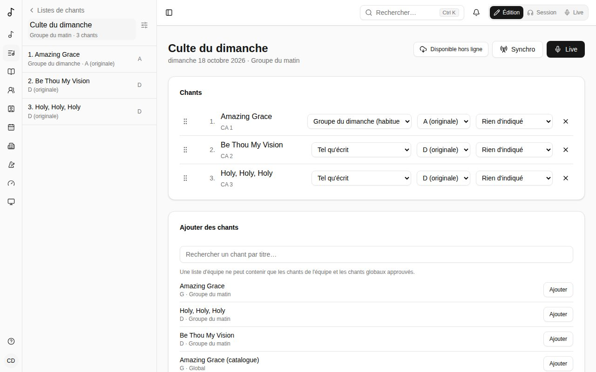
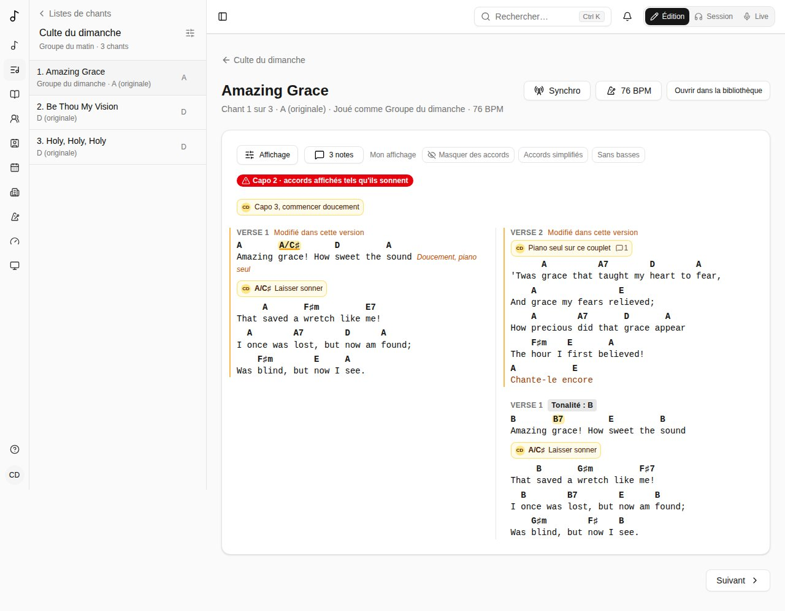
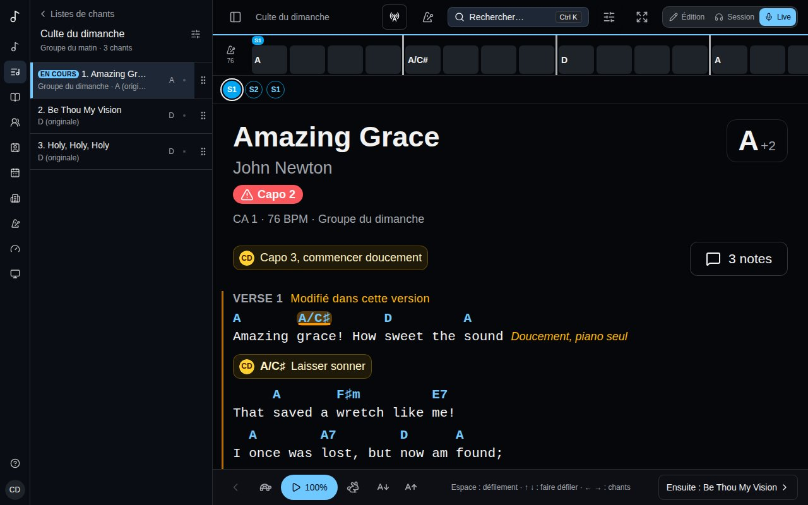
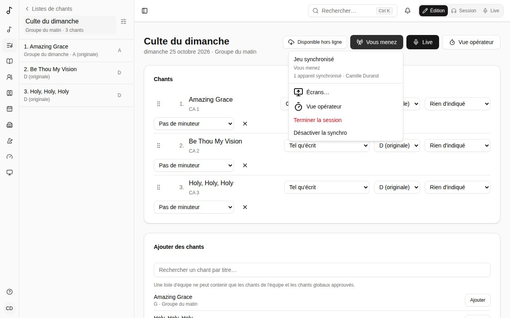

Une **liste de chants** rassemble les chants d'un culte, d'une répétition ou d'un concert. Vos listes s'affichent sous **Listes de chants** dans la barre latérale.

## Créer une liste

Choisissez **Listes de chants** > **Nouvelle liste** :

- **Date (facultatif)** - sans nom, la liste porte le nom de sa date.
- **Nom (facultatif)** - « Culte du dimanche », « Soirée jeunes ».
- **Propriétaire** - **Moi seulement**, ou une équipe dont vous êtes administrateur. Une liste d'équipe est vue par ses membres et modifiée par ses administrateurs.

## Les chants d'une liste

- **Ajouter des chants** en les cherchant comme le champ de recherche en haut de la page : par titre, sous-titre, version, artiste, numéro CCLI ou numéro dans un recueil (« HY 42 », « 42 »), et dans leurs paroles avec **Dans les paroles**. Sans rien saisir, il affiche les derniers chants modifiés. Une liste d'équipe ne peut contenir que les chants de l'équipe et les chants globaux approuvés, pour que chaque membre puisse les ouvrir.
- **Réordonnez** en faisant glisser la poignée d'un chant (ou mettez le focus sur la poignée et utilisez Espace et les flèches).
- Pour chaque chant, choisissez :
  - sa **Traduction**, quand le chant a des [chants liés](/fr/library/#chants-liés) (le même chant dans une autre langue, par exemple) ;
  - sa **Version** - **Tel qu'écrit**, ou l'une de vos [versions](/fr/versions/) ou de celles de votre équipe. Dans une liste d'équipe, la version habituelle de l'équipe est choisie pour vous ;
  - sa **Tonalité** - déplace le chant depuis la tonalité de la version (« un ton plus bas ce dimanche ») sans changer la version ;
  - **Après ce chant** - ce qui suit : **Arrêt** (la fin, attendre le meneur), **Enchaîner le suivant** (directement le chant suivant), **Segue (sans pause)** (le décompte du suivant sur la dernière mesure) ou **Transition**, un pont vers le chant suivant avec une note à côté (« Pad sous la prière ») et [des accords pour y entrer](/fr/sets/#accords-vers-le-chant-suivant). Le mode Live l'indique avant la fin du chant, avec le changement de tonalité et de tempo quand le chant suivant en a d'autres.
  - son **Minuteur sur les écrans** - **Pas de minuteur**, **Chronomètre** ou un compte à rebours : lancé sur les [écrans](/fr/screens/#lopérateur-média) de la liste quand Live arrive à ce chant.
- **×** retire un chant de la liste (le chant lui-même n'est pas touché).

### Ajouter un chant depuis le chant ou la bibliothèque

Pas besoin d'ouvrir la liste pour y ajouter un chant :

- Sur un chant, en **Édition** ou en **Session**, **Ajouter à une liste** affiche les listes que vous pouvez modifier et qui ne sont pas passées - les prochaines d'abord, puis celles sans date. Choisissez-en une et le chant s'ajoute à la fin. Une liste qui le contient déjà affiche **Déjà dedans**, avec **Ouvrir** pour y aller ; une liste où il ne peut pas aller (une liste d'équipe et un chant qui n'est pas à l'équipe) le dit. **Nouvelle liste avec ce chant…** crée une liste qui le contient déjà.
- Dans les **Chants** de la bibliothèque, faites glisser un chant sur une liste de la barre latérale. Pendant que vous le faites glisser, les listes qui peuvent le recevoir sont entourées, celle qui le contient déjà est cochée et les autres sont estompées ; lâchez-le sur une liste et il s'ajoute à la fin, avec **Ouvrir la liste** pour y aller.

### Accords vers le chant suivant

Pour une **Transition**, le bouton **Accords** à côté de sa note propose des accords à jouer vers le chant suivant : du dernier accord de ce chant au premier accord du suivant, tels que la liste les joue (avec la version et la **Tonalité** de chaque chant). Les deux encadrent la liste - **De C → … → vers D** - et les propositions mènent à ce premier accord (« I » ci-dessous) : si le chant suivant commence sur son 4 ou son 6m plutôt que son 1, elles y mènent. Les accords sont montrés avec leurs chiffres dans la tonalité du chant suivant, comme les grilles Nashville les écrivent : **5⁷** est son 5 avec une septième (A7 en D), **7°7** une septième diminuée sur son 7 (C#°7), **♭7/6** C sur B.

Chaque façon d'enchaîner tient sur une ligne : ses accords en étapes (touchez-en un pour l'entendre) et **Utiliser** ; survolez son nom pour savoir quand l'utiliser. Une fois l'une choisie, **‹ ›** à côté de ses accords passe d'une variante à l'autre, ici, sur la page de la liste et en mode Live. D'un chant qui finit sur C vers un chant en D :

- **V7 → I** - l'incontournable : A7 → D, ou A9, A13. La nouvelle tonalité s'entend tout de suite, d'à peu près n'importe où. Quand le chant suivant ne commence pas sur son 1, aussi la dominante de la tonalité qui se pose sur son premier accord : A7 → Bm, G/A A7 → Bm.
- **II7 → V7 → I** - plus doux, la dominante préparée : Em7 A7 → D, ou Em9 A13, Em7 A7♭9 (vers un accord mineur, IIø7 V7).
- **V7sus → V7 → I** - contemporain, ample et voulu : A7sus4 A7 → D, ou A9sus4 A7♭9.
- **V7 altéré → I** - tension maximale : A7♭9 → D, ou A7♯5, A7♯9.
- **Par un accord diminué** - un seul accord, élégant, les voix par demi-tons : C#°7 → D, ou C#°7 A7 → D.
- **Un accord commun aux deux tonalités** - sans couture : C → G → D (G est le V de C et le IV de D), ou G A7.
- **Basse chromatique** - des parties qui s'enchaînent : C → C/B → B♭ → A7 → D ; ou par la gamme jusqu'au premier accord (de E♭ vers Bm : D, A/C#) ; ou le dernier accord sur la note suivante de la basse, puis IV/V et V7 (E♭/D G/A A7).
- **Porte dérobée : IV7 → ♭VII7 → I** - soul, chaleureux, un peu inattendu : Gm7 C7 → D, ou C7.
- **Combiné : basse, sus et altéré** - tout à la fois : C → G/B → A9sus4 → A7♭9 → D.

**Rapide** ne garde que ce qui tient en un accord - A7, A7♭9, C#°7, un accord commun, C7. Touchez n'importe quel accord - dans une proposition, ou les deux qui les encadrent - pour l'entendre ; ou écrivez les vôtres (**Em7 A7**, ou en chiffres, **2m7 57**) et touchez **Utiliser** ; **Pas d'accords** les retire. Ils sont gardés en chiffres dans la tonalité du chant suivant : si ce chant change de tonalité, ses accords suivent. En mode Live, ils s'affichent sous la transition en une ligne compacte d'étapes - le dernier accord du chant, les accords de la transition, le premier du suivant - chacun touché pour l'entendre. Le bouton au bout de la ligne l'ouvre : les [diagrammes d'accords](/fr/versions/#diagrammes-daccords) de votre instrument sous chaque accord et, si vous pouvez modifier la liste, les autres façons d'enchaîner à choisir (la liste ci-dessus). Elle reste ouverte ou compacte sur cet appareil.

### Pour cette liste seulement

Pour réordonner, sauter ou répéter des sections dans une seule liste, choisissez **Pour cette liste seulement…** dans le menu **Version** du chant. Cela copie la version que la liste jouait (ou l'ordre du chant) et l'ouvre dans l'[éditeur de version](/fr/versions/#le-modifier). Elle ne sert que dans cette liste, n'apparaît pas parmi les versions du chant, et disparaît quand le chant quitte la liste. Le bouton ✎ à côté du menu la rouvre.

### Du texte pour les écrans

Une liste peut aussi contenir des diapositives de texte : un accueil, une lecture, les annonces. Sous **Ajouter des chants**, **Ajouter du texte** ouvre une fenêtre avec un **Titre** et le **Texte** ; une ligne vide commence une nouvelle diapositive, et la fenêtre les compte pendant la saisie. Le texte prend sa place dans la liste comme un chant - faites-le glisser, retirez-le avec **×** - et son bouton crayon (**Modifier** et son titre) le change. Il n'a ni version, ni tonalité, ni accords. Ouvert depuis la liste ou en live, il se lit comme ses diapositives ; sur les [écrans](/fr/screens/), il est présenté comme les paroles d'un chant, un paragraphe à la fois, avec son titre dans les widgets qui nomment l'élément à l'écran.

Une liste peut aussi contenir des passages de la Bible, lus dans une Bible qu'un administrateur a importée sur le serveur ou sur YouVersion quand l'administrateur l'a configuré (voir [Administration](/fr/admin/#bibles)), ajoutés ici ou depuis la [Bible](/fr/bible/) de la barre latérale. **Ajouter un passage** ouvre une fenêtre qui choisit un passage comme la page Bible : la **Langue** et la **Version**, puis le livre, le chapitre et les versets, ou le **Passage** écrit comme on l'écrit (« Jean 3.16-18 », « Ps 23,1-4 », « John 3:16 ») ; **Lire** en donne un aperçu. Choisissez son **Modèle d'écran** (voir [Bible](/fr/bible/#lajouter-à-une-liste)), puis **Enregistrer**. La liste garde la référence, jamais une copie du texte : le passage est nommé comme cette Bible nomme son livre (« Jean 3:16-18 » et l'abréviation de la Bible), et son bouton crayon le change. Ouvert depuis la liste ou en live, il se lit comme ses versets, avec la mention de copyright de la Bible en dessous. Sur les [écrans](/fr/screens/), il s'affiche avec son modèle, nommé à côté du passage dans la liste - ou celui de l'écran - et chaque verset est une diapositive, ou autant que son modèle en regroupe, chacun avec son numéro (un long verset continue sur plusieurs), avec sa référence, et la mention de copyright s'affiche sous le texte à chaque diapositive, quoi que dise le thème des crédits. La licence d'une Bible dit où son texte peut aller, et l'administrateur la coche : une Bible qui ne peut pas être montrée sur les écrans n'y met pas le passage (la console de l'opérateur dit pourquoi) ; une Bible qui ne peut pas être gardée hors ligne n'est pas dans les copies gardées sur les appareils, et son texte ne s'affiche qu'en ligne. Un passage YouVersion est lu sur YouVersion à chaque ouverture, avec la mention de copyright de sa version et un lien **Lire sur YouVersion** ; il va sur les écrans, lu lui aussi sur YouVersion à chaque fois, et jamais dans les copies gardées sur les appareils.

## Jouer depuis une liste

Cliquez sur un chant de la liste pour ouvrir sa grille, telle que la liste la joue : sa version, dans la tonalité de la liste.

- **Précédent** et **Suivant** parcourent la liste dans l'ordre.
- **Mon affichage** change la grille pour vous seul - accords masqués, simplifiés, sans basses. Voir [Votre propre affichage d'une grille](/fr/versions/#votre-propre-affichage-dune-grille). **Affichage** à côté règle la façon dont les grilles se lisent - noms des accords, formes de capo, diagrammes, texte, colonnes : voir [Affichage](/fr/display/).
- Les **notes** sur le chant - les vôtres, celles de la liste, de votre équipe - s'affichent sur la grille, là où elles sont attachées. Clic droit (ou appui long) sur un accord, un mot ou le nom d'une partie pour en ajouter une ; une note enregistrée dans la liste ne s'affiche que dans cette liste. Voir [Notes](/fr/notes/).

## Jouer une liste en live

Sur scène, passez en mode **Live** - le bouton sur la page de la liste, ou le sélecteur de mode en haut à droite de chaque page. Songverse passe en sombre (reposant dans une salle peu éclairée) et chaque chant de la liste occupe toute la page à côté de la barre latérale, en grand, tel que vous le lisez avec [Mon affichage](/fr/versions/#votre-propre-affichage-dune-grille) et les réglages d'[Affichage](/fr/display/) propres au Live.

- La barre latérale reste à côté du chant sur une tablette ou un ordinateur, avec les chants de la liste : touchez-en un pour y aller. Le chant en cours est marqué **En cours**, avec une barre sur le côté ; les chants joués sont cochés et plus discrets, mais restent à leur place, et **Reprendre au début** au-dessus de la liste les efface. Si vous pouvez modifier la liste, chaque chant a une poignée (⋮⋮) à droite : faites-la glisser vers le haut ou le bas pour déplacer le chant (ou placez-y le focus, appuyez sur Espace, les flèches, puis Espace de nouveau). Le nouvel ordre est enregistré aussitôt, et **Suivant** le suit. À côté de chaque chant, son symbole indique ce qui se passe après - un carré pour s'arrêter, une flèche pour enchaîner, une double flèche pour un segue, des flèches croisées pour une transition - et si vous pouvez modifier la liste, le toucher le change. Le bouton à côté du nom de la liste (curseurs) choisit ce que chaque chant affiche aussi à droite, en colonnes : sa **Tonalité** telle que jouée, le **Tempo (BPM)**, la **Mesure**, la **Durée**, et **Ce qui se passe après** ; c'est retenu sur cet appareil. Le bouton en haut à gauche masque la barre latérale ou la réaffiche ; sur un téléphone, où il n'y a pas de place à côté du chant, il l'ouvre par-dessus. L'en-tête montre aussi le nom de la liste.
- Dessous, la structure du chant : ses parties dans l'ordre où on les chante, en petits cercles - **S1** **R** **S2** **R** **P** **R** (strophe, refrain, pont…) - colorés par genre : intros et outros, strophes et pré-refrains, refrains, ponts et vamps, et instrumentaux, interludes et breaks ont chacun leur couleur. La partie en cours est entourée et celles déjà chantées sont pleines, au fil du défilement ; touchez-en une pour y aller.
- **Grille** / **Mesures** en haut le lit comme sa grille ou en mesures (voir [Grille en mesures](/fr/metronome/#grille-en-mesures)), et quand le chant a un PDF, **PDF** comme les pages du PDF. Votre choix est gardé pour le chant sur votre compte, le même sur chaque appareil et en Session : choisissez-le en travaillant et la scène l'affiche ; les chants où vous n'avez rien choisi suivent votre réglage **Lire les chants en** (voir [Affichage des grilles](/fr/account/#affichage-des-grilles)). Avec un PDF, le défilement le fait toujours défiler, et la barre de structure est masquée ; sur un téléphone, ses pages occupent l'écran d'un bord à l'autre, sous l'en-tête, le titre du PDF remplaçant celui du chant.
- Un chant qui enchaîne en segue ou en transition sur le suivant a le suivant **dessous, sur la même page** (et celui d'après, tant que la chaîne continue) : continuez de faire défiler - ou laissez le défilement automatique continuer - jusqu'à lui. Entre les deux, un bandeau indique ce qui se passe et, pour une transition, montre ses [accords](/fr/sets/#accords-vers-le-chant-suivant) du dernier accord du chant au premier du suivant. Le chant joué suit le défilement : dès que le titre du chant suivant passe le tiers haut de l'écran, il est marqué **En cours** dans la barre latérale, le précédent est joué, et la barre de structure, la tonalité, le métronome et le jeu synchronisé le suivent. **Suivant** et **Précédent** font défiler jusqu'au chant suivant ou précédent de la page, et changent de page au-delà. Pour jouer chaque chant sur sa propre page, décochez **Enchaîner segues et transitions sur la même page** dans le menu à curseurs de la barre latérale ; c'est retenu sur cet appareil.
- Le chant commence par son titre et son artiste, son numéro de recueil (**JEM 855 · JEM3**), son capo et son tempo, et défile avec les accords et les paroles.
- Sa tonalité est en haut à droite : **G**, avec un petit **+2** quand la liste le joue plus haut ou plus bas qu'écrit. Touchez-la pour transposer au dernier moment, avec **−** et **+** : seulement sur votre écran, pour ce chant, jusqu'à ce que vous le quittiez. **Revenir à la tonalité de la liste** l'annule. Une transition suit : son changement de tonalité, le dernier accord du chant, ses accords et le premier accord du suivant bougent avec la tonalité de l'un ou l'autre chant.
- En bas : ce qui vient ensuite - **Ensuite : …** y mène - et la flèche du chant précédent.
- Le **défilement** (le bouton lecture) fait défiler la grille au rythme du chant : sur sa durée quand elle est connue, sinon deux mesures par ligne à son tempo. La tortue et le lièvre le ralentissent ou l'accélèrent, un cran à la fois.
- Le bouton du métronome, en haut, démarre le [métronome](/fr/metronome/) au tempo et à la mesure du chant, et clignote avec le temps ; appuyez à nouveau pour l'arrêter.
- Les boutons **A** réduisent ou agrandissent le texte. **Affichage** dans l'en-tête (curseurs) ouvre le panneau [Affichage](/fr/display/) du Live, en bas de l'écran pendant que le chant reste visible : taille du texte, police et interligne, noms et couleurs des accords, diagrammes, et les colonnes - **Auto** répartit un long chant sur autant de colonnes que l'écran en contient, comme un journal, sans jamais couper une section entre deux, pour qu'il tienne sans défiler ; **1**, **2** ou **3** fixent le maximum. Ils sont gardés pour le Live sur votre compte, à part de ceux de la Session.
- Le bouton d'agrandissement passe en plein écran, sans les barres du navigateur.
- L'écran reste allumé tant qu'un chant est ouvert.
- Les boutons peuvent flotter par-dessus la grille au lieu de la barre du bas, ou être masqués, et chacun peut être retiré : **Commandes** dans le [panneau Affichage](/fr/display/#ce-quil-règle).

Au clavier ou avec un pédalier tourne-page : **Espace** lance et met en pause le défilement, **↑** **↓** (ou Page précédente et Page suivante) font défiler, **←** **→** passent au chant précédent ou suivant.

Sur un téléphone ou une tablette, balayez vers la gauche pour le chant suivant et vers la droite pour le précédent.

En Live, choisir une liste - dans les listes, la barre latérale ou l'accueil - l'ouvre directement en Live, sur son premier chant. Revenir à la liste reprend au dernier chant ouvert en Live sur cet appareil, plutôt qu'au premier. Un chant compte comme joué une fois sa grille défilée aux 95 % (à la main ou avec le défilement) ; un chant assez court pour tenir à l'écran compte quand vous passez au suivant. La page de la liste (en Édition ou en Session) montre les chants joués d'une coche et met en évidence le numéro du chant où le Live reprendra, et son bouton devient **Reprendre le Live**. **Reprendre au début** oublie où vous en étiez ; Songverse l'oublie aussi de lui-même au bout de 12 heures, pour que le service suivant reparte du premier chant.

### Un chant qui n'est pas dans la liste

Quand le leader lance un chant imprévu, utilisez la recherche (la loupe en haut) : par son titre, ou par son numéro s'il est annoncé ainsi (« Cantique 42 ! » : **CA 42**). En Live, le chant choisi s'ouvre de la même façon, avec le défilement et votre taille de texte. **Retour** (la flèche à côté du bouton de la barre latérale) revient au chant de la liste où vous étiez. Si vous pouvez modifier la liste, chaque chant trouvé propose aussi **Jouer ensuite** (ou **Maj Entrée**), qui l'ajoute à la liste juste après le chant en cours, et le bouton à côté, **Ajouter à la fin de la liste** ; le chant en cours reste à l'écran, et **Suivant** mène ensuite au chant ajouté.

## Jouer synchronisé

Avec **Synchro**, tous ceux d'une liste jouent ensemble : une personne mène, et le métronome des autres - à l'écran et dans leurs oreilles - suit le sien, au même instant, et leur écran suit le chant du meneur. **Synchro** est sur la page de la liste, sur celles de ses chants et en haut du Live (l'icône d'antenne).

- **Activer la synchro**, sur chaque appareil : on voit qui mène et combien d'appareils sont synchronisés. La synchro reste active pendant que vous naviguez dans Songverse, et revient si la page se recharge ; **Désactiver la synchro** la quitte.
- Quelqu'un qui peut modifier la liste - son propriétaire, ou un administrateur de son équipe - choisit **Mener la liste**. Un autre peut prendre le relais avec **Mener à sa place** : le métronome continue comme il était.
- Le meneur démarre le [métronome](/fr/metronome/) : le bouton du métronome en Live ou sur la page d'un chant, ou la page Métronome, où il règle le tempo, la mesure et le motif. Celui de chacun démarre sur le même temps, et un nouveau tempo arrive chez tous sur le même temps. Le métronome des autres affiche **Suit** et le nom du meneur : ses réglages sont ceux du meneur, mais son son et son volume restent les leurs.
- Quand le meneur lance les pistes ou l'enregistrement d'un chant (sur la page d'un chant de la liste, en mode Session), chacun joue le même chant au même instant : la pause et la tête de lecture suivent aussi, comme le multipiste et la transposition du meneur, et chacun garde ses propres parties coupées et en solo. Les fichiers de chacun se téléchargent dès que la page du meneur ouvre le chant ; un appareil pas encore prêt rejoint à la position en cours. En Live, où il n'y a pas de lecteur, le petit bouton en bas à droite montre le chant en lecture. **Clic avec l'enregistrement** rend le métronome de chacun calé sur l'enregistrement (voir [Pistes](/fr/library/#pistes)).
- Quand le meneur passe à un autre chant de la liste, en Live ou sur sa page, l'écran de chacun suit. Vous pouvez regarder un autre chant entre-temps : au prochain changement du meneur, vous suivez à nouveau.
- Si un appareil perd sa connexion, son métronome garde le tempo seul, et se recale à son retour. Si le meneur perd la sienne, la session continue, et il reprend la main à son retour.
- Qui mène peut aussi présenter la liste sur grand écran, ses paroles pour l'assemblée ou sa grille pour le groupe : voir [Écrans](/fr/screens/).
- **Terminer la session** arrête le métronome de chacun.
- Quelqu'un qui ne peut plus ouvrir la liste (retiré de son équipe, par exemple) cesse de la suivre dans la demi-minute, et quelqu'un qui ne peut plus la modifier cesse de la mener.

Après un rechargement, le navigateur ne laisse le métronome jouer qu'après une touche : **Touchez pour entendre le métronome** (sous **Synchro**, ou sur la page Métronome) le permet.

Pour que les temps tombent ensemble à l'oreille, utilisez un casque filaire ou le haut-parleur de l'appareil : un casque Bluetooth ajoute son propre retard. Pendant la synchro, un iPhone ou un iPad joue les pistes directement sur ses haut-parleurs (elles s'arrêtent alors écran verrouillé : le Live le garde allumé). Chaque appareil garde le tempo avec sa propre horloge, calée sur celle de Songverse ; seuls le tempo et le moment où tombe le temps passent par le réseau, jamais le son.

Si un appareil n'est pas en rythme avec les autres, ajoutez `?debug=sync` à l'adresse sur celui-ci : un encadré en haut à gauche montre ce qu'il sait de ses horloges (son écart avec celle de Songverse, le temps d'un aller-retour, si le minutage de sa sortie audio est utilisé, de combien son temps a été recalé). Il reste affiché dans cet onglet jusqu'à sa **×**. Envoyez ces chiffres avec le nom de l'appareil et du navigateur.

## Partager une liste avec des invités

Sous **Partager**, **Créer un lien de partage** et envoyez-le à qui doit voir la liste - un musicien invité, par exemple. Toute personne connectée qui l'ouvre peut lire chaque chant de la liste, même ceux qui ne sont pas dans sa bibliothèque, et garder ses propres notes. Elle ne peut pas la modifier.

- **Réinitialiser le lien** arrête l'ancien lien ; les personnes déjà inscrites gardent l'accès.
- **Désactiver le lien** empêche de nouvelles personnes de rejoindre.
- **Invités** liste qui a rejoint ; vous pouvez les retirer.

Un invité peut **Quitter la liste** à tout moment.

## Passer une liste à une équipe, ou l'inverse

Changez le **Propriétaire** dans **Détails**. Quand une liste personnelle passe à une équipe, vos chants personnels y restent : ils sont partagés en lecture seule avec l'équipe et indiqués comme les vôtres. Un administrateur de l'équipe peut **Demander ce chant**, et vous pouvez le **Céder à l'équipe** - le chant devient alors celui de l'équipe.
