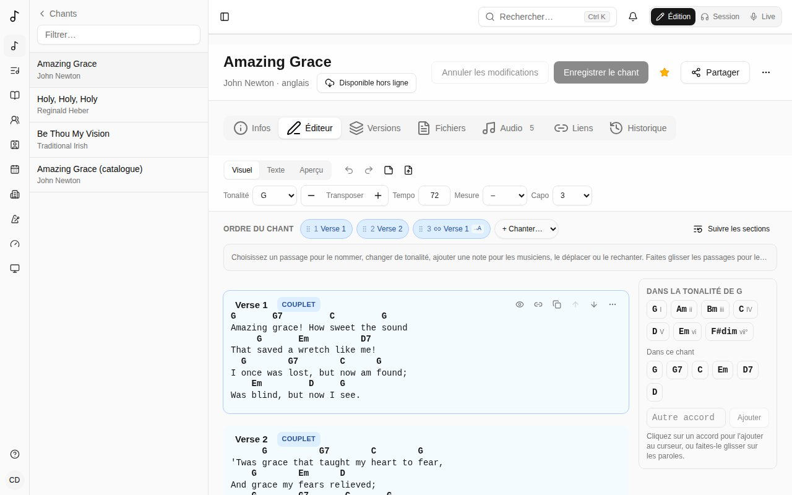
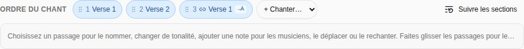
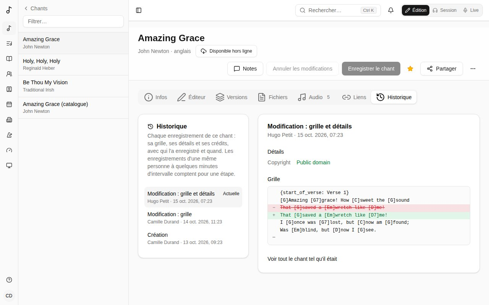

Ouvrez un chant et choisissez l'onglet **Éditeur**.

La barre d'outils de l'éditeur reste en haut de l'écran quand vous faites défiler. Elle a les trois modes de l'éditeur à gauche, puis **Annuler**, **Rétablir** et la ligne de note, puis la **Tonalité** du chant, **Transposer**, **Tempo**, **Mesure** et **Capo**. Ses boutons ne bougent jamais quand vous vous en servez : appuyez sur **Transposer** + encore et encore, ou sur **Annuler**, sans regarder. Un outil qui ne sert pas dans un mode y est grisé plutôt que retiré.

Les trois modes :

- **Visuel** - la grille avec les accords au-dessus des mots. C'est là que vous passerez le plus de temps.
- **Texte** - la même grille en texte ChordPro, pour des modifications rapides en bloc. Les accords et les lignes que vous ne changez pas restent tels quels.
- **Aperçu** - la grille telle que les musiciens la verront. Sur un écran large, elle s'affiche aussi à côté de **Visuel** et **Texte**, mise à jour au fil de la saisie.

**Visuel** utilise la même police que l'aperçu : **Police** dans son panneau **Affichage**, **Chasse fixe** ou **Proportionnelle**. Dans les deux cas, chaque accord reste au-dessus de sa lettre. Là où deux accords sont plus proches que la largeur du premier, un peu d'espace est laissé entre leurs mots.

## Les accords

- **Tapez un accord** entre crochets à l'endroit où il se joue : `[G]Amazing grace`.
- **Déplacez un accord** en le faisant glisser sur une autre lettre, ou sélectionnez-le et utilisez les flèches ← →.
- **Cliquez sur un accord** pour le changer (avec des suggestions de la tonalité du chant et des variantes comme `G7` ou `Gsus4`) ou le supprimer.
- Le **panneau des accords**, à droite de la grille et toujours visible quand vous faites défiler, liste les **accords de la tonalité** du chant (avec leur degré : I, IV, V…) et ceux **Dans ce chant**. Cliquez sur l'un d'eux pour l'ajouter au curseur, ou faites-le glisser sur un mot. **Autre accord** en ajoute un autre.
- Sur un téléphone ou une tablette, les accords sont dans une barre en bas de l'écran, au-dessus du clavier. Touchez-en un pour l'ajouter au curseur ; pas besoin de taper `[G]`. Un accord sélectionné, touchez-en un autre pour le mettre à sa place. La barre commence alors par les outils de cet accord - le déplacer d'une lettre à gauche ou à droite, ou le supprimer - et ajoute ses variantes (G7, Gsus4…).
- Sur un écran tactile, **appuyez longuement sur un accord** de la grille pour le faire glisser : il se soulève, et la lettre où il ira est mise en évidence. Un balayage rapide fait défiler la page.

Modifier les paroles garde les accords avec elles : taper avant un accord l'emmène, et supprimer des mots qui portent des accords laisse les accords à l'endroit des mots, pour que vous les replaciez. Entrée coupe une ligne, et ses accords suivent leurs mots.

## Les sections

Chaque bloc est une section : intro, couplet, pré-refrain, refrain, post-refrain, pont, vamp (une phrase répétée autant qu'il faut), break, instrumental, interlude, outro ou tag.

Chaque type a sa couleur, légère - couplets en bleu, refrains en ambre, ponts en violet… - sur son étiquette et en un léger fond derrière ses lignes : on distingue d'un coup d'œil les parties du chant.

- **Ajoutez une section** avec le **+** entre deux sections (il apparaît sous le pointeur, et toujours sur un écran tactile), au-dessus de la première, ou avec **Ajouter une section** à la fin. Son menu a tous les types de section, et **Chanter à nouveau** : une copie liée d'une section déjà dans le chant, chantée là.
- Le titre d'une section est son nom (« Couplet 2 ») : cliquez dessus pour le changer. La petite étiquette colorée à côté est son **type** : choisissez-la pour en changer.
- Les outils de la section - l'œil, ses duplications, monter et descendre, et son menu **⋯** - apparaissent sur la section que vous modifiez, ou sous le pointeur. Leur place est gardée : rien ne bouge quand ils apparaissent. L'œil masque son nom (« Refrain ») sur la grille en Session et en Live.
- Le menu **⋯** la déplace, la duplique (liée ou en copie indépendante, voir [Copies liées](/fr/song-editor/#copies-liées)), la retire de l'ordre du chant ou la supprime.
- Une ligne peut être une **note pour le groupe** (« ×2, montée ») plutôt que des paroles.

## Tonalité et transposition

Choisissez la **Tonalité** du chant dans la barre d'outils. **Transposer** − et + déplacent tous les accords et la tonalité d'un demi-ton ; **Annuler** remet les deux. **Tempo**, **Mesure** et **Capo** sont ceux du chant, les mêmes que dans l'onglet **Infos**, et sont enregistrés avec lui.

Sur un téléphone, la barre en bas de l'écran a toujours **Enregistrer le chant** : grisé tant qu'il n'y a rien à enregistrer.

## L'ordre du chant

L'**Ordre du chant**, au-dessus de la grille, est l'ordre dans lequel on le chante ; chaque fois qu'on chante une section est un *passage*. Chaque passage a la couleur de sa section.

- **+ Chanter…** ajoute un passage : le refrain une nouvelle fois, par exemple.
- **Choisissez un passage** - ou cliquez dans sa section sur la grille - et ses actions s'affichent dans la barre sous l'ordre : **Plus tôt**, **Plus tard**, **Rechanter juste après**, **Dupliquer (copie indépendante)** (une section à part, après lui), **Renommer** (« Dernier refrain »), **Changement de tonalité** et **Note pour les musiciens**. Le dernier bouton est **Retirer ce passage** ; sur le seul passage d'une section, c'est **Retirer de l'ordre du chant**. La barre garde sa place et sa hauteur, qu'un passage soit choisi ou non : vous pouvez appuyer sur **Plus tôt** encore et encore sans regarder. Choisir un passage fait défiler jusqu'à sa section.
- **Faites glisser les passages** pour les réordonner. Sur un écran tactile, appuyez d'abord longuement sur un passage ; un balayage rapide fait défiler la page.
- **Suivre les sections** revient à chanter chaque section une fois, dans l'ordre.

Les changements de tonalité et les notes s'affichent sur la grille à ce passage.

### Copies liées

L'éditeur montre le chant dans l'ordre où il est chanté. La première apparition d'une section est le bloc que vous modifiez ; partout où elle est rechantée, c'est une **copie liée** - marquée d'un lien, « Liée à Refrain », verrouillée - qui suit la section : modifiez la section et chaque copie le montre.

Une copie est repliée sur une ligne qui dit ce qu'elle fait - « chantée à nouveau, telle qu'écrite », « 2 demi-tons plus haut · en A », « 1 accord à elle », « 1 ligne laissée de côté ». **Afficher** l'ouvre, avec sa transposition et **Modifier cette copie** ; **Masquer** la replie. Elle reste comme vous l'avez laissée pendant que vous modifiez le chant.

- **Dupliquer (liée)** dans le menu d'une section en ajoute une copie juste après ; **Dupliquer (copie indépendante)** ajoute une section indépendante. Dans le menu d'une copie, **Dupliquer (liée)** ajoute une autre copie avec les mêmes modifications, toujours liée à la section, pas à la copie. Monter et descendre les blocs (leur menu) change l'ordre où ils sont chantés, comme l'**Ordre du chant** au-dessus.
- Quand l'éditeur a de la place, les flèches pour monter et descendre un bloc et ses duplications sont aussi à droite de son titre, à côté de son menu : sur une section, **Dupliquer (liée)** (le lien) et **Dupliquer (copie indépendante)** (l'icône de copie) ; sur une copie liée, **Dupliquer (liée)** (l'icône de copie).
- **− / +** dans le titre d'une copie transpose cette copie seule (un changement de tonalité, dans l'ordre du chant, vaut jusqu'à la fin du chant).
- **Modifier cette copie** ouvre ses modifications, qui restent des différences avec la section, si bien qu'elle continue de la suivre : **Retirer la ligne**, changer ses paroles (les mots retirés s'affichent grisés et barrés, les nouveaux surlignés, et les accords suivent leurs mots), ou taper un autre accord sur l'un d'eux (écrit dans la tonalité du chant) ou le retirer avec le bouton en forme d'œil. **Terminé** la verrouille de nouveau.
- Une copie avec ses propres paroles, lignes ou accords porte une **\*** dans son titre, dans l'ordre du chant et sur la grille. Une copie seulement transposée n'est pas marquée : elle montre de combien (**+2**). **Comme la section est écrite** (son menu) retire les modifications ; **Rendre indépendante** en fait une section à part, ses modifications écrites dedans - elle ne suit plus l'originale.
- **Retirer de l'ordre du chant** (menu d'une section) place une section à la fin, sous **Pas dans l'ordre du chant**, avec ses copies ; **Remettre dans l'ordre du chant** la ramène.

Si une ligne ou un accord qu'une copie modifie est supprimé de la section, la grille le signale au lieu de l'ignorer. Exportée en ChordPro, une copie modifiée est écrite en entier.

### Sections reprises

Un fichier lu (un nouveau chant, une grille collée ou envoyée) lie ce qu'il écrit à nouveau : un refrain écrit une deuxième fois est une copie liée du premier - aussi quand il est quelques demi-tons plus haut ou plus bas (une copie transposée), quand un tiers de ses accords au plus diffère (une copie avec ces accords à elle), ou quand ce n'est que la fin du refrain.

Un chant écrit avant garde ses sections en double. Au-dessus de l'éditeur, ses éditeurs voient ce qui se répète - « Refrain 2 est Refrain avec 1 accord à elle », « Dernier refrain est Refrain, 2 demi-ton(s) plus haut » - et **Lier** chacune, ou **Tout lier** : la reprise devient une copie liée de la section, en gardant son nom. Les arrangements et les repères des enregistrements suivent, et l'**Historique** du chant permet d'annuler. Enregistrez d'abord vos modifications.

## Coller une grille

Collez une grille entière n'importe où - en ChordPro, ou avec les accords écrits au-dessus des paroles - et elle devient des sections avec les accords en place. Coller de simples paroles les tape, tout simplement. Un nom de section seul sur sa ligne (« Strophe 1 », « [Refrain] », « Pont », « Chorus », « Coro ») commence une section de ce type, en français, anglais, espagnol, allemand, italien ou portugais.

## Remplacer la grille

**Remplacer depuis un fichier ou un collage…**, dans la barre d'outils, lit une nouvelle grille pour tout le chant : envoyez un fichier (`.cho`, `.txt` ou `.pdf`) ou collez les paroles et les accords, puis **Remplacer la grille**. Ce qui ne change pas garde sa place - les copies liées, les [versions](/fr/versions/) et les sections des enregistrements le suivent - et **Annuler les modifications** remet l'ancienne grille tant que vous n'avez pas enregistré. (Un nouveau chant reçoit sa grille dans l'onglet **Infos**.)

## Enregistrer

**Enregistrer le chant** enregistre la grille et les détails du chant ensemble. Si quelqu'un d'autre a enregistré le chant après que vous l'avez ouvert, Songverse vous le dit au lieu d'écraser ses modifications.

## Historique

L'onglet **Historique** liste chaque enregistrement du chant, du plus récent au plus ancien : qui l'a enregistré, quand, et ce qui a changé - la **grille**, les **détails** (titre, tonalité, droits…) ou les **crédits**. Les enregistrements d'une même personne à quelques minutes d'intervalle comptent pour une étape.

Choisissez une étape pour voir ce qu'elle a changé : détails et crédits avec l'ancienne valeur barrée et la nouvelle à côté, et les lignes de la grille supprimées et ajoutées. **Voir tout le chant tel qu'il était** montre le chant à cette étape.

Si vous pouvez modifier le chant, **Restaurer cet état** remet sa grille, ses détails et ses crédits tels qu'ils étaient à cette étape. C'est enregistré comme toute autre modification : la restauration apparaît dans l'historique et peut elle-même être annulée. Les étiquettes, fichiers, liens et versions ne font pas partie de l'historique et restent tels quels. Enregistrez ou annulez vos propres modifications avant de restaurer.

Les chants créés avant l'historique commencent par **Avant le début de l'historique** : le chant tel qu'il était alors.
