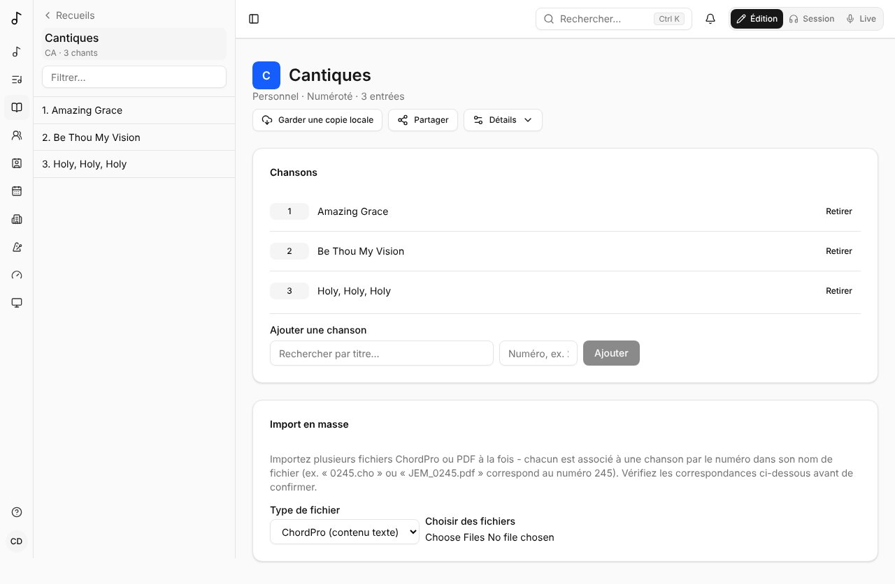

Un **recueil** est une collection de chants. Les vôtres s'affichent sous **Recueils** dans la barre latérale.

## Créer un recueil

Choisissez **Créer un recueil** et son **Type** :

- **Simple** - une collection sans ordre ; les chants n'ont pas de numéro.
- **Numéroté** - les chants sont numérotés comme dans une édition imprimée, et chaque numéro est unique.

Donnez-lui un nom, et si vous voulez une abréviation, une langue, un éditeur et une année. Choisissez à qui il appartient : vous, une équipe, ou tout le monde (administrateurs globaux seulement).

La page d'un recueil parle de ses entrées : son nom, avec son nombre d'entrées (et son éditeur et son année), puis les entrées. **Détails** ouvre ce qui le décrit - son nom, son abréviation, sa langue, son éditeur et son année, les sections d'un recueil numéroté - et **Supprimer le recueil**.

### Couleur et image

Qui gère un recueil lui donne une **Couleur** et une image sous **Détails**, dans **Couleur et image**, comme pour une équipe (voir [Couleur et image](/fr/teams/#couleur-et-image)) : elles s'affichent à côté de son nom dans la barre latérale et les listes.

## Les chants d'un recueil

Sous **Chansons**, **Ajouter une chanson** en la cherchant et, dans un recueil numéroté, en indiquant son numéro.

Le recueil d'une équipe contient des chants que tous ses membres peuvent ouvrir : ceux de l'équipe, ceux du catalogue global, et ceux partagés avec l'équipe. Ajoutez l'un de vos chants et la question vous est posée d'abord : **Partager avec** l'équipe (il reste à vous, ses membres le voient) ou **Déplacer vers** l'équipe (il devient celui de l'équipe). Le chant de quelqu'un d'autre que l'équipe ne peut pas ouvrir ne peut pas y entrer.

Les chants sont listés dans l'ordre des numéros (1, 2, 10, 100), et un numéro simple est gardé sans zéros devant : « 0245 » est 245.

Un recueil numéroté peut avoir des **sections** : des plages de numéros avec un libellé, comme les volumes imprimés d'un recueil (1-371 « JEM1 », 372-721 « JEM2 »…). Vous pouvez ensuite filtrer le recueil par section.

La page d'un chant liste ses recueils avec sa référence complète - l'abréviation du recueil, le numéro et le volume : **JEM 855 · JEM3** - et **Copier** met « Titre — JEM 855 · JEM3 » dans le presse-papiers, pour la donner à quelqu'un qui n'utilise pas Songverse. Une liste l'indique aussi sous chaque chant.

## Partager un recueil

Pour que votre groupe utilise un recueil que vous avez commencé - retrouver ses chants par numéro, voir **JEM 683** en Live, mettre ses chants dans leurs listes - ouvrez-le et touchez **Partager**. Choisissez l'un de vos [contacts](/fr/people/) ou l'une de vos équipes, et ce qu'ils peuvent faire :

- **Peut lire** - il apparaît dans leurs recueils (marqué **Partagé avec vous**), avec ses numéros et ses chants, en lecture seule : ils les ouvrent, les retrouvent avec la recherche, les ajoutent à leurs listes et les jouent. Le partage avec une équipe vaut pour ses membres, actuels et futurs.
- **Peut modifier** - ils ajoutent aussi, retirent et renumérotent ses chants et changent ses détails. Ils ajoutent des chants qu'ils voient ; ces chants restent à eux, désormais lisibles par tous ceux avec qui le recueil est partagé.

Les chants restent à vous. Retirer un chant du recueil, ou arrêter le partage, retire cet accès. Vous seul (ou les admins de votre équipe) le partagez, le supprimez et y faites un import en masse. Dans la même fenêtre, changez ce que quelqu'un peut faire, ou arrêtez de partager avec lui (**×**). Quelqu'un avec qui il est partagé peut le retirer de ses recueils : **Retirer de mes recueils**, sur la page du recueil (le partage avec une équipe reste celui de l'équipe).

### Le donner à une équipe

Quand un recueil que vous avez commencé doit être celui de votre équipe, ouvrez **Partager** et, sous **Donner à une équipe**, choisissez une des équipes dont vous êtes administrateur et ce que deviennent vos chants qu'il contient : **Déplacer mes chants vers l'équipe** (ils deviennent aussi ceux de l'équipe) ou **Garder mes chants, partagés avec l'équipe** (ils restent à vous, et ses membres les lisent). **Donner** demande de confirmer : il devient le recueil de l'équipe, ses administrateurs le modifient désormais, et vous ne pourrez pas annuler vous-même. Les chants des autres qu'il contient restent les leurs. Pas administrateur de l'équipe ? Partagez-le plutôt avec l'équipe.

## À partir du catalogue d'un recueil publié

Le **Catalogue de recueils** (**Parcourir le catalogue**) est un annuaire de recueils publiés : numéros, titres, crédits, tonalités et plus - mais ni paroles ni accords.

Un catalogue peut indiquer ses volumes imprimés, comme les sections d'un recueil. Commencer un recueil à partir de lui les copie ; un recueil commencé avant que le catalogue les ait propose **Utiliser les volumes du catalogue**.

Commencer un recueil à partir d'un catalogue vous donne toutes ses entrées d'un coup. Celles dont le chant n'est pas encore dans votre bibliothèque sont listées dans **Entrées en attente** : **Démarrer** l'une d'elles crée le chant avec les détails du catalogue, puis vous ajoutez paroles et accords.

## Infos des chants

**Modifier les infos des chants** montre tous les chants du recueil dans un tableau : titre, artiste, album, année, tonalité, tempo, mesure, numéro CCLI et copyright. Modifiez une case, elle est enregistrée quand vous la quittez (« Enregistré » sur sa ligne) ; **Ouvrir** mène au chant. Un chant du catalogue que vous ne pouvez pas modifier reçoit votre changement comme suggestion pour ses éditeurs (« Suggestion envoyée », voir [Proposer une modification](/fr/library/#proposer-une-modification)).

En dessous, **Mettre à jour depuis Internet** cherche à nouveau chaque chant sur MusicBrainz, Apple Music, Deezer et Spotify, selon les réglages de votre administrateur : un chant déjà lié à ses infos par son lien, un autre par un résultat avec le même titre et le même artiste. **Chercher les chants** le fait en arrière-plan (« Recherche 12 sur 40… ») ; vous pouvez quitter la page et revenir. Chaque chant qui changerait est ensuite listé, champ par champ, de ce qu'il a à ce que dit le résultat : ce que le chant n'a pas encore est coché, ce qu'il a n'est remplacé que si vous le cochez. **Appliquer 5 changements** enregistre ce qui est coché, chacun dans l'**Historique** de son chant, et lie les chants à leurs résultats. Rien n'est enregistré avant.

## Import en masse

Pour remplir vite un recueil numéroté, l'**Import en masse** ajoute de nombreux fichiers ChordPro ou PDF d'un coup. Chaque fichier est associé à un chant par le numéro dans son nom (`0245.cho` ou `JEM_0245.pdf` correspond au numéro 245). Vérifiez les correspondances, puis **Confirmer l'import**. Deux fichiers avec le même numéro sont tous deux marqués en conflit, chacun nommant l'autre (« Même numéro que … »), et aucun n'est importé. Seuls les fichiers du type choisi sont associés (un PDF à côté d'un fichier ChordPro n'est pas un conflit). Les fichiers système, comme les copies `._0245.cho` de macOS ou `.DS_Store`, sont ignorés et seulement comptés. Un recueil entier peut partir d'un coup : les fichiers sont envoyés par centaines, et le bouton les compte (« Envoi de 300 sur 1199… »). Plutôt que de choisir chaque fichier, choisissez **Ou tout un dossier**, ou déposez des fichiers ou un dossier sur le cadre en dessous : chaque fichier qu'il contient (et ses dossiers) est associé, et les autres types sont ignorés.

Une fois un fichier importé, son chant est cherché en ligne, comme le fait la **Détection automatique**, sans personne pour choisir : seul un résultat avec le même titre et le même artiste est pris, et il ne complète que ce que le chant n'a pas encore (album, année, auteurs, ISRC, tempo, durée, sa pochette). Un chant sans artiste, ou sans résultat aussi proche, reste tel quel ; la **Détection automatique** reste possible dessus. Ce qui a été complété figure dans l'**Historique** du chant, à votre nom.

Chaque fichier ChordPro devient la grille de son chant, et le fichier est gardé avec le chant. Les fichiers écrits comme les recueils les écrivent sont compris :
- un commentaire qui nomme une section (`{c: Strophe 1}`, `{c: Refrain}`, `{c: Pont}`, `{c: Fin}`, en français, anglais, espagnol, allemand, italien ou portugais) en donne le type ;
- le « 2. » au début de la première ligne d'une strophe est retiré ;
- un refrain réécrit à chaque fois est chanté à nouveau, plutôt que gardé en double ;
- une ligne `© …` avant la première section devient le copyright du chant, et la tonalité vient de `{key}`, si le chant ne les a pas encore ;
- l'adresse du site et les commentaires « Changement de tonalité » sont ignorés ;
- les accords écrits à la française sont lus aussi (`G7maj`, `C7M`, `F#d`, `A4`, `F9/6`).
