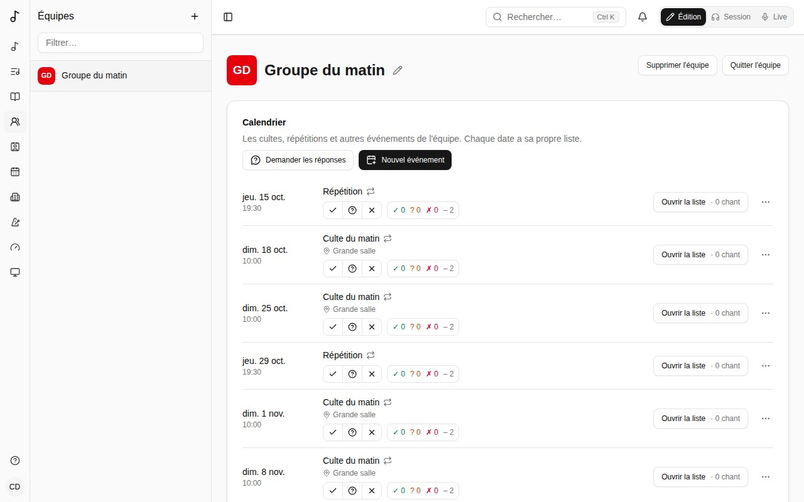

Une **équipe** est un groupe qui partage chants, versions, listes de chants et recueils. Vos équipes s'affichent sous **Équipes** dans la barre latérale.

## Calendrier

La page de l'équipe commence par son **Calendrier** : ses cultes, répétitions et autres événements, les huit semaines à venir (**Voir plus** pour la suite). Tous les membres le voient ; ses administrateurs le gèrent.

- **Nouvel événement** : son **Titre**, sa **Date** et son **Heure de début**, sa durée, son **Fuseau horaire** (le vôtre par défaut) et, si vous voulez, un lieu et une note. **Répétition** : **Chaque semaine**, toutes les 2 semaines, etc., le même jour de la semaine que sa date, **Jusqu'au** une date ou sans fin ; ou **Ne se répète pas**. Les heures restent les mêmes au changement d'heure.
- **Arrivée (minutes avant)** : quand être là, tant de minutes avant le début - pour une balance ou un temps de prière. Chaque date affiche alors « Arrivée 9:15 » sous son heure, dans le calendrier et dans **Mon calendrier** ; elle figure dans votre lien de calendrier et dans le rappel de la veille. Laissez vide pour aucune.
- **Chaque date a sa propre liste**, au nom de l'événement suivi de sa date dans votre langue (« Culte du matin - 12 oct. ») : **Ouvrir la liste** la prépare comme toute liste. Les listes sont créées à l'avance - **Créer les listes à l'avance**, sous le calendrier, dit combien de semaines, de 1 à 52 (4 par défaut ; 13 font environ trois mois). Une date plus lointaine a **Préparer la liste**, qui crée sa liste tout de suite.
- **Dates** et **Événements**, en haut du calendrier : **Dates** liste chaque date à venir ; **Événements** liste chaque événement une fois - une série avec son rythme (« Chaque semaine · dimanche 10:00 · à partir du 23 nov. »), un événement ponctuel avec sa date, une répétition avec son événement - et **Modifier la série** (**Modifier l'événement** pour un événement qui ne se répète pas) le change en entier.
- Le menu **…** d'une date : **Annuler cette date** (sa liste est supprimée si elle n'a pas encore de chants) ou **Rétablir cette date** ; dans une série, **Modifier cette date** - son propre titre et son heure de début, pour cette date seulement (marquée **Modifiée**), ou **Revenir à la série** - **Déplacer cette date** à un autre jour, et **Modifier la série**. Une date déplacée emporte ses réponses, son équipe du jour et sa liste (ses répétitions suivent), affiche **Déplacé du** jour d'origine, et ceux qui ont répondu ou sont dans son équipe du jour sont prévenus ; la série continue comme avant. Le nouveau jour ne doit pas déjà avoir une date de l'événement ; la remettre à son jour d'origine en refait une date ordinaire. La liste faite pour une date la suit : sa date se change dans le calendrier, pas sur la liste.
- Dans un groupe d'une organisation, la fenêtre d'un événement propose **Confier à** l'organisation, ponctuel ou en série : ses administrateurs sont sollicités, et l'événement est marqué **En attente de** l'organisation jusqu'à ce que l'un d'eux accepte (voir [Événements](/fr/organizations/#événements)). **Retirer la demande** l'annule. Accepté, c'est un événement de l'organisation, et la part de cette équipe telle quelle : ses dates, réponses, équipes du jour et listes.
- Modifier un événement (son titre, sa date, sa fréquence) met à jour ses listes à venir. Les dates où il n'a plus lieu perdent leur liste si elle est encore vide ; une liste avec des chants reste, comme liste de l'équipe. **Supprimer l'événement** fait de même. Une liste supprimée à la main n'est pas recréée ; **Préparer la liste** la fait revenir.

### Types d'événement

Tous les événements ne se ressemblent pas : un culte a besoin d'une présidence, d'un prédicateur et de quelqu'un à la musique, et d'une liste (ses chants, passages bibliques, diapositives et plus) ; une réunion n'a besoin ni de l'un ni de l'autre. **Types d'événement**, à côté de **Nouvel événement**, garde les sortes d'événements de l'équipe. Une équipe qui n'en a pas se voit proposer **Ajouter Culte** (Présidence, Prédicateur, Musique et Opérateur média, tous obligatoires, les deux derniers ouverts aux membres de l'équipe), **Ajouter Soirée de louange** (Musique) et **Ajouter Réunion** (sans liste) ; **Nouveau type** crée le vôtre : son **Nom**, son **Heure de début** habituelle, sa durée et son heure d'arrivée, ses **Postes nécessaires** (voir [Postes nécessaires](/fr/teams/#postes-nécessaires)), et **Créer une liste pour chaque date**. Le crayon à côté d'un type le modifie ; **Supprimer le type** le retire. Dans une équipe d'une organisation, la liste comprend aussi les types de l'organisation, marqués de son nom : ses administrateurs les gèrent (voir [Types d'événement](/fr/organizations/#types-dévénement)), et le groupe les choisit comme les siens.

Dans **Nouvel événement**, **Type** en choisit un : l'événement prend son nom comme titre (sauf si vous en avez tapé un), son heure, ses postes et s'il a des listes. Tout peut encore être changé pour cet événement, et il peut demander plus de postes que son type. Un événement garde ce qu'il a reçu : modifier ou supprimer son type ensuite le laisse tel quel.

**Créer une liste pour chaque date**, dans la fenêtre d'un événement, est activé par défaut (désactivé dans une équipe qui ne fait que planifier) ; avec lui, **L'équipe du jour modifie la liste** dit si les personnes de l'équipe du jour d'une date changent sa liste, ou seulement les administrateurs de l'équipe (voir [Qui modifie la liste d'une date](/fr/sets/#qui-modifie-la-liste-dune-date)). Un événement d'une organisation choisit les deux dans les Événements de l'organisation. Une liste n'est pas faite que de chants : elle réunit ce que la date projette et joue - passages bibliques, diapositives, annonces. Désactivez-le pour un événement qui n'en a pas besoin - une réunion : ses dates n'ont ni liste ni **Préparer la liste**. Le désactiver sur un événement existant supprime ses listes à venir encore vides (une liste qui contient quelque chose reste) ; le réactiver les recrée.

### Disponibilités

Sous chaque date, dites si vous pouvez jouer : **Je m'inscris**, **Si besoin** (libre si on vous le demande, pas en premier choix) ou **Pas disponible**. Appuyez de nouveau sur votre réponse pour la retirer. Une fois répondu, ajoutez une note pour les administrateurs de l'équipe (« Clavier seulement », « j'arrive en retard ») ; seuls vous et eux la voient. Ne pas répondre n'est jamais compté comme disponible.

Avec **Je m'inscris** ou **Si besoin**, le bouton en forme de main à côté de votre réponse ouvre **Ce que j'aimerais jouer** : choisissez ce que vous aimeriez tenir ce jour-là - les postes demandés par l'événement, ou, s'il n'en liste aucun, les instruments et rôles de votre tableau de bord. Les administrateurs de l'équipe les voient dans **Qui peut jouer**, et ceux qui modifient la liste de cette date les voient sur la liste (voir [Qui peut jouer](/fr/sets/#qui-peut-jouer)). Répondre **Pas disponible** les efface.

**Mon calendrier**, dans la barre latérale, liste les dates à venir de toutes vos équipes, pour y répondre au même endroit. Sous **Absences**, **Ajouter une absence** ouvre un calendrier : choisissez le premier jour, puis le dernier, ajoutez une note si vous voulez, puis **Ajouter**. Chaque date de ces jours se lit **Pas disponible**, marquée **Absent**, pour toutes vos équipes - sauf si vous répondez vous-même à cette date. Chaque absence peut être modifiée (**Modifier** : choisissez de nouveau les jours, changez la note, **Enregistrer**) ou supprimée ; vos autres absences apparaissent barrées sur le calendrier.

Les administrateurs de l'équipe voient, à côté de chaque date, combien de membres sont inscrits, viennent si besoin, pas disponibles, et n'ont pas répondu. Un clic ouvre **Qui peut jouer** : la réponse de chacun, avec ses notes et ses absences. Un administrateur peut y répondre pour un membre qui n'utilise pas Songverse ; c'est marqué comme répondu par lui.

### La page d'une date

Chaque date a sa propre page : son titre dans le calendrier de l'équipe, dans **Mon calendrier** et dans **Vos prochaines dates** d'Oneverse l'ouvre, tout comme les notifications et rappels qui la concernent et son entrée dans votre lien de calendrier. C'est la même page dans Songverse, Plan et Oneverse : quand et où (avec **Déplacé du** si la date a été déplacée), la note de l'événement, **Votre réponse**, son **Équipe du jour** - **Prévu : Batterie** pour accepter ou refuser, les places que vous pouvez prendre - ses **Répétitions**, et **Ouvrir la liste**. Ceux qui modifient la liste voient aussi **Qui peut jouer**. Les administrateurs de l'équipe ont **Modifier l'équipe du jour** et un lien vers le calendrier de l'équipe, où l'événement lui-même se modifie. Une date qui n'est pas dans votre calendrier - celle d'une autre équipe, ou supprimée - le dit.

### Postes nécessaires

Dans la fenêtre d'un événement, **Postes nécessaires** liste ce dont il a besoin et combien : **Ajouter un poste** choisit un rôle - **Présidence**, **Orateur**, **Musique**, **Projection**, **Sono**, **Lumières**, **Technicien** - les postes propres à l'équipe (voir [Postes](/fr/organizations/#postes)), un nom déjà utilisé par l'équipe, ou **Un autre nom…** (« Accueil », « Café »). Un événement demande des rôles, pas des instruments : sur la liste de chaque date, la personne à la **Musique** demande les instruments dont la date a besoin (voir [Qui peut jouer](/fr/sets/#qui-peut-jouer)) ; les événements créés avant gardent les instruments qu'ils demandaient. Un membre couvre les rôles qu'il a indiqués sous **Rôles** sur son tableau de bord, et les postes qu'il a cochés ; tout le monde couvre un poste nommé par l'équipe.

Les administrateurs de l'équipe voient alors, à côté de chaque date à venir, ce qui manque : **Manque : Musique, Sono** nomme les postes pour lesquels pas assez de membres qui les couvrent ont répondu **Je m'inscris**. **Qui peut jouer** commence par les postes : qui couvre chacun et est disponible, qui jouerait si besoin, ou **Personne d'inscrit pour l'instant**.

Sous chaque poste, **Obligatoire** indique qu'il doit être pourvu : tant qu'il n'y a pas assez de monde dans l'équipe du jour, la date affiche **À pourvoir : Présidence, Musique** à toute l'équipe et dans [Mon calendrier](/fr/teams/#disponibilités). **De** dit de quelle équipe viennent ses personnes : les membres de cette équipe voient **Je m'en charge : Musique** à côté de la date et s'y placent eux-mêmes, acceptés aussitôt (sauf si leur équipe fait [confirmer les propositions](/fr/organizations/#équipes)), tant qu'il reste des places ; les administrateurs de l'équipe sont prévenus. **Aucune équipe : les administrateurs choisissent** le laisse aux administrateurs. Dans une équipe d'une organisation, **De** liste aussi ses autres équipes : leurs membres trouvent la place sous **Postes ouverts** dans **Mon calendrier**, et la prendre fait d'eux des invités de cette date (ils voient sa liste). Dans une organisation, un poste que l'une de ses équipes tient (**Postes qu'elle tient**, voir [Équipes](/fr/organizations/#équipes)) est ouvert à cette équipe dès qu'il est ajouté, ou qu'il vient d'un type d'événement : **Musique · Louange**. Une place ouverte à une équipe l'est aussi aux équipes en dessous : ouverte à Technique, elle l'est à Projection, Sono et Lumières. Qui a pris une place ainsi peut **Y renoncer** ; elle est de nouveau ouverte et les administrateurs sont prévenus. La présidence et l'orateur sont des postes comme les autres : **De** dit de quelle équipe viennent leurs personnes (une équipe Présidence, par exemple). Les types d'événement gardent ces deux réglages, si bien que chaque événement créé à partir d'un type les reprend.

### Équipe du jour

Une fois les postes d'une date fixés, ses administrateurs choisissent qui tient quoi : **Équipe du jour** à côté de la date liste chaque poste avec les personnes placées, et **Ajouter quelqu'un** y place un membre - ceux qui le tiennent d'abord, avec leur réponse, puis les autres. Chacun est prévenu et répond dans le calendrier de l'équipe ou **Mon calendrier** : **Prévu : Batterie**, **Accepter** ou **Décliner** (un administrateur qui se place lui-même est accepté d'emblée). Accepter répond aussi **Je m'inscris** pour cette date ; décliner prévient les administrateurs de l'équipe. Un administrateur peut retirer quelqu'un d'un poste ; il est prévenu.

L'équipe du jour signale ce qui coince : quelqu'un **Absent**, qui **A répondu pas disponible**, ou qui **Joue ailleurs à ce moment-là** - sur un autre événement en même temps, de n'importe laquelle de ses équipes. Chaque poste montre combien il en a sur combien il en faut, et **Manque** compte ceux de l'équipe du jour une fois qu'elle existe.

**Musique** est un poste comme les autres (chacun indique qu'il mène la musique sous **Rôles** sur son tableau de bord). La **Présidence** et l'**Orateur** ne le sont pas : personne ne les indique, et aucun rôle ne les donne. Un événement demande l'un ou l'autre dans **Postes nécessaires**, comme n'importe quel poste - tous n'ont pas besoin d'une présidence - et **De** dit de quelle équipe ils viennent : une équipe « Présidence » de l'organisation, par exemple, dont les membres proposent d'assurer la présidence sans faire partie des équipes qui jouent. Sans équipe, les administrateurs y placent quelqu'un. La présidence revient toujours à un membre de l'équipe ou de son organisation - jamais un invité : elle n'est pas confiée à quelqu'un de l'extérieur. Toute personne dans l'équipe du jour d'une date, qui n'a pas décliné, peut modifier la liste de cette date - ses chants, passages et textes - comme les administrateurs de l'équipe, sauf si **L'équipe du jour modifie la liste** est désactivé pour l'événement (voir [Qui modifie la liste d'une date](/fr/sets/#qui-modifie-la-liste-dune-date)). Elle ne peut ni supprimer la liste ni la donner à quelqu'un d'autre. **Mène la liste**, sous n'importe quel poste dans **Postes nécessaires** (ou ceux d'un type d'événement), désigne qui la mène dans **Qui peut jouer** sur la liste ; tant que vous ne le cochez pas, la **Présidence** et la **Musique** la mènent.

Contrairement à la présidence, l'**Orateur** peut toujours être un invité, même hors de l'organisation : l'une de vos personnes, ou **Quelqu'un sans compte…**.

**Invités** : **Ajouter quelqu'un** liste aussi **Vos personnes (invités)** - les personnes avec qui vous êtes en lien dans [Personnes](/fr/people/) et qui ne sont pas dans l'équipe. Un invité est prévenu et répond comme un membre, voit cette date dans son **Mon calendrier** et sa liste (en lecture seule), et la perd quand on le retire. **Quelqu'un sans compte…** l'ajoute par son nom et son e-mail, pour pouvoir le joindre (seuls les administrateurs de l'équipe voient l'e-mail) : il figure dans l'équipe du jour, marqué **Sans compte**, mais n'est jamais prévenu. La **Présidence** n'est jamais un invité : seulement un membre de l'équipe ou de son organisation.

**Un empêchement ?** À côté de votre place, **Chercher un remplaçant**, avec un mot si vous voulez, puis **Demander**. Les membres qui tiennent ce poste - pas déjà dessus, ni absents ou indisponibles ce jour-là - sont prévenus, et voient **Prendre Batterie à la place de Alex** dans le calendrier de l'équipe et **Mon calendrier** - d'abord ceux qui ont répondu **Si besoin** pour cette date : les autres ne sont sollicités que si aucun d'eux ne la prend dans la journée (deux heures quand la date est dans moins de deux jours), ou tout de suite quand personne n'a répondu **Si besoin**. Le premier qui la prend a la place, acceptée (et **Je m'inscris** ce jour-là) ; vous et les administrateurs de l'équipe êtes prévenus. D'ici là la place reste la vôtre, marquée **Cherche un remplaçant** ; **Annuler** retire la demande.

**Qui est inscrit à une date** : une fois son équipe du jour faite, les personnes placées - sollicitées ou ayant accepté, pas celles qui ont décliné ; jusque-là, ceux qui ont répondu **Je m'inscris**. Ce sont eux qui voient sa liste dans leur barre latérale, la trouvent dans leur lien de calendrier, et reçoivent rappels et notifications.

### Répétitions

Une répétition avant chaque date : dans **Nouvel événement**, **Répétition pour** choisit l'événement qu'elle prépare, et **Jours avant** combien de jours avant (14 au plus), avec son heure de début et sa durée. Elle suit cet événement : une date déplacée ou annulée déplace ou annule sa répétition. Elle apparaît dans le calendrier marquée **Répétition**, « pour Culte du dimanche, dim. 18 oct. », et **Ouvrir la liste** ouvre la liste de cette date, pour que chacun répète les chants qui seront joués. Une répétition n'a ni réponses ni équipe du jour à elle : les personnes inscrites à sa date (voir [Équipe du jour](/fr/teams/#équipe-du-jour)) la voient dans **Mon calendrier** et dans leur lien de calendrier, et reçoivent un rappel la veille. Supprimer l'événement supprime ses répétitions.

### Sites

Où ont lieu les événements de l'équipe : ses administrateurs les ajoutent sous **Sites** sur la page de l'équipe, avec **Ajouter un site** : un **Nom**, une **Adresse (facultatif)** et un **Fuseau horaire**. **Modifier** en change un, **Retirer** l'enlève (ses événements gardent leur lieu, sans le site). Une équipe dans une organisation peut aussi utiliser les sites de l'organisation (voir [Sites](/fr/organizations/#sites)).

Dans **Nouvel événement**, **Site** en choisit un : le lieu devient son nom, et le fuseau horaire le sien. Vous pouvez toujours écrire un lieu à vous à côté (« Salle 4 »).

### Votre lien de calendrier

Dans **Mon calendrier**, **Lien de calendrier** met les dates où vous êtes inscrit (voir [Équipe du jour](/fr/teams/#équipe-du-jour)) dans votre propre calendrier : **Obtenir mon lien de calendrier**, puis **Ajouter à Google Agenda**, **Ajouter à Calendrier Apple** ou **Ajouter à Outlook** - ou **Copier le lien** et l'ajouter à n'importe quelle application de calendrier comme abonnement (« À partir de l'URL », « S'abonner à un calendrier »). Chaque date s'affiche avec son équipe, son lieu et un lien vers sa liste, de trois mois en arrière à un an à l'avance ; les dates annulées en disparaissent.

Le calendrier se met à jour tout seul, mais les applications de calendrier vérifient les changements à leur rythme - toutes les quelques heures (Google peut mettre jusqu'à un jour). Toute personne ayant le lien voit ces dates : gardez-le pour vous. **Réinitialiser le lien** en crée un nouveau et arrête l'ancien ; **Désactiver** le supprime.

### Le lien de calendrier de l'équipe

Les administrateurs d'une équipe en ont un de plus sur sa page : **Lien de calendrier de l'équipe**, avec **Obtenir le lien de calendrier de l'équipe**. Il contient toutes les dates de l'équipe - événements et répétitions, avec leur heure d'arrivée, leur lieu, leur note et leur liste - sans les réponses de chacun, pour un agenda partagé, le site de l'église ou quiconque a besoin du planning. Il fonctionne comme votre propre lien : **Copier le lien**, les boutons **Ajouter à…**, **Réinitialiser le lien** s'il circule trop, **Désactiver**. Les membres de l'équipe voient aussi le lien, pour l'ajouter à leur agenda, mais seuls ses administrateurs le créent, le réinitialisent ou le désactivent ; tant qu'ils n'en ont pas créé, c'est indiqué.

Une organisation en a un aussi, pour tous ses événements (voir [Événements](/fr/organizations/#événements)).

### Les listes que vous voyez

La liste d'une date s'affiche dans votre barre latérale quand vous y êtes inscrit (voir [Équipe du jour](/fr/teams/#équipe-du-jour)) : répondre **Je m'inscris** l'y met, ou être placé dans son équipe du jour, et le retirer l'enlève. Les autres dates à venir de l'équipe restent sur la page **Listes de chants** et dans le calendrier de l'équipe. Une fois la date passée, sa liste quitte la barre latérale et la liste : celles auxquelles vous avez participé sont sur la page **Listes de chants** sous **Archives**, et toutes les dates passées sont sur la page de l'équipe sous **Dates passées**. Les listes que vous créez vous-même s'affichent comme avant. Les listes gardées hors ligne suivent la même règle.

### Rappels

- **Demander les réponses** (administrateurs) : choisissez les dates (**Du**, **Au**) et **Répondre d'ici le**, puis **Demander**. Les membres qui n'ont pas encore répondu à certaines de ces dates sont prévenus tout de suite - pas ceux absents à ces dates - puis, s'ils n'ont toujours pas répondu, la veille de l'échéance. La demande s'affiche en haut du calendrier pour tous jusqu'à l'échéance ; **Ne plus demander** (×) la retire.
- **La veille** : chacun de ceux inscrits à une date (voir [Équipe du jour](/fr/teams/#équipe-du-jour)) reçoit un rappel la veille, à partir de 18:00 dans le fuseau horaire de l'événement, avec l'heure, l'heure d'arrivée, le lieu et la liste.
- **Dire que la liste est prête** (administrateurs, dans le menu **…** d'une date, une fois sa liste créée) : les personnes inscrites sont prévenues, et la date affiche **Liste prête**. **Le redire** après d'autres changements.

Comme toutes les notifications, ils s'affichent sous la cloche, et par e-mail ou sur vos appareils selon vos choix (voir [Notifications](/fr/account/#notifications)).

### Notifications

La cloche en haut de chaque page montre combien de notifications vous n'avez pas lues ; appuyez dessus pour les voir, des plus récentes aux plus anciennes. Appuyer sur l'une d'elles ouvre ce qu'elle concerne et la marque comme lue ; **Tout marquer comme lu** remet le compteur à zéro, et **Voir les plus anciennes** charge les précédentes. Vous êtes prévenu :

- quand une date pour laquelle vous êtes inscrit (voir [Équipe du jour](/fr/teams/#équipe-du-jour)) est annulée, déplacée à un autre jour, ou que son heure ou son titre change - aussi quand tout l'événement change ou est supprimé ;
- quand un administrateur de l'équipe répond pour vous, avec sa réponse.

En dehors des calendriers de vos équipes, vous êtes prévenu quand quelqu'un demande à se connecter avec vous (voir [Personnes](/fr/people/)) - **Accepter** ou **Refuser** sur place - ou accepte votre demande ; quand une de vos personnes partage un chant ou un recueil avec vous (et quand vous pouvez désormais le modifier) ; quand quelqu'un rejoint une de vos listes par son lien, ou une équipe que vous administrez par son lien d'invitation ; quand quelqu'un demande à modifier la liste d'une date que vous modifiez, et quand votre propre demande est acceptée ou refusée ; quand vous devenez administrateur d'une équipe, ou de nouveau membre ; quand une suggestion que vous avez faite est retenue ou refusée, ou qu'un chant que vous avez proposé au catalogue est publié ou renvoyé, avec les notes du relecteur ; et quand quelqu'un enregistre une partie dans un multipiste de votre chant (une fois par heure au plus).

**Tout voir**, en bas de la liste, ouvre la page **Notifications** : tout, page par page. Les notifications lues sont supprimées après 90 jours, les non lues après un an.

Celui qui fait le changement n'en est pas prévenu. Elles peuvent aussi arriver par e-mail, comme vous le choisissez dans les [réglages de votre compte](/fr/account/#notifications), quand le serveur les envoie.

## Membres et rôles

- Les **Administrateurs** gèrent l'équipe : ils modifient ses chants, ses versions et ses listes, et invitent des personnes.
- Les **Membres** voient et utilisent tout ce qu'a l'équipe.

À côté de chaque nom, l'équipe montre ce que la personne joue ou fait (voir [Rôles](/fr/account/#rôles)). Ses administrateurs voient qui ne l'a pas encore dit.

## Créer une équipe et inviter

**Créer une équipe** depuis la carte **Équipes** du tableau de bord ; vous en êtes le premier administrateur.

Pour inviter, créez un **lien d'invitation** : choisissez le rôle donné en rejoignant, quand il expire et combien de fois il peut servir, puis **Copier le lien** et envoyez-le. Toute personne qui l'ouvre et se connecte rejoint l'équipe. **Révoquer** un lien l'arrête.

Sur un serveur qui a des organisations, une équipe peut faire partie de l'une d'elles - son église ou son club : sous **Organisation**, ses administrateurs en choisissent une dont ils sont administrateurs (voir [Organisations](/fr/organizations/#y-mettre-une-équipe)).

## Couleur et image

Les administrateurs d'une équipe lui donnent une **Couleur** et une image sur sa page, dans **Couleur et image** : l'image (**Ajouter une image**, recadrée en carré) ou les initiales de l'équipe sur sa couleur s'affichent à côté de son nom dans la barre latérale et les listes, pour tous ceux qui la voient. **D'après son nom** choisit une couleur à partir du nom de l'équipe.

## Serveur de séparation en pistes

Quand ce Songverse le permet, les admins d'une équipe peuvent connecter son propre serveur Songverse Sonic dans **Séparation en pistes** sur sa page : les chants de l'équipe y sont alors séparés en pistes, par ses administrateurs et les membres qui ont l'un de ses rôles qui sépare les enregistrements. Voir [Votre propre serveur de séparation](/fr/sonic/).

## Rôles dans l'équipe

Sous **Rôles**, les administrateurs de l'équipe donnent à ses membres les rôles que l'administration permet aux équipes de donner, dans cette équipe seulement. Le rôle intégré **Media operator** (opérateur média) gère les écrans des listes de l'équipe - présenter, le minuteur, les messages, les calques - sans modifier les listes (voir [L'opérateur média](/fr/screens/#lopérateur-média)). Cochez un rôle sous le nom d'un membre pour le donner, décochez-le pour le reprendre. Les administrateurs d'une organisation font de même sur sa page pour toutes ses équipes.

Les administrateurs de l'équipe y créent aussi des rôles propres à l'équipe, avec **Nouveau rôle** : le même éditeur que [Administration > Rôles](/fr/admin/#rôles), avec seulement ce qu'il revient à l'équipe de permettre - **Séparer des enregistrements en pistes** sur son propre serveur Songverse Sonic (avec ses propres **Séparations par personne sur 30 jours**, sinon celle du serveur), et gérer, avancer, orienter et administrer les écrans de ses listes. Ils ne valent que dans cette équipe. Seuls ses administrateurs et les membres qui ont l'un de ses rôles qui sépare les enregistrements utilisent son propre serveur Sonic (voir [Votre propre serveur de séparation](/fr/sonic/#quel-serveur-pour-quel-chant)).

## Bible

Sous **Bible**, les administrateurs de l'équipe cochent **Montrer la Bible dans la barre latérale** : ses membres trouvent alors une [Bible](/fr/bible/) dans les **Outils** de la barre latérale, pour lire un passage et l'ajouter à une liste. Une équipe d'une organisation qui l'a activée l'a déjà.

## Chants joués souvent

Sous **Chants joués souvent**, les administrateurs de l'équipe choisissent sur combien de semaines compter les fois où un chant était dans les listes de l'équipe (6 par défaut) et, avec **Signaler un chant joué au moins ce nombre de fois**, une limite. Au-delà, un chant est signalé dans les listes de l'équipe et dans **Ajouter à une liste**, mais on peut toujours l'ajouter (voir [Chants joués souvent](/fr/sets/#chants-joués-souvent)). Une liste compte une fois sa date passée.

## Annonces

Les administrateurs d'une équipe envoient des nouvelles à ses membres depuis sa page : **Annonces**, puis **Nouvelle annonce** - un **Titre**, un **Texte** et, si vous voulez, un **Lien**, tapé ou choisi sous **Ou une page de l'application** (**Ce que je joue ou fais (Tableau de bord > Rôles)**, **Réglages du compte**, **Mon calendrier**…). **Sous la cloche** montre à quoi elle ressemblera ; elle reste un **Brouillon** jusqu'à **Envoyer**, qui dit à combien de membres elle part. Les membres la reçoivent sous la cloche avec le nom de l'équipe, et sur leurs appareils ; par e-mail seulement s'ils l'activent. Une annonce envoyée peut encore être corrigée pour tout le monde (**Enregistrer : corrigée pour tout le monde**) ou retirée (**Retirer**). Elle va aux membres de l'équipe, pas aux équipes en dessous ; les administrateurs d'une organisation peuvent écrire à plusieurs équipes à la fois (voir [Organisations](/fr/organizations/#annonces)).

## Quitter ou supprimer une équipe

**Quitter l'équipe** vous en retire. Si vous en êtes le seul administrateur, nommez d'abord un autre membre administrateur. Un administrateur peut la **Renommer** - le crayon à côté de son nom ; une équipe d'organisation aussi - ou **Supprimer l'équipe**.

## Ce qui appartient à une équipe

Les versions, les listes de chants et les recueils peuvent appartenir à l'équipe plutôt qu'à vous : choisissez l'équipe en les créant (il faut en être administrateur). Ce qui est à l'équipe y reste quand les personnes vont et viennent.

Un de vos chants devient celui de l'équipe quand vous le lui cédez : voir [Passer une liste à une équipe](/fr/sets/#passer-une-liste-à-une-équipe-ou-linverse).
