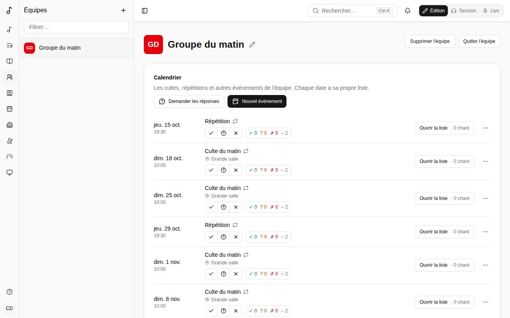

Une **équipe** est un groupe qui partage chants, versions, listes de chants et recueils. Vos équipes s'affichent sous **Équipes** dans la barre latérale.

## Calendrier

La page de l'équipe commence par son **Calendrier** : ses cultes, répétitions et autres événements, les huit semaines à venir (**Voir plus** pour la suite). Tous les membres le voient ; ses administrateurs le gèrent.

- **Nouvel événement** : son **Titre**, sa **Date** et son **Heure de début**, sa durée, son **Fuseau horaire** (le vôtre par défaut) et, si vous voulez, un lieu et une note. **Répétition** : **Chaque semaine**, toutes les 2 semaines, etc., le même jour de la semaine que sa date, **Jusqu'au** une date ou sans fin ; ou **Ne se répète pas**. Les heures restent les mêmes au changement d'heure.
- **Arrivée (minutes avant)** : quand être là, tant de minutes avant le début - pour une balance ou un temps de prière. Chaque date affiche alors « Arrivée 9:15 » sous son heure, dans le calendrier et dans **Mon calendrier** ; elle figure dans votre lien de calendrier et dans le rappel de la veille. Laissez vide pour aucune.
- **Chaque date a sa propre liste**, au nom de l'événement suivi de sa date dans votre langue (« Culte du matin - 12 oct. ») : **Ouvrir la liste** la prépare comme toute liste. Les listes sont créées à l'avance - **Créer les listes à l'avance**, sous le calendrier, dit combien de semaines, de 1 à 52 (4 par défaut ; 13 font environ trois mois). Une date plus lointaine a **Préparer la liste**, qui crée sa liste tout de suite.
- Le menu **…** d'une date : **Annuler cette date** (sa liste est supprimée si elle n'a pas encore de chants) ou **Rétablir cette date**, et **Modifier l'événement**.
- Modifier un événement (son titre, sa date, sa fréquence) met à jour ses listes à venir. Les dates où il n'a plus lieu perdent leur liste si elle est encore vide ; une liste avec des chants reste, comme liste de l'équipe. **Supprimer l'événement** fait de même. Une liste supprimée à la main n'est pas recréée ; **Préparer la liste** la fait revenir.

### Disponibilités

Sous chaque date, dites si vous pouvez jouer : **Disponible**, **Si besoin** (libre si on vous le demande, pas en premier choix) ou **Pas disponible**. Appuyez de nouveau sur votre réponse pour la retirer. Une fois répondu, ajoutez une note pour les administrateurs de l'équipe (« Clavier seulement », « j'arrive en retard ») ; seuls vous et eux la voient. Ne pas répondre n'est jamais compté comme disponible.

**Mon calendrier**, dans la barre latérale, liste les dates à venir de toutes vos équipes, pour y répondre au même endroit. Sous **Absences**, **Ajouter une absence** ouvre un calendrier : choisissez le premier jour, puis le dernier, ajoutez une note si vous voulez, puis **Ajouter**. Chaque date de ces jours se lit **Pas disponible**, marquée **Absent**, pour toutes vos équipes - sauf si vous répondez vous-même à cette date. Chaque absence peut être modifiée (**Modifier** : choisissez de nouveau les jours, changez la note, **Enregistrer**) ou supprimée ; vos autres absences apparaissent barrées sur le calendrier.

Les administrateurs de l'équipe voient, à côté de chaque date, combien de membres sont disponibles, si besoin, pas disponibles, et n'ont pas répondu. Un clic ouvre **Qui peut jouer** : la réponse de chacun, avec ses notes et ses absences. Un administrateur peut y répondre pour un membre qui n'utilise pas Songverse ; c'est marqué comme répondu par lui.

### Postes nécessaires

Dans la fenêtre d'un événement, **Postes nécessaires** liste ce dont il a besoin et combien : **Ajouter un poste** choisit un instrument ou un rôle que chacun indique sous **Rôles** sur son tableau de bord (Ingénieur du son, Opérateur média…), un instrument ajouté par un administrateur, un nom déjà utilisé par l'équipe, ou **Un autre nom…** (« Responsable de louange », « Projection »). Une équipe qui a ses propres postes liste d'abord les **Postes de ce groupe** (voir [Postes](/fr/organizations/#postes)). Un membre couvre les instruments et rôles qu'il a indiqués, et les postes qu'il a cochés ; tout le monde couvre un poste nommé par l'équipe.

Les administrateurs de l'équipe voient alors, à côté de chaque date à venir, ce qui manque : **Manque : Batterie, Ingénieur du son** nomme les postes pour lesquels pas assez de membres qui les couvrent ont répondu **Disponible**. **Qui peut jouer** commence par les postes : qui couvre chacun et est disponible, qui jouerait si besoin, ou **Personne de disponible pour l'instant**.

### Équipe du jour

Une fois les postes d'une date fixés, ses administrateurs choisissent qui tient quoi : **Équipe du jour** à côté de la date liste chaque poste avec les personnes placées, et **Ajouter quelqu'un** y place un membre - ceux qui le tiennent d'abord, avec leur réponse, puis les autres. Chacun est prévenu et répond dans le calendrier de l'équipe ou **Mon calendrier** : **Prévu : Batterie**, **Accepter** ou **Décliner** (un administrateur qui se place lui-même est accepté d'emblée). Accepter répond aussi **Disponible** pour cette date ; décliner prévient les administrateurs de l'équipe. Un administrateur peut retirer quelqu'un d'un poste ; il est prévenu.

L'équipe du jour signale ce qui coince : quelqu'un **Absent**, qui **A répondu pas disponible**, ou qui **Joue ailleurs à ce moment-là** - sur un autre événement en même temps, de n'importe laquelle de ses équipes. Chaque poste montre combien il en a sur combien il en faut, et **Manque** compte ceux de l'équipe du jour une fois qu'elle existe.

**Invités** : **Ajouter quelqu'un** liste aussi **Vos personnes (invités)** - les personnes avec qui vous êtes en lien dans [Personnes](/fr/people/) et qui ne sont pas dans l'équipe. Un invité est prévenu et répond comme un membre, voit cette date dans son **Mon calendrier** et sa liste (en lecture seule), et la perd quand on le retire. **Quelqu'un sans compte…** ajoute un nom pour mémoire : il figure dans l'équipe du jour, marqué **Sans compte**, mais n'est jamais prévenu.

**Un empêchement ?** À côté de votre place, **Chercher un remplaçant**, avec un mot si vous voulez, puis **Demander**. Les membres qui tiennent ce poste - pas déjà dessus, ni absents ou indisponibles ce jour-là - sont prévenus, et voient **Prendre Batterie à la place de Alex** dans le calendrier de l'équipe et **Mon calendrier** - d'abord ceux qui ont répondu **Si besoin** pour cette date : les autres ne sont sollicités que si aucun d'eux ne la prend dans la journée (deux heures quand la date est dans moins de deux jours), ou tout de suite quand personne n'a répondu **Si besoin**. Le premier qui la prend a la place, acceptée (et **Disponible** ce jour-là) ; vous et les administrateurs de l'équipe êtes prévenus. D'ici là la place reste la vôtre, marquée **Cherche un remplaçant** ; **Annuler** retire la demande.

**Qui est inscrit à une date** : une fois son équipe du jour faite, les personnes placées - sollicitées ou ayant accepté, pas celles qui ont décliné ; jusque-là, ceux qui ont répondu **Disponible**. Ce sont eux qui voient sa liste dans leur barre latérale, la trouvent dans leur lien de calendrier, et reçoivent rappels et notifications.

### Répétitions

Une répétition avant chaque date : dans **Nouvel événement**, **Répétition pour** choisit l'événement qu'elle prépare, et **Jours avant** combien de jours avant (14 au plus), avec son heure de début et sa durée. Elle suit cet événement : une date déplacée ou annulée déplace ou annule sa répétition. Elle apparaît dans le calendrier marquée **Répétition**, « pour Culte du dimanche, dim. 18 oct. », et **Ouvrir la liste** ouvre la liste de cette date, pour que chacun répète les chants qui seront joués. Une répétition n'a ni réponses ni équipe du jour à elle : les personnes inscrites à sa date (voir [Équipe du jour](/fr/teams/#équipe-du-jour)) la voient dans **Mon calendrier** et dans leur lien de calendrier, et reçoivent un rappel la veille. Supprimer l'événement supprime ses répétitions.

### Votre lien de calendrier

Dans **Mon calendrier**, **Lien de calendrier** met les dates où vous êtes inscrit (voir [Équipe du jour](/fr/teams/#équipe-du-jour)) dans votre propre calendrier : **Obtenir mon lien de calendrier**, puis **Ajouter à Google Agenda**, **Ajouter à Calendrier Apple** ou **Ajouter à Outlook** - ou **Copier le lien** et l'ajouter à n'importe quelle application de calendrier comme abonnement (« À partir de l'URL », « S'abonner à un calendrier »). Chaque date s'affiche avec son équipe, son lieu et un lien vers sa liste, de trois mois en arrière à un an à l'avance ; les dates annulées en disparaissent.

Le calendrier se met à jour tout seul, mais les applications de calendrier vérifient les changements à leur rythme - toutes les quelques heures (Google peut mettre jusqu'à un jour). Toute personne ayant le lien voit ces dates : gardez-le pour vous. **Réinitialiser le lien** en crée un nouveau et arrête l'ancien ; **Désactiver** le supprime.

### Le lien de calendrier de l'équipe

Les administrateurs d'une équipe en ont un de plus sur sa page : **Lien de calendrier de l'équipe**, avec **Obtenir le lien de calendrier de l'équipe**. Il contient toutes les dates de l'équipe - événements et répétitions, avec leur heure d'arrivée, leur lieu, leur note et leur liste - sans les réponses de chacun, pour un agenda partagé, le site de l'église ou quiconque a besoin du planning. Il fonctionne comme votre propre lien : **Copier le lien**, les boutons **Ajouter à…**, **Réinitialiser le lien** s'il circule trop, **Désactiver**.

### Les listes que vous voyez

La liste d'une date s'affiche dans votre barre latérale quand vous y êtes inscrit (voir [Équipe du jour](/fr/teams/#équipe-du-jour)) : répondre **Disponible** l'y met, ou être placé dans son équipe du jour, et le retirer l'enlève. Les autres dates à venir de l'équipe restent sur la page **Listes de chants** et dans le calendrier de l'équipe. Une fois la date passée, sa liste quitte la barre latérale et la liste : celles auxquelles vous avez participé sont sur la page **Listes de chants** sous **Archives**, et toutes les dates passées sont sur la page de l'équipe sous **Dates passées**. Les listes que vous créez vous-même s'affichent comme avant. Les listes gardées hors ligne suivent la même règle.

### Rappels

- **Demander les réponses** (administrateurs) : choisissez les dates (**Du**, **Au**) et **Répondre d'ici le**, puis **Demander**. Les membres qui n'ont pas encore répondu à certaines de ces dates sont prévenus tout de suite - pas ceux absents à ces dates - puis, s'ils n'ont toujours pas répondu, la veille de l'échéance. La demande s'affiche en haut du calendrier pour tous jusqu'à l'échéance ; **Ne plus demander** (×) la retire.
- **La veille** : chacun de ceux inscrits à une date (voir [Équipe du jour](/fr/teams/#équipe-du-jour)) reçoit un rappel la veille, à partir de 18:00 dans le fuseau horaire de l'événement, avec l'heure, l'heure d'arrivée, le lieu et la liste.
- **Dire que la liste est prête** (administrateurs, dans le menu **…** d'une date, une fois sa liste créée) : les personnes inscrites sont prévenues, et la date affiche **Liste prête**. **Le redire** après d'autres changements.

Comme toutes les notifications, ils s'affichent sous la cloche, et par e-mail ou sur vos appareils selon vos choix (voir [Notifications](/fr/account/#notifications)).

### Notifications

La cloche en haut de chaque page montre combien de notifications vous n'avez pas lues ; appuyez dessus pour les voir, des plus récentes aux plus anciennes. Appuyer sur l'une d'elles ouvre ce qu'elle concerne et la marque comme lue ; **Tout marquer comme lu** remet le compteur à zéro, et **Voir les plus anciennes** charge les précédentes. Vous êtes prévenu :

- quand une date pour laquelle vous êtes inscrit (voir [Équipe du jour](/fr/teams/#équipe-du-jour)) est annulée, ou que son heure ou son titre change - aussi quand tout l'événement change ou est supprimé ;
- quand un administrateur de l'équipe répond pour vous, avec sa réponse.

En dehors des calendriers de vos équipes, vous êtes prévenu quand quelqu'un demande à se connecter avec vous (voir [Personnes](/fr/people/)) - **Accepter** ou **Refuser** sur place - ou accepte votre demande ; quand une de vos personnes partage un chant ou un recueil avec vous (et quand vous pouvez désormais le modifier) ; quand quelqu'un rejoint une de vos listes par son lien, ou une équipe que vous administrez par son lien d'invitation ; quand vous devenez administrateur d'une équipe, ou de nouveau membre ; quand une suggestion que vous avez faite est retenue ou refusée, ou qu'un chant que vous avez proposé au catalogue est publié ou renvoyé, avec les notes du relecteur ; et quand quelqu'un enregistre une partie dans un multipiste de votre chant (une fois par heure au plus).

**Tout voir**, en bas de la liste, ouvre la page **Notifications** : tout, page par page. Les notifications lues sont supprimées après 90 jours, les non lues après un an.

Celui qui fait le changement n'en est pas prévenu. Elles peuvent aussi arriver par e-mail, comme vous le choisissez dans les [réglages de votre compte](/fr/account/#notifications), quand le serveur les envoie.

## Membres et rôles

- Les **Administrateurs** gèrent l'équipe : ils modifient ses chants, ses versions et ses listes, et invitent des personnes.
- Les **Membres** voient et utilisent tout ce qu'a l'équipe.

À côté de chaque nom, l'équipe montre ce que la personne joue ou fait (voir [Rôles](/fr/account/#rôles)).

## Créer une équipe et inviter

**Créer une équipe** depuis la carte **Équipes** du tableau de bord ; vous en êtes le premier administrateur.

Pour inviter, créez un **lien d'invitation** : choisissez le rôle donné en rejoignant, quand il expire et combien de fois il peut servir, puis **Copier le lien** et envoyez-le. Toute personne qui l'ouvre et se connecte rejoint l'équipe. **Révoquer** un lien l'arrête.

Sur un serveur qui a des organisations, une équipe peut faire partie de l'une d'elles - son église ou son club : sous **Organisation**, ses administrateurs en choisissent une dont ils sont administrateurs (voir [Organisations](/fr/organizations/#y-mettre-une-équipe)).

## Couleur et image

Les administrateurs d'une équipe lui donnent une **Couleur** et une image sur sa page, dans **Couleur et image** : l'image (**Ajouter une image**, recadrée en carré) ou les initiales de l'équipe sur sa couleur s'affichent à côté de son nom dans la barre latérale et les listes, pour tous ceux qui la voient. **D'après son nom** choisit une couleur à partir du nom de l'équipe.

## Quitter ou supprimer une équipe

**Quitter l'équipe** vous en retire. Si vous en êtes le seul administrateur, nommez d'abord un autre membre administrateur. Un administrateur peut la **Renommer** - le crayon à côté de son nom ; un groupe d'organisation aussi - ou **Supprimer l'équipe**.

## Ce qui appartient à une équipe

Les versions, les listes de chants et les recueils peuvent appartenir à l'équipe plutôt qu'à vous : choisissez l'équipe en les créant (il faut en être administrateur). Ce qui est à l'équipe y reste quand les personnes vont et viennent.

Un de vos chants devient celui de l'équipe quand vous le lui cédez : voir [Passer une liste à une équipe](/fr/sets/#passer-une-liste-à-une-équipe-ou-linverse).
