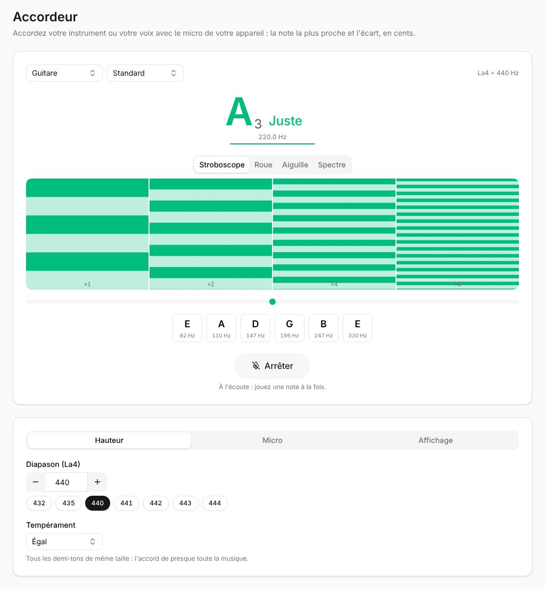

**Accordeur**, dans les **Outils** de la barre latérale, ouvre l'accordeur : il écoute le micro de votre appareil et montre la note la plus proche et son écart, en cents (un centième de demi-ton). Ses réglages sont gardés sur cet appareil.

## Accorder

1. Appuyez sur **Accorder**. La première fois, le navigateur demande le micro : autorisez-le. Le micro n'est utilisé que pendant l'écoute, et rien ne quitte votre appareil.
2. Jouez ou chantez une note à la fois. L'accordeur montre son nom et son octave (**A₂**), son écart (**-10.0 ¢** : trop bas ; **+** : trop haut) et sa fréquence. Il affiche **Juste**, en vert, à 2 cents près.
3. **Arrêter** libère le micro, comme quitter la page.

La ligne sous la fréquence montre à quel point l'accordeur est sûr de la note. Entre deux notes, il garde la dernière, estompée.

Si votre appareil met le micro en pause (un appel, une autre application), **Toucher pour reprendre** le relance.

## Votre instrument

Choisissez votre **instrument** - **Chromatique** pour n'importe quelle note, **Guitare**, **Basse**, **Ukulélé**, **Violon**, **Alto** ou **Violoncelle** - et, pour certains, son **accordage** : **Standard**, **Drop D**, **DADGAD**, **Open G**, **Un demi-ton plus bas**... - ou **Votre accordage**, celui que vous avez tapé comme le vôtre pour les diagrammes d'accords. **Accorder**, à côté des accords d'une grille dont la version est dans un autre accordage, ouvre l'accordeur réglé dessus. Ses cordes s'affichent sous l'accordeur, avec leurs notes, et celle que vous jouez s'allume (en vert une fois juste).

## Affichages

Quatre façons de lire la même note :

- **Stroboscope** : des bandes qui défilent dans le sens de l'écart (vers le bas quand c'est trop bas, vers le haut quand c'est trop haut) et ralentissent à l'approche ; elles s'arrêtent quand c'est juste. Le plus précis, pour le dernier cent.
- **Roue** : la même chose, en roue qui tourne.
- **Aiguille** : une aiguille de -50 à +50 cents.
- **Spectre** : les fréquences du son, la note et ses harmoniques en pics.

Sous chacun, un point sur une ligne montre la même chose : à gauche trop bas, à droite trop haut.

## Réglages

**Hauteur** :

- **Diapason (La4)** : le La d'où partent les autres, **440 Hz** par défaut. **−** et **+** le changent de 1 Hz, ou tapez-le (de 392 à 466 Hz) ; les plus courants sont à portée d'un appui (**432** à **444**).
- **Tempérament** : **Égal** (tous les demi-tons de même taille, celui de presque toute la musique), ou un tempérament accordé depuis une **tonalité** - **Intonation juste** (intervalles purs dans cette tonalité, pour les chœurs, les cordes et les cuivres qui y jouent), **Pythagoricien** (quintes pures) ou **Mésotonique (quart de comma)** (tierces majeures pures, pour la musique ancienne aux claviers). Les cents sont alors comptés depuis les notes de ce tempérament : en intonation juste en Fa, un La juste est 13,7 cents sous celui du tempérament égal.

**Micro** :

- **Sensibilité du micro** : **Basse**, **Normale**, **Haute** ou **Max**. Plus haut entend des notes plus douces et plus lointaines, plus bas ignore davantage le bruit de la salle. Si l'accordeur ne réagit pas à votre instrument, essayez **Haute** ; s'il montre des notes que personne n'a jouées, essayez **Basse**.
- **Détecteur de hauteur** : **MPM**, rapide et stable, le meilleur pour la plupart des instruments et des voix ; ou **YIN**, qui tient mieux dans une salle bruyante et pour les notes très graves.

**Affichage** :

- **Précision** : les cents au dixième (**±0.1¢**) ou entiers (**±1¢**).
- **Bandes du stroboscope** : chaque bande tourne à une **octave** de la note ou à l'une de ses **harmoniques** (F à 5F) ; toutes s'arrêtent quand c'est juste.

Sur un téléphone, les réglages sont sous l'accordeur.

Accordez dans un endroit calme quand vous le pouvez, près du micro ; le micro d'un téléphone entend moins bien les cordes les plus graves d'une basse que les aiguës.
