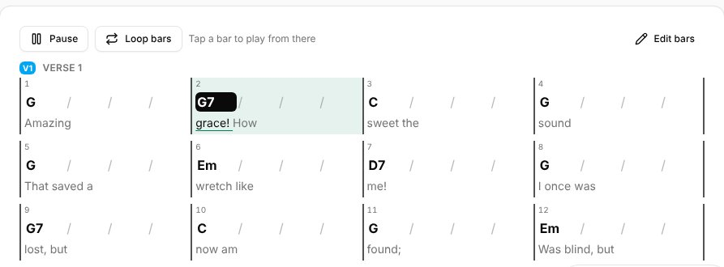
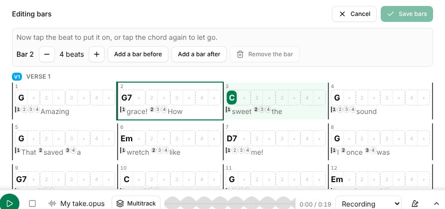
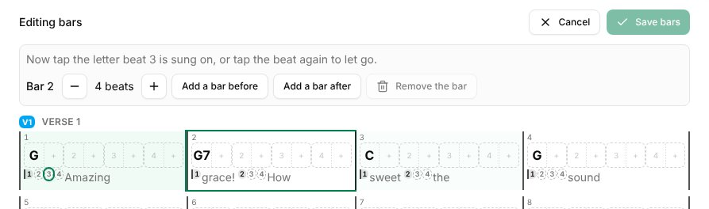

**Metronome**, in the sidebar's **Tools**, opens its page: everything it can do, set once and remembered on this device. It keeps time while you move around Songverse; a small button at the bottom of the screen shows its tempo and beat, takes you back to its page and stops it.

## Tempo

- **−** and **+** change the tempo a beat per minute at a time; type it in, or drag the slider (20 to 300 BPM).
- **Tap**: tap it in time with the music, and the metronome takes that tempo.
- **Start** and **Stop**. With a keyboard, **Space** starts and stops it, and **↑** **↓** change the tempo (by 5 with **Shift**).

A new tempo takes over on the next beat, without stopping.

## Time signature and pattern

- **Time signature**: the beats per bar and the beat's value - **4 / 4**, **3 / 4**, **6 / 8**... The tempo counts those beats: in 6/8, eighth notes.
- The circles are the bar's beats: the one you hear lights up, the first of the bar is bigger. Click a beat to make it **accented**, **normal** or **silent** - for example, only beats 2 and 4, or a bar with its last beat left out.
- **Subdivision** adds clicks between the beats: **2 per beat**, **Triplets** or **4 per beat**, softer than the beats.

## Count-in

**Count-in** plays one or two bars before the song, every beat heard. With **Count-in only**, it goes silent after them: the circles keep showing the beat, for a band that only needs to be counted in.

## Sound and volume

**Sound**: **Click**, **Wood block** or **Beep**; and its **Volume**. The sound is made on your device, so the metronome works offline.

Use wired headphones or the device's speaker: Bluetooth headphones hear it a fraction of a second late.

## At a song's tempo

In [Live](/sets/#playing-a-set-live), on a song's page in a set and on a song's page in Practice, the metronome button (on a song's page, it shows the song's tempo: **76 BPM**) starts it at the song's tempo and time signature (its version's, when the set plays one) in one press; press it again to stop. It uses your pattern, sound and count-in from the Metronome page, and flashes with the beat. A song without a tempo can't start it: add one on its **Song info**.

Playing with others, the leader's metronome can be everyone's, in time: see [Playing in sync](/sets/#playing-in-sync).

## Bars

At the top of a song in Practice and in Live, the **bars row** puts the song's chords in bars and beats, with the metronome:

- **A box for each beat.** A strong line starts each bar, and a chord's name sits on the beat it starts on. Each section's name (V, C, B…) is on its first bar, in the structure bar's colours.
- **The metronome button** at its left shows the song's tempo and starts or stops the click at it.
- **While the music plays,** the beat being played fills and the row slides along, so what's coming stays in view. It follows the song's stems or recording when they're playing - beat by beat when the [stem separation found its beats and bars](/library/#separating-a-recording-into-stems), else from its tempo and first beat - else the metronome, including the leader's when you [play in sync](/sets/#playing-in-sync). Stopped, it stands at the first bar and you can scroll it.
- **The chords read as on the chart:** transposed, with your capo, names and colours.

The bars come from the chart's [bar lines](/song-editor/#bar-lines) when it has them. Otherwise from its chords: each chord gets a bar, and a sung line takes at least two (a line with one chord holds it for a second bar). Lines of chords alone (an intro) take a bar per chord, and notes take none. Each bar has as many beats as the song's time signature says, and a section can have a time signature of its own in the song's order.

**Display** > **Chords** > **Bars** hides it, separately in Practice and in Live (see [Display](/display/)).

## Chord grid

**Chart** / **Grid** above a song (in Practice, on its page in a set, and in Live's header) reads the song as a chord grid instead of its chart: the same bars, laid out like a lead sheet.

- **Four bars to a row** (two on a phone), each section under its name, with its time signature where it changes.
- **Each bar** has its number, a slash for each beat and the chord on the beat it changes on. A chord held on from the bar before is named again, in grey. Underneath are the words sung in that bar (from the chord or the bar line they start at to the next one).
- **While the music plays,** the bar and the beat being played light up, and the grid scrolls to keep that bar in view. It follows the same things as the bars row: the stems, the metronome, or the leader's.
- **The chords read as on the chart:** transposed, with your capo, names and colours, and on a set's song page your **Simpler chords** and **No bass notes** too.

Your choice is kept for the song, as a PDF's is: every device you sign in on, and Live, show it the same way. To read every song this way unless you choose otherwise, set **Songs read as** to **Chord grid (bars)** (see [Chart display](/account/#chart-display)).

### Playing from the grid

Above the grid, **Play the recording** plays the song's stems or recording, and **Play the click** plays the metronome at the song's tempo when it has neither.

- **Tap a bar** to play from its first beat, or to jump there while it plays. With a recording, the bar is found from its beats and bars (when the [stem separation found them](/library/#separating-a-recording-into-stems)), else from its tempo and first beat. With the click, a count-in plays the beats just before the bar.
- **Loop bars** (with a recording): tap the first bar, then the last. Those bars play over and over, marked underneath, until you press **Stop looping**.

When you [play in sync](/sets/#playing-in-sync) and follow the leader, they start and stop the music: tapping a bar does nothing.

### Placing chords on beats

If you can edit the song, **Edit bars** above the grid in Practice lets you say exactly where each chord falls:

- **Move a chord to another beat.** Drag it there, or tap it and then tap the beat. Each beat has two halves: the left one is the beat itself and the right one is its "and" (the + between beats). A chord stays between the chords before and after it in the chart, so the grid and the lyrics never disagree.
- **Change a bar.** Tap a bar to show its tools. **−** and **+** change how many beats it has, for a pickup or a 2/4 bar before the chorus. **Add a bar before** and **Add a bar after** add an empty bar, where the chord before carries on. **Remove the bar** removes an empty bar (move its chords out first).
- **Save bars** saves them, and **Cancel** drops your changes. Every pass of a section has the same bars, so a chorus is changed everywhere it comes back.

The bars are saved with the song, as the Editor's [bar lines](/song-editor/#bar-lines) are, and show in the song's history. The bars row, the click and the grid all follow them. If you later move a bar line in the Editor, the chords you placed here keep their beats in every bar that hasn't changed.

### Placing beats in the words

Under each bar, its words are cut at its beats: as the music plays, the words of the beat being played are underlined. The grid places the beats by itself. The first beat is where the bar's words start, a chord's beat is on its word, and the others are spread evenly between them, each on the nearest word. A word held over a beat gets none.

When a beat is sung somewhere else, move it in **Edit bars**. Each beat is a small number just before the letter it's sung on (a held beat sits right after the one before it).

- **Drag a beat onto a letter**, or tap it and then tap the letter. It can go on any letter, not only the start of a word, but it stays in its own bar's words, between the beats before and after it. Beats you placed are filled in.
- **Beat 1 is where the bar starts.** Dragging it moves the bar line within its line of lyrics, so words go from one bar to the next.
- **Let the grid place it**, shown when you tap a beat you placed, gives it back to the grid.

**Save bars** saves the beats with the bars. They are also what [Follow the music](/screens/#following-the-music) moves the screens with.

