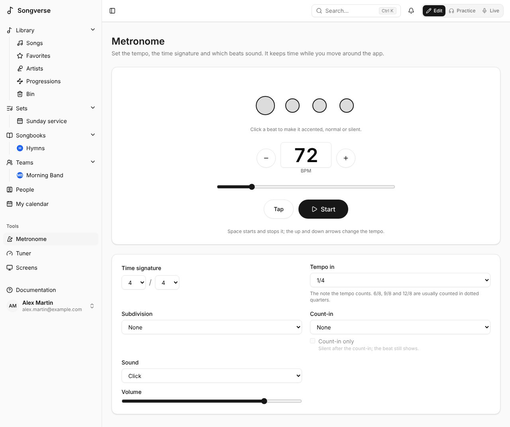
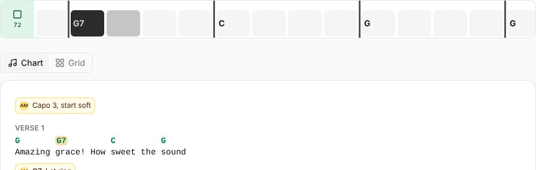
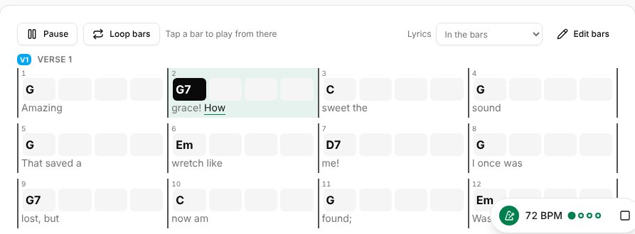
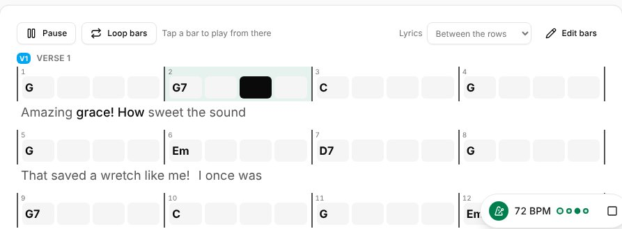
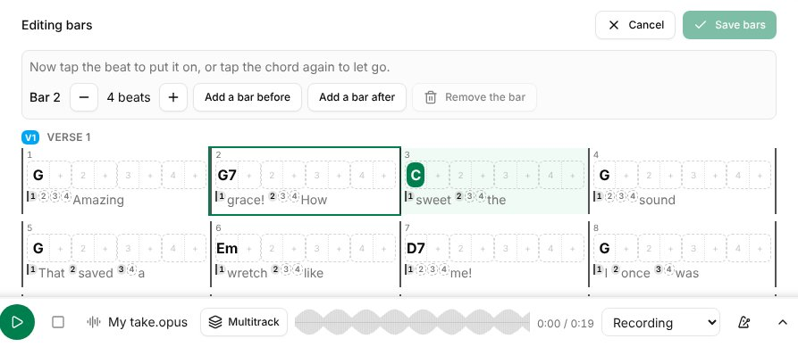
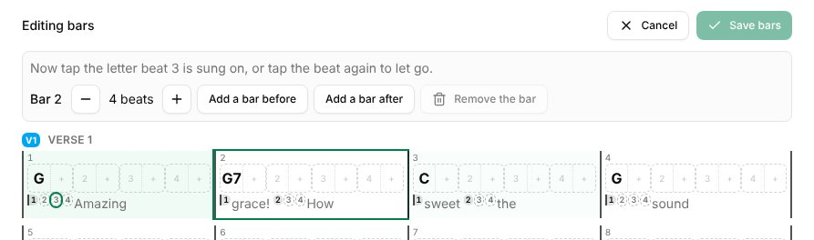

**Metronome**, in the sidebar's **Tools**, opens its page: everything it can do, set once and remembered on this device. It keeps time while you move around Songverse; a small button at the bottom of the screen shows its tempo and beat, takes you back to its page and stops it.

## Tempo

- **−** and **+** change the tempo a beat per minute at a time; type it in, or drag the slider (20 to 300 BPM).
- **Tap**: tap it in time with the music, and the metronome takes that tempo.
- **Start** and **Stop**. With a keyboard, **Space** starts and stops it, and **↑** **↓** change the tempo (by 5 with **Shift**).

A new tempo takes over on the next beat, without stopping.

## Time signature and pattern

- **Time signature**: the beats per bar and the beat's value - **4 / 4**, **3 / 4**, **6 / 8**...
- **Tempo in**: the note the tempo counts - **1/8**, **1/4**, **1/2**, **1/8 dotted**, **1/4 dotted** or **1/2 dotted**. It takes the time signature's usual one: its own beat, except 6/8, 9/8 and 12/8, counted in quarters (**1/4**). So 3/4 at 71 plays three quarters a bar, and 6/8 at 71 plays its six eighths in the same time, twice as fast (142 a minute). Whatever the note, every beat of the time signature clicks: the note only sets how fast. Pick another when a song is counted differently: **1/4 dotted** for a 6/8 counted in two (71 dotted quarters, its eighths 213 times a minute), **1/8** for a slow 6/8 counted in six. Changing the time signature takes the new one's usual note, unless you picked another.
- The circles are the bar's beats, the one you hear lit. Each beat has a level, and its circle's size shows it: **accent** (the biggest, a higher sound), **medium**, **small** or **off** (hollow, not heard). Click a beat to go from one to the next.
- **Each time signature has its own pattern.** Its usual one accents the first beat; the others are small, except the first beat of each group, which is medium. So 3/4 is "**1** 2 3", 4/4 "**1** 2 3 4", and 6/8 "**1** 2 3 *4* 5 6": two groups of three, 3/4 and 6/8 feel different with nothing else changed. 9/8 and 12/8 have three and four groups of three. A pattern you change is kept for that time signature on this device: 6/8 and 6/4 are two, and coming back to 6/8 brings yours back. **Usual pattern** puts the usual one back.
- **A bar of 5 or 7** shows how its beats are grouped: **3+2** or **2+3** for 5, **2+2+3**, **3+2+2** or **2+3+2** for 7. Pick one and each group's first beat becomes medium.
- **Subdivision** adds clicks between the beats: **2 per beat**, **Triplets** or **4 per beat**, softer than the beats.

## Count-in

**Count-in** plays one or two bars before the song, every beat heard with the pattern's levels (a beat that's off is small there, so the count is complete). With **Count-in only**, it goes silent after them: the circles keep showing the beat, for a band that only needs to be counted in.

## Sound and volume

**Sound**: **Click**, **Wood block** or **Beep**, each with its own sound for an accent, a medium and a small beat; and its **Volume**. The sound is made on your device, so the metronome works offline.

Use wired headphones or the device's speaker: Bluetooth headphones hear it a fraction of a second late.

## At a song's tempo

In [Live](/sets/#playing-a-set-live), on a song's page in a set and on a song's page in Practice, the metronome button (on a song's page, it shows the song's tempo: **76 BPM**, with its note when it isn't a quarter: **71 BPM · 1/4.**) starts it at the song's tempo, its note and time signature (its version's, when the set plays one) in one press; press it again to stop. It uses your pattern for that time signature, sound and count-in from the Metronome page, and flashes with the beat. A version can have a pattern of its own, a 7/8 felt 3+2+2 for example: set it on its **Song info**, under **More details** > **Metronome pattern** (**Set one for this version**, then click the beats). Everyone then hears that one for the song; **Use each player's own** takes it away. A song without a tempo can't start it: add one on its **Song info**, with **Tempo in** under it when it isn't counted in the time signature's usual note.

Playing with others, the leader's metronome can be everyone's, in time: see [Playing in sync](/sets/#playing-in-sync).

## Bars

At the top of a song in Practice and in Live, the **bars row** puts the song's chords in bars and beats, with the metronome:

- **A box for each beat.** A strong line starts each bar, its first beat is ringed, and a chord's name sits on the beat it starts on (in the middle of the box when it's the beat's only chord). Each section's name (V, C, B…) is on its first bar, in the structure bar's colours.
- **The metronome button** at its left, in Live, shows the song's tempo and starts or stops the click at it. In Practice the metronome is beside the tempo, under the song's title: with the stems or the recording playing, it's their **Click with the recording**.
- **While the music plays,** the beat being played fills. The row shows whole bars - one on a phone, more on a wider screen - and the next one's first beat; when the last bar shown is over, it turns to the next ones at once, without sliding. It follows the song's stems or recording when they're playing - beat by beat when the [stem separation found its beats and bars](/library/#separating-a-recording-into-stems), else from its tempo and first beat - else the metronome, including the leader's when you [play in sync](/sets/#playing-in-sync). Stopped, it stands at the first bar and you can scroll it.
- **The chords read as on the chart:** transposed, with your capo, names and colours.

The bars come from the chart's [bar lines](/song-editor/#bar-lines) when it has them. Otherwise from its chords: each chord gets a bar, and a sung line takes at least two (a line with one chord holds it for a second bar). Lines of chords alone (an intro) take a bar per chord, and notes take none. Each bar has as many beats as the song's time signature says, and a section can have a time signature of its own in the song's order.

**Display** > **Chords** > **Bars** hides it, separately in Practice and in Live (see [Display](/display/)). While the [chord grid](#chord-grid) shows, the bars row isn't shown, as the grid has the same bars: **Display** > **Grid** > **Bars row** brings it back.

The chart follows along too, in Practice and on a song's page in a set: while the music plays, the line being sung is lit a beat ahead and kept in view, above the player. The words are matched to the beats as the [beats are placed in the words](#placing-beats-in-the-words), or spread over their bars until they are. Scroll yourself and it waits a few seconds before following again.

## Chord grid

**Chart** / **Grid** above a song (in Practice, on its page in a set, and in Live's header) reads the song as a chord grid instead of its chart: the same bars, laid out like a lead sheet.

- **As many bars to a row as fit**, each section under its name, with its time signature where it changes. Each beat keeps room for a chord and a word, so a phone held upright has one bar a row in Practice (two 4/4 bars in Live, which has the whole screen), and a laptop four. **Display** > **Grid** > **Per row** sets 1, 2 or 4 instead of **Auto**, separately in Practice and in Live.
- **Each bar** has its number, a block for each beat and the chord in the block of the beat it changes on, as in the bars row. The beat being played turns dark. A chord on the "and" of a beat splits its block in two. A chord held on from the bar before is named again, in grey. Underneath are the words sung in that bar (from the chord or the bar line they start at to the next one).
- **While the music plays,** the bar and the beat being played light up, and the grid scrolls to keep that bar in view. It follows the same things as the bars row: the stems, the metronome, or the leader's.
- **The chords read as on the chart:** transposed, with your capo, names and colours, and on a set's song page your **Simpler chords** and **No bass notes** too.

Your choice is kept for the song, as a PDF's is: every device you sign in on, and Live, show it the same way. To read every song this way unless you choose otherwise, set **Songs read as** to **Chord grid (bars)** (see [Chart display](/account/#chart-display)).

### The words

The grid's settings are in **Display**, which opens on its **Grid** section while the grid shows. **Lyrics** there chooses where the words go. Your choice is kept on this device, for every song:

- **In the bars**: each bar has the words sung in it underneath, as above.
- **Between the rows**: each row of bars has its words as a line under it, easier to read. The words of the bar being played turn dark.
- **Under a pinned row**: the row being played stays at the top, and the song's words scroll under it in large type, with the line being sung lit.
- **Off**: only the bars.

While you **Edit bars**, the words are in the bars, where the beats are placed.

### Playing from the grid

The page's own play button plays the song's stems or recording, and the metronome plays the click: the grid follows either.

- **Tap a bar** to play from its first beat, or to jump there while it plays. With a recording, the bar is found from its beats and bars (when the [stem separation found them](/library/#separating-a-recording-into-stems)), else from its tempo and first beat. With the click, a count-in plays the beats just before the bar.
- **Loop bars** (in **Display** > **Grid**, with a recording): tap the first bar, then the last. Those bars play over and over, marked underneath. A bar over the grid says which, until you press **Stop the loop** there.

When you [play in sync](/sets/#playing-in-sync) and follow the leader, they start and stop the music: tapping a bar does nothing.

### Placing chords on beats

If you can edit the song, **Edit bars** (in **Display** > **Grid**, in Practice) lets you say exactly where each chord falls. **Cancel** and **Save bars** stay at the top of the grid as you scroll:

- **Move a chord to another beat.** Drag it there, or tap it and then tap the beat. Each beat has two halves: the left one is the beat itself and the right one is its "and" (the + between beats). A chord stays between the chords before and after it in the chart, so the grid and the lyrics never disagree.
- **Change a bar.** Tap a bar to show its tools. **−** and **+** change how many beats it has, for a pickup or a 2/4 bar before the chorus. **Add a bar before** and **Add a bar after** add an empty bar, where the chord before carries on. **Remove the bar** removes an empty bar (move its chords out first).
- **Save bars** saves them, and **Cancel** drops your changes. Every pass of a section has the same bars, so a chorus is changed everywhere it comes back.

The bars are saved with the song, as the Editor's [bar lines](/song-editor/#bar-lines) are, and show in the song's history. The bars row, the click and the grid all follow them. If you later move a bar line in the Editor, the chords you placed here keep their beats in every bar that hasn't changed.

### Placing beats in the words

Under each bar, its words are cut at its beats: as the music plays, the words of the beat being played are underlined. The grid places the beats by itself. The first beat is where the bar's words start, a chord's beat is on its word, and the others are spread evenly between them, each on the nearest word. A word held over a beat gets none.

When a beat is sung somewhere else, move it in **Edit bars**. Each beat is a small number just before the letter it's sung on (a held beat sits right after the one before it).

- **Drag a beat onto a letter**, or tap it and then tap the letter. It can go on any letter, not only the start of a word, but it stays in its own bar's words, between the beats before and after it. Beats you placed are filled in.
- **Beat 1 is where the bar starts.** Dragging it moves the bar line within its line of lyrics, so words go from one bar to the next.
- **Let the grid place it**, shown when you tap a beat you placed, gives it back to the grid.

The song Editor shows the same beats under the words of a section with bar lines, to move there too (see [Beats in the words](/song-editor/#beats-in-the-words)). **Save bars** saves the beats with the bars. They are also what [Follow the music](/screens/#following-the-music) moves the screens with.

