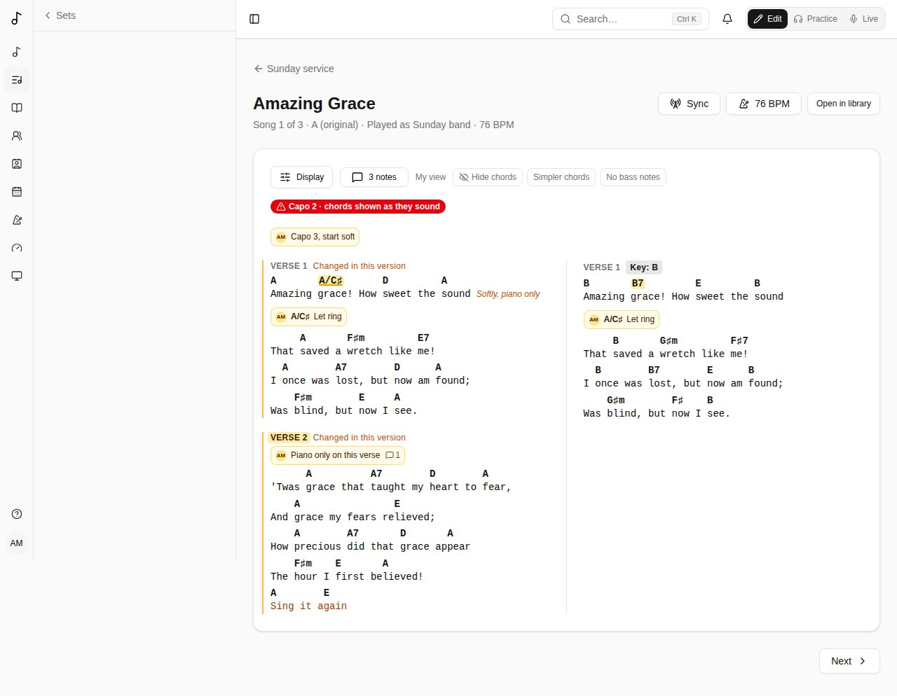
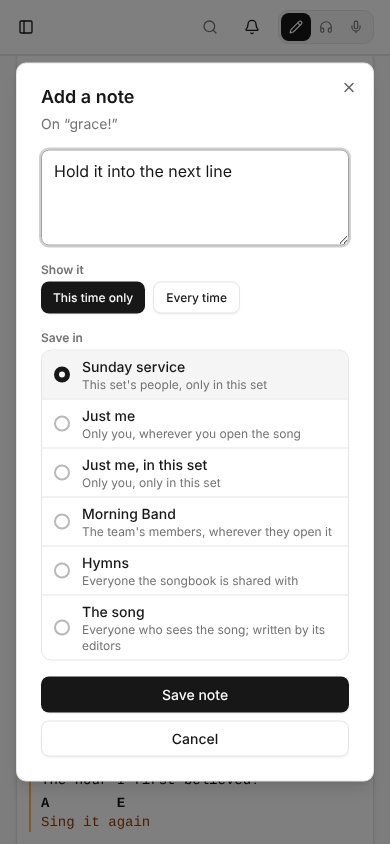

A note is something to remember about a song: "Let ring" on a chord, "Hold it" on a word, "Big ending" on the last chorus, "Capo 3, start soft" on the whole song. You write it once, pin it where it belongs, and save it somewhere. Where it's saved decides who sees it.

## Adding a note

On a song's page in Practice, on a song of a set, and in Live:

- **Right-click** a chord, a word or a section's name. On a touch screen, **press and hold** it.
- Or open **Notes** beside **Display** and choose **Add a note**, for the whole song.

The dialog says what the note goes on (**On G7**, **On “grace”**, **On Chorus**). Write the note, choose where to save it, then **Save note**.

Inside a section sung more than once, **Show it** asks whether the note is for **This time only** (the default) or **Every time**. "Big ending" on the last chorus stays on the last chorus.

## Where it's saved

**Save in** lists the places you can choose, each with who will see the note:

| Saved in | Who sees it | Where it shows |
|---|---|---|
| **Just me** | you | wherever you open the song |
| **Just me, in this set** | you | only in that set |
| A team | the team's members | wherever they open the song |
| A songbook | everyone the songbook is shared with | wherever they open the song, while it's in the songbook |
| A set | everyone who opens the set | only in that set |
| **The song** | everyone who sees the song | everywhere; only the song's editors can save here |

The first choice is where you came from: a set's song saves in that set, a song opened from a songbook saves in that songbook, anything else saves just for you. A song taken out of a songbook hides that songbook's notes. They come back if the song is put back.

## On the chart

Each note shows where it's pinned:

- the whole song's notes above the chart;
- a section's under its name;
- a line's, a chord's or a word's under the line, with the chord or the word it's about;
- notes between two sections after the first.

What a note is on is marked on the chart too: a chord is highlighted, a word underlined, a line gets a bar in the margin, a section its name highlighted. **Marks** in the [Display](/display/) panel turns the marks off, keeping the notes. Each note shows its writer's picture or initials and how many replies it has. If what a note was pinned to is deleted, the note moves up: from a chord to its line, from a line to its section, from a section to the whole song. A small arrow says it moved. A note is never lost to an edit.

## Replies

Tap a note to open it, with its replies. Anyone who sees a note can **Reply**. The note's writer, and everyone who has replied, gets a notification with a link back to it.

The person who wrote a note can **Edit** it, **Resolve** it, or **Delete** it with its replies. A resolved note leaves the chart but stays in its thread; **Reopen** brings it back. So can:

- a team's admins, for the team's notes;
- whoever can change a songbook, for its notes;
- the set's leaders (its owner, or its team's admins), for its notes;
- the song's editors, for the song's notes.

They can also edit or delete replies. Everyone else can change only their own replies.

Global admins can edit, resolve and delete any note and reply.

## Moving a note

When you edit a note you wrote (**Edit**), **Save in** shows where it's saved now and the other places you could save it, as for a new note. Choose another place and **Save**: the note keeps its words, where it's pinned and its replies, and now shows for the people of its new place. Someone who could see it before but isn't in the new place no longer sees it. Only the note's author can move it; the others who can edit it can't.

## As they happen

Notes are live. When someone adds a note, replies, edits, resolves or deletes one, it shows up for everyone who has the song open: there's no need to reload.

In Live, nothing moves while you're reading. A new or changed note waits behind **Notes changed**; tap **Show** to see it. To have them come in at once in Live too, set **New notes** to **At once** in Live's [Display](/display/) panel. An open thread and the notes list update at once, and a thread says who's replying (**Sam is replying…**).

A dot marks a note that's new since you last opened the song on this device: written, or replied to, by someone else. The bell at the top counts a reply to your note as it comes, without reloading.

## Every note on a song

**Notes** (with how many there are) lists every note you can see on the song, resolved ones too. It ignores your Display settings. In Edit it's in the header beside **Share** (on a narrower screen, under **More actions** as **All notes**), to read notes, reply to them, or add one to the whole song while you edit.

## Showing notes, mode by mode

In [Display](/display/), **Layout** > **Notes** sets what the chart shows in each mode: **All notes** (the default), **My notes**, or **No notes**. Practice and Live keep their own choice, so Live can show only your notes while Practice shows everyone's.

## Offline

A song or a set kept on your device keeps its notes. Offline, you can read them and write new ones. A new note waits on the device, marked with a small cloud, and is sent as soon as you're back online. See [Offline](/offline/).
