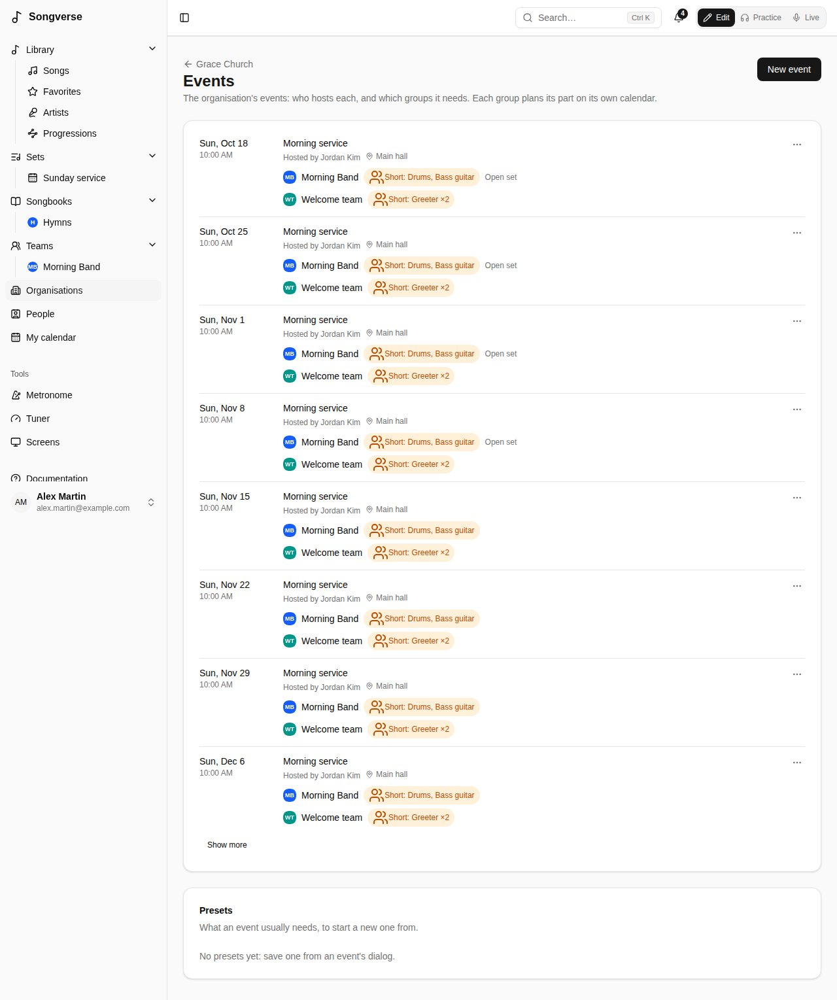

An organisation is the church, club or group your teams are part of: the music team, the welcome team, the tech team… It's where they plan together - who hosts each event, which groups each one needs - in Songverse, or in [Oneverse Plan](/plan/), the planning on its own, where the server has it. Songverse works without any: a server has organisations only if its admins turned them on (see [Admin](/admin/#organisations)), and until then you won't see them.

## Where to find them

**Organisations**, in the sidebar, lists the ones you're in - with how many teams and members each has, and whether you're one of its **Admin**s. Depending on the server:

- **One organisation**: everyone who signs in is in it. You can't leave it.
- **Several**: you're in the ones you were invited to, or whose teams you're in. If the server lets you, **Create an organisation** (a **Name** and an optional **Description**, then **Create**) makes one, run by you.

### Asking for one

On a server whose admins review each organisation first, **Ask for an organisation** takes its **Name**, **What it is** (a church, a school, a choir…), its **Address** - **Number and street**, **Postal code**, **City** and **Country** - the **Person responsible** (**First name** and **Last name**) and a **Phone number** to reach them, a **Contact person** and **Contact email** - you, or someone who runs it - and, if you like, its **Website**, about how many people it has and a **Description**. **Send request**, and this server's admins are told; you're told too when they approve it - it's made, with you as its admin - or decline it, with their reason. **Your requests** lists those waiting, which you can **Withdraw**.

The country is picked from the list, and the postal code is checked against that country's format as you type it (none is asked for in a country without postal codes). The phone number is checked as one that can exist, written as in the address's country or with its own code (like +44); nothing is sent to it, and it's shown only to this server's admins.

Where this server's admins turned address suggestions on, the street suggests addresses as you type it: pick one and the postal code, city and country are filled in. In France they come from the Base Adresse Nationale, elsewhere from OpenStreetMap; what you type of the address is sent there to find them. You can always type the address yourself instead.

If it looks like an organisation already here, or one someone else asked for - nearly the same name in the same city, or another name at the same address - it isn't sent: the form lists those it looks like. If one of them is yours, ask its admins for an invite link instead. If it isn't the same, say why under **Why it isn't the same** and send it again: the admins see your note beside the ones it looks like. Nearly the same name at the same address is the same organisation: it can't be asked for again, even with a note.

### Signing up with your organisation

Some servers let people sign up only by invitation, or by asking for their organisation. There, **Sign up** at Oneverse starts with your organisation - the same details as above - and **Next: your account** checks it, then shows the usual form, your name filled in with the person responsible's. Create your account (or continue with Google) within the hour.

Until this server's admins approve your organisation, your account only shows where your request stands, on your Oneverse account page: Songverse and Planiverse send you there. You can **Withdraw** it, and ask again if it was declined (with their reason). Once it's approved, it's made with you as its admin, and your account is open. Invitations always work: open a team's or an organisation's invite link, and you're in straight away.

## Setting it up

A new organisation's admins find **Set up your organisation** at the top of its page: the steps to get its people planning together, each ticked once it's done, with **Show me** (the card on the page) and **Guide** (the page here that explains it):

1. **Invite your people**, with an invite link (see [An organisation's page](/organizations/#an-organisations-page));
2. **Create your teams**: its groups (see [Groups](/organizations/#groups));
3. **Set up their rights**: its own roles, given to people or to whole teams (see [Its own roles](/organizations/#its-own-roles));
4. **Keep your files in your own storage**, optional, where this server allows it (see [Your own storage](/own-storage/));
5. **Run your own Songverse Sonic**, optional, where this server allows it (see [Your own stem separation server](/sonic/)).

The cross puts it away; **Show the setup checklist**, under **Details**, brings it back. In [Oneverse Plan](/plan/), the last three are set up in Songverse, on the organisation's page.

## An organisation's page

It starts with its **Calendar**: the next dates of its events, each with its host, its place and the groups it needs, **Places to fill** where a group is short; **Open the calendar** opens them all (see [Events](/organizations/#events)).

Everyone in it sees its **Groups** - each under the one it's in, those that don't use Songverse marked **Only plans**, yours marked **Your team** and opening its page - and its **Members**.

Its admins also:

- change its **Name** and **Description** under **Details**, then **Save**;
- choose who's an **Admin** or a **Member**, and **Remove** someone - who leaves its teams too (if they're the only admin of one, make someone else its admin first);
- **Take out** a team: it carries on, on its own, with its members and songs;
- make **Invite links**: with a role, an expiry and a number of uses, like a team's (see [Teams](/teams/#creating-a-team-and-inviting-people)). Whoever opens one joins the organisation, after signing in or creating an account - even on a server where only invited people can sign up;
- connect its own Songverse Sonic server under **Stem separation**, when this Songverse allows it: its teams' songs are split into stems there, unless a team connects its own (see [Your own stem separation server](/sonic/));
- keep its teams' songs' files in its own bucket under **Own storage**, when this Songverse allows it (see [Its own storage](/organizations/#its-own-storage));
- **Delete organisation**: its teams stay, on their own (not while it uses its own storage: stop that first).

**Leave organisation** takes you out of it and its teams; its only admin makes someone else an admin first.

Under **Roles**, its admins give its members the roles Admin lets teams give, on all its teams, such as the **Media operator**, who runs their screens (see [Teams](/teams/#roles-on-the-team)) - and its own roles (see [Its own roles](/organizations/#its-own-roles)).

Under **Bible**, its admins tick **Show the Bible in the sidebar** for the members of all its teams (see [Bible](/bible/)).

## Putting a team in it

On a team's page, its admins choose the organisation under **Organisation** - one they're an admin of - then **Save**. The team's members join the organisation, and so does anyone who joins the team later. The team's page then says **Part of** the organisation. **None (a team on its own)** takes it out.

## Groups

An organisation's groups are its teams: the music team, but also a welcome team or a cleaning rota. Its admins make one with **New group**: a **Name**, the group it goes **Under** (or none, at the top), and whether it **Uses Songverse**, then **Create group** - you're its admin, and its page opens.

- A group that **Uses Songverse** is a team as you know it: its songs, songbooks, arrangements and sets.
- One that doesn't (the default for a new group) only plans: it has its calendar, its members and its positions, and no songs or songbooks of its own. Its dates can still have a set - for the Bible passages, slides and the catalogue's songs they show - when its event asks for one (**Make a set for each date**, off by default for such a group). Its sets open in Songverse. It isn't listed among your teams in Songverse; you find it on the organisation's page.

On a group's page, its admins change both under **Group**, then **Save**. A team with songs, songbooks or arrangements keeps using Songverse until they're moved or deleted; its sets stay either way. A group taken out of the organisation becomes a team of its own again, using Songverse.

A group's admins make groups under it too: **New sub-group** on its page, with a **Name** and whether it **Uses Songverse**, then **Create group** - you're its admin.

Being in a group doesn't put you in the group above it: each group has its own members.

**Roles it fills**, on a group's page, says which roles it takes at the organisation's events: Worship fills **Music**; Tech fills **Media operator**, **Audio operator** and **Lights**. A role an event asks for is then open to that group's members as soon as it's added, shown as **Music · Worship**, and to the members of the groups under it: Media, Sound and Lights under Tech. With no group filling a role, the admins choose who as before.

## Positions

Besides the instruments and roles people list for themselves, each group has **Positions** of its own - "Greeter" and "Coffee" for a welcome team, "Hall" and "Kitchen" for a cleaning rota. Its admins add them under **Positions** (**New position**, then **Add**) and remove them with the cross.

Beside each member's name, the group's positions show: tick the ones you cover by clicking them. The group's admins can tick them for anyone; others see only the ones each member covers.

An event of the group asks for them under **Parts needed**: **Add a part** lists **This group's positions** first (see [Parts needed](/teams/#parts-needed)). A position is covered by the members who ticked it, and its name follows when it's renamed; a position an event still asks for can't be removed.

## Events

An organisation's events need several of its groups: a Sunday service needs the music team's drums and bass, two greeters from the welcome team, someone on the sound desk. On the organisation's page, **Calendar** opens its coming dates (**Show more** for later ones), each with its host and every group it needs. **Events**, beside **Dates**, lists each event once - how it repeats, its host and its groups - with **Edit the series** to change one as a whole.

Its admins make one with **New event**: its **Title**, first date, start time, length, time zone, **Repeats** and **Place (optional)** as for a team's event, its **Host** - one of the organisation's members, who's told - and under **Groups needed**, **Add a group** for each, with the parts it asks of it (its positions, instruments, roles or names; see [Parts needed](/teams/#parts-needed)) and, if you like, its **Call time (minutes before)**: the musicians an hour early, the welcome team a quarter of an hour. Each group's part has **Make a set for each date**, on by default for a group that uses Songverse and off for one that only plans: turn it off for a meeting, and that group's dates get no set. **Save event** puts the event on each group's calendar: the group's admins fill its line-up as for any of its events, a group's date gets its set when it asks for one, and those signed up get their reminders.

- On a group's calendar, the event is marked **Planned by** the organisation (and its host). Its date, time and place are set on the organisation's Events; the group's admins choose only what it needs from them, under **Parts needed**, and its call time.
- On the organisation's Events, its admins and the event's host see how each group's parts are covered (**Short: Drums**, or **All set**), change the event with **Edit the series** (**Edit event** for one that doesn't repeat), and **Cancel this date** - or restore it - for every group at once. Others see the groups and how many are on each.
- Only the admins choose another host (who's told), and **Delete event**, for every group. A group removed from **Groups needed** loses its part; a group taken out of the organisation keeps it, as its own event.

A group's admins can move one of its events to the organisation (see [Calendar](/teams/#calendar)). It waits at the top of the calendar, for the organisation's admins, under **Asked to join the calendar**: **Accept** makes it the organisation's event, with the same timing, hosted by whoever asked, and the group's part of it as it was - its dates, answers, line-ups and sets; **Decline** leaves it the group's. Whoever asked is told either way.

**Presets** keep what an event usually needs: in an event's dialog, **Save as preset** under a **Preset name**. **New event** then starts from one with **Preset**, which fills its title, time, place and groups. The admins remove presets under **Presets**.

### Event types

**Event types**, at the top of the organisation's page, keeps the kinds of events all its groups hold - a service, a prayer night, a meeting - for its admins: each with its usual timing, its parts (which are required, and which places are open to the group the event is in or to other groups; see [Parts needed](/teams/#parts-needed)) and **Make a set for each date**. They're offered to every group: on a group's calendar, **Event types** lists them, marked with the organisation's name, and **New event** picks from them like the group's own. An event made from one can still ask for more parts. Only the organisation's admins change or delete them; the group's admins can still keep types of their own.

## Locations

Where the organisation's events take place - a church, a hall, a campus: its admins add them under **Locations** on its page, with **Add location** (a **Name**, an **Address (optional)**, a **Time zone**), **Edit** and **Remove**. Its events pick one with **Location** in their dialog, which fills the place and the time zone, and each group's part follows it; a preset keeps it too. Its groups' own events can use them as well, beside the team's own (see [Locations](/teams/#locations)).

## Its own roles

Its admins make roles of their own under **Roles** on its page, with **New role** - the same editor as [Admin > Roles](/admin/#roles), with only what's the organisation's to allow, and counting only in it:

- **Keep files in its own storage**, with an optional **Storage (MB)**: how much each holder may keep in its bucket, else the default under **Own storage**;
- **Upload audio files** and **Keep lossless originals**, for its teams' songs kept in its own storage;
- **Split recordings into stems**, on its own Songverse Sonic server (see [Your own stem separation server](/sonic/)), with its own **Separations per person in 30 days** or, empty, the server's;
- running, moving on, routing and managing its teams' screens.

Tick who has each under the role. A role that keeps files can also be given to **whole teams**: their members have it, and its storage tier is the team's share. Its names are its own; this server's admins don't see them in Admin > Roles, and they count nowhere else. A team's admins make roles of their own too, for its own Sonic server and its screens (see [Teams](/teams/#roles-on-the-team)).

## Announcements

An organisation's admins send news to its members from its page: **Announcements**, then **New announcement** - a **Title**, a **Text** and, if you like, a **Link** (a web address, or a page of the app, typed such as `/calendar` or picked under **Or a page of the app**). **Who gets it**: **All its members**, or **Some of its groups' members** - tick the groups, and **And the groups under them** to include those too; each person gets it once. **Under the bell** shows how it will look; it stays a **Draft** until **Send**, which says how many members it goes to. Members get it under the bell with the organisation's name, and on their devices; by email only if they turn that on. A sent one can still be fixed for everyone (**Save: fixes it for everyone**) or taken back (**Take back**).

## Its own storage

An organisation can keep the files of its teams' songs - recordings, stems, PDFs and the other attachments - in a bucket of its own rather than on this server: its space, its bill. Its admins see **Own storage** on its page when the server's admin has ticked **Organisations may use their own storage** (see [Admin](/admin/#organisations)) and one of their roles allows **Own storage for organisations** (see [Admin](/admin/#roles)); otherwise the card says who to ask.

Choose the **Provider** - **Cloudflare R2**, **Amazon S3**, **Backblaze B2** or **Wasabi** - then its **Account ID** (R2) or the bucket's **Region** (the others, such as `eu-central-1` or `us-west-004`), the **Bucket**, the **Access key ID** and the **Secret access key**. Use a key that can only read and write this bucket. **Save and try it** writes, reads back and deletes a small file there, and keeps the settings only if that works; the secret is kept encrypted and never shown again (leave it blank to keep the current one).

Once it's connected:

- the files already on its teams' songs are moved there in the background, each one checked byte for byte before it leaves this server; the card counts the files there and those being moved;
- new files on its teams' songs go straight there. People's own songs, and pictures (avatars, song and team images), stay on this server;
- only its admins, and those it gives one of its own roles that ticks **Keep files in its own storage** (see [Its own roles](/organizations/#its-own-roles)), add files to its teams' songs. Anyone else is told to ask its admins;
- its files don't count toward its teams' storage pools here. Under **Defaults**, in MB, its admins set **Per team** (what each team's songs may keep there), **Per person** (what each role holder may upload there) and the **Largest file** (up to 500 MB; this server's own limits per file type still apply). A role's own storage tier wins over them, as on this server. A field left empty is no limit; **Save defaults** keeps them. They hold for new uploads and stems, not for files already there or moved in;
- a team that leaves the organisation, or a song that moves to someone else, takes its files back to this server.

If the bucket stops answering, the card says so: new files are kept on this server meanwhile and moved there once it answers again (it's tried every ten minutes). Its bucket can't be changed while files are in it.

**Stop using it**, then **Move the files back and disconnect**, brings every file back to this server, then disconnects the bucket; the files left in the bucket are deleted from it as they're moved. Until then, the organisation can't be deleted.

Why you'd use it, who can see the files, what's yours to look after and how to set it up at each provider: [Your own storage](/own-storage/). What's in its bucket is the organisation's to back up: this server's own backups don't copy it, though a [backup of the organisation](/backups/) still holds its teams' files.
