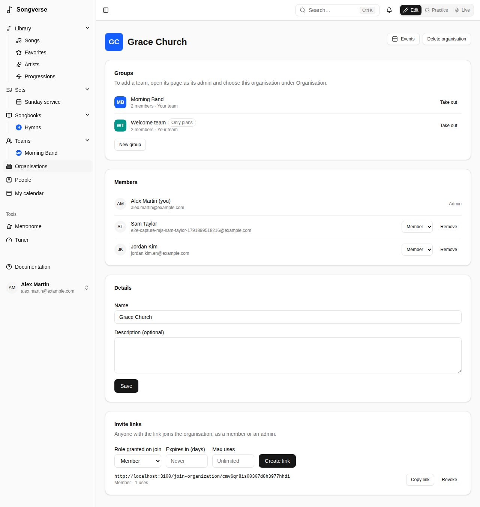
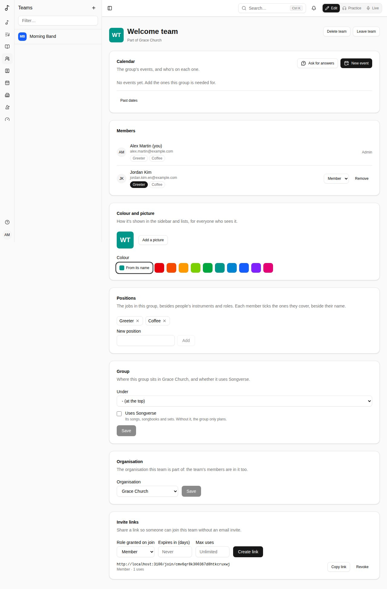
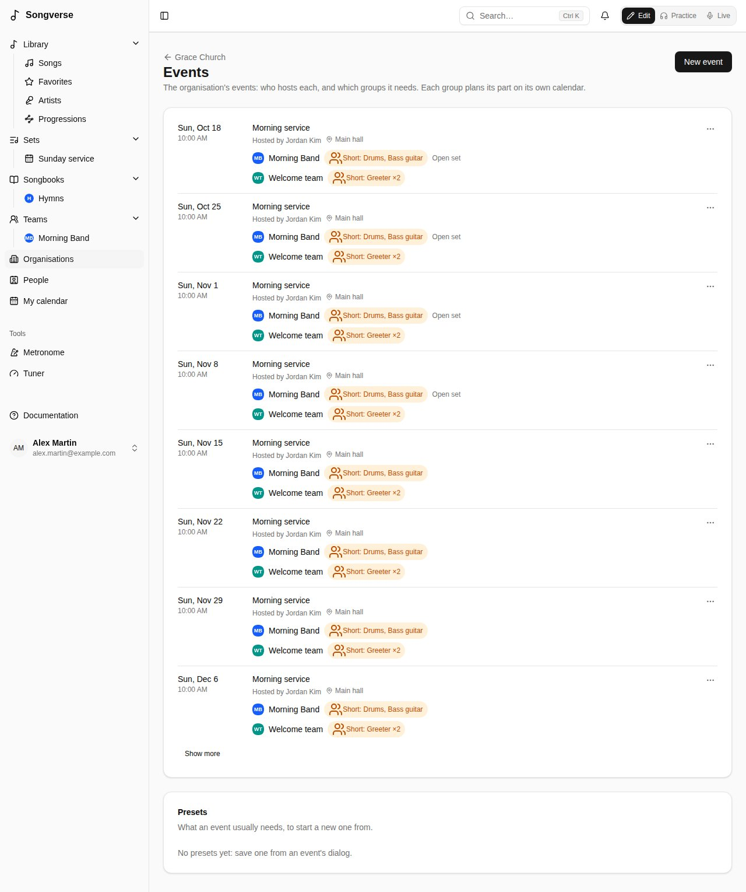

An organisation is the church, club or group your teams are part of: the music team, the welcome team, the tech team… It's where they'll plan together - who hosts each event, which teams each one needs (this is being built, see Planiverse). Songverse works without any: a server has organisations only if its admins turned them on (see [Admin](/admin/#organisations)), and until then you won't see them.

## Where to find them

**Organisations**, in the sidebar, lists the ones you're in - with how many teams and members each has, and whether you're one of its **Admin**s. Depending on the server:

- **One organisation**: everyone who signs in is in it. You can't leave it.
- **Several**: you're in the ones you were invited to, or whose teams you're in. If the server lets you, **Create an organisation** (a **Name** and an optional **Description**, then **Create**) makes one, run by you.

## An organisation's page

Everyone in it sees its **Groups** - each under the one it's in, those that don't use Songverse marked **Only plans**, yours marked **Your team** and opening its page - and its **Members**.

Its admins also:

- change its **Name** and **Description** under **Details**, then **Save**;
- choose who's an **Admin** or a **Member**, and **Remove** someone - who leaves its teams too (if they're the only admin of one, make someone else its admin first);
- **Take out** a team: it carries on, on its own, with its members and songs;
- make **Invite links**: with a role, an expiry and a number of uses, like a team's (see [Teams](/teams/#creating-a-team-and-inviting-people)). Whoever opens one joins the organisation, after signing in or creating an account - even on a server where only invited people can sign up;
- **Delete organisation**: its teams stay, on their own.

**Leave organisation** takes you out of it and its teams; its only admin makes someone else an admin first.

## Putting a team in it

On a team's page, its admins choose the organisation under **Organisation** - one they're an admin of - then **Save**. The team's members join the organisation, and so does anyone who joins the team later. The team's page then says **Part of** the organisation. **None (a team on its own)** takes it out.

## Groups

An organisation's groups are its teams: the music team, but also a welcome team or a cleaning rota. Its admins make one with **New group**: a **Name**, the group it goes **Under** (or none, at the top), and whether it **Uses Songverse**, then **Create group** - you're its admin, and its page opens.

- A group that **Uses Songverse** is a team as you know it: its songs, songbooks and sets.
- One that doesn't (the default for a new group) only plans: it has its calendar, its members and its positions, but no songs, songbooks or sets, and its dates have no set. It isn't listed among your teams in Songverse; you find it on the organisation's page.

On a group's page, its admins change both under **Group**, then **Save**. A team with songs, songbooks or sets keeps using Songverse until they're moved or deleted. A group taken out of the organisation becomes a team of its own again, using Songverse.

Being in a group doesn't put you in the group above it: each group has its own members.

## Positions

Besides the instruments and roles people list for themselves, each group has **Positions** of its own - "Greeter" and "Coffee" for a welcome team, "Hall" and "Kitchen" for a cleaning rota. Its admins add them under **Positions** (**New position**, then **Add**) and remove them with the cross.

Beside each member's name, the group's positions show: tick the ones you cover by clicking them. The group's admins can tick them for anyone; others see only the ones each member covers.

An event of the group asks for them under **Parts needed**: **Add a part** lists **This group's positions** first (see [Parts needed](/teams/#parts-needed)). A position is covered by the members who ticked it, and its name follows when it's renamed; a position an event still asks for can't be removed.

## Events

An organisation's events need several of its groups: a Sunday service needs the music team's drums and bass, two greeters from the welcome team, someone on the sound desk. On the organisation's page, **Events** lists the coming dates (**Show more** for later ones), each with its host and every group it needs.

Its admins make one with **New event**: its **Title**, first date, start time, length, time zone, **Repeats** and **Place (optional)** as for a team's event, its **Host** - one of the organisation's members, who's told - and under **Groups needed**, **Add a group** for each, with the parts it asks of it (its positions, instruments, roles or names; see [Parts needed](/teams/#parts-needed)). **Save event** puts the event on each group's calendar: the group's admins fill its line-up as for any of its events, a music team's date gets its set, and those signed up get their reminders.

- On a group's calendar, the event is marked **Planned by** the organisation (and its host). Its date, time and place are set on the organisation's Events; the group's admins choose only what it needs from them, under **Parts needed**.
- On the organisation's Events, its admins and the event's host see how each group's parts are covered (**Short: Drums**, or **All set**), change the event with **Edit event**, and **Cancel this date** - or restore it - for every group at once. Others see the groups and how many are on each.
- Only the admins choose another host (who's told), and **Delete event**, for every group. A group removed from **Groups needed** loses its part; a group taken out of the organisation keeps it, as its own event.

**Presets** keep what an event usually needs: in an event's dialog, **Save as preset** under a **Preset name**. **New event** then starts from one with **Preset**, which fills its title, time, place and groups. The admins remove presets under **Presets**.
