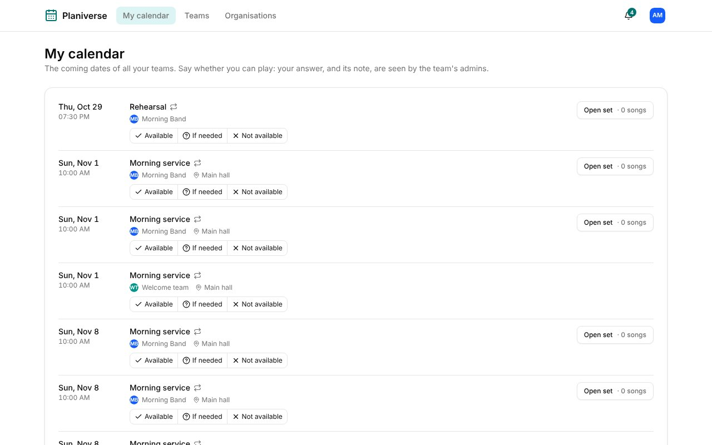

Oneverse Plan (called Planiverse before) is Songverse's planning on its own: [My calendar](/teams/#calendar), [organisations](/organizations/), their teams and their events, without the songs and songbooks. It's for the people who plan with you without playing - the welcome team, the tech team, whoever hosts. A server has it only if its admins deployed it, beside Songverse.

## Signing in

It's the same account as Songverse's, your Oneverse account: Oneverse Plan sends you to Oneverse to sign in (see [Signing in](/getting-started/#signing-in)), and back. Signing up from there makes an account that works in both: the email's link brings you back to Oneverse Plan. **Settings**, in the menu under your picture, is the same page as in every app (see [Your account](/account/)): your name, picture, language and appearance, your notifications, and **Oneverse Plan**'s own - your availability, the first day of the week and your calendar link; **Change at Oneverse** changes your email, password and passkeys; **Help** opens this page.

## What's there

- **Calendar**: your calendar, and each of your organisations' and teams' (see [Calendar](/plan/#calendar) below).
- **Teams**: every team you're in, those in no organisation too - a sub-team under the one above it, when you're in both.
- **Organisations**: the ones you're in, their teams, members and events, as in Songverse (see [Organisations](/organizations/)).
- A team's page: **Calendar**, which opens its calendar there, then its calendar, members and positions, and for its admins the same tools as in Songverse - events, answers asked for, the line-up, invite links.

A date with a set shows it - a team that only plans has sets too, for the Bible passages, slides and the catalogue's songs its date shows: **Open set** opens its [running order](/sets/#a-sets-running-order) in the Oneverse app, with or without Songverse: its songs, texts and passages, to add and move if you edit it. **Plan the set**, on a date that has none yet, makes it and opens it there.

An invite link to an organisation or a team, opened on Oneverse Plan, joins you there.

## Calendar

**Calendar** shows **My calendar** first: the coming dates of all your teams, answered there - Sign up, If needed, Can't make it. **Calendar**, at the top of its menu, picks another: one of your organisations, or one of your teams. The menu beside it (tabs across the top on a phone) shows what that calendar has:

- **Dates**: its coming dates - for a team, answered and lined up as on its page; for an organisation, its events' dates and the places still to fill.
- **Events**: its events, to make and change with **New event**, for its admins.
- **Event types**: the kinds of events it holds (see [Event types](/teams/#event-types)), for its admins only.
- **Subscribe**: its calendar link. My calendar's is yours (see [Your calendar link](/teams/#your-calendar-link)); a team's or an organisation's holds all its dates, made, reset and turned off by its admins and seen by all its members (see [The team's calendar link](/teams/#the-teams-calendar-link)).
- **Availability**: your days away, for all your teams (see [Availability](/teams/#availability)).

**Subscribe** and **Availability** are also buttons at the top, whichever calendar you're on. **Back to my calendar** goes back to yours. The address keeps your choice, so a link to it opens the same calendar.

## Notifications

The bell beside your picture lists your notifications, as in Songverse. **Settings** > **Notifications** chooses how each kind reaches you, and turns them on for the device you're on. Notifications about a team that only plans, or an event you host, are Oneverse Plan's: their emails open Oneverse Plan, and they go to the devices you turned on in Oneverse Plan (to your others if there are none). The rest are Songverse's: pressing one about a song or your people opens it in Songverse, and one about a set its running order in the Oneverse app. **See all** opens the **Notifications** page.
