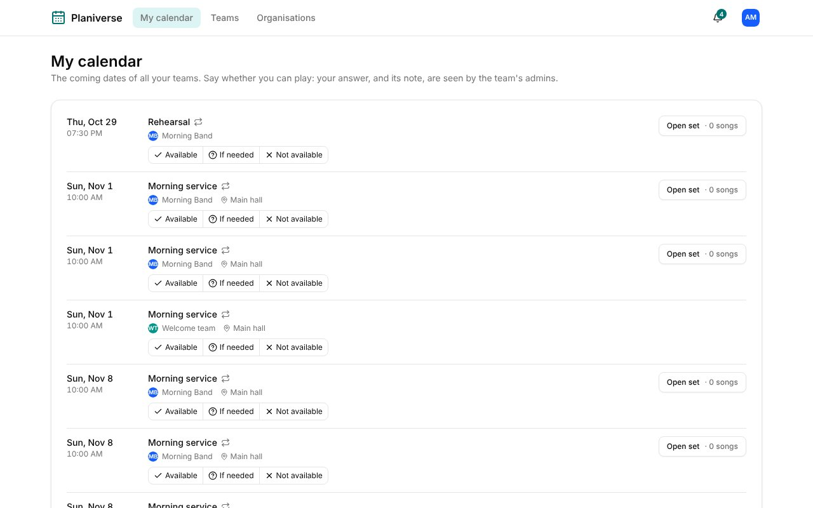

Planiverse is Songverse's planning on its own: [My calendar](/teams/#calendar), [organisations](/organizations/), their groups and their events, without the songs, songbooks and sets. It's for the people who plan with you without playing - the welcome team, the tech team, whoever hosts. A server has it only if its admins deployed it, beside Songverse.

## Signing in

It's the same account as Songverse's: the same email and password, passkey or Google sign-in, signed in to on Planiverse's own address. Signing up there makes an account that works in both: the email's link brings you back to Planiverse. **Account settings**, in the menu under your picture, changes your name and picture, email, passkeys and language, as in [your account](/account/) in Songverse; **Help** opens this page.

## What's there

- **My calendar**: the coming dates of all your teams and groups, answered there - Available, If needed, Not available - and your days away.
- **Teams**: every team and group you're in, those in no organisation too - a sub-group under its group, when you're in both.
- **Organisations**: the ones you're in, their groups, members and events, as in Songverse (see [Organisations](/organizations/)).
- A team's or group's page: its calendar, members and positions, and for its admins the same tools as in Songverse - events, answers asked for, the line-up, invite links.

A date of a team that uses Songverse shows its set: **Open set** opens it in Songverse. Sets are planned there, not in Planiverse.

An invite link to an organisation or a group, opened on Planiverse, joins you there.

## Notifications

The bell beside your picture lists your notifications, as in Songverse. **Account settings** also chooses how each kind reaches you, and turns them on for the device you're on. Notifications about a group that only plans, or an event you host, are Planiverse's: their emails open Planiverse, and they go to the devices you turned on in Planiverse (to your others if there are none). The rest are Songverse's: pressing one about a song, a set or your people opens it in Songverse. **See all** opens the **Notifications** page.
