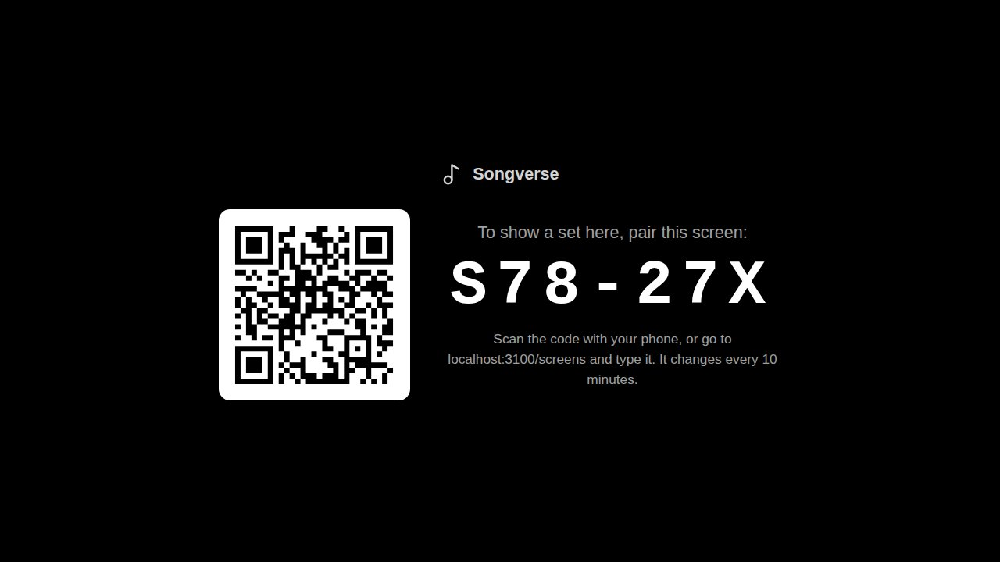
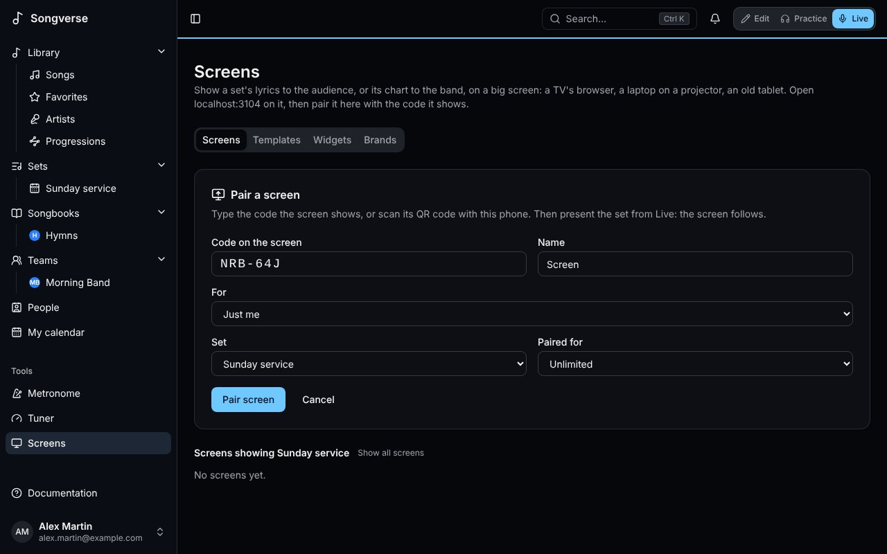
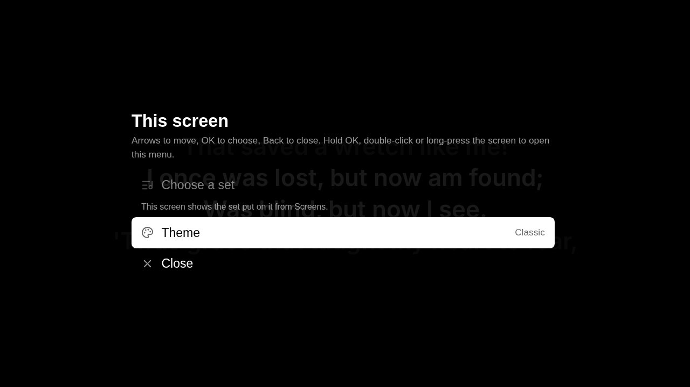
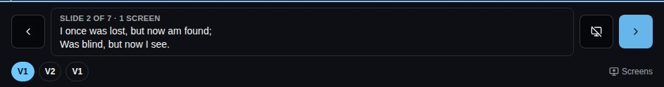
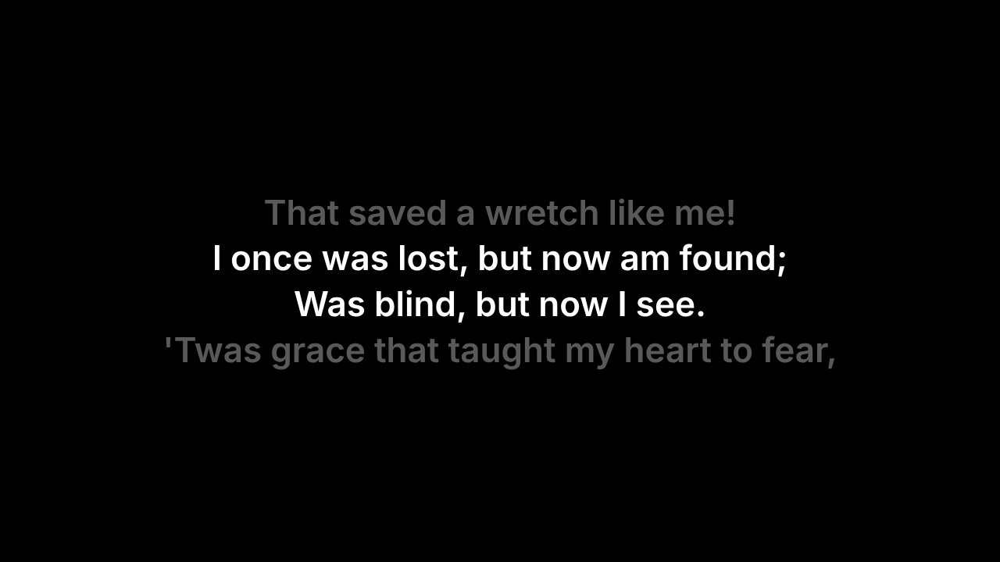
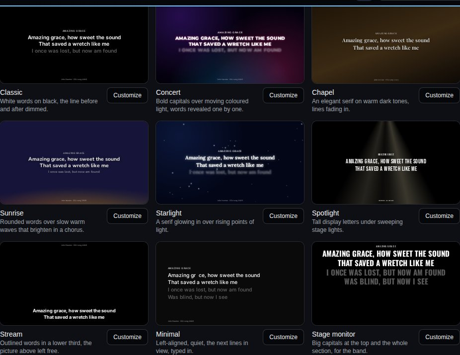
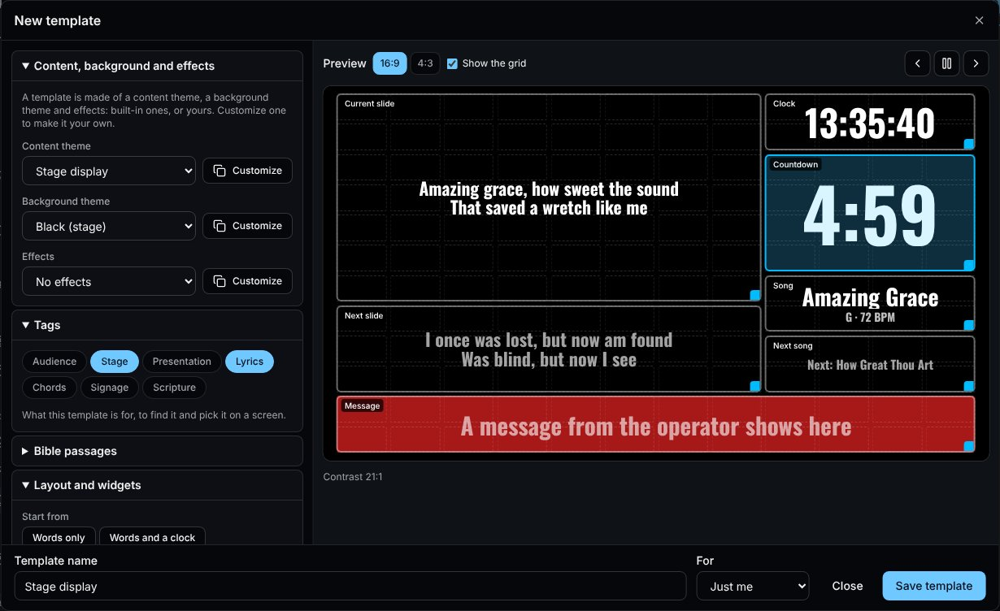
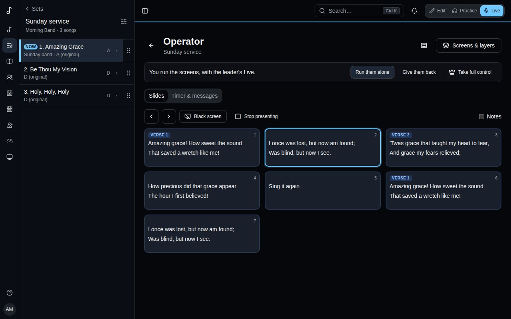

A **screen** shows a set on a big screen: the lyrics for the audience, two lines at a time, or the chart for the band. It can be a TV's browser, a laptop or a small computer plugged into a projector, or an old tablet. Whoever leads the set presents it from [Live](/sets/#playing-a-set-live), and every screen follows.

## Pairing a screen

1. On the screen, open **songverse.one/screen**. Nobody signs in there: it shows a code and a QR code. The code changes every 10 minutes until it's used.

   

2. On your phone or tablet, scan the QR code, or open **Screens** - under **Tools** in the sidebar, or from the Sync menu in Live (**Screens…**) - and type the code.
3. Give the screen a **Name** ("Church TV"), pick the **Set** it shows - one of yours, or **The day's set (automatic)** (see [below](/screens/#the-days-set)) - and what it **Shows**: **Lyrics, for the audience** or **The chart, for the band**. Then **Pair screen**.

   

The screen remembers it's paired: next time, open the same page and it reconnects by itself. Only someone who can edit the set (its owner, or an admin of its team) can pair a screen to it, because they're the ones who lead it.

**Screens** has three tabs: **Screens**, **Templates** and **Widgets**. On **Screens**, **Add screen** opens the pairing form above (a QR code opens it with the code filled in). Under it, each screen is a tile: how it looks, whether it's **Connected** (or when it last was), the set it shows, lyrics or chart, its template and whose it is. **Settings** opens a dialog to rename the screen, move it to another set, switch it between lyrics and chart, change its template or its owner, with the screen's look beside them; the screen changes at once, and **Done** closes it. **Disconnect**, on the tile, stops it: it goes back to showing a new code.

### The day's set

A screen on **The day's set (automatic)** follows its owner's schedule: a team's screen shows the team's set dated today, an organisation's the set of the day among its teams', and your own screen yours. With two sets on the same day, it shows the one going on (started within three hours), else the next to start. The screen works it out from its own clock each time it loads, so it moves on to the next day's set by itself.

On the screen itself, with nothing presented, **OK** on the remote (or Enter on a keyboard) opens the list of the owner's sets: **Today and coming up**, **Without a date**, then **Archive** when you open it. Move with the remote's arrows and pick one with **OK**; it stays until the next day. **Back to the day's set** returns to the day's own, and Back (Escape) closes the list. With no set today, the list shows by itself. It works with a Chromecast with Google TV's remote, or the arrow keys on a computer.

A set put on a screen from **Screens**, in its tile's **Settings**, is fixed instead: the screen shows it until you change it, and OK doesn't open the list. Its tile says which set the day's set is, or that there's none today.

### The screen's menu

The screen has a menu of its own, for whoever stands by it, even while a set is presented. To open it, press **OK three times** quickly on the remote (or Enter on a keyboard), hold OK for about a second, or press the remote's **Menu** key. With a mouse, **double-click** or right-click the screen; on a touch screen, **press and hold**. A single OK or a single click never opens it, so it doesn't appear over the words by accident. On a screen following the day's set, a single OK still opens the list of sets, half a second later, once no second press follows.

- **Choose a set** opens the list of sets above. On a screen with a fixed set it's greyed out: change that set from **Screens**.
- **Theme** lists the **Built-in** templates and the owner's **Saved themes**, with the one in use marked. Pick one with **OK** and the screen changes at once. It keeps that theme, as if you'd picked it in the tile's **Settings**.
- **Back** steps out of the themes, and Back (Escape) or **Close** closes the menu.

### Whose screen it is

A screen is yours, a team's or an organisation's. When you pair it, **For** chooses: **Just me**, or a team or [organisation](/organizations/) you're an admin of - the church's projector and stage monitor belong to the church, and stay when whoever paired them leaves. The buttons above the tiles show **All** of them, **Mine**, or one team's or organisation's.

- A team's screen is managed by the team's admins, an organisation's by its admins: they rename it, change what it shows and its template, give it to someone else with **Belongs to**, or disconnect it.
- The team's or organisation's members see it and put one of their sets on it - a set they can edit. The screen shows it as they see it.
- Your own screens go with your account; a team's or an organisation's go when it's deleted.

## Presenting from Live

Presenting uses [Sync](/sets/#playing-in-sync): the screens are members of the set's session.

1. In Live, open the Sync menu, **Turn sync on**, then **Lead the set**. Paired screens are listed there with the other members, marked "(screen)".
2. Choose **Present on screens**. A panel opens at the bottom of Live, showing what the screens show.

- **Next slide** and **Previous slide** (the arrows on each side) move two lines at a time. On a keyboard or a Bluetooth page-turner pedal, the down arrow or Page Down goes on, and the up arrow or Page Up goes back. Past a song's last slide, Live moves to the next song of the set and the screens follow; back past its first, to the previous song's last slide.
- The song's sections (V1, C, V2…) under the slide jump straight to one, for a chorus sung again or a verse dropped.
- **Black screen** blanks every screen, for prayer, talking or between songs. Press it again to bring the words back.
- **Stop presenting**, in the Sync menu, leaves the screens showing the set's name.
- When the [media operator](/screens/#who-runs-the-screens) has taken the screens alone, the panel says so and its controls wait until they give them back.

## What the screens show

With **Lyrics, for the audience**, each slide's two lines are big and centred. The line before is faint above, the line after faint below, and each slide fades in - in the default look; a [template](/screens/#templates) changes all of it. A section without words, like an instrumental, is an empty slide, so you step through the song as the band plays it. A song's first slide shows its title, and its first and last show its credits at the bottom: who wrote it, its copyright and its CCLI song number, from the song's details.

With **The chart, for the band**, the screen shows the song's chart with chords, in the set's key, and keeps the section being sung highlighted and in view.

The words come from the version and key the set plays. Song notes and chords are never shown to the audience. If the screen loses its connection, it says so in a corner and reconnects by itself.

## Templates

A template is how a screen looks: its font, colours and background, the lines around the current ones, where the words sit, and how slides come and go. Each screen has its own: a stage monitor can show big capitals at the top while the audience screen has a moving background. They're on the **Templates** tab. A screen picks one in **Template**, in its tile's **Settings**; the screen changes at once. **New template** starts one from the default look.

**Built-in templates** each play on a sample song, so you see how they move:

- **Classic** - white words on black, the line before and after dimmed: the default.
- **Concert** - bold capitals over moving coloured light, words revealed one by one.
- **Chapel** - an elegant serif on warm dark tones, lines fading in.
- **Sunrise** - rounded words over slow warm waves that brighten in a chorus.
- **Starlight** - a serif glowing in over rising points of light.
- **Spotlight** - tall display letters under sweeping stage lights.
- **Stream** - outlined words in a lower third, leaving the picture above free for a video or a livestream.
- **Minimal** - left-aligned and quiet, the next lines in view, typed in.
- **Stage display** - for the platform, on a grid of [widgets](/screens/#widgets): the slide now and the next one, the clock, a countdown, the song and what's next, and the operator's messages.
- **Stage monitor** - big capitals at the top and the whole section, for the band.

**Customize** opens one in the template editor, with its preview beside the settings - at **16:9** or **4:3**, on the lyrics or the band's chart - changing as you change them. **⏵** plays the sample song, **‹ ›** go slide by slide.

- **Text** - the font (or an **Uploaded font**: a WOFF2, WOFF, TTF or OTF file you may use this way), its size (**Fit the line**, or fixed), weight, colour, **Capitals**, **Readability** (a shadow, an outline or a glow, for words over a moving background), alignment, line and letter spacing.
- **Lines** - **The slide**, with the lines before and after it, or **The whole section** with the slide's lines picked out; the lines around them **Dimmed**, **Smaller**, **Blurred** or **Hidden**.
- **Layout** - top, centre, bottom or **Lower third**, and a **Safe margin** for TVs that crop their edges.
- **Background** - a **Colour**, a **Gradient**, moving light (**Aurora**, **Waves**, **Particles**, **Spotlight**, in up to four colours), or your own **Picture** (drifting slowly closer) or looping **Video**: **Upload…** a JPEG, PNG, WebP, AVIF or GIF up to 15 MB, or an MP4 or WebM up to 150 MB. **Moves with the song** sends a pulse of light with each slide and brightens it in a chorus. **Darken** keeps words readable over anything.
- **Motion** - **Between slides**: a cut, a fade, a slide, rise, scale, blur or zoom, and how long it takes (a new song takes twice as long). **Words appear** all at once, line by line, word by word, letter by letter, typed or glowing.
- **Title and credits** - whether to show the song's title and its credits (writers, copyright, CCLI number), on which slides and where.
- **Chords** - for **The chart, for the band**: the chords' colour and the chart's size.
- **Layout and widgets** - places [widgets](/screens/#widgets) on a grid. Below.

The editor checks the contrast between the words and the background and warns when it's under 4.5:1. Pictures, videos and fonts are added to a saved template, so save it first; they count toward your storage. Name the template and **Save template**: it's yours, or - if you're an admin of a team - the team's, for every member to pick for their screens (only its admins change it). A template you can change has **Edit** and **Delete**; deleting it puts its screens back to the default look.

Everything that moves is drawn by the screen's graphics chip, so it stays smooth on a TV's browser. A viewer whose device asks for reduced motion gets still backgrounds and simple fades.

To try a built-in template on one screen, or to show the words in streaming software (as a browser source), add `?theme=` and its name to the screen's address: **songverse.one/screen?theme=stream**. It's for that device only, until the address changes.

## Widgets

A template can place widgets on a grid: a stage display shows the singers the slide now and the next one, the time and how long is left; an audience screen can add a clock in a corner, or the Wi-Fi password. The **Widgets** tab lists them:

- **Lyrics or chart** - what the screen shows without a grid: the lyrics, or the chart for the band, in the template's look.
- **Current slide** and **Next slide** - the words on the audience's screens now, and the ones coming (the next song's first, at the end of a song).
- **Current section** and **Next section** - the whole section, every line: the one being sung, with the slide on screen picked out, and the one after it.
- **Song structure** - the song's sections in the order they're sung (V1 C V2 C B C), the one now picked out, and a **Progress bar** through the song.
- **Clock** - in **24 hours** or **12 hours (AM/PM)**, with **Seconds** and **The date** if you like. **Analog clock** - a clock face, with a **Second hand** if you like.
- **Countdown** - the time left. **Time from**: **The media operator**, **A set length, from when the item comes on**, or **Until a time of day** (when the service starts). **Past zero** it can **Count on, in red** or **Stay at 0:00**, and it turns amber near the end. **Colours by time left** sets your own instead: **Add a break point**, give it a time (m:ss) and the colour of its **Text** and **Panel** from then on - amber under 5:00 and white on red under 1:00, say.
- **Count up** - the time since **The song on screen, since it came on**, or since the media operator started it. **Colours by time gone by** works as a countdown's does, once that much time has gone by.
- **Message** - a short message from the media operator, shown until it's cleared.
- **Song** and **Next song** - the song's title, with its key and tempo, and what comes next in the set.
- **Current item** and **Next item** - what's on in the set and what comes next, songs or not, with **Its place in the set (3 of 8)**.
- **Text** - words of your own.
- **Date** - today's date, **Written as** **Sunday 20 October**, **20 Oct 2026**, **20/10/2026**, **2026-10-20** or the weekday alone, **With the time** if you like.
- **Slide count** - which slide is on screen, as 3 / 12: **Count** **The song's slides** or **The whole set's slides**, with a **Progress bar** (**Thin**, **Thick** or **None**) under it.
- **QR code** - a code people scan with their phone. **It holds** **A web address**, **An event** (its title, start, end and place, added to their calendar), **A contact card** (name, phone, email, organisation) or **The Wi-Fi** (the network's name and password, to join it in one tap). Its label is written under it.

Each one plays live on the **Widgets** tab, with a sample song. **Customize** sets its default look - its options, font, colour, size, panel and corners - which it gets when it's added to a template: **Save as default** for yourself, or, with **For**, for a team you're an admin of. A team's template takes the team's look, else yours, else the built-in one; **Back to the built-in look** forgets yours. A template that already has the widget keeps its own.

In the template editor, **Layout and widgets** places them:

1. **Start from** a ready-made layout - **Words only**, **Words and a clock** or **Stage display** - or **Add a widget** to the words.
2. On the preview, drag a widget to move it, and drag its corner to resize it. Picked, the arrow keys move it, and with Shift they resize it. **Show the grid** hides the cells to see the screen as it will be.
3. Pick a widget, in the list or on the preview, to set what it shows and its **Look**: its font and colour (or the template's), size, a **Panel behind it** and **Rounded corners**. In the list, the arrows bring one forward or send it back, where widgets overlap.
4. **Columns**, **Rows** and **Space between cells** set the grid, and **Black screen hides** **Everything** or **Only the words (timers and the clock stay)** - a stage display keeps its clock and countdown when the audience's screens go black.

Every screen using the template shows its widgets, each in its cells. Widgets the media operator runs - their countdowns and messages - come from the set being presented.

## The media operator

Whoever runs the screens during a service - the media operator - has a view of their own: **Operator view**, on the set's page, or in Live's Sync menu (it opens in a new tab, so Live carries on). It's a Live page: the app switches to Live mode. Anyone who can edit the set can use it, leading the set or not; it doesn't play the metronome or the stems.

### Who runs the screens

By default the leader's Live runs the screens. The bar at the top of the operator view says who does now, and lets you take them:

- **Take the screens** - you send slides too, and so does the leader's Live: whoever moves last wins.
- **Take them alone** - only you send slides. In Live, the present panel says who runs the screens, and its controls wait until you **Give them back**.
- **Share with Live** and **Run them alone** switch between the two; **Give them back** returns the screens to the leader.
- **Take full control** leads the set as well: the metronome, the stems and the song everyone follows, as in Live.

If you close the operator view, the screens go back to the leader.

### The set and its slides

The sidebar lists the set's songs, as in Live. The one on the screens is marked **Now**, and the ones the screens have moved past are ticked as played (**Start from the top** clears them). Pick a song there to see its slides.

The **Slides** tab shows every slide of that song as a tile, coloured by its section (verse, chorus, bridge…). Once you've taken the screens, a tile sends its slide to every screen; the arrows (**Next slide** and back) step through them, and **Black screen** and **Stop presenting** work as in Live.

Tick **Notes** to show the song's notes under the slides they're on: **All notes**, or only those of the people holding one of the team's [positions](/organizations/#positions) (*Media's notes*), for the cues meant for you.

### Timer and messages

The **Timer & messages** tab:

- **On the screens** - the song and slide the screens show now, and whether they're black.
- **Timer** - what the **Countdown** and **Count up** widgets show when their time comes from **The media operator**: pick a length (1, 3, 5, 10, 15 or 30 minutes, or type one and **Set**), or **Count up**; then **Start** and **Pause**, **Reset**, a minute less or more (**-** and **+**), or **Clear**. Past zero, a countdown turns red.
- **Message to the stage** - type one and **Send**, or press a quick one (**Wrap up**, **One minute**, **Next song**…). It shows in the **Message** widget of the set's screens until you **Clear** it.

A song of the set can carry its own timer (**Timer on the screens**, on the [set's page](/sets/#songs-in-a-set)): a five-minute countdown for a talk, a count up for a song. When the leader's Live comes to that song, the timer starts on the screens by itself.

### Screens and layers

**Screens & layers**, at the top right, opens a panel down the right, beside the slides rather than over them, like the **Display** panel. On a phone, it opens at the bottom. The slides, the sidebar and the keyboard keep working while it's open. It lists the **Connected screens** showing the set now, and its **Layers**:

- **The words** - off, the screens show the background alone (for a video or a quiet moment) while the slides keep moving.
- **The background** - off, the words show on black.
- **Title card over everything** - the set's name and team, over whatever the screens show, before the service or between parts.

### Keyboard shortcuts

The keyboard runs the screens too, once you've taken them. The keyboard button beside **Screens & layers** lists the shortcuts:

| Keys | What they do |
| --- | --- |
| → ↓ Page Down | Next slide, into the next song after the last one |
| ← ↑ Page Up | Previous slide, back into the previous song |
| Enter | Put up the song you're looking at |
| Home, End | First or last slide of the song |
| B or . | Black screen, or back |
| S | Stop presenting |
| W | Words on or off |
| G | Background on or off |
| T | Title card on or off |
| C | Layers back to normal |

Shortcuts don't fire while you type a message. A button that has the focus keeps its own Enter.
