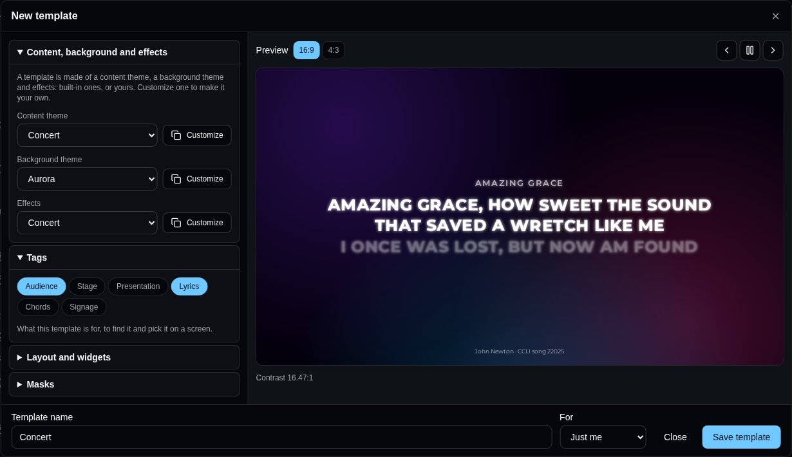
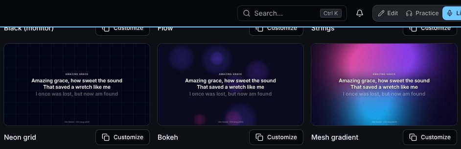
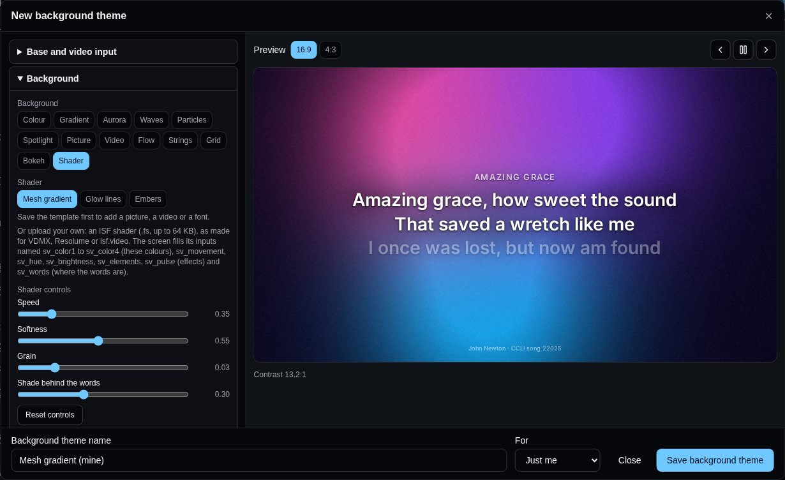
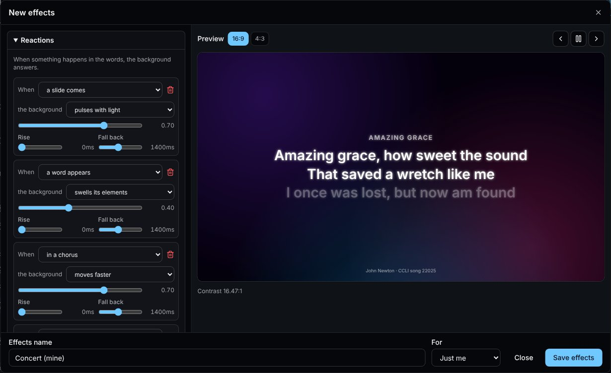
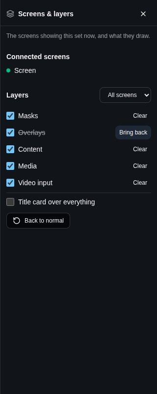

A **screen** shows a set on a big screen: the lyrics for the audience, two lines at a time, or the chart for the band. It can be a TV's browser, a laptop or a small computer plugged into a projector, or an old tablet. Whoever leads the set presents it from [Live](/sets/#playing-a-set-live), and every screen follows.

## Pairing a screen

1. On the screen, open **screen.oneverse.top**, Oneverse's screen app. Nobody signs in there: it shows a code and a QR code. The code changes every 10 minutes until it's used.

   

2. On your phone or tablet, scan the QR code, or open **Screens** - under **Tools** in the sidebar, or from the Sync menu in Live (**Screens…**) - and type the code.
3. Give the screen a **Name** ("Church TV"), pick the **Set** it shows - one of yours, or **The day's set (automatic)** (see [below](/screens/#the-days-set)) **Paired for** says how long it stays paired: **Unlimited**, or **12 hours**, **1 day** or **1 week** for a guest speaker's laptop or a rented venue's screen (see [For a while, or for several](/screens/#for-a-while-or-for-several)). Then **Pair screen**. What it shows - the lyrics or the band's chart - comes from its [template](/screens/#templates).

   

The screen remembers it's paired: next time, open the same page and it reconnects by itself. A screen paired before the screen app, at **songverse.top/screen**, is sent there and stays paired. Only someone who can edit the set (its owner, or an admin of its team) can pair a screen to it, because they're the ones who lead it.

**Screens** has four tabs: **Screens**, **Templates**, **Widgets** and **Brands** (your teams' and organisations' [brands](/brands/)). On **Screens**, **Add screen** opens the pairing form above (a QR code opens it with the code filled in). Under it, each screen is a tile: how it looks, whether it's **Connected** (or when it last was), the set it shows, its template and whose it is. **Settings** opens a dialog to rename the screen, move it to another set, change its template or its owner, turn its **Effects** on or off (see [Effects](/screens/#effects)), and choose the **Layers it shows** (see [Layers](/screens/#layers)), with the screen's look beside them; the screen changes at once, and **Done** closes it. **Disconnect**, on the tile, stops it: it goes back to showing a new code.

### The day's set

A screen on **The day's set (automatic)** follows its owner's schedule: a team's screen shows the team's set dated today, an organisation's the set of the day among its teams', and your own screen yours. With two sets on the same day, it shows the one going on (started within three hours), else the next to start. The screen works it out from its own clock each time it loads, so it moves on to the next day's set by itself.

On the screen itself, with nothing presented, **OK** on the remote (or Enter on a keyboard) opens the list of the owner's sets: **Today and coming up**, **Without a date**, then **Archive** when you open it. Move with the remote's arrows and pick one with **OK**; it stays until the next day. **Back to the day's set** returns to the day's own, and Back (Escape) closes the list. With no set today, the list shows by itself. It works with a Chromecast with Google TV's remote, or the arrow keys on a computer.

A set put on a screen from **Screens**, in its tile's **Settings**, is fixed instead: the screen shows it until you change it, and OK doesn't open the list. Its tile says which set the day's set is, or that there's none today.

### Events at a location

A team's or an organisation's screen can follow one of its [locations](/teams/#locations) instead: pick **Events at Main campus (automatic)** as its **Set**. It then shows the set of the event taking place there now (started within three hours), else the next one there today, worked out in the location's time zone; it moves on by itself when the next event starts. A lobby TV or a Pulse that stays at a church is set up this way once. Its tile says "At Main campus: Sunday service", or that there's no event there now.

### The screen's menu

The screen has a menu of its own, for whoever stands by it, even while a set is presented. To open it, press **OK three times** quickly on the remote (or Enter on a keyboard), hold OK for about a second, or press the remote's **Menu** key. With a mouse, **double-click** or right-click the screen; on a touch screen, **press and hold**. A single OK or a single click never opens it, so it doesn't appear over the words by accident. On a screen following the day's set, a single OK still opens the list of sets, half a second later, once no second press follows.

- **Choose a set** opens the list of sets above. On a screen with a fixed set it's greyed out: change that set from **Screens**.
- **Theme** lists the **Built-in** templates and the owner's **Saved themes**, with the one in use marked. Pick one with **OK** and the screen changes at once. It keeps that theme, as if you'd picked it in the tile's **Settings**.
- **Video input**, with a template that shows one (see [Layers](/screens/#layers)), lists the device's cameras and capture cards: **The first camera there is**, or one by name. The screen keeps the one picked, on that device. The browser asks to allow the camera the first time.
- **Profiles** lists the screen's profiles, one for each time it was paired, with the one showing marked: pick another and the screen shows it. **Pair it again** shows a code for one more (see [For a while, or for several](/screens/#for-a-while-or-for-several)).
- **Back** steps out of the themes, the cameras or the profiles, and Back (Escape) or **Close** closes the menu.

### Whose screen it is

A screen is yours, a team's or an organisation's. When you pair it, **For** chooses: **Just me**, or a team or [organisation](/organizations/) you're an admin of - the church's projector and stage monitor belong to the church, and stay when whoever paired them leaves. The buttons above the tiles show **All** of them, **Mine**, or one team's or organisation's.

- A team's screen is managed by the team's admins, an organisation's by its admins: they rename it, change what it shows and its template, give it to someone else with **Belongs to**, or disconnect it.
- Someone whose role lets them **Manage screens** (see [Roles](/admin/#roles)) - the church's tech person, say - does the same for the teams and organisations it was given for, without being their admin: they pair screens and Pulses for them, rename, change and disconnect them. They don't give a screen to someone else, and put only sets they can edit on it.
- The team's or organisation's members see it and put one of their sets on it - a set they can edit. The screen shows it as they see it.
- Your own screens go with your account; a team's or an organisation's go when it's deleted.

### For a while, or for several

A screen paired for **12 hours**, **1 day** or **1 week** says when it ends on its tile ("Until 14 Oct 2026, 22:00"). Its managers push the end back with **Extend**, on the tile: for that long from now, or **Unlimited**. When it ends, the screen is disconnected by itself: it goes back to showing a new code, and its tile goes from **Screens**.

One screen can also have several profiles - a venue's TV used by two churches, say. Its managers open its **Settings** and press **Show a code again**, or someone by the screen picks **Profiles**, then **Pair it again**, in [its menu](/screens/#the-screens-menu). The screen shows a code, and someone else pairs it as usual, to their own set, template and owner, for as long as they choose; **Back** on the screen returns to the profile it showed. Each profile is its own screen in **Screens**: each owner sees and changes only theirs, and **Disconnect** removes only that profile. The screen switches between its profiles from its menu's **Profiles**, and shows the last one again when it's turned back on. A profile disconnected, or ended, is forgotten: the screen shows one of the others, or a new code when there's none left. A Pulse has one owner: pair another Pulse instead.

## Presenting from Live

Presenting uses [Sync](/sets/#playing-in-sync): the screens are members of the set's session.

1. In Live, open the Sync menu, **Turn sync on**, then **Lead the set**. Paired screens are listed there with the other members, marked "(screen)".
2. Choose **Present on screens**. A panel opens at the bottom of Live, showing what the screens show.

- **Next slide** and **Previous slide** (the arrows on each side) move two lines at a time. On a keyboard or a Bluetooth page-turner pedal, the down arrow or Page Down goes on, and the up arrow or Page Up goes back. Past a song's last slide, Live moves to the next song of the set and the screens follow; back past its first, to the previous song's last slide.
- The song's sections (V1, C, V2…) under the slide jump straight to one, for a chorus sung again or a verse dropped.
- **Black screen** blanks every screen, for prayer, talking or between songs. Press it again to bring the words back.
- **Stop presenting**, in the Sync menu, leaves the screens showing the set's name.
- When the [media operator](/screens/#who-runs-the-screens) has taken the screens alone, the panel says so and its controls wait until they give them back.

Others can present beside you. In the Sync menu, while you lead, **Also presenting** lists the people in the set: tick someone to let them present from their own Live too, for this session; tick them again to stop. Anyone who can edit the set, or whose role runs the screens (see [The media operator](/screens/#the-media-operator)), presents without being asked. Each **Next slide** moves the screens on from what they show now: when two people press it at the same moment, the screens move once, not twice. If someone edits the song while it's on, a screen that still has the old words loads the song again; until it has the words you see, it shows none rather than the wrong ones. On a weak connection, a slide you move to stays on your Live marked **sending…** until the server has it, and goes to the screens as soon as the connection is back.

### Moving the screens on

Someone whose role lets them **Move the screens on** (see [Roles](/admin/#roles)) - a singer leading the set on, say - doesn't present, but has **Move the screens** in Live's Sync menu: **Previous song**, **Previous section**, **Next section** and **Next song**. The screens go to the first slide of that song or section, as everyone's Live cuts it: past a song's last section, **Next section** goes to the next song. Like **Next slide**, two people pressing at the same moment move the screens once, and while someone runs the screens alone it does nothing. A Bible passage counts as one section. It works the same on Pulse when the internet goes.

### When the internet goes: Continue on Pulse

Oneverse Pulse, a small computer that stays at the venue, is in preparation. Where a set has one, it follows the set's session while the internet is there, and keeps its slides. If the internet goes for more than a few seconds, Pulse runs the session in the room, and Live (and the media operator's console) shows **Continue on Pulse**. Tap it, on a device connected to the venue's network: Pulse's own page opens with the set's slides and the screen controls, and you go on from where the screens were, without signing in again. When the internet is back, what the room did becomes the set's session again, and Live picks it up.

A Pulse is paired like a screen: it shows a code, which you enter under **Pair a screen**. The form then says **This code is a Oneverse Pulse's** and names it "Pulse". Give it a set, or more usefully **Events at** its location (see [Events at a location](/screens/#events-at-a-location)): it then runs the set of whatever event is on there. In **Screens**, its tile has a **Pulse** badge.

## What the screens show

With a template for the audience, each slide's two lines are big and centred. The line before is faint above, the line after faint below, and each slide fades in - in the default look; a [template](/screens/#templates) changes all of it. A section without words, like an instrumental, is an empty slide, so you step through the song as the band plays it. A song's first slide shows its title, and its first and last show its credits at the bottom: who wrote it, its copyright and its CCLI song number, from the song's details.

With a template for the band, such as **Band chart**, the screen shows the song's chart with chords, in the set's key, and keeps the section being sung highlighted and in view.

The words come from the version and key the set plays. Song notes and chords are never shown to the audience. If the screen loses its connection, it says so in a corner and reconnects by itself.

## Templates

A template is how a screen looks and what it's for. It's made of three parts, each saved and edited on its own, so one change follows everywhere it's used:

- a **content theme** - how the words look and how they come and go, or the chord chart for the band;
- a **background theme** - the colour, picture, video or moving light under the words, and the video input;
- **effects** - the glue between the two: the background answering the words, and the words' own movement.

A template adds its **tags** and its layout - [widgets](/screens/#widgets) on a grid, and [masks](/screens/#layers). Each one is built for a single use: there's no switch between lyrics and chart, a template for the band uses a chord-chart content theme. A screen picks a template in **Template**, in its tile's **Settings**; the screen changes at once.

The **Templates** tab has four views: **Templates**, **Content themes**, **Background themes** and **Effects**. Each plays on a sample song, so you see how it moves.

### Templates and their tags

Tags say what a template is for: **Audience**, **Stage**, **Presentation**, **Lyrics**, **Chords**, **Signage** and **Scripture**. Pick tags above the list to see only the templates with all of them. **New template** starts one from the built-in parts. The **Built-in templates**:

- **Classic** - white words on black, the line before and after dimmed: the default.
- **Concert** - bold capitals over moving coloured light, words revealed one by one.
- **Chapel** - an elegant serif on warm dark tones, lines fading in.
- **Sunrise** - rounded words over slow warm waves that brighten in a chorus.
- **Starlight** - a serif glowing in over rising points of light.
- **Spotlight** - tall display letters under sweeping stage lights.
- **Stream** - outlined words in a lower third, leaving the picture above free for a video or a livestream.
- **Minimal** - left-aligned and quiet, the next lines in view, typed in.
- **Stage display** - for the platform, on a grid of [widgets](/screens/#widgets): the slide now and the next one, the clock, a countdown, the song and what's next, and the operator's messages.
- **Stage monitor** - big capitals at the top and the whole section, for the band.
- **Band chart** - the song's chart with its chords, the section being sung in view, for the band.
- **Scripture** - for a Bible passage: the chapel's look, two verses on each slide.

**Customize** opens one in the template editor, with its preview beside the settings - at **16:9** or **4:3** - changing as you change them. **⏵** plays the sample song, **‹ ›** go slide by slide.

- **Content, background and effects** - the template's three parts: built-in ones, or yours and your teams'. **Customize** beside a built-in part makes a copy of your own and opens it; **Edit** opens one of yours. A part used by several templates says so: changing it changes them all.
- **Tags** - what the template is for.
- **Bible passages** - **Verses per slide**: how many verses of a passage go on a slide when a set's passage is shown with this template (see [Bible](/bible/#adding-it-to-a-set)). Tag it **Scripture** to offer it first for passages.
- **Layout and widgets** - places [widgets](/screens/#widgets) on a grid. Below.
- **Masks** - black over part of the picture, or a window to the video input. See [Layers](/screens/#layers).

Name the template and **Save template**: it's yours, or - if you're an admin of a team - the team's, for every member to pick for their screens (only its admins change it). A team's template uses the team's parts. A template you can change has **Edit** and **Delete**; deleting it puts its screens back to the default look, and its parts stay.

### Content themes

How the words look, edited from **Content themes** (**New content theme**, or **Customize** a built-in one) or from a template:

- **Shows** - **Lyrics, for the audience** or **The chord chart, for the band**.
- **Text** - the font (or an **Uploaded font**: a WOFF2, WOFF, TTF or OTF file you may use this way), its size (**Fit the line**, or fixed), weight, colour, **Capitals**, **Readability** (a shadow, an outline or a glow, for words over a moving background), alignment, line and letter spacing.
- **Lines** - **The slide**, with the lines before and after it, or **The whole section** with the slide's lines picked out; the lines around them **Dimmed**, **Smaller**, **Blurred** or **Hidden**.
- **Layout** - top, centre, bottom or **Lower third**, and a **Safe margin** for TVs that crop their edges.
- **Motion** - **Between slides**: a cut, a fade, a slide, rise, scale, blur or zoom, and how long it takes (a new song takes twice as long). **Words appear** all at once, line by line, word by word, letter by letter, typed or glowing.
- **Title and credits** - whether to show the song's title and its credits (writers, copyright, CCLI number), on which slides and where.
- **Chords** - for the chord chart: the chords' colour and the chart's size.

The editor checks the contrast between the words and the background and warns when it's under 4.5:1.

### Background themes

What's under the words:

- **Base and video input** - the base colour and the screen's camera or capture card. See [Layers](/screens/#layers).
- **Background** - a **Colour**, a **Gradient**, moving light (**Aurora**, **Waves**, **Particles**, **Spotlight**, in up to four colours), or your own **Picture** (drifting slowly closer) or looping **Video**: **Upload…** a JPEG, PNG, WebP, AVIF or GIF up to 15 MB, or an MP4 or WebM up to 150 MB. **Darken** keeps words readable over anything.
- Four backgrounds follow the words on the screen, wherever the template puts them:
  - **Flow** - trails drifting across the screen, parting around the words, with a burst where each word appears;
  - **Strings** - glowing lines waving across the screen, bending round the words, ringing with each new slide;
  - **Grid** - a faint grid whose cells light up under each word as it appears, then fade;
  - **Bokeh** - big soft discs drifting and gathering behind the words.

  

  The first colour is the background, the others the trails, strings, cells or discs. With effects, they also move faster, change colour, brighten or swell, as **How it answers effects** says. With **Movement** at 0, they stand still.
- A **Shader** is drawn by the screen's graphics chip (WebGL 2): **Mesh gradient** (soft colours morphing into one another), **Glow lines** (glowing lines waving across the screen) or **Embers** (points of light rising in depth). Each has its own **Shader controls** - speed, softness, how many, and so on - and keeps the area behind the words quieter. **Reset controls** puts them back. **Movement** sets its pace, and **Spin** turns it slowly, one way or the other, for a shader that can turn.

  

  You can also **Upload…** your own: an [ISF](https://isf.video) shader (a `.fs` file up to 64 KB), the format VDMX, Resolume and many shader sites use. Its inputs become its controls. Inputs named as the [shader spec](https://github.com/Vulcio/Oneverse/blob/main/docs/screen-shader-spec.md) says - `sv_brightness`, `sv_contrast`, `sv_hue`, `sv_rotation`, `sv_scale` and the others - get the same controls as the built-in shaders and answer effects; the screen fills `sv_color1` to `sv_color8` (the theme's colours), `sv_pulse` (what effects set off), `sv_speed`, `sv_quality` and `sv_words` (an image, white where the words are). A file without an ISF header is refused; one the screen can't draw shows the colours instead. Shaders with several passes aren't drawn yet.

  A screen that can't keep up draws the shader with less detail first, then smaller, and back again once it can: a TV stick still moves smoothly, a mini PC draws it all at full size. A screen without WebGL 2 (some older TV sticks) shows the shader's colours, slowly drifting, instead.
- **How it answers effects** - how much its **Movement**, **Colour shift**, **Brightness** and **Elements** (blobs, waves, particles, beams) move when effects set them off; for a shader, its **Rotation** and **Scale** too.

Fonts and pictures are added to a saved content or background theme, so save it first; they count toward your storage.

### Effects

Effects tie the words to the background. **Reactions**: **When** a slide comes, a line or a word appears, a new section starts, or in a chorus (while it lasts), **the background** pulses with light, moves faster, shifts colour, brightens, swells its elements, turns or comes closer - each by how much you choose, times how much the background answers. **The words' movement**: a **Pulse**, **Breathe**, **Glow**, **Shimmer** or **Float**, with how much and how fast. A template can have no effects.

A screen that can't keep up - an old TV, a small stick computer - can turn **Effects** off in its tile's **Settings**: it shows the same template, without the reactions and the words' movement.

Each screen says what it is and how it's drawing, every half minute while it's connected: its tile shows how well it keeps up - **Smooth**, **Limited** or **Minimal** - and its **Settings** show its **Device**: the browser and model, its graphics chip and the WebGL it has, its cores and memory, its screen, and how its background is drawing (frames per second, the slowest frame, the detail and resolution a shader draws at). **Smooth** runs everything; **Limited** runs shaders with less detail or at a lower resolution and light effects (a TV stick such as a Chromecast, a Raspberry Pi on a big screen); **Minimal** should keep to still backgrounds, without effects.

### Layers

A screen draws its template as layers, from the bottom up:

1. **Base** - a colour under everything: **The background's first colour**, or one of its own.
2. **Video input** - the screen's own camera or capture card (**Camera or capture card**), to show a camera or a video mixer's output under the words. **Fill the screen** or **Whole picture**, and how much it shows. Each screen uses the device it's plugged into, picked in [its menu](/screens/#the-screens-menu); a preview shows where it goes.
3. **Media** - the **Background** above: a colour, a gradient, moving light, a picture or a video. A **Colour** background is the base, so the video input shows through it.
4. **Content** - the words, and the widgets that show the song (the slide now and the next, sections, the song, the set's items).
5. **Overlays** - the other widgets (clocks, timers, messages, QR codes…) and the operator's title card.
6. **Masks** - **Add a mask**: a **Rectangle** or an **Ellipse**, placed in % of the screen, with a **Soft edge**. **Cover in black** hides that part of the picture, for a projector on an odd-shaped wall; **Window to the video** cuts through the media there, so the video input shows through while the words stay over it. **Everything but the shape** turns it inside out.

A widget's **Layer**, in its settings on the grid, moves it between **Content** and **Overlays**. The [media operator](/screens/#screens-and-layers) shows, hides or clears each layer, and a screen's **Layers it shows**, in its tile's **Settings**, leaves some out for good: a stage monitor without the media, a lobby TV without the content. A screen's own choice wins: the operator can't turn on a layer it leaves out.

Everything that moves is drawn by the screen's graphics chip, so it stays smooth on a TV's browser. A viewer whose device asks for reduced motion gets still backgrounds and simple fades.

To try a built-in template on one screen, or to show the words in streaming software (as a browser source), add `?theme=` and its name to the screen's address: **screen.oneverse.top/?theme=stream**. It's for that device only, until the address changes.

## Widgets

A template can place widgets on a grid: a stage display shows the singers the slide now and the next one, the time and how long is left; an audience screen can add a clock in a corner, or the Wi-Fi password. The **Widgets** tab lists them:

- **Lyrics or chart** - what the screen shows without a grid: the lyrics, or the chart for the band, in the template's look.
- **Current slide** and **Next slide** - the words on the audience's screens now, and the ones coming (the next song's first, at the end of a song).
- **Current section** and **Next section** - the whole section, every line: the one being sung, with the slide on screen picked out, and the one after it.
- **Song structure** - the song's sections in the order they're sung (V1 C V2 C B C), the one now picked out, and a **Progress bar** through the song.
- **Clock** - in **24 hours** or **12 hours (AM/PM)**, with **Seconds** and **The date** if you like. **Analog clock** - a clock face, with a **Second hand** if you like.
- **Countdown** - the time left. **Time from**: **The media operator**, **A set length, from when the item comes on**, or **Until a time of day** (when the service starts). **Past zero** it can **Count on, in red** or **Stay at 0:00**, and it turns amber near the end. **Colours by time left** sets your own instead: **Add a break point**, give it a time (m:ss) and the colour of its **Text** and **Panel** from then on - amber under 5:00 and white on red under 1:00, say.
- **Count up** - the time since **The song on screen, since it came on**, or since the media operator started it. **Colours by time gone by** works as a countdown's does, once that much time has gone by.
- **Message** - a short message from the media operator, shown until it's cleared.
- **Song** and **Next song** - the song's title, with its key and tempo, and what comes next in the set.
- **Current item** and **Next item** - what's on in the set and what comes next, songs or not, with **Its place in the set (3 of 8)**.
- **Text** - words of your own.
- **Date** - today's date, **Written as** **Sunday 20 October**, **20 Oct 2026**, **20/10/2026**, **2026-10-20** or the weekday alone, **With the time** if you like.
- **Slide count** - which slide is on screen, as 3 / 12: **Count** **The song's slides** or **The whole set's slides**, with a **Progress bar** (**Thin**, **Thick** or **None**) under it.
- **QR code** - a code people scan with their phone. **It holds** **A web address**, **An event** (its title, start, end and place, added to their calendar), **A contact card** (name, phone, email, organisation) or **The Wi-Fi** (the network's name and password, to join it in one tap). Its label is written under it.

Each one plays live on the **Widgets** tab, with a sample song. **Customize** sets its default look - its options, font, colour, size, panel and corners - which it gets when it's added to a template: **Save as default** for yourself, or, with **For**, for a team you're an admin of. A team's template takes the team's look, else yours, else the built-in one; **Back to the built-in look** forgets yours. A template that already has the widget keeps its own.

In the template editor, **Layout and widgets** places them:

1. **Start from** a ready-made layout - **Words only**, **Words and a clock** or **Stage display** - or **Add a widget** to the words.
2. On the preview, drag a widget to move it, and drag its corner to resize it. Picked, the arrow keys move it, and with Shift they resize it. **Show the grid** hides the cells to see the screen as it will be.
3. Pick a widget, in the list or on the preview, to set what it shows and its **Look**: its font and colour (or the template's), size, a **Panel behind it** and **Rounded corners**. In the list, the arrows bring one forward or send it back, where widgets overlap.
4. **Columns**, **Rows** and **Space between cells** set the grid, and **Black screen hides** **Everything** or **Only the words (timers and the clock stay)** - a stage display keeps its clock and countdown when the audience's screens go black.

Every screen using the template shows its widgets, each in its cells. Widgets the media operator runs - their countdowns and messages - come from the set being presented.

## The media operator

Whoever runs the screens during a service - the media operator - has a view of their own: **Operator view**, on the set's page, or in Live's Sync menu (it opens in a new tab, so Live carries on). It's a Live page: the app switches to Live mode. Anyone who can edit the set can use it, leading the set or not, and so can anyone whose role lets them **Run the screens** (see [Roles](/admin/#roles)), on every set they can open; it doesn't play the metronome or the stems.

The same console is at **screen.oneverse.top/operate**, without Songverse: sign in with your Oneverse account, then pick a set under **Run the screens**. It runs the screens, their timer, messages and layers, but never the metronome or the stems.

### Who runs the screens

You can send slides as soon as the operator view opens, beside the leader's Live: each slide sent moves the screens on from what they show now, so a Next pressed here and in Live at the same moment moves them once. The bar at the top says who runs the screens now, and lets you take them:

- **Take the screens** - the bar shows everyone that you run them; Live keeps presenting too.
- **Take them alone** - only you send slides. In Live, the present panel says who runs the screens, and its controls wait until you **Give them back**.
- **Share with Live** and **Run them alone** switch between the two; **Give them back** returns the screens to the leader.
- **Take full control** leads the set as well: the metronome, the stems and the song everyone follows, as in Live.

If you close the operator view, the screens go back to the leader. If your connection drops instead (the Wi-Fi at the desk, a reload), they wait a minute for you, still yours alone if you had taken them alone, and the operator view takes them back when it reconnects; the bar and Live say you lost your connection meanwhile. Not back within the minute, they go back to the leader.

### The set and its slides

The sidebar lists the set's songs, as in Live. The one on the screens is marked **Now**, and the ones the screens have moved past are ticked as played (**Start from the top** clears them). Pick a song there to see its slides.

The **Slides** tab shows every slide of that song as a tile, coloured by its section (verse, chorus, bridge…). A tile sends its slide to every screen; the arrows (**Next slide** and back) step through them, and **Black screen** and **Stop presenting** work as in Live.

Tick **Notes** to show the song's notes under the slides they're on: **All notes**, or only those of the people holding one of the team's [positions](/organizations/#positions) (*Media's notes*), for the cues meant for you.

### Timer and messages

The **Timer & messages** tab:

- **On the screens** - the song and slide the screens show now, and whether they're black.
- **Timer** - what the **Countdown** and **Count up** widgets show when their time comes from **The media operator**: pick a length (1, 3, 5, 10, 15 or 30 minutes, or type one and **Set**), or **Count up**; then **Start** and **Pause**, **Reset**, a minute less or more (**-** and **+**), or **Clear**. Past zero, a countdown turns red.
- **Message to the stage** - type one and **Send**, or press a quick one (**Wrap up**, **One minute**, **Next song**…). It shows in the **Message** widget of the set's screens until you **Clear** it.

A song of the set can carry its own timer (**Timer on the screens**, on the [set's page](/sets/#songs-in-a-set)): a five-minute countdown for a talk, a count up for a song. When the leader's Live comes to that song, the timer starts on the screens by itself.

### Screens and layers

**Screens & layers**, at the top right, opens a panel down the right, beside the slides rather than over them, like the **Display** panel. On a phone, it opens at the bottom. The slides, the sidebar and the keyboard keep working while it's open. It lists the **Connected screens** showing the set now, and the **Layers** they draw (see [Layers](/screens/#layers)), top first: **Masks**, **Overlays**, **Content**, **Media** and **Video input**.

- **Layers for** - **All screens**, or one of the connected screens. A change for one screen is that screen's own ("its own layers" beside its name); a change for all screens reaches it too. **Like all screens** puts it back.
- A layer's box shows or hides it. Off **Content**, the screens show the background alone (for a video or a quiet moment) while the slides keep moving; off **Media**, the words show on the base colour.
- **Clear** hides a layer until the next slide or song, as other presentation software does; it comes back by itself, or with **Bring back**.
- **Title card over everything** - the set's name and team, over whatever the screens show, before the service or between parts.
- **Back to normal** shows every layer again, on every screen, without the title card.

A layer a screen leaves out in its own settings stays off there, whatever the panel says.

Someone whose role lets them **Route the screens** (see [Roles](/admin/#roles)) - the tech at the desk, say - opens the operator view too, from Live's Sync menu, and gets these screens and layers alone: they change what the screens draw, but don't present, nor run the timer or messages. While someone runs the screens alone, only they change the layers, the set's leader included; the rest comes back when they give them back.

### Keyboard shortcuts

The keyboard runs the screens too. The keyboard button beside **Screens & layers** lists the shortcuts:

| Keys | What they do |
| --- | --- |
| → ↓ Page Down | Next slide, into the next song after the last one |
| ← ↑ Page Up | Previous slide, back into the previous song |
| Enter | Put up the song you're looking at |
| Home, End | First or last slide of the song |
| B or . | Black screen, or back |
| S | Stop presenting |
| W | Content on or off (the words) |
| G | Media on or off (the background) |
| V | Video input on or off |
| O | Overlays on or off |
| M | Masks on or off |
| Shift with W, G, V, O or M | Clear that layer until the next slide |
| T | Title card on or off |
| C | Layers back to normal |

The layer keys act on every screen.

Shortcuts don't fire while you type a message. A button that has the focus keeps its own Enter.
