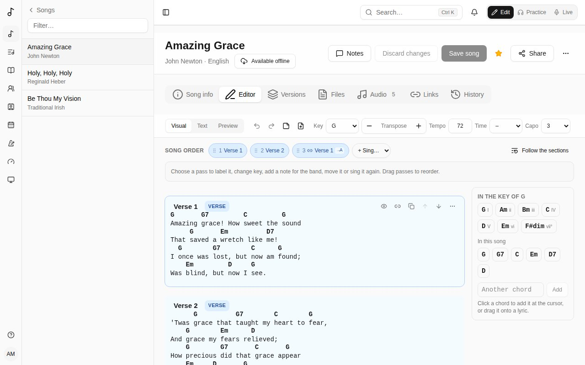
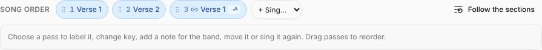
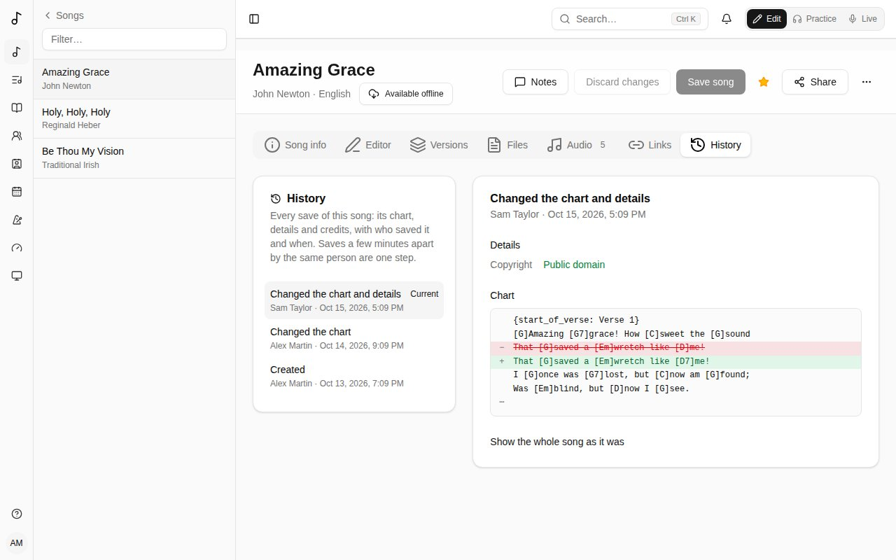

Open a song and choose the **Editor** tab.

The editor's toolbar stays at the top of the screen as you scroll. It has the editor's three modes on the left, then **Undo**, **Redo** and the note line, then the song's **Key**, **Transpose**, **Tempo**, **Time** and **Capo**. Its buttons never move as you use them: press **Transpose** + again and again, or **Undo**, without looking. A tool that doesn't apply in a mode is greyed out there rather than taken away.

The three modes:

- **Visual** - the chart with chords sitting over the words. This is where you'll spend most of your time.
- **Text** - the same chart as ChordPro text, for quick bulk edits. Chords and lines you don't change stay as they were.
- **Preview** - the chart as players will see it. On a wide screen it's also shown beside **Visual** and **Text**, updated as you type.

**Visual** uses the same lettering as the preview: **Font** in its **Display** panel, **Monospace** or **Proportional**. Either way each chord stays over its own letter. Where two chords are closer together than the first one is wide, a little room is left between their words.

## Chords

- **Type a chord** in square brackets where it's played: `[G]Amazing grace`.
- **Move a chord** by dragging it onto another letter, or select it and use the ← → arrow keys.
- **Click a chord** to change it (with suggestions from the song's key and variations like `G7` or `Gsus4`) or delete it.
- The **chords panel**, at the right of the chart and in view as you scroll, lists the **chords in the song's key** (with their degree: I, IV, V…) and the chords **In this song**. Click one to add it at the cursor, or drag it onto a word. **Another chord** adds any other.
- On a phone or a tablet, the chords are in a bar along the bottom of the screen, above the keyboard. Tap one to add it at the cursor; no need to type `[G]`. Tapping a chord on the chart selects it and puts the keyboard away, so nothing is covered; with a chord selected, tap another in the bar to put it in its place. The bar then starts with that chord's tools - move it a letter left or right, or delete it - and adds its variations (G7, Gsus4…).
- On a touch screen, **press and hold a chord** on the chart to drag it: it lifts, and the letter it will land on is highlighted. A quick swipe scrolls the page instead.

Editing the words keeps the chords with them: typing before a chord carries it along, and deleting words that carry chords leaves the chords where the words were, so you can place them again. Enter splits a line and its chords go with their words.

## Bar lines

Bar lines mark where each bar starts, in the words, as on a lead sheet: `|Amazing |grace how |sweet the |sound`. The [bars row and the chord grid](/metronome/#chord-grid) follow them, the click too. Without any, the bars come from the chords (see [Bars](/metronome/#bars)).

- **Bar lines** in the toolbar fills them in from the chords - **Fill in this section from its chords** or **Fill in the whole song from its chords** - to start from, and takes them away again (**Remove this section's bar lines**, **Remove all bar lines**).
- **Type `|`** in the words to add one at the cursor, or drag **Bar line** from the chords panel (under **Bars**) onto the words where a bar starts.
- **Drag a bar line by its knob** - the dot under the words - onto another letter. On a touch screen, press and hold it a moment first: it lifts, and follows your finger along its line.
- **Click a bar line** (tap it on a touch screen) to select it. Its tools show under it, or in the bar along the bottom on a phone or a tablet: **Move the bar line left** and **Move the bar line right** a letter at a time (the ← → arrow keys too), **One bar fewer** and **One more bar** for bars with no words of their own - a word held, an instrumental bar - shown as **×2** under the knob, and **Delete the bar line**.

The chords between two bar lines fall in their bar on the beats their words reach: a chord halfway through a bar's words is on its third beat in 4/4.

### Beats in the words

In a section with bar lines, each bar's other beats show as small numbers under the letters they're sung on, beat 1 being the bar line itself. They are the same beats as in the chord grid (see [Placing beats in the words](/metronome/#placing-beats-in-the-words)): placed by themselves, or by you. A dashed number is a beat held over a word.

- **Drag a beat** onto another letter of its bar, or **tap it and then tap the letter**: handy on a phone, where dragging small things is fiddly. A beat stays between the beats before and after it; somewhere it can't go, it flashes red and stays where it was.
- A beat you placed is filled in. **Tap it twice** to let the grid place it again.

They are saved with the song.

## Sections

Each block is a section: intro, verse, pre-chorus, chorus, post-chorus, bridge, vamp (a phrase repeated as long as needed), breakdown, instrumental, interlude, outro or tag.

Each type has its own light colour - verses blue, choruses amber, bridges violet… - on its tag and as a faint wash behind its lines, so the parts of a song stand out at a glance.

- **Add a section** with the **+** between two sections (it shows where the pointer is, and always on a touch screen), above the first one, or with **Add a section** at the end. Its menu has every type of section, and **Sing again**: a linked copy of a section already in the song, sung there.
- A section's heading is its name ("Verse 2"): click it to rename it. The small coloured tag beside it is its **type**: choose it to change the type.
- The section's tools - the eye, its duplicates, up and down, and its **⋯** menu - show on the section you're editing, or under the pointer. Their place is kept, so nothing moves when they appear. The eye hides its name ("Chorus") on the chart in Practice and Live.
- The **⋯** menu moves, duplicates (linked or as a unique copy, see [Linked copies](/song-editor/#linked-copies)), takes out of the song order or deletes it.
- A line can be a **note for the band** ("×2, build") rather than lyrics.

## Key and transposing

Set the song's **Key** in the toolbar. **Transpose** − and + move every chord and the key by a semitone; **Undo** puts both back. **Tempo**, **Time** and **Capo** are the song's, the same as in the **Song info** tab, and are saved with it.

On a phone, the bar at the bottom of the screen always has **Save song**: greyed out until there's something to save.

## The song order

The **Song order** above the chart is the order the song is sung in, each time through a section being a *pass*. Each pass is shown in its section's colour.

- **+ Sing…** adds a pass: the chorus again, say.
- **Choose a pass** - or click into its section in the chart - and its actions show in the bar under the order: **Earlier**, **Later**, **Sing again right after**, **Duplicate (unique copy)** (a section of its own after it), **Rename** ("Final chorus"), **Key change** and **Note for the band**. The last button is **Remove this pass**; on a section's only pass, it's **Take out of the song order**. The bar keeps its place and height whether a pass is chosen or not, so you can press **Earlier** again and again without looking. Choosing a pass brings its section into view.
- **Drag passes** to reorder them. On a touch screen, press and hold a pass first; a quick swipe scrolls the page.
- **Follow the sections** goes back to singing each section once, in order.

Key changes and notes show on the chart at that pass.

### Linked copies

The editor shows the song in the order it's sung. A section's first appearance is the block you edit; wherever it's sung again, it's a **linked copy** - marked with a link, "Linked to Chorus", locked - that follows the section: change the section and every copy shows it.

A copy is folded to one line that says what it does - "sung again, as written", "2 semitones up · in A", "1 chord of its own", "1 line left out". **Show** opens it, with its own transposition and **Edit this copy**; **Hide** folds it again. It stays as you left it while you edit.

- **Duplicate (linked)** in a section's menu adds a copy of it right after; **Duplicate (unique copy)** adds an independent section instead. In a copy's menu, **Duplicate (linked)** adds another copy with the same changes, still linked to the section, not to the copy. Moving blocks up and down (their menu) changes the order they're sung in, as does the **Song order** above.
- When the editor has room, the arrows to move a block up and down and its duplicates are also at the right of its heading, beside its menu: on a section, **Duplicate (linked)** (the link) and **Duplicate (unique copy)** (the copy icon); on a linked copy, **Duplicate (linked)** (the copy icon).
- **− / +** in a copy's heading transposes that copy alone (a key change, in Song order, carries on to the end of the song).
- **Edit this copy** opens its changes, which stay differences from the section, so it keeps following it: **Leave the line out**, change its words (removed words show greyed out and struck through, new ones highlighted, and the chords follow their words), or type another chord over one (written in the song's key) or leave it out with the eye button. **Done** locks it again.
- A copy with its own words, lines or chords shows **\*** in its heading, in the song order and on the chart. A copy only moved up or down isn't marked: it shows how far (**+2**) instead. **As the section is written** (its menu) takes the changes away; **Make unique** turns it into a section of its own, its changes written in - it no longer follows the original.
- **Take out of the song order** (a section's menu) moves a section to the end, under **Not in the song order**, with its copies; **Put back in the song order** brings it back.

If a line or chord a copy changes is deleted from the section, the chart says so rather than dropping it. Exported to ChordPro, a changed copy is written out in full.

### Repeated sections

A file read in (a new song, a pasted or uploaded chart) links what it writes out again: a chorus written a second time is a linked copy of the first - also when it's a few semitones up or down (a transposed copy), when a third of its chords at most are different (a copy with those chords of its own), or when it's only the chorus's last lines.

A song written before keeps its sections twice. Above the editor, its editors see what repeats - "Chorus 2 is Chorus with 1 chord of its own", "Last chorus is Chorus, 2 semitone(s) up" - and **Link** each, or **Link all**: the repeat becomes a linked copy of the section, keeping its name. Arrangements and recordings' cue points follow, and the song's **History** can undo it. Save your changes first.

## Pasting a chart

Paste a whole chart anywhere - ChordPro, or chords written above the lyrics - and it's turned into sections with chords in place. Pasting plain words just types them. Section names on a line of their own ("Verse 1", "[Chorus]", "Refrain", "Pont", "Coro") start a section of that kind, in English, French, Spanish, German, Italian or Portuguese.

## Replacing the chart

The toolbar's **Replace from a file or paste…** reads a new chart in for the whole song: upload a file (`.cho`, `.txt` or `.pdf`) or paste the words and chords, then **Replace the chart**. What stays the same keeps its place - linked copies, [versions](/versions/) and recordings' sections follow it - and **Discard changes** puts the old chart back until you save. (A new song gets its chart on **Song info** instead.)

## Saving

**Save song** saves the chart and the song's details together. If someone else saved the song after you opened it, Songverse tells you instead of overwriting their changes.

## Editing together

When someone else has the song open in the Editor, the header says so (**Sam is editing this song**). It shows in Practice too, under the song's name.

When they save, you're told at once, over the page, so nothing moves while you work:

- With nothing changed on your side, **Load it** brings in their version.
- With changes of your own not saved yet, loading theirs drops yours: **Drop mine and load theirs**, or **Keep editing** to look first. Saving yours will then be refused, with the same choice, rather than overwriting what they saved.

In Practice, a save shows as **Song changed · Load it**; the chart changes only when you tap it.

### Typing together

Where an admin has turned on **Live co-editing** (see [Admin](/admin/#collaboration)), people who can change the song type in it together in the Editor's **Visual** mode. Each sees what the others type as they type it, with their caret and their name. That works for the words, the chords, the sections, the song's order, the key and transposing.

- **Undo** takes back your own changes only, not what others typed meanwhile.
- **Save song** saves the song as everyone has it. After someone saves, the others carry on without being told it was saved elsewhere, and any of them can save again.
- **Discard changes** drops the changes nobody saved, for everyone in the song.
- While someone else is in the song, **Text** mode only shows the chart; change it in **Visual**.
- If the song is changed somewhere else meanwhile (a version restored from **History**, a suggestion accepted), everyone in it gets the song as saved now, and changes nobody had saved are dropped. A message over the page says so.

Where it's off, each person edits on their own, as described above.

## History

The **History** tab lists every save of the song, newest first: who saved it, when, and what changed - the **chart**, the **details** (title, key, rights…) or the **credits**. Saves by the same person a few minutes apart count as one step.

Choose a step to see what it changed: details and credits with the old value struck out and the new one beside it, and the chart's lines removed and added. **Show the whole song as it was** shows the song at that step.

If you can edit the song, **Restore this** puts its chart, details and credits back as they were at that step. It's saved like any other change, so it shows in the history and can itself be undone. Tags, files, links and versions aren't part of the history and stay as they are. Save or discard your own changes before restoring.

Songs created before the history was kept start with **Before the history was kept**: the song as it was then.
