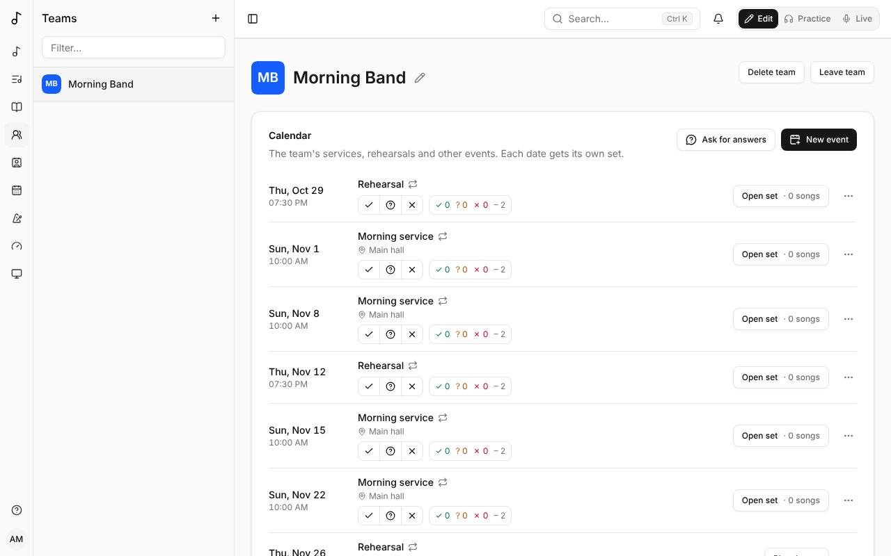

A **team** is a band, or any people working together, that shares songs, versions, sets and songbooks. Your teams are listed under **Teams** in the sidebar.

## Calendar

The team's page starts with its **Calendar**: its services, rehearsals and other events, the coming eight weeks (**Show more** for later ones). Every member sees it; its admins manage it.

On a server with [Oneverse Plan](/plan/), the events themselves are made and changed there: in Songverse, the team's admins have **Events in Plan**, which opens the team's calendar in Plan's [Calendar](/plan/#calendar), instead of **New event** and **Event types**, and a date's menu keeps only what's about its set. Answers, line-ups, **Ask for answers** and sets stay in Songverse. The same goes for an organisation's events. Without Plan, everything is done here.

- **New event**: its **Title**, its **Date** and **Start time**, how long it lasts, its **Time zone** (yours by default) and, if you like, a place and a note. **Repeats**: **Every week**, every 2 weeks and so on, on the weekday of its date, **Until** a date or for ever; or **Doesn't repeat**. Times stay the same when the clocks change.
- **Call time (minutes before)**: when to be there, that many minutes before it starts - for a sound check or a prayer time. Each date then shows "Call 9:15" under its time, on the calendar and on **My calendar**; it's in your calendar link and in the reminder the day before. Leave it blank for none.
- **Each date gets its own set**, named after the event and its date in your language ("Morning service - Oct 12"): **Open set** plans it like any set. Sets are made ahead of time - **Create sets ahead**, under the calendar, says how many weeks, from 1 to 52 (4 by default; 13 is about three months). A date further out has **Plan the set**, which makes its set straight away.
- **Dates** and **Events**, at the top of the calendar: **Dates** lists each coming date; **Events** lists each event once - a series with how it repeats ("Every week · Sunday 10:00 · from Nov 23"), a one-off with its date, a rehearsal with its event - and **Edit the series** (**Edit event** for one that doesn't repeat) changes it as a whole.
- A date's **…** menu: **Cancel this date** (its set is deleted if it has no songs yet) or **Restore this date**; on a series, **Edit this date** - its own title and start time, that date only (marked **Changed**), or **Back to the series** - **Move this date** to another day, and **Edit the series**. A date moved takes its answers, line-up and set with it (its rehearsals follow), shows **Moved from** its own day, and everyone who answered or is on its line-up is told; the series carries on as before. The day must be one the event has no date on; moving it back to its own day makes it an ordinary date again. A set made for a date follows it: its date is changed on the calendar, not on the set.
- In a team of an organisation, an event's dialog has **Move to** the organisation, one-off or series: its admins are asked, and the event is marked **Waiting for** the organisation until one of them accepts (see [Events](/organizations/#events)). **Take the request back** cancels it. Accepted, it's the organisation's event, and this team's part of it as it was: its dates, answers, line-ups and sets.
- Changing an event (its title, its date, how often it repeats) updates its coming sets. Dates it no longer falls on lose their sets if they're still empty; a set with songs stays, as a set of the team's. **Delete event** works the same way. A set deleted by hand isn't made again; **Plan the set** brings it back.

### Event types

Not every event is the same: a service needs a host, a speaker and someone on music, and gets a set (its songs, Bible passages, slides and more); a meeting needs neither. **Event types**, beside **New event**, keeps the kinds of events the team holds. A team with none is offered **Add Service** (Host, Speaker, Music and Media operator, all required, the last two open to the team's members), **Add Worship night** (Music) and **Add Meeting** (no set); **New type** makes your own: its **Name**, its usual **Start time**, length and call time, its **Positions needed** (see [Positions needed](/teams/#positions-needed)), and **Make a set for each date**. The pencil beside a type changes it; **Delete type** removes it. In a team of an organisation, the list also has the organisation's own types, marked with its name: its admins keep them (see [Event types](/organizations/#event-types)), and the group picks from them like its own.

In **New event**, **Type** picks one: the event takes its name as its title (unless you typed one), its time, its positions and whether it gets sets. Everything can still be changed for that event, and it can ask for more positions than its type. An event keeps what it was given: changing or deleting its type later leaves it as it is.

**Make a set for each date**, in an event's dialog, is on by default (off in a team that only plans); with it, **The line-up edits the set** says whether the people on a date's line-up change its set, or only the team's admins (see [Who edits a date's set](/sets/#who-edits-a-dates-set)). An organisation's event chooses both on the organisation's Events. A set isn't only songs: it holds whatever the date shows and plays - Bible passages, slides, announcements. Turn it off for an event that needs none - a meeting: its dates get no set and no **Plan the set**. Turning it off on an existing event deletes its coming sets that are still empty (a set with something in it stays); turning it back on makes them again.

### Availability

Under each date, say whether you can play: **Sign up**, **If needed** (free if asked, not first choice) or **Can't make it**. Press your answer again to take it back. Once you've answered, add a note for the team's admins ("Keys only", "arriving late"); only you and they see it. Not answering is never taken as available.

With **Sign up** or **If needed**, the hand button beside your answer opens **What I'd like to play**: pick the positions you'd like that date - the positions the event asks for, or, when it lists none, the instruments and roles on your dashboard. The team's admins see them in **Who can play**, and those who edit the date's set see them on the set (see [Who can play](/sets/#who-can-play)). Answering **Can't make it** clears them.

**My calendar**, in the sidebar, lists the coming dates of all your teams that use Songverse (a group that only plans is in Plan's), to answer them in one place. Under **Days away**, **Add days away** opens a calendar: pick the first day, then the last, add a note if you like, and **Add**. Every date in them reads **Can't make it**, marked **Away**, for all your teams - unless you answer that date yourself. Each range can be changed (**Edit**: pick the days again, change the note, **Save**) or removed; your other ranges show struck through on the calendar.

The team's admins see, beside each date, how many members signed up, answered if needed, can't make it, and haven't answered. Clicking it opens **Who can play**: everyone's answer, with their notes and days away. An admin can answer there for a member who doesn't use Songverse; it shows as answered by them.

### A date's page

Each date has its own page: its title on the team's calendar, on **My calendar** and in Oneverse's **Your next dates** opens it, and so do the notifications and reminders about that date and its entry in your calendar link. It's the same page in Songverse, Plan and Oneverse: when and where (with **Moved from** if the date moved), the event's note, **Your answer**, its **Line-up** - **You're on Drums** to accept or decline, the places you can take - its **Rehearsals**, and **Open set**. Those who change the set see **Who can play** too. The team's admins have **Edit the line-up** and a link to the team's calendar, where the event itself is changed. A date that isn't on your calendar - another team's, or cancelled for good - says so.

### Positions needed

In an event's dialog, **Positions needed** lists what it needs and how many: **Add a position** picks one - **Host**, **Speaker**, **Music**, **Media operator**, **Audio operator**, **Lights**, **Technician** - the team's own positions (see [Positions](/organizations/#positions)), a name the team used before, or **Another name…** ("Welcome", "Coffee"). An event asks for roles, not instruments: on each date's set, whoever is on **Music** asks for the instruments that date needs (see [Who can play](/sets/#who-can-play)); events made before keep the instruments they asked for. A member covers the roles they listed under **Roles** on their dashboard, and the positions they ticked; anyone covers a position with a name of the team's own.

The team's admins then see, beside each coming date, what's short: **Short: Music, Audio operator** names the positions that not enough members who cover them have answered **Sign up**. **Who can play** starts with the positions: who covers each and is available, who would play if needed, or **No one signed up yet**.

Under each position, **Required** says it must be filled: until enough people are on its line-up, the date shows **Missing: Host, Music** to everyone on the team and on [My calendar](/teams/#availability). **From** says which team its people come from: that team's members see **I'll do it: Music** beside the date and put themselves on it, accepted at once (unless their team has [offers confirmed](/organizations/#teams)), while places are left; the team's admins are told. **No team: the admins choose** keeps it to the admins. In a team of an organisation, **From** lists its other teams too: their members find the place under **Open places** on **My calendar**, and taking it makes them a guest of that date (they see its set). In an organisation, a position one of its teams fills (**Positions it fills**, see [Teams](/organizations/#teams)) is open to that team as soon as it's added, or comes from an event type: **Music · Worship**. A place open to a team is open to the teams under it too: open to Tech, it's open to Media, Sound and Lights. Someone who took a place this way can **Give it up**; it's open again and the admins are told. Host and Speaker work like any other position: **From** names the team their people come from (a Hosts team, say). Event types keep both settings, so every event made from one starts with them.

### Line-up

Once a date's positions are set, its admins choose who plays what: **Line-up** beside the date lists each position with the people on it, and **Add someone** puts a member on it - those who play it first, with their answer, then the others. Each person is told and answers on the team's calendar or **My calendar**: **You're on Drums**, **Accept** or **Decline** (an admin putting themselves on a position is accepted at once). Accepting also answers **Sign up** for that date; declining tells the team's admins. An admin can take someone off a position; they're told.

The line-up flags what clashes: someone **Away**, who **Said they can't make it**, or **Playing elsewhere then** - on another event at the same time, of any of their teams. Each position shows how many it has of how many it needs, and **Short** counts those on the line-up once a date has one.

**Music** is a position like the others (people say they lead music under **Roles** on their dashboard). **Host** ("Présidence") and **Speaker** aren't: nobody lists them, and no role gives them. An event asks for either in **Positions needed**, like any position - not every event needs a host - and **From** says which team they come from: a "Présidence" team of the organisation's, say, whose members offer to host without being in the teams that play. Without one, the admins put someone on it. A host is always a member of the team or of its organisation - never a guest: hosting isn't for someone from outside. Whoever is on a date's line-up, and hasn't declined, can change that date's set - its songs, passages and texts - like the team's admins, unless the event's **The line-up edits the set** is off (see [Who edits a date's set](/sets/#who-edits-a-dates-set)). They can't delete the set or give it to someone else. **Leads the set**, under any position in **Positions needed** (or an event type's), names who leads it on the set's **Who can play**; until you tick it, **Host** and **Music** lead it.

Unlike a host, a **Speaker** can always be a guest, even from outside the organisation: one of your People, or **Someone without an account…**.

**Guests**: **Add someone** also lists **Your People (guests)** - people you're connected with on [People](/people/) who aren't in the team. A guest is told and answers like a member, sees that date on their **My calendar** and its set (read-only), and loses it when taken off. **Someone without an account…** adds them by name and email, so they can be reached (only the team's admins see the email): they're on the line-up, marked **No account**, but never told anything. A **Host** is never a guest: only a member of the team or of its organisation.

**Can't make it?** Beside your place, **Ask for a replacement**, with a note if you like, then **Ask**. The members who play that part - not on it already, not away or unavailable that date - are told, and see **Take Drums from Alex** on the team's calendar and **My calendar** - those who answered **If needed** for that date first: the others are asked only if none of them takes it within a day (two hours when the date is less than two days away), or straight away when no one answered **If needed**. The first to take it gets the place, accepted (and **Sign up** that date); you and the team's admins are told. Until then the place stays yours, marked **Looking for a replacement**; **Cancel** takes the request back.

**Who's signed up for a date**: once it has a line-up, the people on it - asked or accepted, not declining; until then, those who answered **Sign up**. That's who sees its set in their sidebar, finds it in their calendar link, and is reminded and told about it.

### Rehearsals

A rehearsal ahead of each date: in **New event**, **Rehearsal for** picks the event it prepares, and **Days before** how many days ahead (up to 14), with its own start time and length. It follows that event: a date moved or cancelled moves or cancels its rehearsal. It shows on the calendar marked **Rehearsal**, "for Sunday service, Sun 18 Oct", and **Open set** opens that date's set, so everyone rehearses the songs that will be played. A rehearsal takes no answers or line-up of its own: the people signed up for its date (see [Line-up](/teams/#line-up)) see it on **My calendar** and in their calendar link, and are reminded the day before. Deleting the event deletes its rehearsals.

### Venues

Where the team's events take place: its admins add them under **Venues** on the team's page, with **Add venue**: a **Name**, an **Address (optional)** and a **Time zone**. Tick **At someone's home** for a homegroup's house: its address then goes only to those who see its events, never into calendar links. **Edit** changes one, **Remove** takes it off (its events keep their place, without the venue). A team in an organisation can also use the organisation's venues (see [Venues](/organizations/#venues)).

A venue may hold rooms - Main hall, Kids room 1: **Add room** under it, with a **Room name** and maybe a **Capacity**; **×** removes one (its events keep the venue).

In **New event**, **Venue** picks one: the place becomes its name and the time zone its own; a venue with rooms then lists them, to tick those the event takes. Its dates show them before the place ("Main hall, Riverside church"), and calendar links give the rooms, the venue and its address. You can still type a place of your own beside it. An event type keeps its usual venue and rooms too.

### Your calendar link

On **My calendar**, **Calendar link** puts the dates you signed up for (see [Line-up](/teams/#line-up)) in your own calendar: **Get my calendar link**, then **Add to Google Calendar**, **Add to Apple Calendar** or **Add to Outlook** - or **Copy link** and add it to any calendar app as a subscription ("From URL", "Subscribe to calendar"). Each date shows with its team, place and a link to its set, from three months back to a year ahead; cancelled dates leave it.

The calendar keeps itself up to date, but calendar apps look for changes on their own schedule - every few hours (Google can take up to a day). Anyone with the link can see those dates, so keep it to yourself: **Reset link** makes a new one and stops the old one; **Turn off** removes it.

### The team's calendar link

A team's admins have one more on the team's page: **Team calendar link**, with **Get the team's calendar link**. It holds all the team's dates - events and rehearsals, with their call time, place, note and set - and nobody's answers, for a shared calendar, the church's website or anyone who needs the schedule. It works like your own link: **Copy link**, the **Add to…** buttons, **Reset link** if it gets around, **Turn off**. The team's members see the link too, to add it to their calendar, but only its admins make, reset or turn it off; until they make one, it says so.

An organisation has one too, for all its events (see [Events](/organizations/#events)).

### Which sets you see

A date's set shows in your sidebar when you're signed up for it (see [Line-up](/teams/#line-up)): answering **Sign up** puts it there, or being put on its line-up, and taking that back removes it. The team's other coming dates are still on the **Sets** page and the team's calendar. Once a date is over, its set leaves the sidebar and the list: the ones you took part in are on the **Sets** page under **Archive**, and every past date is on the team's page under **Past dates**. Sets you make yourself are listed as before. Sets kept for offline use follow the same rule.

### Reminders

- **Ask for answers** (admins): choose the dates (**From**, **To**) and **Answer by**, then **Ask**. Members with some of those dates still unanswered are told straight away - not those away for them - and, if they still haven't answered, reminded the day before the deadline. The request shows at the top of the calendar for everyone until the deadline is over; **Stop asking** (×) removes it.
- **The day before**: everyone signed up for a date (see [Line-up](/teams/#line-up)) is reminded the day before, from 18:00 in the event's time zone, with its time, call time, place and set.
- **Tell them the set is ready** (admins, in a date's **…** menu, once it has a set): the people signed up are told, and the date shows **Set ready**. **Tell them again** after more changes.

Like every notification, they show under the bell, and by email or on your devices as you choose (see [Notifications](/account/#notifications)).

### Notifications

The bell at the top of every page shows how many notifications you haven't read; press it for the list, newest first. Pressing one opens what it's about and marks it read; **Mark all as read** clears the count, and **Show older** loads earlier ones. You're told:

- when a date you signed up for (see [Line-up](/teams/#line-up)) is cancelled, moves to another day, or its time or title changes - also when the whole event changes or is deleted;
- when a team admin answers for you, with their answer.

Besides your teams' calendars, you're told when someone asks to connect with you (see [People](/people/)) - **Accept** or **Decline** right there - or accepts your request; when one of your people shares a song or a songbook with you (and when you may edit it now); when someone joins one of your sets through its link, or a team you run through its invite link; when someone asks to edit a date's set you edit, and when your own ask is granted or declined; when you're made an admin of a team, or a member again; when a suggestion you made is taken or declined, or a song you submitted to the catalogue is published or sent back, with the reviewer's notes; and when someone records a part in a multitrack of your song (once an hour at most).

**See all**, at the bottom of the list, opens the **Notifications** page: everything, a page at a time. Read notifications are deleted after 90 days, unread ones after a year.

Whoever made the change isn't told about it. They can also come by email, as you choose in your [account settings](/account/#notifications), when the server sends them.

## Members and roles

- **Admins** manage the team: they change its songs, versions and sets, and invite people.
- **Members** see and use everything the team has.

Next to each name, the team shows what they play or do (see [Roles](/account/#roles)). Its admins see who hasn't said yet.

## Creating a team and inviting people

Your teams are all on **Teams** in [Oneverse](/getting-started/#oneverses-home), the top of its page: each organisation with its groups, then main teams with their sub-teams under them, then your other teams. Each opens its page there, where its admins manage it: its colour, picture and description, its members, invitations, and deleting it. What only Songverse has - brands, archives, the stem separation server, songs played often, the Bible - is on its page in Songverse (**Open in Songverse**).

**New team** makes one, and you're its first admin: give it a name, maybe a description and a colour, and choose where it goes under **Inside** - **On its own**, in an organisation you're an admin of (as one of its groups), or under a main team you're an admin of, as its sub-team. A main team's admins also have **New sub-team** on its page. In Songverse, **Create team** on the Dashboard's **Teams** card still makes one on its own.

To invite someone by email, use **Invite by email** on the team's page: their address and the role they get, then **Send invitation**. They're sent a link that works once, for two weeks; someone without an account creates one with it, even when sign-up is by invitation only. Until they join, the invitation waits on the card: **Send again**, or **Revoke** it.

Or create an **invite link** for many people: choose the role they get when they join, when it expires and how many times it can be used, then **Copy link** and send it. Anyone who opens it and signs in joins the team. **Revoke** a link to stop it working.

On a server with organisations, a team can be part of one - its church or club: under **Organisation**, its admins choose one they're an admin of (see [Organisations](/organizations/#putting-a-team-in-it)).

## Colour and picture

A team's admins give it a **Colour**, a picture and a description on its page in Oneverse, in **Colour and picture**: the picture (**Add a picture**, cropped square) or the team's initials on its colour show beside its name in the sidebar and in lists, for everyone who sees it. **From its name** picks a colour from the team's name.

## Stem separation server

When this Songverse allows it, a team's admins can connect the team's own Songverse Sonic server under **Stem separation** on its page: the team's songs are then split into stems there, by its admins and the members given one of its roles that splits recordings. See [Your own stem separation server](/sonic/).

## Roles on the team

Under **Roles**, the team's admins give its members the roles Admin lets teams give, on this team only. The built-in **Media operator** runs the screens of the team's sets - presenting, the timer, messages, layers - without editing the sets (see [The media operator](/screens/#the-media-operator)). Tick a role under a member's name to give it, untick it to take it back. An organisation's admins do the same on its page for all its teams.

The team's admins also make roles of its own there, with **New role**: the same editor as [Admin > Roles](/admin/#roles), with only what's the team's to allow - **Split recordings into stems** on its own Songverse Sonic server (with its own **Separations per person in 30 days**, else the server's), and running, moving on, routing and managing its sets' screens. They count only on this team. Only its admins and the members given one that splits recordings use its own Sonic server (see [Your own stem separation server](/sonic/#which-server-a-song-uses)).

## Bible

Under **Bible**, the team's admins tick **Show the Bible in the sidebar**: its members then find a [Bible](/bible/) in the sidebar's **Tools**, to read a passage and add it to a set. A team in an organisation that turned it on has it already.

## Songs played often

Under **Songs played often**, the team's admins choose over how many weeks a song's plays in the team's sets are counted (6 by default) and, with **Flag a song played this many times or more**, a limit. Past it, a song is flagged in the team's sets and in **Add to set**, but can still be added (see [Songs played often](/sets/#songs-played-often)). A set counts once it's dated before today.

## Announcements

A team's admins send news to its members from its page: **Announcements**, then **New announcement** - a **Title**, a **Text** and, if you like, a **Link**, typed or picked under **Or a page of the app** (**What I play or do (Dashboard > Roles)**, **Account settings**, **My calendar**…). **Under the bell** shows how it will look; it stays a **Draft** until **Send**, which says how many members it goes to. Members get it under the bell with the team's name, and on their devices; by email only if they turn that on. A sent one can still be fixed for everyone (**Save: fixes it for everyone**) or taken back (**Take back**). It goes to the team's own members, not the teams under it; an organisation's admins can send to several teams at once (see [Organisations](/organizations/#announcements)).

## Leaving or deleting a team

**Leave team** takes you out of it. If you're its only admin, promote another member first. An admin can **Rename** it - the pencil beside its name; an organisation's team too - or **Delete team**.

## What belongs to a team

Versions, sets and songbooks can be the team's rather than yours: choose the team when you create one (you need to be one of its admins). Team things stay with the team when people come and go.

A song of yours becomes the team's when you hand it over: see [Moving a set to a team](/sets/#moving-a-set-to-a-team-or-back).
