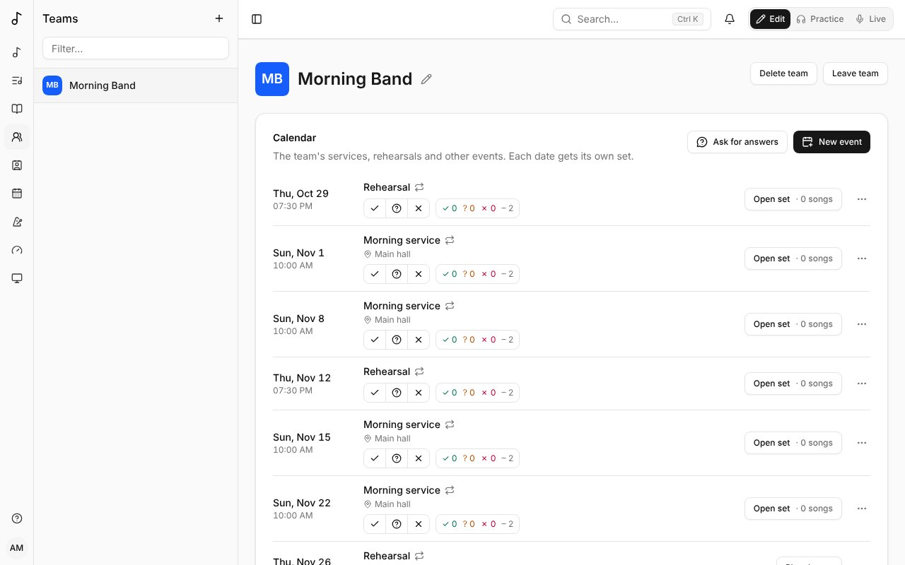

A **team** is a band or a group that shares songs, versions, sets and songbooks. Your teams are listed under **Teams** in the sidebar.

## Calendar

The team's page starts with its **Calendar**: its services, rehearsals and other events, the coming eight weeks (**Show more** for later ones). Every member sees it; its admins manage it.

- **New event**: its **Title**, its **Date** and **Start time**, how long it lasts, its **Time zone** (yours by default) and, if you like, a place and a note. **Repeats**: **Every week**, every 2 weeks and so on, on the weekday of its date, **Until** a date or for ever; or **Doesn't repeat**. Times stay the same when the clocks change.
- **Call time (minutes before)**: when to be there, that many minutes before it starts - for a sound check or a prayer time. Each date then shows "Call 9:15" under its time, on the calendar and on **My calendar**; it's in your calendar link and in the reminder the day before. Leave it blank for none.
- **Each date gets its own set**, named after the event and its date in your language ("Morning service - Oct 12"): **Open set** plans it like any set. Sets are made ahead of time - **Create sets ahead**, under the calendar, says how many weeks, from 1 to 52 (4 by default; 13 is about three months). A date further out has **Plan the set**, which makes its set straight away.
- A date's **…** menu: **Cancel this date** (its set is deleted if it has no songs yet) or **Restore this date**, and **Edit event**.
- Changing an event (its title, its date, how often it repeats) updates its coming sets. Dates it no longer falls on lose their sets if they're still empty; a set with songs stays, as a set of the team's. **Delete event** works the same way. A set deleted by hand isn't made again; **Plan the set** brings it back.

### Availability

Under each date, say whether you can play: **Available**, **If needed** (free if asked, not first choice) or **Not available**. Press your answer again to take it back. Once you've answered, add a note for the team's admins ("Keys only", "arriving late"); only you and they see it. Not answering is never taken as available.

**My calendar**, in the sidebar, lists the coming dates of all your teams, to answer them in one place. Under **Days away**, **Add days away** opens a calendar: pick the first day, then the last, add a note if you like, and **Add**. Every date in them reads **Not available**, marked **Away**, for all your teams - unless you answer that date yourself. Each range can be changed (**Edit**: pick the days again, change the note, **Save**) or removed; your other ranges show struck through on the calendar.

The team's admins see, beside each date, how many members are available, if needed, not available, and haven't answered. Clicking it opens **Who can play**: everyone's answer, with their notes and days away. An admin can answer there for a member who doesn't use Songverse; it shows as answered by them.

### Parts needed

In an event's dialog, **Parts needed** lists what it needs and how many: **Add a part** picks an instrument or a role people list under **Roles** on their dashboard (Sound engineer, Media operator…), one an admin added, a name the team used before, or **Another name…** ("Worship leader", "Slides"). A team with positions of its own lists **This group's positions** first (see [Positions](/organizations/#positions)). A member covers the instruments and roles they listed, and the positions they ticked; anyone covers a part with a name of the team's own.

The team's admins then see, beside each coming date, what's short: **Short: Drums, Sound engineer** names the parts that not enough members who cover them have answered **Available**. **Who can play** starts with the parts: who covers each and is available, who would play if needed, or **No one available yet**.

### Line-up

Once a date's parts are set, its admins choose who plays what: **Line-up** beside the date lists each part with the people on it, and **Add someone** puts a member on it - those who play it first, with their answer, then the others. Each person is told and answers on the team's calendar or **My calendar**: **You're on Drums**, **Accept** or **Decline** (an admin putting themselves on a part is accepted at once). Accepting also answers **Available** for that date; declining tells the team's admins. An admin can take someone off a part; they're told.

The line-up flags what clashes: someone **Away**, who **Said not available**, or **Playing elsewhere then** - on another event at the same time, of any of their teams. Each part shows how many it has of how many it needs, and **Short** counts those on the line-up once a date has one.

**Guests**: **Add someone** also lists **Your People (guests)** - people you're connected with on [People](/people/) who aren't in the team. A guest is told and answers like a member, sees that date on their **My calendar** and its set (read-only), and loses it when taken off. **Someone without an account…** adds a name for reference: they're on the line-up, marked **No account**, but never told anything.

**Can't make it?** Beside your place, **Ask for a replacement**, with a note if you like, then **Ask**. The members who play that part - not on it already, not away or unavailable that date - are told, and see **Take Drums from Alex** on the team's calendar and **My calendar** - those who answered **If needed** for that date first: the others are asked only if none of them takes it within a day (two hours when the date is less than two days away), or straight away when no one answered **If needed**. The first to take it gets the place, accepted (and **Available** that date); you and the team's admins are told. Until then the place stays yours, marked **Looking for a replacement**; **Cancel** takes the request back.

**Who's signed up for a date**: once it has a line-up, the people on it - asked or accepted, not declining; until then, those who answered **Available**. That's who sees its set in their sidebar, finds it in their calendar link, and is reminded and told about it.

### Rehearsals

A rehearsal ahead of each date: in **New event**, **Rehearsal for** picks the event it prepares, and **Days before** how many days ahead (up to 14), with its own start time and length. It follows that event: a date moved or cancelled moves or cancels its rehearsal. It shows on the calendar marked **Rehearsal**, "for Sunday service, Sun 18 Oct", and **Open set** opens that date's set, so everyone rehearses the songs that will be played. A rehearsal takes no answers or line-up of its own: the people signed up for its date (see [Line-up](/teams/#line-up)) see it on **My calendar** and in their calendar link, and are reminded the day before. Deleting the event deletes its rehearsals.

### Your calendar link

On **My calendar**, **Calendar link** puts the dates you signed up for (see [Line-up](/teams/#line-up)) in your own calendar: **Get my calendar link**, then **Add to Google Calendar**, **Add to Apple Calendar** or **Add to Outlook** - or **Copy link** and add it to any calendar app as a subscription ("From URL", "Subscribe to calendar"). Each date shows with its team, place and a link to its set, from three months back to a year ahead; cancelled dates leave it.

The calendar keeps itself up to date, but calendar apps look for changes on their own schedule - every few hours (Google can take up to a day). Anyone with the link can see those dates, so keep it to yourself: **Reset link** makes a new one and stops the old one; **Turn off** removes it.

### The team's calendar link

A team's admins have one more on the team's page: **Team calendar link**, with **Get the team's calendar link**. It holds all the team's dates - events and rehearsals, with their call time, place, note and set - and nobody's answers, for a shared calendar, the church's website or anyone who needs the schedule. It works like your own link: **Copy link**, the **Add to…** buttons, **Reset link** if it gets around, **Turn off**.

### Which sets you see

A date's set shows in your sidebar when you're signed up for it (see [Line-up](/teams/#line-up)): answering **Available** puts it there, or being put on its line-up, and taking that back removes it. The team's other coming dates are still on the **Sets** page and the team's calendar. Once a date is over, its set leaves the sidebar and the list: the ones you took part in are on the **Sets** page under **Archive**, and every past date is on the team's page under **Past dates**. Sets you make yourself are listed as before. Sets kept for offline use follow the same rule.

### Reminders

- **Ask for answers** (admins): choose the dates (**From**, **To**) and **Answer by**, then **Ask**. Members with some of those dates still unanswered are told straight away - not those away for them - and, if they still haven't answered, reminded the day before the deadline. The request shows at the top of the calendar for everyone until the deadline is over; **Stop asking** (×) removes it.
- **The day before**: everyone signed up for a date (see [Line-up](/teams/#line-up)) is reminded the day before, from 18:00 in the event's time zone, with its time, call time, place and set.
- **Tell them the set is ready** (admins, in a date's **…** menu, once it has a set): the people signed up are told, and the date shows **Set ready**. **Tell them again** after more changes.

Like every notification, they show under the bell, and by email or on your devices as you choose (see [Notifications](/account/#notifications)).

### Notifications

The bell at the top of every page shows how many notifications you haven't read; press it for the list, newest first. Pressing one opens what it's about and marks it read; **Mark all as read** clears the count, and **Show older** loads earlier ones. You're told:

- when a date you signed up for (see [Line-up](/teams/#line-up)) is cancelled, or its time or title changes - also when the whole event changes or is deleted;
- when a team admin answers for you, with their answer.

Besides your teams' calendars, you're told when someone asks to connect with you (see [People](/people/)) - **Accept** or **Decline** right there - or accepts your request; when one of your people shares a song or a songbook with you (and when you may edit it now); when someone joins one of your sets through its link, or a team you run through its invite link; when you're made an admin of a team, or a member again; when a suggestion you made is taken or declined, or a song you submitted to the catalogue is published or sent back, with the reviewer's notes; and when someone records a part in a multitrack of your song (once an hour at most).

**See all**, at the bottom of the list, opens the **Notifications** page: everything, a page at a time. Read notifications are deleted after 90 days, unread ones after a year.

Whoever made the change isn't told about it. They can also come by email, as you choose in your [account settings](/account/#notifications), when the server sends them.

## Members and roles

- **Admins** manage the team: they change its songs, versions and sets, and invite people.
- **Members** see and use everything the team has.

Next to each name, the team shows what they play or do (see [Roles](/account/#roles)).

## Creating a team and inviting people

**Create team** from the Dashboard's **Teams** card; you're its first admin.

To invite people, create an **invite link**: choose the role they get when they join, when it expires and how many times it can be used, then **Copy link** and send it. Anyone who opens it and signs in joins the team. **Revoke** a link to stop it working.

On a server with organisations, a team can be part of one - its church or club: under **Organisation**, its admins choose one they're an admin of (see [Organisations](/organizations/#putting-a-team-in-it)).

## Colour and picture

A team's admins give it a **Colour** and a picture on its page, in **Colour and picture**: the picture (**Add a picture**, cropped square) or the team's initials on its colour show beside its name in the sidebar and in lists, for everyone who sees it. **From its name** picks a colour from the team's name.

## Leaving or deleting a team

**Leave team** takes you out of it. If you're its only admin, promote another member first. An admin can **Delete team**.

## What belongs to a team

Versions, sets and songbooks can be the team's rather than yours: choose the team when you create one (you need to be one of its admins). Team things stay with the team when people come and go.

A song of yours becomes the team's when you hand it over: see [Moving a set to a team](/sets/#moving-a-set-to-a-team-or-back).
