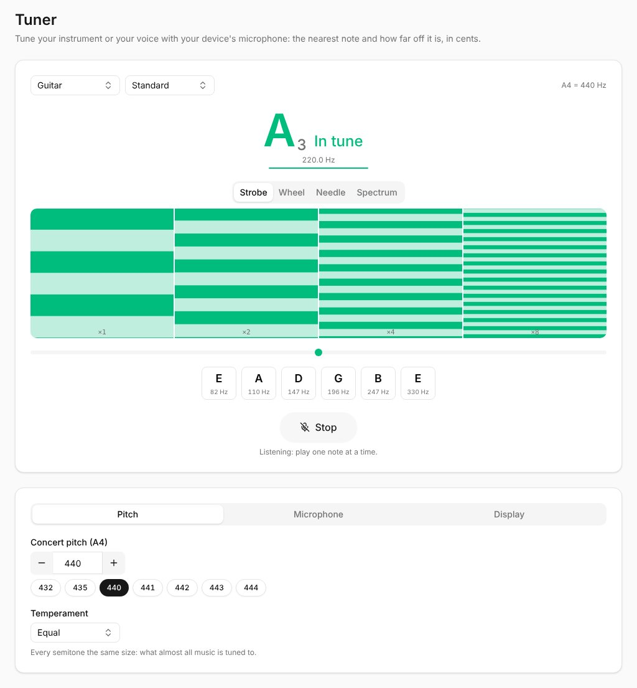

**Tuner**, in the sidebar's **Tools**, opens the tuner: it listens to your device's microphone and shows the nearest note and how far off it is, in cents (a hundredth of a semitone). Its settings are remembered on this device.

## Tuning

1. Press **Start tuning**. The first time, your browser asks for the microphone: allow it. The microphone is used only while the tuner listens, and nothing leaves your device.
2. Play or sing one note at a time. The tuner shows its name and octave (**A₂**), how far off it is (**-10.0¢**: flat, under the note; **+**: sharp) and its frequency. It shows **In tune**, in green, within 2 cents.
3. **Stop** lets the microphone go, and so does leaving the page.

The line under the frequency shows how sure the tuner is of the note. Between notes, it keeps showing the last one, faded.

If your device pauses the microphone (a call, another app), **Tap to resume** picks it up again.

## Your instrument

Choose your **instrument** - **Chromatic** for any note, **Guitar**, **Bass**, **Ukulele**, **Violin**, **Viola** or **Cello** - and, for some, its **tuning**: **Standard**, **Drop D**, **DADGAD**, **Open G**, **Half step down**... Its strings show under the tuner, with their notes, and the one you're playing lights up (green once it's in tune).

## Displays

Four ways to read the same note:

- **Strobe**: bands that turn the way the note is off (down when it's flat, up when it's sharp) and slow down as you get closer; they stand still when it's in tune. The most precise, for the last cent.
- **Wheel**: the same as a turning wheel.
- **Needle**: a needle from -50 to +50 cents.
- **Spectrum**: the sound's frequencies, the note and its harmonics as peaks.

Under each one, a dot on a line shows the same: left flat, right sharp.

## Settings

**Pitch**:

- **Concert pitch (A4)**: the A the others are tuned from, **440 Hz** by default. **−** and **+** change it by 1 Hz, or type it in (392 to 466 Hz); the usual ones are a press away (**432** to **444**).
- **Temperament**: **Equal** (every semitone the same size, what almost all music uses), or one tuned from a **key** - **Just intonation** (pure intervals in that key, for choirs, strings and brass playing in it), **Pythagorean** (pure fifths) or **Quarter-comma meantone** (pure major thirds, for early music on keyboards). The cents are then shown from that temperament's notes: in just intonation in F, an A in tune is 13.7 cents under the equal one.

**Microphone**:

- **Microphone sensitivity**: **Low**, **Normal**, **High** or **Max**. Higher hears quieter notes from further away, lower ignores more of the room's noise. If the tuner doesn't react to your instrument, try **High**; if it shows notes nobody played, try **Low**.
- **Pitch detector**: **MPM**, quick and steady, best for most instruments and voices; or **YIN**, which holds on better in a noisy room and for very low notes.

**Display**:

- **Precision**: the cents to a tenth (**±0.1¢**) or whole (**±1¢**).
- **Strobe bands**: each band turns at an **octave** of the note or at one of its **harmonics** (F to 5F); they all stand still when it's in tune.

On a phone, the settings are under the tuner.

Use the tuner in a quiet place when you can, close to the microphone; a phone's microphone hears the lowest bass strings less well than its higher ones.
