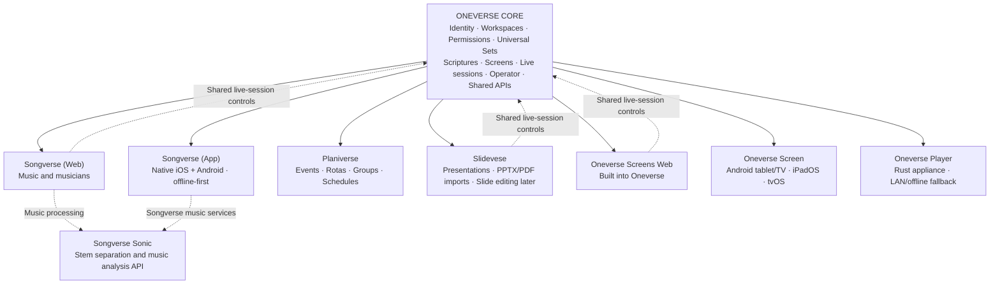

# Oneverse ecosystem — architecture blueprint

**Status:** Agreed product direction; proposed technical boundaries, **not** a description of completed migrations.  
**Date:** 2026-10-21 (revision 3: the monorepo renamed Oneverse)  
**Audience:** engineering and coding agents  
**Parent-company branding:** out of scope.

## 0. Decisions so far

| Decision | Status |
|---|---|
| Stay in one monorepo, renamed `Vulcio/Oneverse` (was `Vulcio/Songverse`); Sonic and the player stay in their own repositories | Decided (2026-10-21) |
| The operator is Oneverse's: authorised by Oneverse, its console a Oneverse surface | Decided (2026-10-21) |
| Scriptures start with imported Bibles (Zefania, Beblia, OSIS XML), stored in one JSON format compatible with json-bible | Done (2026-10-21) |
| YouVersion's licensing is settled with YouVersion, not managed in Oneverse: its passages go on screens, read live, never stored or offline | Decided (2026-10-22) |
| Workspace packages renamed `@oneverse/*` (was `@oneverse/*`); Songverse's image is `Dockerfile.songverse` (was `Dockerfile.web`) | Decided (2026-10-21) |
| Each app on its own domain: oneverse.top, songverse.top, planiverse.top (replacing songverse.one), sign-in through Oneverse ("Sign in with Oneverse": accounts and passkeys at oneverse.top, each app its own session) | Decided (2026-10-21) |
| Organisations govern their teams' Sets rather than owning Sets | Proposed |

## 1. Product map

**Product naming:** Use **Songverse (Web)** for the browser application and **Songverse (App)** for native Android/iOS musician clients. Never label the latter “Songverse Native.” The presentation application's selected spelling is **Slidevese** (not Slideverse; to confirm before it reaches code or domains, since it breaks the -verse pattern of the other names). **Oneverse Screens Web** is built into Oneverse; the separate native display receiver is **Oneverse Screen**. **Oneverse Player** is the planned name for the current `songverse-player` Rust project.

## 2. Responsibility and ownership boundaries

| Product / component | Owns | Does not own |
|---|---|---|
| **Oneverse Core** | Identity, account/session management, personal workspaces, Teams/Organizations, membership, roles and scoped capabilities, invitations, universal Sets, scripture catalog/access, shared device registry, screens/outputs/profiles, shared live sessions, the operator console, content/media contracts and APIs | Song editing, music analysis, general rota workflows, presentation authoring |
| **Songverse (Web)** | Song library, charts, chords, arrangements, music-specific Set behavior, practice/live musician UX, narrowly scoped musician controls of a session | Device ownership or authoritative live-session state |
| **Songverse (App)** | Native mobile experience for musicians, locally cached content, reliable offline usage and reconciliation, native-specific UX | Separate identity/ownership model |
| **Songverse Sonic** | Independently deployable audio processing API: stem separation, tempo/key/beat/section analysis | User/Team/Organization identity, universal Sets |
| **Planiverse** | Events, recurring schedules, homegroups, cleaning rotas, assignments, calendars, planning UX | Core membership and permission primitives |
| **Slidevese** | Import PowerPoint (PPTX) and PDF, presentation organization and playback semantics, scripture presentation layouts; later simple slide editing | Screen registration, scripture-provider account authority |
| **Oneverse Screens Web** | Oneverse-integrated management and browser receiver/control UI | Separate ownership and permissions |
| **Oneverse Screen** | Native display receiver on Android tablets/TVs, iPadOS and tvOS; cached display content and resilient playback | Song and presentation editors |
| **Oneverse Player** | Rust local appliance for deterministic playback, outputs (e.g., HDMI, future NDI), local session mirror, cached data and LAN takeover on WAN loss | Alternate content models or duplicated screen renderer |

**Principle:** Oneverse owns reusable identities, assets, permissions, devices and coordination; each application owns its domain-specific authoring, rendering adapters and workflows. Logical ownership is **not** a mandate for separate repositories, servers or databases.

## 3. What Core already is (2026-10-21)

Most of Core exists today inside `apps/api` and the shared packages. Core is first a boundary to draw, then three real migrations (section 6).

| Concept | Today | Gap |
|---|---|---|
| One account, personal space, Teams, Organisations | BetterAuth in `apps/api`; `Team.organizationId`; organisation mode NONE / SINGLE / MULTI (#241) | Joining an organisation follows joining a team (`joinTeamOrganization()`), not an owner-approved request |
| Planiverse on the same accounts | `apps/planiverse`, `packages/planning`, `packages/app` (#241, #242) | None |
| Scoped capabilities | `Role` + `RoleAssignment` to a user or a team, combined by `capabilitiesOf()`; an assignment scoped to a team or an organisation (#270), given by its admins for team-assignable roles (Media operator), read by `capabilitiesIn()` for running screens | Scoped to a set or a session; the plan's other capabilities (follow, cue, route, manage devices) |
| Universal Sets | `Setlist` owned by a user or a team; `SetlistItem.kind`: songs, texts (#305), Bible passages (#301) | PDF pages, PPTX slides, media |
| Screens owned by person, Team or Organisation | `Screen.owner*` (#222), token hash, revocable | Profiles and pairing again: #284 |
| Layer stack, templates, brands | #280, #287, #281, #279 | None |
| Live session | `SyncSession` in Redis, one per set: `rev`, leader, `presenting`, media operator (#190, #275) | Keyed by set; control is "can edit the set"; no command log, no epoch for an offline takeover |
| Common slide protocol | `setItemSlides()` in core for songs, texts and passages (a passage's template sets its verses per slide, #310); `SyncPresenting` = item + slide number, commands checked against `basedOn` (#305) | Image and media slides |
| Oneverse Player | Rust daemon serving Songverse's `ScreenStage` bundle; mock set, loopback, no auth | The local snapshot contract (#247) |
| Sonic | Independent; Teams and Organisations can bring their own server (#300) | None |

## 4. Shared models and invariants

- **Identity/workspaces:** one Oneverse account; personal space without a Team; Teams may exist without an Organization; Teams can join Organizations only through an explicit, owner-approved process. Planiverse's team-centric onboarding may differ from Songverse's. Applications remain independently usable.
- **Permissions:** authorize by capability and scope (personal / Team / Organization / specific Set or live session), not solely a global flag. A role assignment carries its scope; a new right stays a field on `Role`. Organization administrators do not implicitly own members' personal data. Keep a distinction between *resource ownership* and *permission to use*: an Organization owns its screens and brands; it governs, not owns, its Teams' Sets.
- **Universal Sets:** ordered, typed references to songs, scripture passages, Slidevese decks/slides, media and future items. A set item has a `kind` and one nullable foreign key per kind (not a generic JSON reference), so deletion, song folding and access checks keep working in the database. Passages are the deliberate exception: a reference plus a translation (`{bibleId}` or `{youversionId}`), since a translation can be deleted and a provider's has no row of ours. Set ownership, sharing, item resolution and live sequence state belong to Oneverse; interpretation of a song/deck remains with its product. Existing Songverse Sets migrate compatibly (every existing item is `SONG`); a resource reference never grants unrestricted access to its entire source library.
- **Common slide protocol:** each item kind has an adapter in `@oneverse/core` turning it into slides of a few generic kinds: lines of text (songs, passages), an image (a PDF page, a PPTX slide rendered at import) and media. `ScreenStage` renders those kinds only, so a screen never needs the authoring app installed. `presenting` carries the item's revision with the slide number, so a slide number stays meaningful when an item changes mid-service.
- **Scriptures:** see section 5.
- **Screens:** persistently owned by person, Team or Organization irrespective of who paired the device. Oneverse stores pairing credentials, revocation, capabilities, output assignments, and active display profiles; the screen's current configuration follows the selected profile. Rendering uses a fixed-order configurable layer stack: base → video input → media → content → overlays → final mask. Templates compose reusable themes; shared edits propagate, subject to explicit screen-level overrides.

## 5. Scriptures

- **Translations** are imported files or, later, provider-backed. Imports first: Zefania XML, Beblia XML and OSIS XML, detected from the file, converted to one JSON format: the [json-bible](https://github.com/ChurchApps/json-bible) shape (`name`, `metadata`, `books[].chapters[].verses[]`, `endNumber` for combined verses) with a few fields of our own (each book's OSIS id, the language, the abbreviation, the source format). json-bible is what FreeShow uses, so a Bible converted for one works in the other.
- **Rights are data:** each translation records what it may be used for (search, offline copies, projection, export) and its copyright line, checked wherever the text goes: the API, offline caches, the player's snapshot, exports. Public-domain texts (KJV, Louis Segond 1910, WEB, …) and texts the Organisation is licensed for are the safe start.
- **Who has them:** an instance's admin imports translations for everyone; later an Organisation or Team imports its own, licensed to it.
- **Passage references** ("John 3:16-18", "Jn 3:16; 4:1-3") are parsed in `@oneverse/core`, with book names and abbreviations in each language, and resolved against a translation. A Set holds a passage as a reference plus a translation, never a copy of the text.
- **YouVersion** (#304, #310): a provider through its Platform API, with an App Key set in Admin > Bibles. Licensing is settled with YouVersion, not managed in Oneverse: a set holds a YouVersion passage as `{youversionId, reference}`, its text read from YouVersion each time it's shown - on screens too - with the version's copyright line and link, never stored and never in the copies kept offline.

## 6. Operator and live-session model — agreed direction

**Operator is a Oneverse capability and a Oneverse surface.** Oneverse authorises session and output control, and the operator console is Oneverse's own, not Songverse's. Its code lives in a shared package (as the planning screens live in `packages/planning`), `packages/operator`, served by the screen app at screen.oneverse.top/operate (signed in through Oneverse, #305) and embedded in Songverse's Live. App surfaces offer tailored controls:

- **Oneverse operator console:** general-purpose Set navigation, preview/program, screen and output routing, overlays, black/clear, profile selection, session health and takeover.
- **Songverse (Web/App):** singers and leaders may get narrowly scoped controls (e.g., next song/section, advance, cue) for their assigned Set/session **without** permission to re-pair devices, alter Team ownership or manage unrelated outputs.
- **Slidevese:** presentation-specific navigation, cues and slide controls against the **same** Oneverse session.

Capabilities, each scoped to an Organisation, Team, Set or session:

| Capability | Can |
|---|---|
| Follow | See the session |
| Cue | Next/previous song or section in their assigned Set |
| Present | Drive slides, black, clear |
| Route | Layers, outputs, profiles, overlays |
| Manage devices | Pair, re-pair, revoke screens |

Precedence follows #275: an exclusive operator holds Present and Route; the leader keeps Cue. Handoff is an explicit "take" with a lease, logged, and the previous holder is told. #270 (the media operator as a role of its own) is where this lands first.

The authoritative **Oneverse Live Session** tracks active Set/item/slide, target output groups, control privileges, sequence/revision, and active controller state. It evolves today's `SyncSession` rather than replacing it: commands carry the `rev` they expect, so they are idempotent and a stale controller is refused. Define exclusive versus collaborative operation, control handoff, audit logs and reconnect semantics before implementation. Screen apps render the session; they do not independently decide its truth.

**Offline safety:** normally the cloud Oneverse session leads. Oneverse Player mirrors a pre-authorized snapshot (including assets/permissions necessary offline), then can serve as a local LAN control authority if WAN connectivity fails. The session carries an **epoch**: the player's takeover increments it, and the cloud refuses writes from an older epoch until it has taken the room's state back (#247: the room wins). No split-brain or silent rollback on reconnect. These are **target behaviors**, not current guarantees.

## 7. Implementation strategy / migration

1. **Stay in the monorepo.** `Vulcio/Oneverse` (renamed from `Vulcio/Songverse`) hosts Songverse, Planiverse, the NestJS API, Prisma DB, and shared packages `@oneverse/core`, `@oneverse/app`, `@oneverse/ui`, `@oneverse/planning`. One schema, one API, one e2e harness and atomic changes across them are worth more than separate repositories. Sonic (Python) and the player (Rust) stay separate: different languages, deployed on their own. Map dependencies and preserve working routes, contracts and deployed behavior.
2. **First vertical slice: a scripture passage on the screens.** It exercises typed Set items, the common slide protocol and licensing, without Slidevese, renames or a new session model:
   1. Scriptures: Bible imports (Zefania, Beblia, OSIS) to the JSON format, passage references, rights fields. *(done; the whole slice is on main, #301, #305, #310)*
   2. Typed Set items, songs only: `SetlistItem.kind`, no behaviour change.
   3. The slide contract in core, with conformance cases, and the item revision in `presenting`.
   4. A `PASSAGE` item kind, rendered by `ScreenStage`.
3. **Then** scoped role assignments (starting with #270's operator), then the session as its own entity, designed with the player's snapshot contract (#247).
4. **Evolve existing issues, don't duplicate them.** Shipped foundations: #241, #242, #222, #279, #280, #281, #287, #190, #275. Open and relevant: #247 (offline player), #270 (operator role), #284 (profiles, pairing again), #195 (offline screen), #196 (NDI), #187 (Google TV), #165 and #171 (native apps), #243 (custom domains), #26 (offline creation). Inspect open **and closed** issues before drafting changes.
5. **Player rename is future work:** `vulcio/songverse-player` still exists; change project/binary/docs/package names, links and automation through an issue-based, cross-repository plan. Preserve the upstream shared `ScreenStage` renderer; do not fork rendering implementations. `vulcio/songverse-sonic` remains independent.
6. **Agent rules:** read each repository's `AGENTS.md` and `CLAUDE.md` before editing. GitHub issue first, reference issue(s) in commits, tests/docs with every change, no unverified claims of hardware/offline reliability, no push with failing checks. This document does not override repository-specific instructions.

## 8. Open design questions

Proposed answers are in sections 4–7; still open:

- Organisations owning Sets: proposed no (they govern their Teams' Sets; an Organisation event's host group owns its Set). To confirm.
- Oneverse's own entry point and domain topology (Home, operator console), with self-hosting on one server; tied to #243.
- Controller handoff details: lease length, what a guest may do, audit retention.
- Licensed capabilities of each imported translation (search, caching, offline usage, projection, export); YouVersion's are settled with YouVersion.
- Which item kinds after passages: PDF pages or PPTX slides first.
- What can be delivered natively on Android TV, tvOS and tablets before hardware-validated release; start with the web screen in a WebView (#187), measured with #286's reports.

**Guiding rule:** one shared model and authority, multiple purpose-built applications, independent entry points and resilient display clients.
